# Biskiq

Biskiq is an attempt to combine spatial sketching, object arrangement, and interactive visitor experiences in one browser editor.

The prototypes below are separate demos. They are not connected into one editor yet.

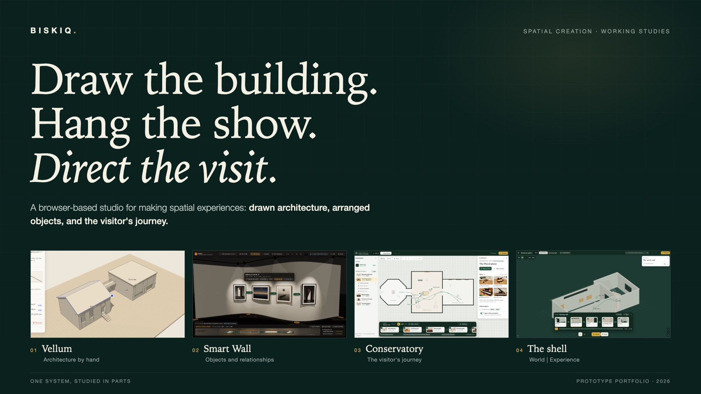

## Prototypes

### Vellum

Draw and edit rooms, walls, roofs, openings and stairs. Make a visitor walk.

**Working prototype.** [More and how to run](prototypes/p3-vellum/README.md).

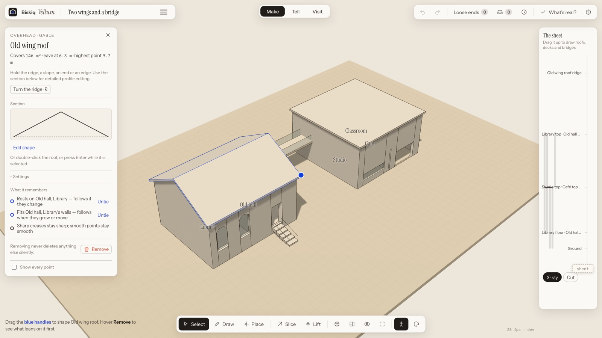

<p>
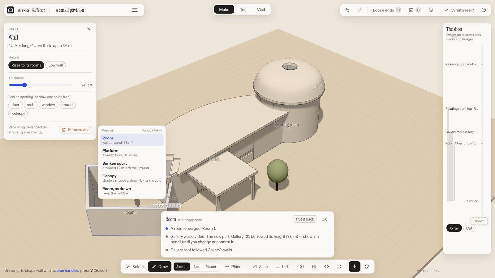
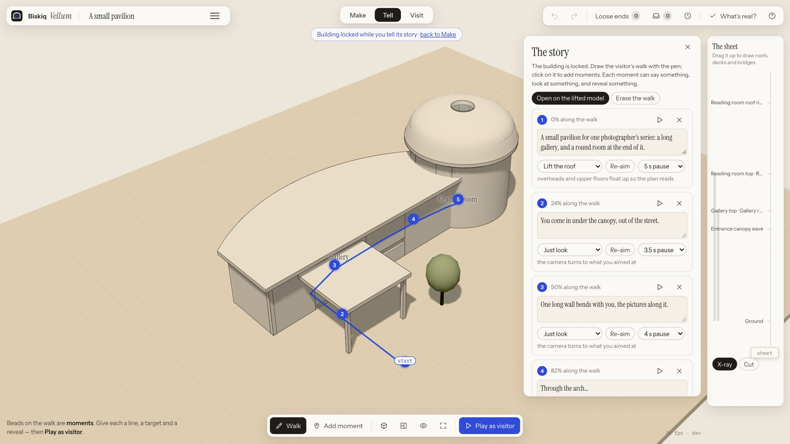
</p>

### Smart Wall

Arrange paintings and lights on a gallery wall. Bend the wall, adjust spacing and compare changes.

**Working prototype.** [More and how to run](prototypes/p2-smart-wall/README.md).

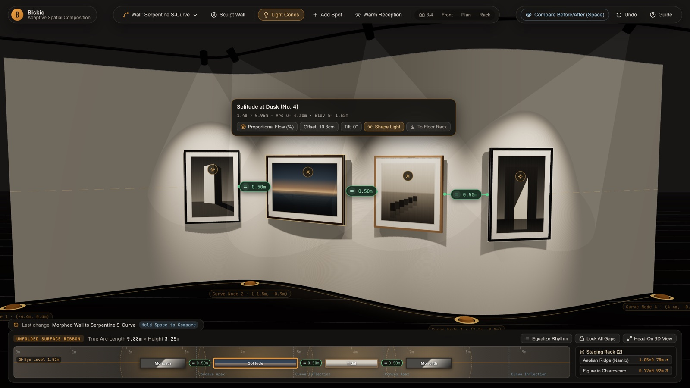

<p>
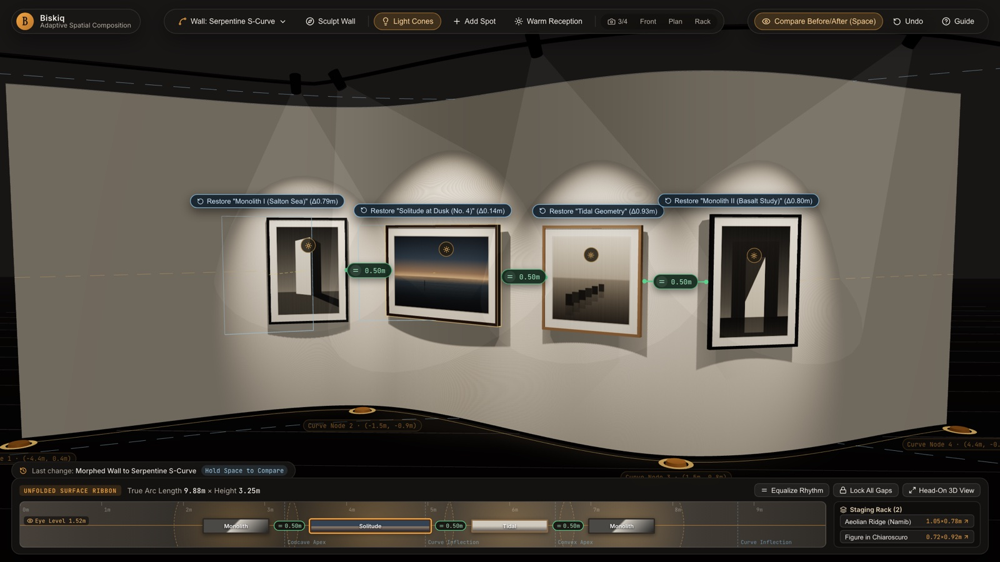
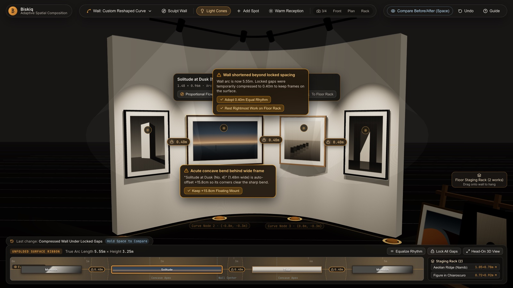
</p>

### Conservatory

Create camera views, arrange stops and paths, and preview a guided visit or free exploration.

**Working prototype with sample data.** [More and how to run](prototypes/experience-ux-alternative/README.md).

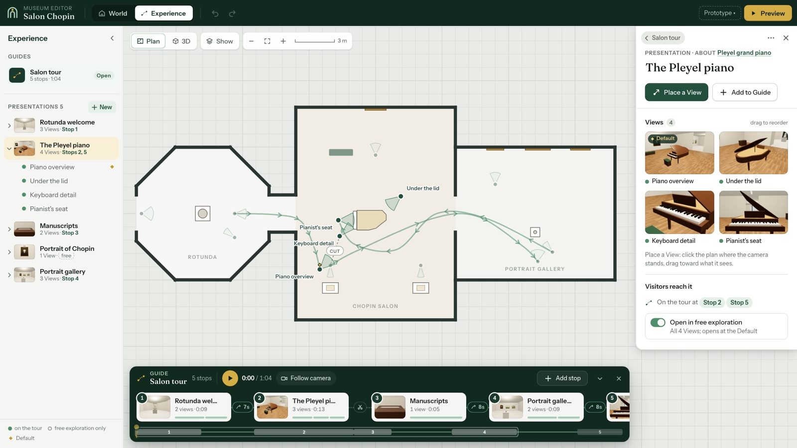

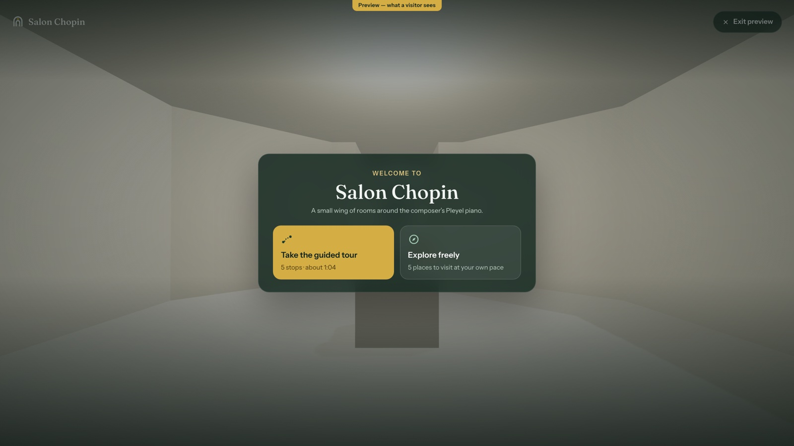

### Unified shell

Try an interface that puts space editing and visitor experiences in the same workspace.

**Interactive wireframe with mock data.** [More and how to run](prototypes/production-shell-wireframe/README.md) · [28-state atlas](prototypes/production-shell-wireframe/atlas.html).

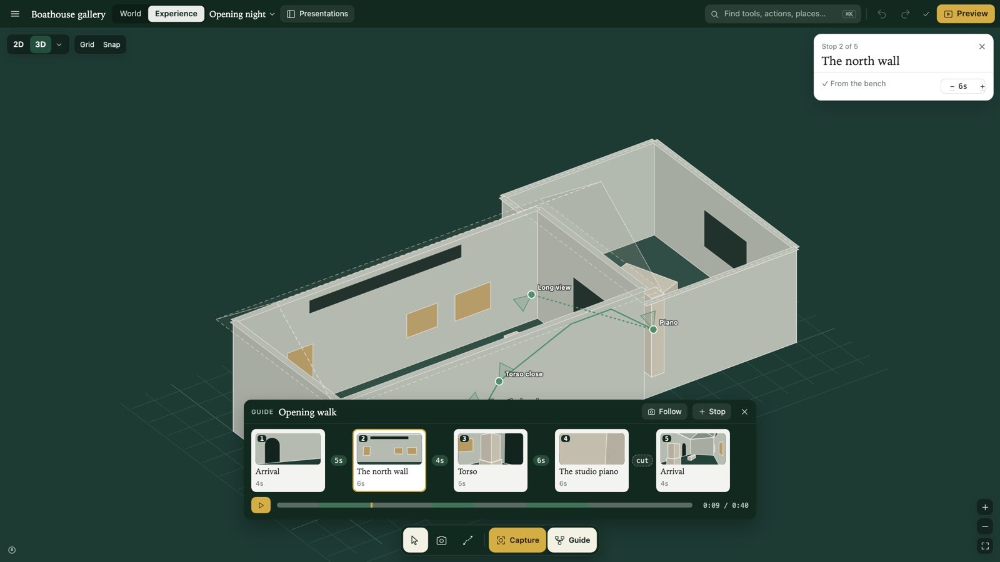

<p>
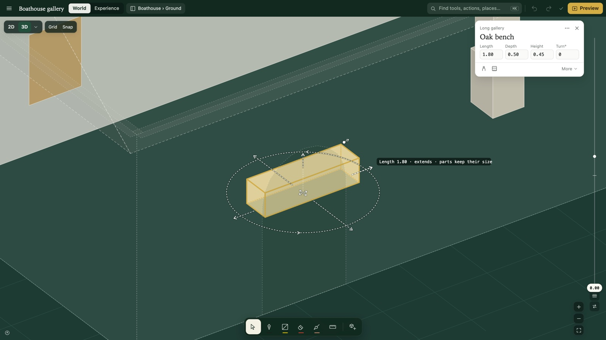
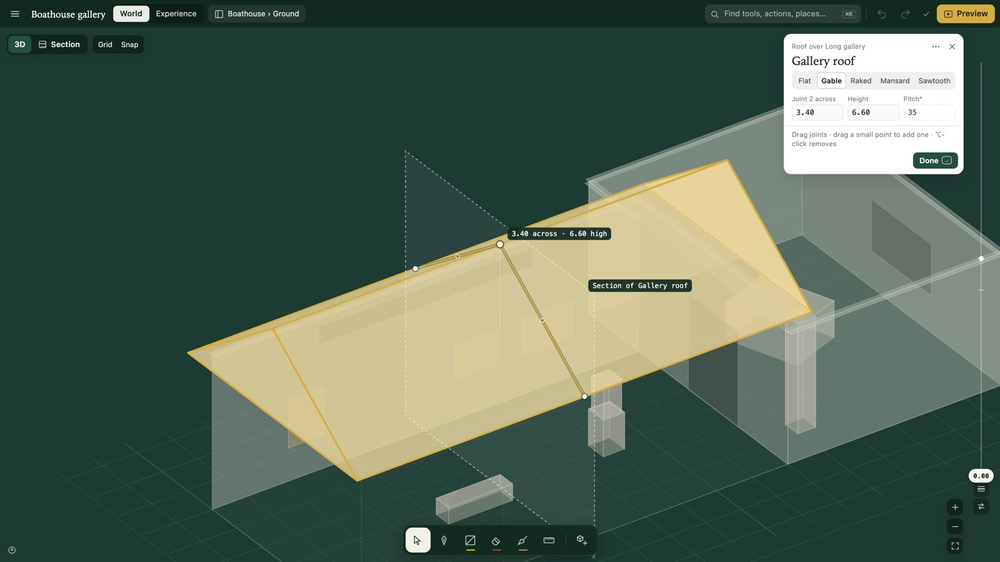
</p>

## More prototypes

- [World spatial interactions](prototypes/spatial-authoring/README.md)
- [Architectural depth](prototypes/p3-depth/README.md)
- [Living Drawings](prototypes/living-drawing/README.md)
- [Native Form Lab](prototypes/native-form-lab/README.md)
- [Object Composition](prototypes/object-composition-prototype/README.md)
- [All prototypes](prototypes/README.md)

## Run locally

Run each prototype from the repository root, in its own terminal:

```sh
cd prototypes/p3-vellum && npm install && npm run dev
cd prototypes/p2-smart-wall && npm install && npm run dev
cd prototypes/experience-ux-alternative && python3 -m http.server 8841
cd prototypes/production-shell-wireframe && python3 serve.py 8850
```

Default ports: Vellum 5191, Smart Wall 5175, Conservatory 8841, shell 8850. The prototype READMEs have more instructions.

## Development

- [Local development](docs/local-development.md)
- Cloud Save/Load uses local username and password accounts. No account is preconfigured; create one from the editor's sign-in screen. The editor still supports guest/local editing without the API.
- [Documentation](docs/orientation.md)
- [Tests](apps/editor/tests/README.md)
- [Roadmap](docs/roadmap/now.md)
- [Contributing](CONTRIBUTING.MD)

Production code lives in `apps/` and `packages/`. The demos live in `prototypes/`.
