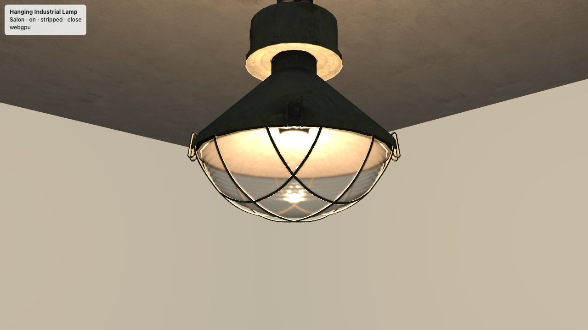
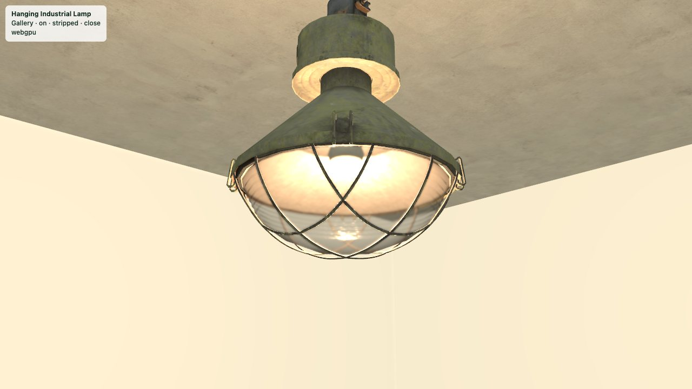
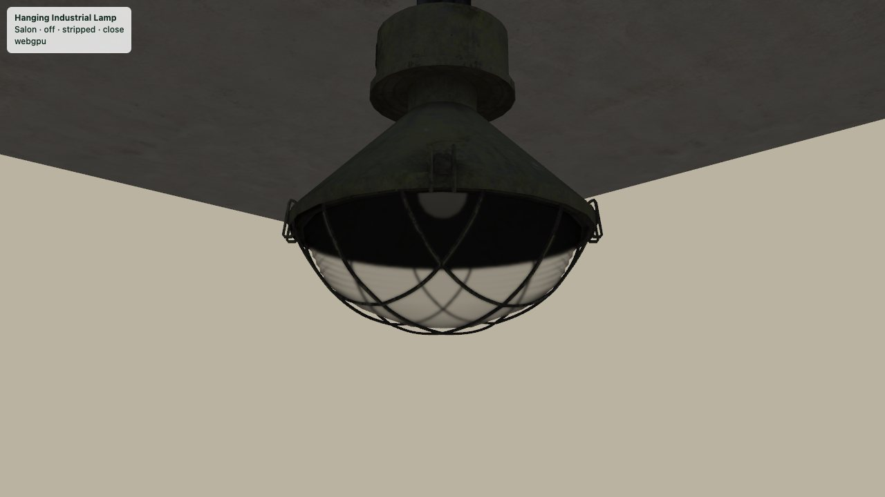
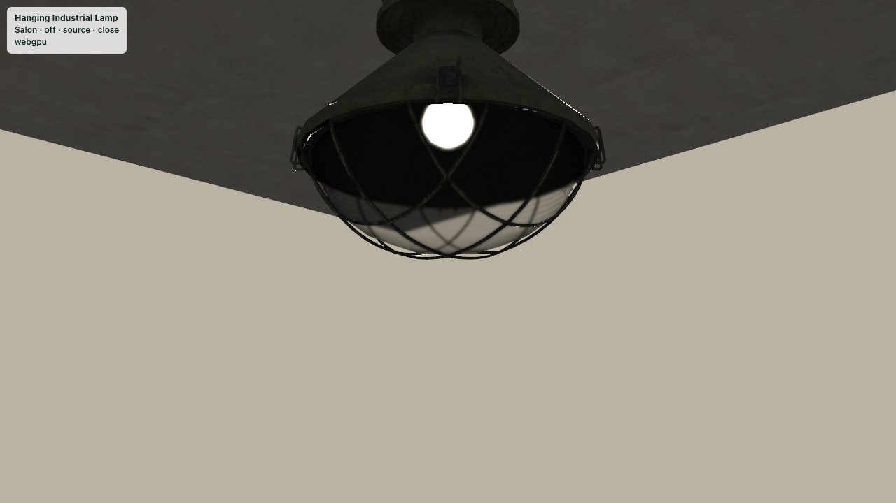
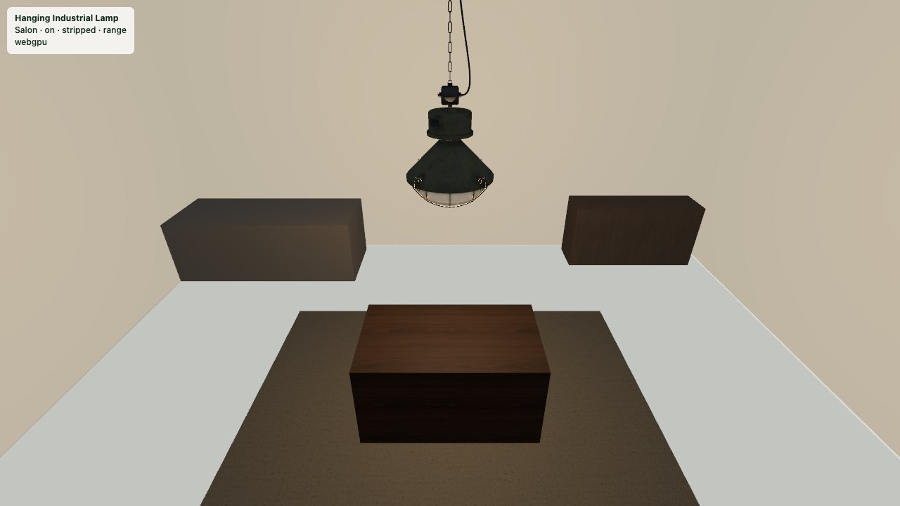
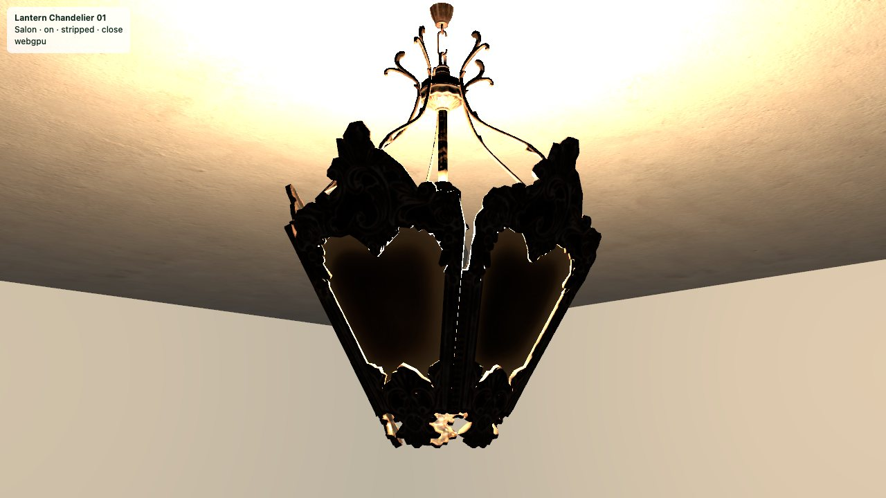
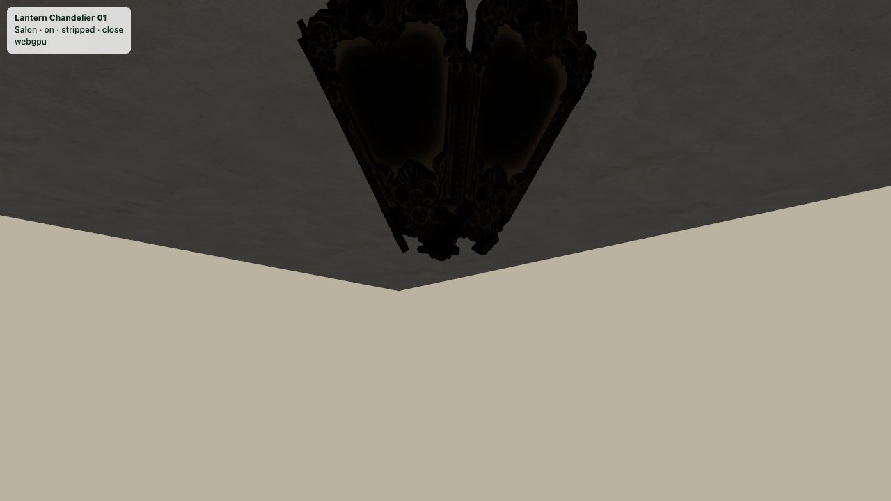
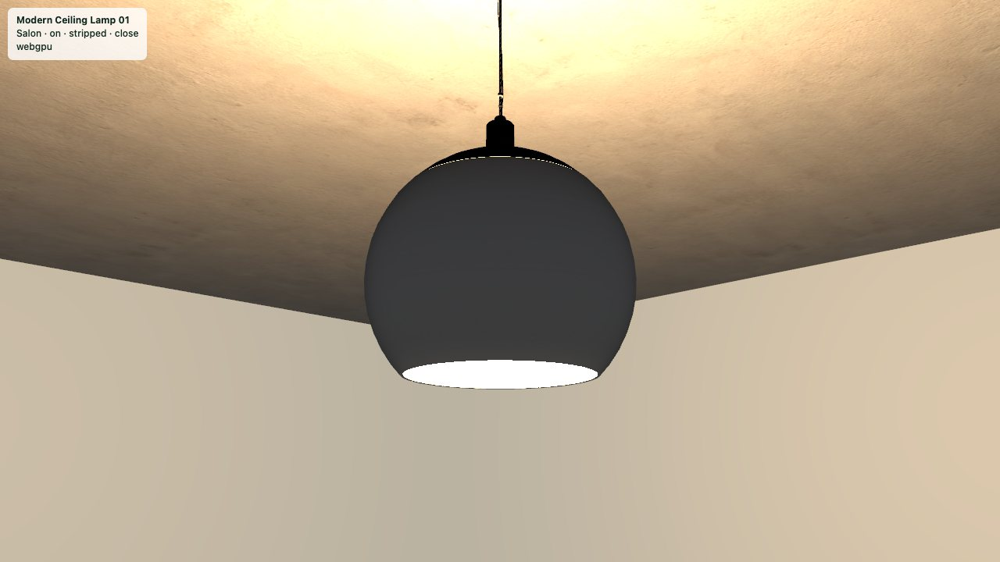
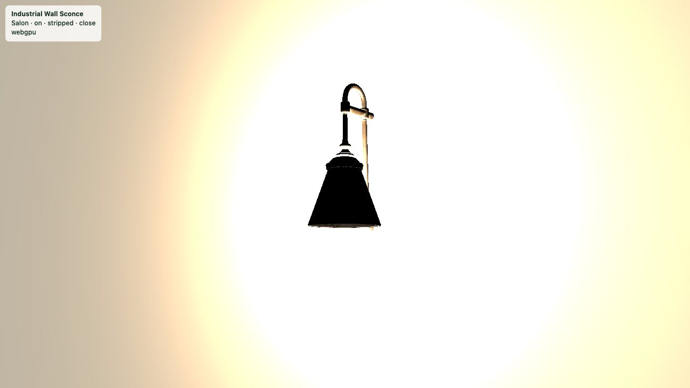
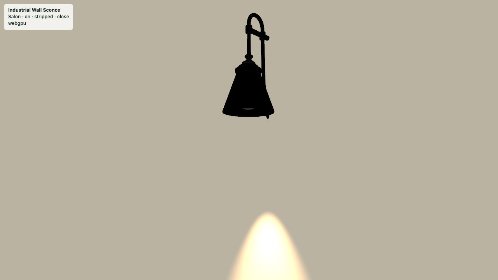

# T2 D8c.1 — fixture qualification and visual probing

Status: **complete — one qualified fixture, three rejected**.

Scope: acquire and qualify the four approved Poly Haven candidates against the real Biskiq
runtime in the Salon and Gallery reference Worlds, on WebGPU and WebGL2, using ordinary Scene
lights and the accepted decision to strip baked emission (P2). No production GLB is ingested,
no shipped asset is registered, no fixture is added to the Library, and D8d is not implemented.

## Verdict

| Candidate | Glass under Model's own | Lit from inside | Self-overexposure | Range clipping | Stripped emission | Verdict |
| --- | --- | --- | --- | --- | --- | --- |
| **Hanging Industrial Lamp** | `MeshPhysicalMaterial`, metalness 0, roughness 0.1, transmission 1 — reads as frosted glass | **Pass** with a point at the bulb: warm, diffused shade on both backends | 1.3% of centre clipped (bulb/glass highlight); ceiling and canopy retain detail | None visible at 6 m | Off is dark; On glows. P2 holds | **Qualified** |
| Lantern Chandelier 01 | `MeshPhysicalMaterial` authored metalness 1, roughness 1, transmission 1 — renders black, effectively opaque | **Fail** at bulb and at mouth | Point at bulb clips 10.0% (Salon) / 13.8% (Gallery) of the frame on the ceiling | n/a | Baked bulb sliver only; panels stay black | **Rejected** |
| Modern Ceiling Lamp 01 | `MeshStandardMaterial`, no transmission or alpha — opaque globe | **Fail**; a point inside lights only the bottom opening | Point at globe clips the ceiling above the canopy | n/a | Baked globe does not read as lit | **Rejected at the P1 condition** |
| Industrial Wall Sconce | No glass; metal shade and bare bulb | **Fail**; mouth spot leaves the shade and bulb black | Point at bulb clips **73.2% of the centre** and 39.8% of the frame | Wall pool clips before useful range | No baked emission at all | **Rejected** |

**Qualified shortlist for D8c.2: Hanging Industrial Lamp only**, with the emitter override below.
P2 does **not** need to be returned to the owner: this fixture reads as a lit diffuser without
baked emission. The other three fail on authored material data, anchor geometry or wall distance,
not because baked emission was stripped.

## Recommended emitter

The plan's default for a downward shade is a 25° spot at the mouth. The probe tested that first;
it leaves the hanging lamp's glass milky and unlit, and it leaves the lantern and sconce black.
For the qualified fixture the working ordinary Scene emitter is:

| Setting | Value |
| --- | --- |
| Kind | Point |
| Anchor | bulb, local `(0, -1.183, 0)` — the centre of the glass cylinder |
| Intensity | `π` cd (3.14159) |
| Range | 6 m |
| Colour | warm stop (`#ffd6a5`) |
| Shadow | off, as in the D8 defaults |
| Body | `castShadow: false` |
| Mount | ceiling datum, node top at the ceiling plane; yaw 0 |

Point rather than spot is deliberate and physical: the diffuser is a glass cylinder around the
bulb, open at the bottom, so the bulb is the emitter and the glass is the shade. The point is
still an ordinary Scene light; no new light kind, material family or renderer path is introduced.
At π cd the table pool is bright, the glass is visibly lit from inside, and only 1.3% of the
centre is clipped (the bulb/core highlight). No higher intensity was needed for the qualification,
so π remains the calibration.

The intensity, range and anchor are the recommendation for D8c.2. They are not yet production
asset metadata.

## Evidence

### The qualified configuration

Salon, stripped emission, point at the bulb, π cd. WebGPU and WebGL2 are visually equivalent:

| WebGPU | WebGL2 |
| --- | --- |
|  |  |

Gallery, same configuration, both backends:

| WebGPU | WebGL2 |
| --- | --- |
|  |  |

Off and On, stripped emission, same anchor and intensity. The bulb and glass are dark when Off,
so the fixture's state is truthful:

| On | Off |
| --- | --- |
|  |  |

Baked emission, for comparison. With the source GLB and the emitter off, the baked bulb still
glows — exactly the untruthful Off state P2 removes:

Range check at 6 m. The pool reaches the table and floor without a visible cutoff; the far wall
is outside the useful falloff but not visibly clipped:

### The rejected candidates

Lantern Chandelier 01, stripped, point at the bulb. The ceiling clips over 10% of the frame and
the panels read black; its mouth spot removes the ceiling clip but leaves the whole fixture
black, so there is no usable middle:

| Point at bulb | Spot at mouth |
| --- | --- |
|  |  |

Modern Ceiling Lamp 01. The globe is opaque; a point inside lights the bottom opening and the
ceiling above the canopy, not the globe:

Industrial Wall Sconce. A point at the bulb blows out the wall behind it:

| Point at bulb | Spot at mouth |
| --- | --- |
|  |  |

## Measurements

Clipped fraction is the share of pixels with every channel above 250, measured on the 1280×720
close captures (`evidence/exposure-metrics.json`). The centre region is the middle 50% of the
frame. WebGPU and WebGL2 agree within 0.03 percentage points in every pair.

| Capture | Full frame | Centre | Reading |
| --- | --- | --- | --- |
| Hanging, Salon, point at bulb, On | 0.33% | 1.30% | Small highlight only |
| Hanging, Salon, point at bulb, Off | 0.00% | 0.00% | Truthful Off |
| Hanging, Gallery, point at bulb, On | 0.44% | 1.75% | Bright room, glass intact |
| Hanging, baked emission, emitter Off | 0.37% | 0.67% | Bulb glows when it should not |
| Lantern, point at bulb | 10.00% | 0.06% | Ceiling clipped |
| Lantern, Gallery, point at bulb | 13.79% | 3.23% | Ceiling clipped |
| Modern, point at globe | 0.77% | 2.88% | Opening and ceiling clip, globe opaque |
| Sconce, point at bulb | 39.80% | 73.15% | Wall blown out |
| Sconce, spot at mouth | 0.29% | 0.00% | No clip, but fixture black |

Runtime counts from the real renderer: 24,843 triangles in the Gallery close view
(9,530 for the fixture itself), 1,572 draw calls. The fixture is 0.550 × 1.355 × 0.550 m.

## Acquisition and licence

All four 1K glTF sets were downloaded from Poly Haven on 2026-11-27 and retained outside git at
`/Users/tony/Documents/Biskiq/fixture-retention/acquisition/`. Every published MD5 and byte size
matches; the full URL list, MD5, SHA-256, content type, ETag, Last-Modified, reported dimensions
and polycount are in `evidence/acquisition-report.json`. Geometry, primitive bounds, glass
bounds and emitter anchors are in `evidence/geometry-report.json`.

| Asset | Creator | Polycount | Source bytes | Files hash |
| --- | --- | ---: | ---: | --- |
| Hanging Industrial Lamp | Kuutti Siitonen | 9,530 | 3,243,654 | `93bdeee8…` |
| Lantern Chandelier 01 | Kirill Sannikov | 5,971 | 1,480,125 | `9fa2671b…` |
| Modern Ceiling Lamp 01 | James Ray Cock | 5,602 | 436,065 | `d324ea2a…` |
| Industrial Wall Sconce | Ulan Cabanilla | 9,826 | 1,841,451 | `aa185f8f…` |

Licence is CC0 1.0, effectively public domain. The captured licence page is
`evidence/polyhaven-license.html`, 63,199 bytes, SHA-256
`d6eb4c64b847ee38970cc6ae43923ef39449bd320d69ef647550a2d1c8398db7`. The page states that
Poly Haven assets are "all licensed as CC0, which is effectively Public Domain even in
jurisdictions that do not support the Public Domain."

### Hanging Industrial Lamp download anomaly

Poly Haven's file listing points every resolution of the glTF set at
`/Models/gltf/4k/hanging_industrial_lamp/hanging_industrial_lamp.bin`, not at a 1K, 2K or 8K
path. The advertised bin is 344,252 bytes, MD5 `7148574f0db05abe68f7e51565abe2ce`; the downloaded
bin matches that hash and size, and the 1K glTF plus that bin parse and render correctly (all
9,530 triangles and the transmission glass appear in the probe). There is no glTF ZIP to compare
against. The listing is anomalous but the delivered bin is consistent; the qualification stands.

All four source sets are within the approved 1 MiB production budget after meshopt + WebP 512
treatment: Hanging 217,028 B, Lantern 323,568 B, Modern 83,616 B, Sconce 126,992 B. The retained
trials are `budget-trial.glb` beside each source set.

## Method and limitations

- Reference Worlds were built through the real Layout planner and rendered through the real
  `CanvasHost`, `WorldEnvironment`, `VisitorLayoutShell`, `VisitorEntityGroups`, material,
  geometry and light stores, and `sceneModelSupport`. Only scenario data is test-owned.
- Salon is 7 × 6 m at 3.2 m, `dusk`; Gallery is 12 × 7 m at 4.2 m, `overcast`.
- The generated room lid is an upward-facing plane, invisible from inside. A test-owned 0.04 m
  ceiling box using the existing `plaster-painted` material was added to each World's scenario
  context so ceiling exposure could be judged. This is not a renderer change.
- The probe serves candidate GLBs from the retention store through a Vite middleware
  (`D8C_RETENTION`); candidate bytes are not in git.
- Headless WebGPU requires `--enable-unsafe-webgpu --enable-features=Metal --use-angle=metal`.
  Polling `page.evaluate` during renderer initialization starves Dawn and loses the device, so
  captures wait 9 s, read the probe record once, and screenshot. No GPU adapter/device
  instrumentation is installed.
- Shadows are off, as in the D8 defaults, so the point is not occluded by the metal cone. The
  qualified look relies on the diffuser surrounding the bulb and on the bulb's distance from the
  ceiling; no large-area clipping or implausible shadowless pool was observed. If D8c.2 enables
  shadows for fixtures, re-check this anchor.
- This is visual qualification with screenshots and pixel metrics, not a perceptual user study.
  The mirror/runtime appearance of the rejected fixtures was not explored beyond the documented
  emitters, because new light kinds and material workarounds are out of scope.
- The test-owned ceiling panel slightly changes ceiling luminance compared with the generated
  lid; comparisons between candidates are made under the same panel.

## D8c.2 handoff

1. Ingest only Hanging Industrial Lamp, with the emitter settings above.
2. Keep baked emission stripped; do not restore the bulb emissive for Off.
3. Carry the lantern, modern and sconce rejections as evidence, not as backlog items. The lantern
   would need its glass material reauthored (metalness 1) and its bulb moved away from the
   ceiling; the modern globe has no transmission; the sconce cannot light its wall without
   clipping at a useful intensity.
4. Do not add a new material family, light kind or renderer workaround for any of the three.

## Reproducing

See `README.md` in this directory for the server, capture and exposure commands and the exact
query parameters. The full 51-capture set and JSON reports are in `evidence/`.
