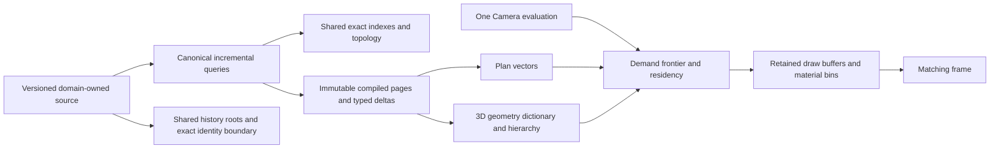

# World-scale computational architecture for Biskiq

Research synthesis and owner proposal, 2026-10-24, for [T1.P02.S06][s06]. The engineering
objective is routine editing of **10,000+ Rooms, 100,000+ architectural entities and millions of
repeated visual details**, with continuous exact local feedback and 60 FPS or better on an ordinary
laptop. Design around that objective now. The implementation and measurement authorizations are
separate decisions, set out in the [revised S06 experiment proposal][experiment-proposal].

**Status (2026-10-27): historical research, not a live plan.** This synthesis was written before
Bench 1 and is kept for its technical investigation, alternatives and falsification ideas. The owner
adopted only a bounded subset of its measurement request on 2026-10-24, and later replaced S06's
formal third pass with the decision-driven milestone gate; S06 is accepted AC-qualified and merged
(PR #190, `6af62eb4`). Every reduction ratio below — 3,125×, 500×, 1,000× and the rest — is a
hypothesis or arithmetic estimate under its stated assumptions, **not** a measured S06 result. The
measurements, the qualified limits and the two rows later slices must carry (continuous pointer-pan
CPU and pick-after-commit) are in the [S06 acceptance record][s06-acceptance] and the
[performance contract][perf]; the world-scale architecture questions this document raises remain
open research with no owner, pass or budget.

**Recommendation:** represent the world as an indexed, versioned semantic store; maintain the
canonical compiler's results incrementally; expose typed deltas to retained representations;
submit shared geometry through a screen-error hierarchy; bound decoded and GPU residency by
explicit pools. Do not mirror every entity into a reactive component, a renderer object, a private
material, a worker clone and every history snapshot. Those ownership choices, rather than Room
count itself, make a large world expensive.

The central bounds are different for editing, display and storage:

```text
local semantic work  ~ evaluated dependencies + spatial-query output + changed result bytes
frame work           ~ hierarchy frontier + projected geometric detail + shaded samples
resident memory      ~ compact source/index + bounded derivative pools + bounded history deltas
```

A single Wall can change a small semantic set while thousands of Rooms remain exposed. All-visible
editing therefore needs both local evaluation and cheap dense presentation. Occlusion is useful
additional elimination; the architecture must work without it.

Screen contribution is an output bound, not permission to omit resolvable features. If the view
contains more distinct, resolvable edges or transparent layers, useful work grows with them.
The objective is to stop paying for world detail beyond that contribution and to share the work
that describes repeated contributions.

## Evidence, objectives and coverage gaps

**[B]** means Biskiq implementation/contract evidence at `2215af341a650ac3a99a0fbb36e48de7e901411e`.
**[M]** means a cited previous measurement. **[X]** means an external implementation or research
result. **[A]** means arithmetic under explicit assumptions. **[H]** means an engineering hypothesis
or proposed mechanism. No new timing, benchmark, prototype or renderer implementation was run for
this document. The active S06 checkout and its baton were not inspected or modified.

The [cinematic strategy][strategy] supplies semantic/visual influence and work-elimination
accounting. This synthesis extends it to broad exterior and all-visible demand, with concrete data
ownership and execution plans. Its interior visibility estimates are not the foundation of the
world-scale design. The [performance contract][perf], F.1–F.5 and S06's existing hard rows remain
accepted authority. The following design targets are **not newly accepted budgets**.

| Product experience | Proposed engineering allocation / invariant | Why it changes the architecture |
| --- | --- | --- |
| Drag a Wall in an exposed 10,000-Room world | [H] Ordinary local evaluation around 4 ms, with room for input, install and presentation inside a 16.67 ms display period | No full Layout walk, source clone, topology extraction or serialization per pointer move |
| See the entire Plan or cutaway | [H] CPU submission in material/page groups; geometric detail selected by projected error, independent of hidden-Room savings | No renderer object or draw command required per semantic entity |
| Descend from town to a building | [H] Continuous hierarchy selection, resident coarse coverage and prioritized refinement; no source reload or global recompile on Camera motion | Demand follows scale and location, not one fixed Room visibility list |
| Show millions of ornament repetitions | [H] Cost follows unique definitions, active pattern patches and projected detail | Avoid per-copy mesh/material ownership and per-frame expansion of every copy |
| Stay responsive over a long session | [H] Explicit capacities, deltas and retirement; stable memory after working-set turnover | Caches, staging, histories and discarded work all count |

60 Hz is the initial throughput objective at a declared viewport; there should be no software
60-FPS cap on a faster display. A 120 Hz display has an 8.33 ms period and requires a smaller
frame allocation. Input-to-matching-result latency, evaluation time and display throughput are
separate measurements. Resolution and DPR must accompany every prediction.

| Coverage gap | Existing Biskiq evidence | Missing discriminator | Foundation recommended now |
| --- | --- | --- | --- |
| Semantic locality at large N | [B] S06 H1/E1/E5; [M] grid-7 compile median 23.00 ms, admission plus compile 53.35 ms in [H0][h0] | Changed versus evaluated set; topology maintenance versus geometric update; full-unit residual work | Typed read/write/dependency census, spatial query counts and named global bytes per operation |
| All-visible Plan | [B] [Stage][stage-canvas] draws 3D geometry in both readings; [Plan evaluator][plan-eval] controls membership and exact correspondence | Representation cost when every footprint is in-frame, independently of labels and semantic N | Dense Plan execution-plan comparison on common compiled fragments |
| Exposed 3D | [B] [Layout shell][layout-shell] builds physical Wall meshes and Room surfaces; [buffer adapter][buffer-adapter] adds material groups | CPU objects, driver submissions, projected detail and shadow work are conflated | Ownership/submission/detail contrasts with separate counters |
| Repetition | [B] [model cloning][model-clone] shares geometry but clones placement materials; E3 counts sharing | Definition work versus placement expansion, material variants and instance scanning | Definition/pattern/override census, not just placement count |
| Town-to-building navigation | [B] E2/E4 describe an interior visible-plus-next-Stop working set | Broad exterior demand, screen-error frontier and cold/refinement turnover | Hierarchy/demand simulation plus a declared physical navigation probe |
| History and acceptance | [B] [capture][f4-immutable] clones/freeze-walks data; [unit canonicalization][unit-canonical] hashes full canonical domain bytes | Entity-local evaluation can coexist with global capture/hash/install costs | Byte ownership and critical-path attribution, including exact content revisions |
| Presentation proof | [B] [harness][harness] distinguishes rAF and trace evidence; [shipped orbit][orbit] has only M and no Stage render probe | Latest input, installed geometry, rendered revision and actual presentation can diverge | Correlated pipeline identities, queue age, completion and honest unsupported fields |

These are source observations, not a verdict about the active setup's unpublished implementation.
For example, the published [fixture API][fixtures] still supports only S/M; S06 is already tasked
with L/XL. H6's generic raycast/BVH shorthand does not describe all current picking:
[Stage fallback selection][facade] recomputes Plan eligibility, sorts fragments and tests projected
surfaces with an 8 CSS-pixel tolerance. It and the Layout template contain repeated Wall-array
`find` calls. Those are potential quadratic lookup patterns, not measured timings. A triangle BVH
alone will not fix them.

## One semantic authority, several derived execution plans

**[H] Recommended architecture.** Layout, Scene, Camera, Experience and typed resources retain
their existing ownership. Each supplies versioned semantic reads and typed changes. There is one
canonical architectural compiler and one Camera evaluation. Compiler outputs may have several
storage and presentation forms without creating another source of architectural truth.



The useful internal boundary is a **compiled page plus a change journal**, not a complete new
`CompiledLayoutGeometry` object graph for every consumer. A page handle names its owning domain,
compiler version, input identity, immutable generation, ranges and source correspondence. Typed
changes distinguish coordinates, topology, hosted intervals, material parameters, transforms,
visibility and resource arrival. Consumers invalidate only the fields they actually depend on.
A material edit must not rebuild planar topology; Camera motion must not compile Layout.

[X] [Hydra 2.0][hydra] demonstrates scene-index observers with attribute locators and lazy reads.
[Differential Dataflow arrangements][arrangements] demonstrate maintaining and sharing indexes
instead of rebuilding one per consumer. [H] Apply those ideas to Biskiq's owned compiler outputs;
do not introduce USD or a database engine as a second authoring model. The journal transports
facts already established by the authority, not renderer guesses about what changed.

**Read dependencies are not notification fan-out.** A query can be dirty because an input changed
but return the same output. Following the [rustc red/green model][rust-incremental], stop propagation
when a deterministic output is unchanged. Use stable field/entity keys, interned IDs and exact
value/version checks where available. Computing a whole-unit hash to discover a cache hit would
reintroduce the cost being removed. Cache-key completeness, dynamic branch dependencies and
compiler-version changes are part of correctness, not later tuning.

Stratify queries from source geometry through topology, Room identity, portals and presentation.
A cyclic Wall/Room adjacency graph is not permission for recursive query invalidation without
termination. Genuine cyclic derivations need an owning component/fixed-point query with measured
work; a change to that component is not automatically local just because the cache is keyed by ID.

## Exact local geometry without repeated whole-world proof

**[H] Split topology maintenance from embedding updates inside the one compiler.** The current
[geometry-edit seam][wall-precision] explicitly preserves Room boundary-cycle identity for
coordinate edits, yet extracts candidate faces and reconciles the document again. Most such
moves can update existing incidence and affected geometric values without rediscovering the
whole embedding. The [face extractor][face-extraction] already separates directed half-edges,
robust order and persistent Room reconciliation; retain that derived structure between edits.

For a Wall move, the intended execution is:

1. Capture the exact input sequence and immutable baseline; write the two endpoint coordinates or
   operation-specific parameters into a small transaction overlay.
2. Traverse declared dependencies: incident Junction joins/Walls, hosted Openings, boundary Rooms,
   changed surfaces and any dependent reference facts. Read unaffected records by shared handle.
3. Query the maintained spatial index over old and new swept bounds. Recheck crossings, overlaps,
   containment and relevant constraints with the canonical narrow phase, including objects that
   enter or leave the region. Update the index transactionally with the geometry.
4. Reuse topology only with a valid certificate: required incidences and cyclic order remain valid,
   no prohibited crossing is introduced, and face validity/containment remains certified. A bounding
   box with no nearby segment is not by itself a proof about all enclosing faces.
5. On a topology event, repair the affected arrangement zone/component, reconcile persistent Room
   identities with the existing policy and update dependents. Escalate to full evaluation when the
   proof cannot bound the affected set.
6. Produce exact compiled deltas, then atomically install through F.4 with the same refusals,
   correspondence and Undo behavior. The full compiler remains the differential oracle.

[X] [CGAL arrangements][cgal-arrangements] separate topology from geometric traits and support
local insertion with point location/zone traversal. [Kinetic data structures][kinetic] maintain
geometric relations by certificates. [H] Borrow proof maintenance, not the assumption that an
arbitrary pointer path has a precomputable event schedule. Robustly check each actual input's
swept change; do not predict through a crossing or defer required semantic validation.

**Indexes certify candidates, not truth.** [X] [PostGIS][postgis-index] combines a spatial
bounding-box prefilter with exact geometry predicates. [H] Retain one domain-owned broad phase,
plus identity/adjacency/host indexes; reuse it for validation, picking and demand where their
coordinate/query semantics agree. Cache negative spatial queries as dependencies too: inserting
an entity into a previously empty region must invalidate the old “no conflict” result. Merely
tracking entities returned by the previous query is unsound. Record query cells/ranges or index
node versions, old and new extents, and conservative invalidation.

**Geometric aggregates need explicit dependencies.** A Room's maximum boundary height, area,
triangulation and bounds are separate queries. Maintain aggregate trees/heaps rather than
rescanning every boundary for a scalar change. Stable combinatorics can reuse triangulation
indices while changing positions only if triangle-validity certificates hold; otherwise re-run
the owning triangulation on the affected face. [X] [OCCT incremental meshing][occt-mesh] is a
precedent for retaining valid triangulated parts under meshing parameters; [IfcOpenShell's
iterator][ifc-iterator] reuses conversion caches across elements. Neither proves a local edit in
a giant face is constant work.

**Exactness is preserved deliberately.** Current I5 equality is not replaced with an epsilon.
Canonical ordering, Room identity tie breaks, diagnostics and floating-point reductions must
match the full compiler. Subtracting an old area and adding a new one can round differently from
a full fold. Refactor shared full/incremental kernels with stable reductions and prove the
existing oracle, or request a numerical-contract decision. [Shewchuk's adaptive predicates][predicates]
show how filtered arithmetic can invoke exact work only when a result is uncertain; they do not
make approximate constructions or a changed tolerance equivalent to today's compiler.

**Operation classes remain honest.** A small coordinate move with a small dependency set is the
routine case to engineer around. Closing a very large enclosure, changing a shared definition or
performing a bulk operation can change substantial output. Measure the actual changed set k,
the evaluated set e and the ratio e/k. A connected world need not force a global scan for every
ordinary move, but “touch one Wall” is not itself proof that k is small.

## Remove duplicate memory ownership and synchronization

**[H] Store immutable source and compiler records in copy-on-write pages with stable ordered IDs.**
History holds roots and changed pages, not 100 copies of the unit, compiled geometry, canonical
JSON and renderer structures. A gesture uses a transient overlay; its final accepted operation
creates one history entry through the existing 100-entry history. Unchanged data is never frozen
or cloned again. [X] [RRB trees][rrb] provide an established persistent-vector alternative to
flat-array copying; a paged B-tree/arena is another. [H] Prefer packed pages for hot numeric data,
with structural sharing at page granularity, over one dependency node and immutable wrapper per
scalar. Measure page write amplification and retained old pages; page granularity is not k for free.

Expose indexed views to consumers instead of materializing equivalent arrays. Canonical arrays
and JSON remain codec-boundary representations. This requires migrating hot callers, not hiding
an O(N) traversal inside a convenient getter or Proxy. Compiler, query and renderer metadata may
share immutable buffers when their layout/lifetime agree; GPU copies, transferable detachment and
worker ownership must still be accounted for separately.

**The global digest is a real architectural barrier.** [B] `computeUnitContentRevision` hashes
UTF-8 canonical bytes of the entire changed domain. F.4's accepted identity and lock checks cannot
be replaced with an internal cache version. [H] Internal page versions/Merkle keys can reduce
compiler/history work now, but cannot turn the existing exact SHA-256 over canonical JSON into
an O(k) operation. Changing an early byte generally changes hashing of the suffix too.

Recommendation for the eventual local-acceptance architecture: owner-review a versioned,
canonical page-tree content identity and its F.2/F.4/Save verification rules, retaining opaque
AcceptedRevision and all stable entity references. Canonical JSON export/full-file Save can remain
global operations. Until that decision, report full-unit digest/serialization separately and
include it in actual F4 completion; do not claim world-size-independent acceptance or silently
weaken source identity. A worker or background digest moves this work and does not remove it.

The proposed root must be canonical for authored content, independent of allocation addresses,
cache versions or edit-history-dependent tree balancing. Authored order still matters. Define and
prove that normalization and server verification explicitly; an arbitrary persistent-tree root
is not automatically a valid replacement content digest.

**Single writer, bounded queues.** [H] Keep semantic transactions under one owner. Workers receive
immutable page handles plus small edits; they do not receive the complete world on every move.
Use latest-pending-input replacement and cancellation checkpoints, with final input guaranteed
to finish. Never coalesce discrete accepted operations or alter Undo history. A completed result
is tagged with baseline revision, gesture sequence and Camera evaluation; a stale result cannot
install or overwrite a later frame. Shared memory is an optional transport, not a correctness
requirement; transfers and cross-origin isolation need their own compatibility decision.

Retain GPU buffers and upload changed ranges. Retire replaced resources after their last in-flight
use with a bounded ring, not a per-edit global fence/readback. Measure queue depth, synchronization
stalls, cancelled work and total bytes across threads. [H] A scheduler prioritizes exact matching
geometry and active controls, then visible detail, lighting refinement and prefetch. It never
accepts an invalid intermediate state merely to produce a frame.

## All-visible Plan should be a cheap vector workload

**[H] First recommendation: compiled fragments → retained packed vectors, not 3D meshes.** At
100,000 simple Wall/Opening records, a direct batched representation may already meet the
objective without elaborate visibility machinery. Shared compiled vertices, stroke quads/fills,
material tables and source IDs can be drawn in a small number of stream/material bins. A local
Wall update changes a few ranges and bounds. Shaders realize Layout-supplied geometry; they do
not independently reconstruct joins, Openings or topology.

[A] At 64 bytes per simple segment record, 100,000 records occupy 6.4 MB. Two triangles per
stroke produce 200,000 triangles before joins/fills. These are design arithmetic, not a hardware
throughput result or complete Room mesh count. Compare them with the current cost of many
components, materials, Wall groups, surfaces, rebuilds and submissions. Do not start by assuming
100,000 architectural records are intrinsically too much geometry.

**Escalate to a spatial vector hierarchy when projected detail demands it.** [H] Retain immutable
vector pages in a multiscale spatial hierarchy. Select pages by projected stroke/curve error and
coverage. At steady pose, raster pages may be cached by source generation, style, reading and
scale; re-raster only dirty pages, with the exact active edit in a foreground layer. Dirty old
geometry must be removed, not left underneath the new Wall. On pan/zoom, prefer resident vector
pages or a valid scale level; stale reprojected images are not the matching edited geometry.
Cache borders/halos are necessary for strokes, joins and filters crossing tile boundaries.

Competing execution plans are direct WebGL2 vector batches, CPU preprocessing with GPU strips,
and GPU tile binning/rasterization. [X] At its inspected revision, [Vello GPU][vello-gpu] uses CPU
path/tile preprocessing and compact sparse strips with a WebGL backend; Vello's separate
[research binning shader][vello-binning] and [coarse rasterizer][vello-coarse] show the compute
alternative. [H] Borrow the work decomposition, not a Rust toolchain or full UI renderer. A
compute port that re-encodes all source paths each frame can still lose to retained simple batches.
CPU preprocessing versus GPU traversal is a measured choice, not a ranking by novelty.

**Dense labels are a screen allocation problem.** [A] A 100 × 100 Room grid across 1080 CSS pixels
provides at most 10.8 pixels per Room vertically before shell/padding. Ten thousand full text
labels cannot be simultaneously legible there. Preserve every source identity and footprint;
allocate passive labels by projected size/priority with stable placement and hysteresis. Selected
identity, active grips, exact values and refusals retain priority under the [instrument grammar][grammar].
Use an atlas/batched glyph path for passive text and a small accessible overlay for active controls.
[X] [MapLibre's collision grid][maplibre-collision] is a stability/overlap precedent. Label omission
must not change authored coordinates, canonical eligibility or the ability to inspect an entity.

**Picking stays exact and local.** [H] Query world-space bounds, then the existing projected
narrow phase and deterministic domain priority. Scale the query conservatively from the CSS
halo; near-camera perspective queries need more than a datum-plane box. Cache the Plan result
by its actual inputs and generation rather than rebuilding it on every click. At overview, many
entities can fall inside one halo: spatial indexing gives output-sensitive work, not a universal
O(log N) promise. Aggregate priority bounds can accelerate the current first-eligible policy;
a different nearest/visibility policy requires its owner. A GPU ID buffer can nominate candidates,
but asynchronous readback must not become the drag's dependency, and no raster proxy answers
snapping, dimensions, validation or acceptance.

## Exposed 3D: share definitions, select detail, submit groups

**[H] Treat geometry as a dictionary of compiled values, with identity in separate correspondence.**
Repeated coffers, columns, balusters and frames should share geometry/material programs and use
compact transform/parameter records. A procedural repetition can store origin, basis, range,
spacing and sparse overrides instead of millions of explicit matrices. Visibility/LOD operates
on pattern patches before expanding visible detail. Do not run a per-copy CPU transform/cull loop
or create millions of Svelte/Three objects to realize a mathematical repetition.

[X] [OpenUSD PointInstancer][usd-instancer] separates prototypes, compact per-instance attributes,
IDs and masks. [H] Biskiq can retain the same distinction under its own Layout/Scene ownership.
A detail's stable correspondence is its owner-qualified instance path and component/pattern
identity, not a transient buffer slot. Editing one copy makes a sparse override, leaving other
copies shared. Editing a definition computes its distinct geometry once, but affected bounds,
lighting and visible copies still require work. Reuse never licenses stale aggregate bounds.
New authored patterns/overrides need an explicit owning format/capability; render-only reuse of
already identical compiled geometry does not create new authored semantics.

GPU draw/instance IDs should index a generation-qualified correspondence table retained for the
frame's lifetime. Compaction can reuse slots only after older frames/readbacks retire; an old
pick must not silently resolve to the new occupant. Selection and canonical queries continue
to use the stable source reference, never the storage address.

**Retain mutable leaves and a hierarchical screen-error cut.** [H] Place small compiled pages
under spatial hierarchy nodes, with shared boundary constraints and geometric-error bounds.
Choose the coarsest valid representation for each branch whose projected error is acceptable,
then refine near/selected/edited content. All branches may be exposed while only a small frontier
is selected. Stop traversal at valid coarse nodes: a GPU scan of every original instance each
frame is not screen-bounded. Cache frontier coherence between frames, with conservative updates
on view, source or resource changes.

[X] [Nanite's overview][nanite] describes hierarchical triangle clusters, view-dependent selection,
streaming and a dedicated submission path. [H] Take the principle that **visible does not mean
finest-detail**, including in a cutaway; do not transplant a static asset build pipeline into
interactive editing. Geometry simplification, anti-aliased filtered ornament and material mips
must preserve silhouettes, apertures and semantic correspondence under an owner-ratified
presentation error policy. [meshoptimizer][meshopt] is one candidate simplifier; thin structures
and attribute seams can prevent its requested reduction. Exact selected geometry and queries
remain sourced from the canonical compiler.

[H] Start a future context-geometry experiment with a proposed 0.25 CSS-pixel projected displacement
allowance, while retaining the full canonical active-edit geometry. Validate aperture/silhouette
coverage and temporal stability separately; an average image score or a simplifier's reported
error alone does not prove the bound. Refine or reject a representation that loses a resolvable
feature. This is a proposed future presentation policy, not a change to S06 I5, preview semantics
or the accepted performance budgets.

**A Wall edit must not invalidate the whole hierarchy.** [H] Maintain reverse dependencies from
compiled leaves to ancestor derivatives. For a dirty leaf, reject affected ancestor versions and
select a valid replacement cut along those paths: unaffected siblings remain coarse; dirty
leaves draw their current exact geometry until their replacement parents are ready. For branching
factor b, depth h and d dirty leaves, path repair is roughly O(d·b·h), before duplicate-path
coalescing, not all descendants. With b=4, h=8 and d=2, the loose bound is 64 sibling references.
This bound requires a hierarchy whose nodes form substitutable coverage, with valid cached
siblings and a bounded dirty leaf; it does not hold for an arbitrary merged mega-mesh.

Parent simplification can blend sources, so hiding an old Wall ID in a merged parent is not
sufficient. Either the hierarchy provides separable source coverage or that parent is removed
from the cut. Border preservation and version-consistent sibling selection prevent cracks,
double coverage and stale Walls. Count peak dirty frontier size and upload bytes; continuous
editing must not keep regenerating all ancestors eagerly. This is the decisive experiment for
editable virtual geometry, not a screenshot of a very large static city.

**Choose the submission backend by the measured workload.**

| Execution plan | What it eliminates | Residual cost / recommendation |
| --- | --- | --- |
| WebGL2 retained spatial/material pages plus instancing | Per-entity ownership and many driver calls; small edits patch ranges | Strong first implementation for Plan and architectural shells; page granularity, material splits and transparent ordering remain |
| Three [BatchedMesh][three-batch-source] | Packs heterogeneous geometries sharing material | Per-instance culling/sorting remains; [renderer source][three-renderer] falls back to separate draws without `WEBGL_multi_draw`; do not equate one object with one driver submission |
| WebGPU compute frontier/compaction plus indirect material/geometry bins | CPU per-instance preparation and dynamic visible-list traffic | Core [WebGPU commands][webgpu-spec] expose individual indirect draws, not native multi-draw-count/mesh shaders; fixed bounded bins or render bundles still cost commands |
| WebGPU vertex-pulled cluster lists and material passes | Can avoid one indirect command per heterogeneous cluster | Extra storage fetches, padding/dispatch, loss of indexed vertex reuse and material divergence can outweigh submission savings; compare on the target integrated GPU |
| Visibility-buffer shading | Decouples visibility/identity from material shading | [Burns/Hunt][visibility-buffer] demonstrate the bandwidth rationale; transparent layers, derivatives, MSAA and material fetches complicate it. Reserve for evidence of shading/bandwidth limits |

[X] Bevy's [GPU preprocessing][bevy-preprocess] and [indirect construction][bevy-indirect] are
concrete open implementations; the code distinguishes fixed indirect slots from native
multi-draw-count support and excludes compute on WebGL2. [H] A browser backend must honor that
feature boundary. WebGPU is a strong candidate when traversal/submission remains significant
after retention and sharing, not an excuse to keep O(N) work or assume native GPU features exist
in the browser. Keep the semantic store and compiled pages independent of this backend choice.

## Town continuity, richness and a bounded working set

**[H] Use separate hierarchies for source influence, spatial demand, visual detail and lighting.**
Their keys and page identities can be shared; their membership cannot be assumed identical.
A Room portal graph is useful inside buildings. Exterior demand needs building/block/world
partitions and screen-error refinement; streets, vegetation and outdoor spaces need their own
spatial content. Camera moves from overview to building to interior through the same evaluation.
No navigation/controller fork or per-building source reload is necessary.

[X] [3D Tiles][tiles-spec] supplies spatially coherent HLOD with geometric error and replacement
versus additive refinement. [CesiumJS][cesium-source] adapts desired error under memory pressure;
[3DTilesRendererJS][tiles-api] supplies prioritized work and an LRU policy in a Three-compatible
implementation. [Geometry clipmaps][clipmaps] demonstrate incremental refill around a moving
viewer for outdoor terrain. [H] Use those execution principles; a read-mostly streamed tileset
is not an editable Layout format, and a clipmap is not the building topology structure.

**Budget demand, not only eviction.** [H] Keep a coarse coverage floor resident. Traverse bounds
and projected error against available geometry/texture/command capacities before scheduling
loads. Pin the active edit's exact pages and a small working neighborhood; prioritize near-future
Camera demand, cancel obsolete requests and limit decode/upload work in flight. A view reversal
must reuse resident pages rather than repeatedly evicting and reloading the same two buildings.
Use hysteresis and admission reservations. Shared resource refcounts prevent one building's
eviction from freeing a definition still used elsewhere. Pool exhaustion selects valid coarser
context, never missing architecture or eviction of an in-flight/active semantic result.

Finite pool management and fixed error are competing constraints. A view with an enormous amount
of unique fine structure may not fit both. [H] Design representative scenes and filtered detail
so that the target working set fits, expose the achieved error in experiments and reject the
policy if it cannot preserve required features. Do not silently weaken the error bound to claim
60 FPS. [Nanite's technical documentation][nanite-limits] explicitly records streaming thrash and
candidate/visible-list overflow risks; intermediate buffers need bounded capacity accounting too.

**Preserve richness at the right spatial frequency.** [H] Share material programs/texture arrays,
instance parameters and tiling detail maps; avoid unique 2K textures for indistinguishable repeats.
Choose mips and compressed derivative formats by projected footprint, with pinned source resources
and an upgrade path for close inspection. Prefilter subpixel ornament/roughness to preserve energy
and avoid shimmer; do not simply delete geometry that contributes to silhouette, apertures or
shadows. Current material cloning does not itself duplicate the shared textures, so material
count and unique texture bytes must be measured separately.

Lighting work follows its own influence. [X] [Filament's froxelizer][filament-froxels] provides a
clustered-light implementation; [virtual shadow maps][virtual-shadows] demonstrate demand-driven
cached shadow pages and geometry/light invalidation. [H] For Biskiq, first retain H9's exact static
shadow result; later investigate light lists, bounded shadow pages/clipmaps and reusable indirect
lighting derivatives. A local Wall may affect a long sun-shadow region; a light change may be
global. Bounds and dirty pages must cover that influence. Geometry being off-screen or hidden
is not proof its light contribution is irrelevant. Page caching, rather than per-frame shadowing
of every exposed Room, is the architectural direction; runtime GI is not assumed free.

**Precision follows the consumer.** Canonical coordinates, robust predicates, snapping and values
keep their existing semantics. [H] Render in chunk-local/camera-relative coordinates, with compact
GPU encodings chosen by a proven projection bound. [X] [Epic's large-world rendering guidance][large-world]
uses translated world space to avoid paying double precision throughout shading. [A] For a local
range L and b-bit uniform position encoding, maximum scalar quantization error is approximately
`L / (2·(2^b−1))`; projected error multiplies it by pixels per world unit. At L=64 m, 16 bits
means about 0.488 mm or 0.049 px at 100 px/m; at 1,000 px/m it is 0.488 px and needs finer
encoding if the approved allowance is smaller. Upgrade encoding/refine pages near the camera;
do not quantize authored geometry. Perspective bounds must include the nearest part of the
page, not just its center. Internal chunk frames are derivatives, not mandatory authored Room frames.

## Quantitative design predictions

The following **[A/H]** ledger predicts reductions in specific workload dimensions. Reference
representations are stated explicitly; not all are present in today's Biskiq. Ratios are neither
measured application speedups nor factors to multiply indiscriminately.

| Dimension and assumptions | Counterfactual reduction | Decisive qualification |
| --- | --- | --- |
| N=100,000; e=32 evaluated records for an ordinary edit | One full entity sweep → 32 evaluations: 3,125× fewer entity evaluations; at N=1,000 and 10,000 the same ratio is 31× and 312× | Count evaluated records, query visits, aggregation, serialization and index maintenance separately; e is not E1's output k |
| 100,000 separately submitted visible surfaces; 200 compatible visible material/page groups | 500× fewer submissions before shadow passes | Real group count and extension fallback; not a triangle/pixel reduction |
| 2 million copies, 1,000 vertices/copy, 32 B/vertex; 200 unique definitions | Expanding geometry would cost 64 GB; dictionary vertices cost 6.4 MB, a 10,000× vertex-storage ratio | Biskiq already shares imported geometry. This predicts the value of preserving sharing, not a new 10,000× win over its current model path; indices/attributes/instances still count |
| 2 million arbitrary placements at 32 B each | 64 MB of compact placement records; an assumed 1 KiB per-copy object graph would exceed 2 GB | The 1 KiB is a model assumption, not a measured Three object size; measure actual allocations |
| Repetition expressible by 2,000 patches at 64 B, before sparse overrides | 128 KB of patch descriptors versus 64 MB explicit placements: 500× descriptor reduction | Only procedural repetition has this compression; arbitrary independent placements do not |
| 2 million details × 500 triangles = 1 billion finest-detail triangles; selected hierarchy around 1 million triangles | 1,000× less submitted detail at the reference view | Image/error/coverage evidence and measured GPU time; 1 million is a hypothesis for the working frontier, not a universal GPU budget |
| 100 snapshots of a 12.8 MB packed source; 100 edits each touch two 16 KiB pages | 1.28 GB naive payload copies → base plus about 3.3 MB changed pages and tree overhead, roughly 80× | Only the modeled source payload; real histories retain variable page sets, references and compiled caches |
| 12 cached shadow pages dirty out of 12,000 resident pages | 1,000× fewer page updates for that edit versus redrawing all pages | Source/light influence and cache turnover decide actual dirty counts; the page renderer is future work |

**Local evaluation arithmetic.** [M] H0's 23.00 ms grid-7 compile is the only measured coefficient
used here. [A] Dividing by S06's approximate 340 entities gives 67.6 microseconds/entity. A crude
uniform extrapolation gives 6.76 s for 100,000 entities; evaluating 32 at that coefficient gives
2.16 ms. Allocate a further hypothesized 1.5 ms for index visits, dependency checks and delta
construction: about 3.7 ms. This is a concrete prediction to falsify, not a fit: the calibration
includes fixed work, entity costs differ, and current compile is not an incremental kernel.
Bench 1 must isolate the coefficients and expose any residual N-dependent work. Hash/acceptance
and presentation are not included in that 3.7 ms.

**Frame arithmetic.** [H] An initial 60 Hz design envelope is about 4 ms semantic evaluation plus
4 ms other CPU frame work, and up to roughly 10 ms GPU work with limited queueing. CPU/GPU
throughput is governed approximately by `max(CPU, GPU) + synchronization`, not by assuming all
work overlaps perfectly or summing unrelated medians. Budget input queueing, matching-frame
completion and display separately. Required throughput at 1080p is about 124 million output
pixels/s at 60 Hz, multiplied by shading layers/samples; this explains why material, transparency
and overdraw need independent tests after draw count falls. No unmeasured triangle-rate claim
establishes 60 FPS.

**Memory arithmetic.** [H] One illustrative allocation is 128 MiB texture pages, 64 MiB geometry,
32 MiB shadow pages, 16 MiB frame targets and 16 MiB instance/material/command data: 256 MiB
GPU resources. Reserve a further 64 MiB for replacement/staging overlap, then account separately
for source/index/history, CPU decoded pages, browser runtime and driver overhead. At 128 B per
entity, 100,000 semantic records require 12.8 MB; 600,000 8-byte dependency edges add 4.8 MB,
before IDs, indexes and allocator overhead. These allocation hypotheses are deliberately finite,
not a new budget or a claim of compliance with the contract's M GPU-memory row. Unified memory
does not make retained CPU and GPU copies free; peak physical residency must be measured.

At the initial target, a compact semantic store/index can remain resident while derived detail
turns over in fixed pools. This still has an O(N) source term. [H] The extension beyond that is
a persistent page tree for cold source and spatial metadata as well as render pages: pin the
active transaction's exact dependencies, fetch/version-check cold pages on demand and retain
validated roots. Its admission, integrity and content-identity rules belong with the F.2/F.4
page-identity decision. Do not claim total memory independent of world size while keeping the
full object-form source, all indexes and every compiler cache resident.

**Bandwidth and refinement arithmetic.** [A] A newly needed 64 MiB working set takes at least
about 26.8 s on the contract's 20 Mbit/s link before latency/decode. A seamless descent therefore
cannot depend on fetching it all after the user arrives. Resident coarse coverage, shared assets,
route/Camera lookahead, compressed pages and bounded refinement are required. The prediction is
immediate valid coverage and measured convergence, not instantaneous cold full fidelity. Cached
and cold sessions remain separate evidence; remote work is not omitted from I6 accounting.

A 1,000× stage reduction can expose a different bottleneck. If that stage was 90% of a flow,
Amdahl's bound is `1 / (0.1 + 0.9/1000)`, about 9.9× end to end. Make the stage ratios large
where their dimensions permit it, then measure the residual; do not present their product as
an application-level result.

## Decisive experiments and competing architectural choices

The [S06 proposal][experiment-proposal] specifies how to establish these without adding a fourth
benchmark pass. The strongest tests are counterexamples to the architecture, not impressive
static scene screenshots.

| Hypothesis / competing mechanisms | Experiment and prediction | Falsifier and response |
| --- | --- | --- |
| Query/certificate compiler versus full recomputation | Fix the same Wall edit and k; grow unrelated N through connected and disconnected regions. Count e, empty-query invalidations, node visits, face work and exact output | e or non-global bytes grow with unrelated N; a new blocker in a formerly empty region is missed; Room/diagnostic identity differs. Repair the dependency proof before claiming locality |
| Page sharing versus unit cloning | Same 100 accepted edits and Undo/Redo; vary page size and unit bytes; count unique retained allocations, copied/frozen bytes and content-identity work | History/clone cost still follows whole Layout; large dirty pages erase sharing. Keep the global digest visible and change storage granularity or seek its owner decision |
| Direct dense Plan versus cached tiles versus compute vectors | Same canonical fragments/camera, both static and continuously edited; vary projected density independently of N; compare equal-output retained draws, dirty tiles, CPU encoding and GPU work | Faster static view but growing edit tail, full scene re-encoding on pan, stale Wall image, label flicker or mismatched picks. Prefer the simpler retained path when it already meets the objective |
| CPU grouping versus GPU-generated work | Same compiled geometry/material output in WebGL2 page batches and a WebGPU candidate; include supported and missing native feature paths | GPU traversal/indirection or fixed command slots cost more than CPU grouping; reduced driver calls do not improve frame time. Select the cheaper backend, preserving common pages |
| Instance/pattern hierarchy versus flat per-instance culling | Hold visible projected detail constant while logical repetitions grow to millions; separately vary definition count and overrides | Per-frame candidate visits, CPU allocations or material objects track every logical repeat; source correspondence breaks on override. Stop expanding below a valid aggregate frontier |
| Editable HLOD versus static-city HLOD | Edit a visible interior/boundary Wall during a continuous town-to-room descent; count invalid ancestors, selected frontier, bytes and exact revision latency | One leaf forces global rebuild/refinement, stale coarse geometry survives, siblings crack or representation IDs retarget. Fix replacement coverage/versioning or reject the hierarchy |
| Bounded residency versus retain-all caching | Navigate, reverse, enter several buildings, return, edit; hold capacities and quality policy fixed; include cold demand | Monotonic memory growth, eviction of active data, overflow holes, repeated refetch or failure to converge at fixed view. Change admission/prefetch/coarse coverage, not just the cache limit |
| Local arithmetic versus unnecessary precision | Fixed exact source and query results, translated/quantized display at several scales and coordinate offsets; near-plane/silhouette stress | Predicate/acceptance output changes, picking changes or projected error exceeds the declared allowance. Retain exact semantics and refine only the rendering encoding |

## Recommendation and authorization boundary

**Immediate S06 foundation:** establish sufficient statistics and orthogonal experiments before
Bench 1, not just broad-view timings. Preserve E1–E5 and H1–H9, and use their data to identify
whether the current bottleneck is semantic discovery, topology, identity, ownership, submission,
projected detail, shading or residency. Add owner-approved diagnostic scale/working-set probes
and a disposable execution-plan laboratory, as specified in the proposal. No such code is
implemented or implicitly authorized by this research PR.

**Future production sequence recommended:**

1. Exact indexed/certified compiler queries, typed deltas and retained per-entity results under
   H1–H4; unchanged shadow reuse under H9. Measure the remaining whole-unit work explicitly.
2. Entity/page sharing through F.4 history and admission; owner decision for any new content-identity
   representation. This closes the source-size floor that renderer work cannot address.
3. Retained vector Plan and shared material/geometry pages, sparse identity/selection state and
   repeated-instance data. First make the 100,000-entity simple case cheap without complex LOD.
4. Editable hierarchical detail and pattern expansion, coarse town coverage and bounded resource
   residency; then choose CPU/WebGL2 versus WebGPU traversal/submission on measured evidence.
5. Influence-scoped lighting/shadow pages, compressed detail and reproducible release lowering
   under the same canonical derivations. No separate visitor geometry/navigation authority.

This is a cohesive architecture: shared pages reduce copy/upload work; local invalidation makes
those pages retainable; stable source correspondence permits batching and hierarchy replacement;
a projected frontier bounds shading and residency; bounded residency prevents cache/GC pressure
from destroying local latency. Faster numeric kernels and workers are useful within this design,
but neither removes an unnecessary world traversal or a million unnecessary allocations.

The owner-review proposal expands S06's measurement scope to identify these execution plans.
Activating it requires an explicit S06 scope/method ruling and the
shared-harness/T3 review. It does not authorize production rendering, a changed digest, a new
format, numerical semantics, a new gate or a fourth pass. Preserve accepted contracts and the
active setup's ownership while making that decision. Research is ready to integrate before
Bench 1; the stronger experimental package should be reviewed before its measurement design is
frozen, rather than silently treated as part of the released setup.

## Primary sources and implementation provenance

Sources accessed 2026-10-24. External capabilities are evidence of mechanisms, not laptop results
for Biskiq. Full papers with unavailable downloads were used only for their retrieved primary
abstract/definition excerpts (KDS and RRB), not for uninspected benchmark claims. Research licenses
and implementation admission are different: no code was copied or dependency admitted; CGAL,
OCCT and PostGIS are design references, not candidates under S06's full-permissive rule.

| Tradition / implementation | Specific evidence used | Boundary for Biskiq |
| --- | --- | --- |
| Incremental compilers | [rustc query red/green algorithm][rust-incremental] and [stable result fingerprints][rust-fingerprints] | Share compiler results and stop unchanged propagation; not a second compiler or a whole-unit hash per query |
| Spatial databases / incremental views | [Differential shared arrangements][arrangements], [PostGIS index prefilters][postgis-index] | Maintain one index and recheck exact predicates; cache negative-query dependencies too |
| Computational geometry / CAD | [CGAL arrangement/DCEL][cgal-arrangements], [kinetic certificates][kinetic], [adaptive predicates][predicates], [OCCT retained meshing][occt-mesh] | Maintain canonical proof/results; preserve existing numeric and identity semantics; no copyleft adoption |
| BIM conversion and identity | [IfcOpenShell caching iterator][ifc-iterator], [Hydra change locators][hydra], [USD vectorized instancing][usd-instancer], [That Open tile/edit architecture][fragments-guide] | Reuse values while preserving owner-qualified instance identity; wholesale kernels/scene models are not proposed |
| Persistent data structures | [Bagwell/Rompf RRB trees][rrb] | Alternative to flat snapshot copying; compare packed-page amplification and caller materialization |
| 2D rendering | Vello `65338c258f09`: [GPU sparse strips][vello-gpu], [research binning][vello-binning], [coarse stage][vello-coarse]; [MapLibre collisions][maplibre-collision] | Current CPU/GPU split and research compute path are distinct; no full-frame re-encoding assumed away |
| GPU-driven games | Bevy `fd9e76091097`: [preprocess][bevy-preprocess], [indirect generation][bevy-indirect]; [WebGPU spec][webgpu-spec] `0ba4e22611c9` | Native multi-draw-count/mesh shaders cannot be presumed available in core browser WebGPU |
| Virtual geometry / visibility | [Nanite hierarchy overview][nanite], [streaming/candidate capacity limits][nanite-limits], [visibility buffer paper][visibility-buffer], [meshoptimizer][meshopt] | Pixel-scale selection is relevant; editable hierarchy, material bandwidth and output error still need proof |
| Large worlds | [3D Tiles HLOD][tiles-spec], [Cesium memory/error policy][cesium-source], [3DTilesRendererJS queues][tiles-api], [terrain clipmaps][clipmaps], [translated world space][large-world] | Editable source, exterior demand and derived caches have separate ownership and costs |
| Lighting | Filament `34388e76bec4` [froxelizer][filament-froxels]; [Epic shadow page invalidation][virtual-shadows] | Bound light/shadow influence independently of semantic k; no claim of free dynamic GI |
| Shipped Three.js | [BatchedMesh][three-batch-source], [renderer fallback][three-renderer], [InstancedMesh raycast][three-instance-source], [WebGLInfo][three-info], [directional shadow defaults][three-directional-shadow] | Object/mesh counts differ from driver calls, GPU time, bytes and actual exposure; r186 mechanisms checked against installed 0.186.1 in the earlier inspection |

[s06]: ../docs/roadmap/t1-spatial-world/t1.p02-native-wall-creation/t1.p02.s06-performance-foundation/implementation-plan.md
[s06-acceptance]: ../docs/roadmap/t1-spatial-world/t1.p02-native-wall-creation/t1.p02.s06-performance-foundation/acceptance.md
[perf]: ../docs/reference/components/performance.md
[strategy]: ./cinematic-scale-computational-strategy.md
[h0]: ../docs/roadmap/t3-experience/t3.p03-shared-acceptance-and-measurement/t3.p03.s02-measurement-workflow-and-final-gate/acceptance.md#measured-pre-flight-rows-no-budget-accepted
[architecture]: ../docs/reference/architecture.md
[stage-canvas]: ../apps/editor/src/lib/authoring/stage/shell/StageCanvas.svelte
[stage-camera]: ../apps/editor/src/lib/authoring/stage/shell/StageCamera.svelte
[plan-eval]: ../packages/layout-core/src/layout-plan-representation.ts
[plan-params]: ../apps/editor/src/lib/authoring/stage/plan-parameters.ts
[facade]: ../apps/editor/src/lib/authoring/stage/stage-facade.ts
[layout-shell]: ../apps/editor/src/lib/visitor/VisitorLayoutShell.svelte
[buffer-adapter]: ../apps/editor/src/lib/render/wall-geometry-adapter.ts
[overlay]: ../apps/editor/src/lib/authoring/stage/shell/StageOverlay.svelte
[route]: ../apps/editor/src/routes/project/[projectId]/spatial/+page.svelte
[grammar]: ../docs/reference/design-system/spatial-instrument-grammar.md#density-and-correspondence-between-readings
[model-clone]: ../apps/editor/src/lib/museum/assets/model-utils.ts
[orbit]: ../apps/editor/perf/flows/orbit.spec.ts
[fixtures]: ../apps/editor/perf/lib/fixtures.ts
[harness]: ../apps/editor/perf/README.md#correlation-why-the-ledger-exists
[three-batch]: https://threejs.org/docs/pages/BatchedMesh.html
[three-instance]: https://threejs.org/docs/pages/InstancedMesh.html
[three-batch-source]: https://github.com/mrdoob/three.js/blob/r186/src/objects/BatchedMesh.js#L1516
[three-renderer]: https://github.com/mrdoob/three.js/blob/r186/src/renderers/WebGLRenderer.js
[three-instance-source]: https://github.com/mrdoob/three.js/blob/r186/src/objects/InstancedMesh.js#L258
[three-shadow]: https://github.com/mrdoob/three.js/blob/r186/src/renderers/webgl/WebGLShadowMap.js
[three-directional-shadow]: https://github.com/mrdoob/three.js/blob/r186/src/lights/DirectionalLightShadow.js#L16
[three-info]: https://github.com/mrdoob/three.js/blob/r186/src/renderers/webgl/WebGLInfo.js
[three-license]: https://github.com/mrdoob/three.js/blob/r186/LICENSE
[maplibre-collision]: https://github.com/maplibre/maplibre-gl-js/blob/da14df808f394e34d3aa3797b771df11357c769c/src/symbol/collision_index.ts
[maplibre-license]: https://github.com/maplibre/maplibre-gl-js/blob/da14df808f394e34d3aa3797b771df11357c769c/LICENSE.txt
[rbush]: https://github.com/mourner/rbush/blob/e59712716a84dda2e31f9b471b32faa178d8056f/README.md
[rbush-license]: https://github.com/mourner/rbush/blob/e59712716a84dda2e31f9b471b32faa178d8056f/LICENSE
[flatbush]: https://github.com/mourner/flatbush/blob/c5af0778aa6f04c532b7dc9ca72d1697c85368b9/README.md
[flatbush-license]: https://github.com/mourner/flatbush/blob/c5af0778aa6f04c532b7dc9ca72d1697c85368b9/LICENSE
[bvh]: https://github.com/gkjohnson/three-mesh-bvh/blob/16d6ae6383e9a20600152be2955851b20914b1ca/API.md
[bvh-license]: https://github.com/gkjohnson/three-mesh-bvh/blob/16d6ae6383e9a20600152be2955851b20914b1ca/LICENSE
[fragments-guide]: https://github.com/ThatOpen/engine_fragment/blob/a1e3aa3accbf276f5b78c099caf9e440f9fb3f76/CONTRIBUTING.md
[fragments-tiles]: https://github.com/ThatOpen/engine_fragment/blob/a1e3aa3accbf276f5b78c099caf9e440f9fb3f76/packages/fragments/src/FragmentsModels/src/virtual-model/virtual-controllers/virtual-tiles-controller.ts
[fragments-license]: https://github.com/ThatOpen/engine_fragment/blob/a1e3aa3accbf276f5b78c099caf9e440f9fb3f76/LICENSE.md
[tiles-spec]: https://github.com/CesiumGS/3d-tiles/blob/b4eedf8fa441beb7360d25d30903a6672cff5f1e/specification/README.adoc
[cesium-source]: https://github.com/CesiumGS/cesium/blob/ad366f071293b28bdf330c822965b8bd0bdeb781/packages/engine/Source/Scene/Cesium3DTileset.js
[cesium-license]: https://github.com/CesiumGS/cesium/blob/ad366f071293b28bdf330c822965b8bd0bdeb781/LICENSE.md
[tiles-renderer]: https://github.com/NASA-AMMOS/3DTilesRendererJS/blob/56789f3f6613c9d63ebbbc2e8967a5077b4ba666/README.md
[tiles-api]: https://github.com/NASA-AMMOS/3DTilesRendererJS/blob/56789f3f6613c9d63ebbbc2e8967a5077b4ba666/src/core/renderer/API.md
[tiles-license]: https://github.com/NASA-AMMOS/3DTilesRendererJS/blob/56789f3f6613c9d63ebbbc2e8967a5077b4ba666/LICENSE
[meshopt]: https://github.com/zeux/meshoptimizer/blob/f0a684f11ead064e176775c9b796f82a55910e92/README.md#simplification
[meshopt-license]: https://github.com/zeux/meshoptimizer/blob/f0a684f11ead064e176775c9b796f82a55910e92/LICENSE.md

[experiment-proposal]: ../docs/roadmap/t1-spatial-world/t1.p02-native-wall-creation/t1.p02.s06-performance-foundation/scale-measurement-proposal.md
[f4-immutable]: ../packages/project-model/src/f4/immutable.ts
[unit-canonical]: ../packages/project-model/src/units/canonical.ts
[wall-precision]: ../packages/layout-core/src/layout-wall-first-precision.ts
[face-extraction]: ../packages/layout-core/src/layout-face-extraction.ts
[rust-incremental]: https://rustc-dev-guide.rust-lang.org/queries/incremental-compilation.html
[rust-fingerprints]: https://rustc-dev-guide.rust-lang.org/queries/incremental-compilation-in-detail.html
[arrangements]: https://timelydataflow.github.io/differential-dataflow/chapter_5/chapter_5.html
[hydra]: https://openusd.org/dev/api/_page__hydra__getting__started__guide.html
[usd-instancer]: https://openusd.org/release/api/class_usd_geom_point_instancer.html
[cgal-arrangements]: https://doc.cgal.org/latest/Arrangement_on_surface_2/index.html
[kinetic]: https://graphics.stanford.edu/courses/cs368-04-spring/handouts/KDS.pdf
[predicates]: https://www.cs.cmu.edu/~quake/robust.html
[postgis-index]: https://postgis.net/documentation/faq/spatial-indexes/
[occt-mesh]: https://occt3d.com/dev/doc/refman/html/class_b_rep_mesh___incremental_mesh.html
[ifc-iterator]: https://docs.ifcopenshell.org/ifcopenshell-python/geometry_processing.html#geometry-iterator
[rrb]: https://infoscience.epfl.ch/record/169879/files/RMTrees.pdf
[vello-gpu]: https://github.com/linebender/vello/blob/65338c258f091883c6ab99b4e9b7d2b47caafb4a/vello_gpu/README.md
[vello-binning]: https://github.com/linebender/vello/blob/65338c258f091883c6ab99b4e9b7d2b47caafb4a/research/vello_shaders/shader/binning.wgsl
[vello-coarse]: https://github.com/linebender/vello/blob/65338c258f091883c6ab99b4e9b7d2b47caafb4a/research/vello_shaders/shader/coarse.wgsl
[bevy-preprocess]: https://github.com/bevyengine/bevy/blob/fd9e7609109758a2d9af401345f100be9442e9f6/crates/bevy_pbr/src/render/gpu_preprocess.rs
[bevy-indirect]: https://github.com/bevyengine/bevy/blob/fd9e7609109758a2d9af401345f100be9442e9f6/crates/bevy_pbr/src/render/build_indirect_params.wesl
[webgpu-spec]: https://github.com/gpuweb/gpuweb/blob/0ba4e22611c995abd3077e422cb82e5ad203974b/spec/index.bs
[nanite]: https://dev.epicgames.com/documentation/en-us/unreal-engine/nanite-virtualized-geometry-in-unreal-engine
[nanite-limits]: https://dev.epicgames.com/documentation/unreal-engine/nanite-technical-details
[visibility-buffer]: https://jcgt.org/published/0002/02/04/
[clipmaps]: https://hhoppe.com/proj/geomclipmap/
[large-world]: https://dev.epicgames.com/documentation/en-us/unreal-engine/large-world-coordinates-rendering-in-unreal-engine-5
[filament-froxels]: https://github.com/google/filament/blob/34388e76bec43a0e031b9722c46bf94fcb580214/filament/src/Froxelizer.cpp
[virtual-shadows]: https://dev.epicgames.com/documentation/unreal-engine/virtual-shadow-maps-in-unreal-engine
