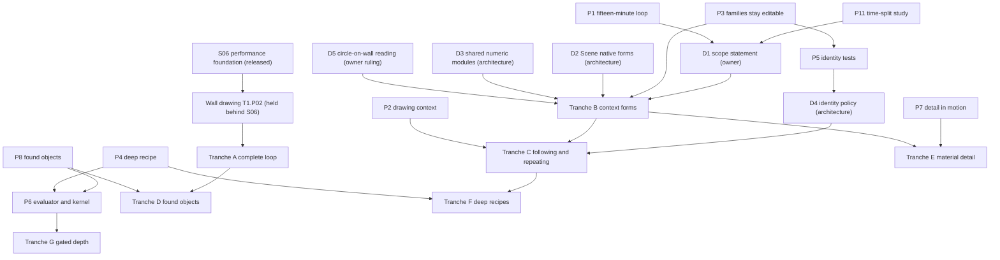

# Native creative depth: roadmap handoff

**Research date:** 25 October 2026  
**Status:** A handoff for a future planning agent and the owner. It releases no scope, assigns no phase, ratifies no architecture and admits no dependency.  
**Package:** [Native creative depth](./README.md)

This document turns the [synthesis](./synthesis-and-direction.md) into planning inputs:

- capability tranches ordered by dependency;
- the decisions that need owner or architecture authority;
- planning-ready briefs.

It deliberately avoids mapping conclusions onto the current T1–T4 phase structure. Where a brief touches an existing track, that is noted for reconciliation, not as an assignment.

## 1. Readiness verdict

**Ready for roadmap reconciliation as research input.** A planning agent can use this package without another broad research round. Specifically, it can:

- register the eleven proofs in the [proof agenda](./proof-agenda.md) as unscheduled research proposals, for the owner to commission;
- prepare decision D1 (scope statement) and the architecture-cycle questions D2–D4 for their authorities;
- use the briefs in [§5](#5-planning-ready-briefs) as the starting text of future plans once the relevant decisions and proofs exist.

**Not ready** for:

- releasing implementation scopes for native families. This needs D1, D2, and the P1, P3 and P5 outcomes;
- designing persisted schemas for Scene forms, profiles or correspondence records. This needs an architecture cycle after P5;
- admitting any geometry dependency.

**One targeted evidence gap remains:** how target creators actually split their time ([P11](./proof-agenda.md#p11-where-creators-time-actually-goes)). It is a bounded study, not broad research, and it can run in parallel with everything else.

## 2. Capability tranches

The tranches below are ordered by dependency and evidence, not by track. Each lists the [briefs](#5-planning-ready-briefs) that implement it.

| Tranche | Contents | Why here | Briefs |
| --- | --- | --- | --- |
| **A. The complete loop, made attractive** | Wall drawing (held today), host-local Openings (production), placement, a lighting look, saved views, still capture, visitor preview | Without it no form capability can be judged. P1 decides whether presentation outranks forms | B1 |
| **B. Context forms** | A Shape extrusion family with profile rounding; one profile editor everywhere; revolve as a kind; validation and refusal vocabulary; arc-length UVs | Strongest evidence; smallest new concept; carriers already exist | B2, B3, B4, B10, B8 (UV part) |
| **C. Following and repeating** | Profile on carrier (trim, edge bands); distributions with anchors; role-address identity | The ten-hour revision value; depends on B and on the identity policy | B5, B6, B11 |
| **D. Found objects and handoff** | Light edit kit; non-destructive re-import; imports in family slots; glTF out | Content-in is most of a real scene. Can proceed in parallel with B and C after A | B9 |
| **E. Material-level detail** | Cut-out materials with correct shadows; decals; text and SVG profiles; standees | Cheap depth, if P7 confirms it works in motion | B8 |
| **F. Few deep recipes** | Railing and stair with transitions; shelving and display bays; exhibition families | Only after B and C prove the language; P4 decides | B7 |
| **G. Gated depth** | Loft, Coons spans, membranes, cushions, terrain heightfields, booleans on found objects, signed-distance forms | Each needs its own demand evidence and P6 | none until a proof passes |

**R** **Difference from the original study's [adoption order](../spatial-modeling-depth-research-2026-10-25.md#12-suggested-adoption-order):**

- Found objects (D) and profile rounding (B) move earlier.
- Carriers from context replace arbitrary-plane drawing as the second step.
- Material-level detail becomes its own tranche.

## 3. Dependency graph

**Reading the graph.**

- No arrow means "schedule after". An arrow means "needs the evidence or decision from".
- Proofs can start before any production work. Prototypes need only a commission.
- Tranche A's Wall drawing remains behind the released S06 performance foundation, under the existing [performance-first halt](../../docs/roadmap/README.md#production-implementation-hold).

## 4. Owner decisions

Each decision names its authority, a recommended default, and the evidence that would change it.

| # | Decision | Authority | Recommended default (**R**) | Evidence that would change it |
| --- | --- | --- | --- | --- |
| D1 | **Scope statement** for native form, relative to the non-goal "general-purpose geometry modeling" | Owner (product) | Adopt wording along these lines: *Biskiq natively creates the context-dependent forms a spatial environment needs, meaning forms that fit, follow, host or repeat within its architecture and scene, through domain-owned families of profiles, carriers and rules. General-purpose geometry modeling, freeform surfacing and fabrication-grade solid editing remain upstream; their results are welcome through import.* | P11 shows that context-independent bespoke modeling dominates target creators' work |
| D2 | **Scene native forms:** Shapes and object families stored as Scene parametric definitions with instances | Architecture cycle (Scene), under the owner-ratified destination | Yes. A project-local Shape is an inline definition with one instance, using the same identity semantics as a later library resource | P3 shows creators need per-object variation that definitions cannot express |
| D3 | **Shared numeric modules** used by the Layout compiler and Scene evaluation | Architecture cycle (kernel substrate, an open mechanism) | Pure, deterministic, runtime-safe modules that take numbers and return numbers. They hold no domain types and no truth | P6 shows an evaluator boundary that cannot stay pure |
| D4 | **Identity policy:** role addresses, published correspondence, resolution by reference kind, coarse defaults | Architecture cycle (correspondence algorithms are open) | Ratify after P5 passes | Any P5 silent-retarget failure; P9 showing frequent sub-role references |
| D5 | **Circle on a wall**, from the original study's [§10](../spatial-modeling-depth-research-2026-10-25.md#two-interaction-conflicts-deserve-explicit-decisions) | Owner ruling on a PLATE amendment | Keep "a circle on a wall face is a round Opening, with no chip". Add the alternative "Shape on this face" (medallion, relief, sign) as a re-read within the same undo step. The retained Shape intent toggle stays the fallback | Wrong-first-reading rates in P2 |
| D6 | **Drawing context:** readings plus picked carriers before arbitrary workplanes | Owner (product), informed by design | Yes. Defer explicit workplanes and free three-dimensional chains until P2 names the tasks that need them | P2 finds two or more ordinary tasks impossible |
| D7 | **Found-object edit kit:** per-axis scale to dimension, mirror, re-pivot, re-material by slot | Architecture cycle (Scene transform contract) | Admit after P8 | P8 shows these edits are rarely used, or that booleans dominate |
| D8 | **Escape that keeps meaning:** a family member can be custom while the family keeps its label; "bake to plain objects" is explicit and one-way | Architecture cycle (each family's owner) | Yes, as a family-contract requirement | P4 shows creators prefer full detachment |
| D9 | **Kernel admission** | Owner (dependency admission) | Admit nothing now. Commission a Manifold spike (Apache-2.0, editor-only, lazy, in a worker, behind a validator) only if P4 or P8 show booleans in ordinary tasks. Record Clipper2's BSL-1.0 explicitly when a lane needs it, since the admission examples do not name it | P6 results |
| D10 | **Licence-blocked interchange:** IFC through web-ifc (MPL-2.0); STEP through OCCT (LGPL) | Owner (licensing) | No action. Leave both to the eventual licensing decision | A licensing decision |
| D11 | **Recipe admission policy** | Owner (product) | Few deep recipes. Each must reuse the profile, carrier and rule language, pass the original study's [feature-admission test](../spatial-modeling-depth-research-2026-10-25.md#a-feature-admission-test), and ship transitions, validation, slots and the escape | P4 |

## 5. Planning-ready briefs

Each brief is written so that a later planning agent can turn it into a plan once its prerequisites exist. "Touches" names existing work for reconciliation; it is not a placement.

### B1. Complete-loop baseline and presentation

- **Intent.** A creator reaches a convincing, well-lit, framed place in fifteen minutes.
- **Scope in.**
  - Wall drawing with host-local Openings, including curved walls with arched heads.
  - Solve-once placement of supplied content.
  - One lighting look.
  - A saved view.
  - Still capture.
  - Visitor preview.
- **Scope out.** New form families.
- **Prerequisites.** S06 accepted; the Wall-drawing release.
- **Evidence.** P1.
- **Touches.** T1.P02 (drawing, Openings); T2 placement; T3 Experience views.
- **Risk.** The time split shows setup, not geometry, as the blocker. That is a valid result.

### B2. Shape extrusion family with profile rounding

- **Intent.** A closed Ink stroke read as Shape becomes an editable solid that looks finished.
- **Scope in.**
  - Outline with holes.
  - Height ray.
  - Per-corner round and crease.
  - Rim radius by inset profiles.
  - Arc-length UVs.
  - Card facts.
  - Refusal in words, for example "radius larger than half the narrowest part".
- **Scope out.** Taper beyond a bounded angle; booleans; arbitrary face pulls.
- **Owner.** Scene.
- **Prerequisites.** D1, D2, D3.
- **Evidence.** P1, P3.
- **Touches.** The PLATE Shape reading; T2 Scene definitions.
- **Risk.** Families feel rigid; mitigated by import and escape.

### B3. One profile editor

- **Intent.** Every profile, whether roof section, molding, plinth outline or lamp half-section, is edited the same way, on the object.
- **Scope in.**
  - Generalize Edit shape: a local section with joint points, midpoint ＋ marks, and exact values in the Card.
  - A 3D | Section reading.
  - Stable point keys with published segment correspondence.
- **Owner.** Shared shell pattern, with facts owned by each family's domain.
- **Prerequisites.** D4 draft.
- **Evidence.** P3, P5.
- **Touches.** PLATE Edit shape; Vellum's overhead editor.

### B4. Revolve as a Shape kind

- **Intent.** Turn a half-section about an axis to make lamps, vessels, columns and turned legs.
- **Scope in.**
  - The kind change on the Card.
  - Angle, including below 360° with end faces.
  - A radial rib or flute count.
  - Rounding.
  - UVs.
- **Owner.** Scene; Layout if a structural column family is later admitted.
- **Prerequisites.** B2, B3.
- **Evidence.** P3.

### B5. Profile on carrier: trim and edge bands

- **Intent.** Baseboards, crown, casings and edge bands follow rooms, walls and openings, and survive revision.
- **Scope in.**
  - Carriers derived from Room boundaries, Wall top and base edges, and Opening outlines.
  - Offset-based sweeps.
  - Corner policy: mitre, cope or return.
  - An honest answer for sloped ceilings: keep the profile and accept a gap, or use a rake variant.
  - Profile swap as a design option.
- **Owner.** Layout on architecture. Scene-object carriers depend on D2 and the open cross-domain seam.
- **Prerequisites.** B3, D4, and a 2D offset capability (Clipper2 candidate, D9).
- **Evidence.** P3, P5.
- **Touches.** Layout family admission ("native forms grow family by family").

### B6. Distributions with anchors

- **Intent.** Repetition stays authored intent.
- **Scope in.**
  - Count or spacing (one drives the other).
  - Anchors at corners and at user-placed points.
  - End rules.
  - Orientation: upright, tangent or fixed.
  - Ordinal slots with suppression.
  - Orphaned overrides kept visible.
  - Instanced rendering.
- **Owner.** By host.
- **Prerequisites.** D4.
- **Evidence.** P5, P9, and the original study's Experiment 4 workloads (20, 200 and 1,000 members).

### B7. Railing and stair recipe with transitions

- **Intent.** One deep recipe proves the language and the escape.
- **Scope in.**
  - Straight, L and U stairs with landings.
  - A walking line.
  - Rise and run validation.
  - A railing derived from nosings plus height, with a frame-mode toggle.
  - Transitions at landings and turns.
  - Baluster distribution with anchors.
  - An infill span.
  - Module slots that accept imported posts.
  - "Make custom" that keeps the label.
- **Scope out.** Winders, helical stairs with custom stringers, and fabrication documentation.
- **Owner.** Layout.
- **Prerequisites.** B3, B5, B6, D8, D11.
- **Evidence.** P4.

### B8. Material-level detail and real-scale texture

- **Intent.** Presentation depth without geometric cost.
- **Scope in.**
  - Arc-length UVs on every family.
  - Object-space box mapping for extrusions.
  - Overrides keyed by role groups.
  - Alpha cut-out materials with shadow-correct depth.
  - Decals on host frames.
  - Text and SVG to profile.
  - Photo standees.
- **Owner.** Scene materials; Experience for still capture.
- **Prerequisites.** P7 for cut-outs and standees.
- **Evidence.** P7.

### B9. Found objects: edit kit and re-import

- **Intent.** Imported and AI-generated objects can be fitted, varied and updated without leaving Biskiq.
- **Scope in.**
  - Scale to a dimension, uniform or per axis.
  - Mirror.
  - Array.
  - Re-pivot.
  - Re-material by slot.
  - A section view.
  - Re-import diff review.
  - Per-property ownership, separating linked from overridden properties.
  - Linking by asset identity.
  - glTF export carrying stable IDs.
- **Scope out.** Topology editing; booleans on found objects (gated, D9).
- **Owner.** Scene and canonical ingest.
- **Prerequisites.** D7.
- **Evidence.** P8.
- **Touches.** T2.P02.S02's own-GLB import, which is production.

### B10. Family validation and refusal vocabulary

- **Intent.** Every family names its failures in design terms and offers a fix.
- **Scope in.**
  - A shared refusal shape: cause, affected fact, suggested alternatives.
  - One-answer qualification, where chip, preview and commit share one function.
  - Validation ranges, for example rise and run, rim radius, and opening fit.
- **Owner.** Each family's domain, with presentation following PLATE.
- **Prerequisites.** None beyond the first family.
- **Evidence.** P3, P4. Reviewers should be able to read every refusal string without geometric jargon.

### B11. Role addresses and correspondence

- **Intent.** Material, attachment and Experience references survive ordinary revision, or become visibly unresolved.
- **Scope in.**
  - Role vocabularies per family.
  - Correspondence records (preserved, retired, replaced, new) published by owners.
  - Resolution by reference kind.
  - Repair interaction: highlight, list, reassign, keeping dependent relations.
- **Owner.** Architecture cycle, then each domain.
- **Prerequisites.** P5.
- **Evidence.** P5, P9.
- **Touches.** The ratified correspondence transport; Scene attachment; Experience references.

## 6. What not to schedule

**R** None of the following should be scheduled without new evidence and an owner decision:

- arbitrary B-rep face push/pull with neighbor healing;
- three-dimensional fillets;
- shells of arbitrary solids;
- freeform surfacing such as Gordon networks;
- a feature-history tree;
- a node graph;
- sculpting;
- UV unwrapping;
- a signed-distance editing mode;
- a Rust/WASM kernel;
- threaded WASM;
- any OCCT-based path;
- a broad recipe catalog;
- IFC, STEP or DWG import before a licensing decision;
- live-link plug-ins to external renderers before demand is proven.

## 7. Reconciliation with current authorities and roadmap

- **Production hold.** Every implementation scope absent from the [release list](../../docs/roadmap/now.md) stays held. This package releases nothing. It is not a release under the [production hold](../../docs/roadmap/README.md#production-implementation-hold).
- **Performance-first halt.** Wall drawing and Openings inherit S06. Tranche A therefore waits for S06 acceptance, and proofs that need drawing use prototype drawing until then.
- **Ratified authorities preserved.**
  - The PLATE shell's dock, readings, precision ladder and Card rule are used as they stand. D5 is the only proposed amendment.
  - The convergence ratification's family-by-family growth, typed refusals and correspondence transport are assumed.
  - The Scene destination's definitions, attachment and opaque part identity are assumed.
  - The North Star's agent surface and non-goals are respected. D1 proposes clarifying wording, not a reversal.
- **Where results would be registered.** An owner who accepts these proofs as research proposals would record them under the roadmap's [unscheduled proposals](../../docs/roadmap/README.md#unscheduled-proposals-and-maintenance-evidence). Current coordination stays in [cross-track execution](../../docs/roadmap/cross-track-execution.md). This package edits neither.

## 8. How a planning agent should use this package

1. **Start with the [synthesis](./synthesis-and-direction.md)**, sections 1, 3 and 6, for the direction and its boundaries.
2. **Check claims against the [status ledger](./synthesis-and-direction.md#2-status-ledger-what-exists-by-kind-of-evidence).** Never treat a prototype or a destination as shipped.
3. **Take decisions to their authority** using §4. Do not settle architecture questions in a plan.
4. **Commission proofs in the [proof agenda](./proof-agenda.md#5-suggested-sequence)'s order.**
5. **Write plans from the §5 briefs** only after their prerequisites exist. Cite the [creator evidence](./creator-evidence.md) and [precedents](./approaches-and-precedents.md) for the user problem, and [geometry](./geometry-identity-and-performance.md) for technical constraints.
