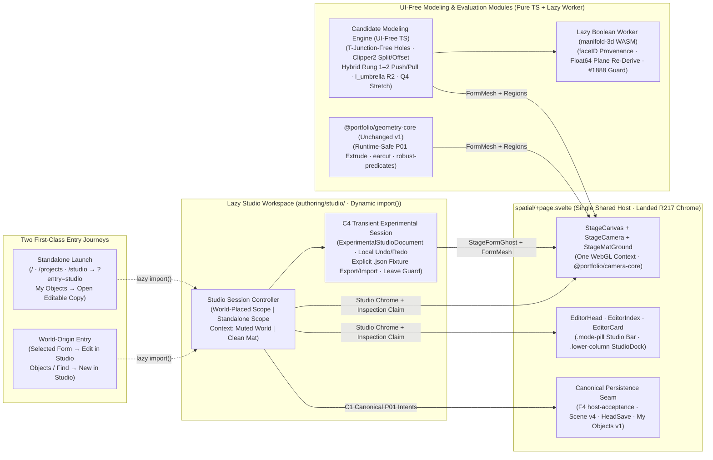
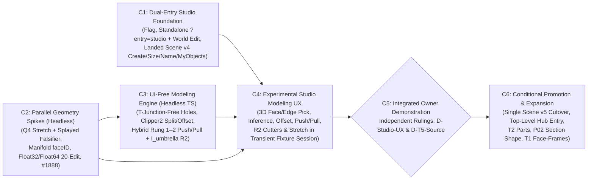

# Candidate T5 architecture: Dual-entry Native Object Studio & direct modeling foundation

**Research & architecture proposal · PR #266 review revision · 2026-11-03 · owner & final architect review**

Prepared against `main` at `535e4bd1` (`R217` landed through `S28`). **Proposal only:** no implementation code, schema bump, dependency installation, contract ratification or roadmap release is included in this PR.

**Product destination:** establish **Object Studio** as a **self-contained, promotion-ready modeling workspace within [`apps/editor`](../../apps/editor/src/lib/authoring/README.md)**—reachable through **two equal first-class journeys** (**World-origin** from a selected object and **Standalone** by launching Biskiq directly into Studio without a Room or World composition)—backed by UI-free geometry modules so proven UX and modeling capabilities promote into Biskiq without rebuilding a throwaway prototype.

---

## 1. Product destination & architectural assessment: one Studio, two entry journeys

### 1.1 Dual-entry Object Studio within Biskiq

Building inside `apps/editor` avoids repeating [`native-form-lab`](../../prototypes/native-form-lab/FINDINGS.md)'s throwaway viewport/camera/undo rebuild tax while letting us prove what an isolated `prototypes/` app never could: seamless transitions between spatial architecture and focused modeling over the single [`StageCanvas.svelte`](../../apps/editor/src/lib/authoring/stage/shell/StageCanvas.svelte), `@portfolio/camera-core`, `F4` [`host-acceptance.ts`](../../apps/editor/src/lib/authoring/stage/host-acceptance.ts), `HeadSave`, and [`MyObjectsSection.svelte`](../../apps/editor/src/lib/authoring/adapters/scene/library/MyObjectsSection.svelte).

Object Studio serves **two equal entry journeys** with **one identical Studio UX, toolset, geometry engine, Card grammar, and visual language**—context governs **lifecycle and exit/placement actions**, never modeling power:

| Dimension | Journey A — World-origin (`World \| Experience → Studio`) | Journey B — Standalone (`Direct launch → Studio`) |
| --- | --- | --- |
| **How creator enters** | Select a native form in World → choose **Edit in Studio** (`EditorCard` `•••`, contextual action, or `Find` `⌘K`); or choose **New Object in Studio** from World's `Objects` / `My Objects`. | Launch Biskiq **directly into Object Studio** from [`/`](../../apps/editor/src/routes/+page.svelte), [`/projects`](../../apps/editor/src/routes/projects/+page.svelte), `/studio` (redirecting like [`/editor`](../../apps/editor/src/routes/editor/+page.svelte) to `?create=1&entry=studio`), or **Open editable copy in Studio** from `My Objects`. |
| **Spatial context** | Target stays at its real World coordinates; surrounding compiled [`@portfolio/layout-core`](../../packages/layout-core/src/layout-geometry.ts) rooms & Scene entities dim as non-pickable reference (`Context: World`, toggleable to `Context: Mat`). | Opens directly on `StageCanvas`'s measured dark cutting mat and world-anchored grid (`StageMatGround`, `Context: Mat`), with **zero `Layout` rooms required**. |
| **Save, exit & World handoff** | Accepted canonical edits are already part of the project's `Scene` unit and `F4` history; **Back to World** restores prior Camera reading/pose and `Select` on the same entity (never duplicating). | **Save** (`HeadSave`) persists accepted standalone work; **Save to My Objects** publishes an immutable reusable snapshot; **Place in World** transitions into World floor/support placement as an explicit `F4` insertion. |

### 1.2 Substantive pushbacks & hybrid decoupling guardrails

To keep early in-app integration from creating premature schema churn, hidden persistence traps, or biased geometry tests, we explicitly **push back against four tempting shortcuts** and adopt cleaner seams:

1. **Pushback — Do not invent a separate `ObjectDraft` database table or mutable `My Objects` draft schema before `C6`:**
   [`form-library.ts`](../../packages/project-model/src/library/form-library.ts) (`umbrella-plan.md` A7) ratifies `My Objects` as **immutable, content-addressed source snapshots** (`FormLibraryPayload` v1), while [`ProjectEnvelope`](../../packages/project-model/src/scene-planning/planners.ts) *already* supports empty-`Layout` projects (`Begin empty` in [`spatial/+page.svelte`](../../apps/editor/src/routes/project/[projectId]/spatial/+page.svelte) `:5773`) with `F4` Undo/Redo, `HeadSave` optimistic concurrency (`savedBaseToken`), sign-in pending-save recovery (`TD-9`), and rename/delete. Creating a parallel draft store now would duplicate persistence and auth plumbing. **Recommended seam:** host canonical Standalone Studio sessions in an empty-`Layout` `ProjectEnvelope` (`?entry=studio`), keep `My Objects` strictly for immutable reusable snapshots, and defer any dedicated draft-library table or `/projects` filter facet until post-`C5`.
2. **Pushback — Do not wire unproven `C4` geometry into `F4` acceptance or `Scene` v4 codecs:**
   Letting `F4` accept experimental B-rep / `R2` cutter / stretch payloads while blocking `HeadSave` would violate `F4`'s core guarantee that every accepted revision is a valid, savable `ProjectEnvelope`. **Recommended seam (§3.2):** keep `F4` and `HeadSave` 100% canonical `Scene` v4 through `C5`; run `C4`'s experimental geometry inside an explicitly badged **Transient Experimental Studio Session** with its own local command undo/redo stack, unsaved-leave guards, and **deterministic `.json` fixture export/import** until `C5` selects one permanent `Scene` v5 representation.
3. **Pushback — Do not make [`UX-SPEC.md`](../../prototypes/native-object-shaping/UX-SPEC.md)'s 2D paper-slice split mandatory on Studio entry:**
   `UX-SPEC.md` (`:138-165`) assumes a mandatory side-by-side 2D section pane on entry and disables editing whenever a slice crosses holes or multiple regions—blocking architectural casework, vitrines, rebates, and frames. **Recommended seam (§2):** default Studio to **direct 3D manipulation on `StageCanvas`** (`Context: World | Mat`) while retaining `Front / Side / Top` orthographic **Section** (`3D | Section` or inset) as an **invoked reading** for contour shaping.
4. **Pushback — Do not pull multi-part `Scene` assemblies (`Rung 0` persistence) into `C1–C4` UI scope:**
   Persisting multi-part hierarchies before `T2`'s `PartDefinition`/`PartInstance` (`F.1`) seam lands would force throwaway sub-entity selection/codec code and overpromise `C5`. **Recommended seam:** prove single-body modeling + `R2` positioned cutters/adders + `Q4` stretch (e.g., open-frame vitrines and single-body portal/bridge tables) in `C1–C4`, and build multi-part `Parts` assemblies in `C6` directly on `T2`'s `F.1` contract.

### 1.3 Exact relationship to `T5` umbrella commitments, `PLATE` and landed `R217` code

Differentiating **shared infrastructure/domain authorities** (preserved) from **workspace/representation commitments** (explicitly challenged) and **design authority vs implementation reality**:

- **Authorities preserved unchanged:** One SvelteKit app (`apps/editor`), one WebGL `<Canvas>` (`StageCanvas.svelte`), one Camera authority (`@portfolio/camera-core` via [`StageCamera.svelte`](../../apps/editor/src/lib/authoring/stage/shell/StageCamera.svelte)), one `Scene` semantic owner (`umbrella-plan.md` **A2**), one `F4` acceptance/history host, one `HeadSave` protocol, IEEE-754 canonical determinism (**A5**), reusable `My Objects` copy semantics (**A7**), and Visitor bundle isolation—enforced continuously by [`stage-shell-composition.test.ts`](../../apps/editor/tests/lib/authoring/stage-shell-composition.test.ts), [`editor-host-no-write.test.ts`](../../apps/editor/tests/lib/authoring/editor-host-no-write.test.ts), and [`geometry-core-boundary.test.ts`](../../apps/editor/tests/lib/geometry-core/geometry-core-boundary.test.ts).
- **Existing [`umbrella-plan.md`](../../docs/roadmap/t5-expressive-geometry/umbrella-plan.md) commitments challenged (requiring explicit owner rulings at `C5`):**
  1. **`A1` & §2 (`:25, 33, 40-55` — *"Object Focus is a scope on the one Stage, not a workspace... Rejected now: a separate studio route or shell"*):** Amended under **`D-Studio-UX`** to admit a **dedicated in-app Object Studio workspace posture and direct standalone entry (`/studio` / `?entry=studio`)** over the shared Stage/Camera/F4 host, with its own modeling dock/tools.
  2. **`A6` (`:30` — *"Integrate in place, prove at gates; no parallel studio or prototype to port"*):** Preserves A6's no-throwaway-app principle while amending admission so Studio UX is flag-gated and `C4` geometry uses a reversible transient session before `C5` promotion.
  3. **`A3`, `A4` & §5.1 proportional `scale` (`:27-28, 33-38, 154-156`):** Challenged conditionally under **`D-T5-Source`**—testing planar face-addressed Rung 1–2 operators and thickness-preserving `Q4` stretch against the fair incumbent `I_umbrella` baseline, subject to [`north-star.md`](../../docs/reference/north-star.md) (`:129-132`, *demonstrated creative barrier*).
- **Ratified [`PLATE`](../../docs/reference/design-system/editor-shell-and-visual-system.md) shell authority vs landed `R217` implementation (`535e4bd1`):**
  Per [`AGENTS.md`](../../AGENTS.md) Rule 10, **landed `R217` code (`S01–S28`) defines current implementation seams** (e.g., `S17A` moving shape creation from `Ink → Shape` to `Objects`, `S20` moving viewing preferences to Stage `⚙` + `Find`, `S25` `ExperienceHomesHost` dock/Index swapping, `S28` `.mode-pill`), **not automatic supersession of ratified `PLATE` design requirements**. Studio wires cleanly into landed `R217` code while explicitly recording **four material `PLATE` departures** requiring owner approval under **`D-Studio-UX`** before unflagged release:
  1. **Direct Standalone Studio launch** alongside `PLATE` §0.8's `World | Experience` top-level framing (`:22, 116-137`);
  2. **Replacing World's `StageDock` (`Select · Ink · Measure · Eraser · Objects`)** in `.lower-column` with a task-specific `StudioDock` while Studio is active (`:135, 153-180`);
  3. **Elevating object modeling from `PLATE`'s lightweight reading pill/chip** (`:177-179, 405, 577-582`) into a full Studio workspace posture; and
  4. **Scoping `EditorIndex` in Studio to an object's features/parts** (when `C6` parts land), adopting [PR #244](../native-object-creation-ux/PROPOSAL.md)'s bounded exception (`:70`) to `PLATE`'s no-outline-tree Index rule (`:132, 1327`).

---

## 2. Reconciling PR #244, Shape Focus (`UX-SPEC`) and PR #266 geometry research

Rather than treating prior UX and geometry studies as parallel tracks, Object Studio reconciles their concrete interactions, transitions, and guarantees:

| Design concern | [PR #244 Object Focus UX](../native-object-creation-ux/PROPOSAL.md) | [`UX-SPEC.md` (Shape Focus)](../../prototypes/native-object-shaping/UX-SPEC.md) | PR #266 Geometry Research | Reconciled Object Studio synthesis |
| --- | --- | --- | --- | --- |
| **Quick World creation vs deeper Studio** | Keep `S17A` `Objects` (`Box`, `Round`, `Free`, `Sphere`) fast in World; never auto-enter Focus. | Creation needs only closed drawing + depth; no mandatory Focus visit (`:67, 104`). | Simple plinths/slabs need only `P01` extrusion. | **Adopted verbatim:** simple World objects stay 1-step in World; Studio is entered deliberately (**Edit in Studio** or **Standalone**). |
| **Standalone start & library reuse** | Proposes unplaced **New object**, **Open editable copy** (replacing ambiguous *"Open for editing"*), and independent placed copies (`:54-62, 85`). |Scene-only start (`:5, 75`). | Agnostic to shell entry. | **Adopted & elevated:** promotes PR #244's unplaced journey to a **first-class Standalone launch** (`/`, `/projects`, `/studio`) while keeping PR #244's `Open editable copy` vs `Insert copy` distinction. |
| **Entry, framing & return transitions** | Preserve identity, placement & angle; muted read-only World context; restore `Select` & prior view on return; prompt on pending edit (`:47-52`). | `~220 ms` framing (`reducedMotion` aware); never relocate placed object to `[0,0,0]`; single selection (`:52, 134-143`). | Needs stable object-local frame for deterministic math. | **Reconciled:** math evaluates in exact object-local `Float64` coordinates while `StageCanvas` renders placed objects **in place** in World (`Context: World`) or on `StageMatGround` (`Context: Mat`); `Esc` unwinds pending edit → tool → Studio return. |
| **Primary viewport vs 2D Section** | Entry starts in `Select` on 3D Stage; does *not* auto-open a section (`:48, 103`). | Mandatory split 2D `Drawing` slice + 3D view; disables edits on holes/multi-contours (`:138-165`). | Requires 3D face/loop picking, holes, offsets, push/pull & `R2` cutters. | **Resolved in favor of 3D-first + optional Section:** Studio opens in 3D on `StageCanvas`; `Front/Side/Top` **Section** + `Local/Throughout` reach + `Keep` enter as an **invoked reading** (`C6` `P02` integration), lifting the genus-0 lock. |
| **Precision, sizing & refusals** | One `EditorCard` writer; explicit whole vs part reach; imported models inspect-only (`:71-78, 87`). | Anchor-bracketed dimensions (`Center \| Left/Right \| Base stays`), blur never commits, no silent category/symmetry inference, explicit refusal text (`:185-196`). | Adds **`Q4` Stretch** alongside proportional `scale`, plus typed topological/boolean refusals. | **Unified:** `EditorCard` is sole numeric writer (with anchor brackets, blur-never-commits, and `R217.S22` `gesturing` fade during 3D drags), offering **Size** (proportional) alongside **Stretch** (thickness-preserving) once `C4` is active. |

---

## 3. Studio, standalone lifecycle and modeling architecture on real Biskiq seams

### 3.1 Simplest viable standalone & World-origin object lifecycle

1. **Direct Standalone Launch (`/` · `/projects` · `/studio` → `/project/[projectId]/spatial?create=1&entry=studio`):**
   Extending [`boot-state.ts`](../../apps/editor/src/lib/authoring/stage/boot-state.ts) with an explicit `entry=studio` boot parameter lets `/` and `/projects` (once promoted) and a lightweight `/studio` redirect route (matching [`/editor/+page.svelte`](../../apps/editor/src/routes/editor/+page.svelte)) mint or open an **empty-`Layout` `ProjectEnvelope`** directly in Studio posture on `StageMatGround`—bypassing World's starter-gallery prompt and World dock completely.
2. **In-session empty draft vs accepted canonical work (`Save` / `Resume`):**
   - Before the first shape is created, Studio holds a clean empty workplane; leaving abandons nothing and triggers no save ceremony.
   - Once a canonical `P01` shape is accepted (`C1`), it lives as the Studio project's primary `SceneFormEntity` at the mat origin: `EditorHead` `Undo`/`Redo` (`F4`) and **`HeadSave` (`Save`)** work out of the box (including `TD-9` sign-in capture), and reopening that project with `entry=studio` resumes editing immediately.
   - When **New Object in Studio** is invoked *from inside an existing World project*, Studio holds an unplaced candidate session (**Not placed**) until the creator chooses **Place in World** or **Save to My Objects**, so scratch work never drops onto a room floor unasked.
3. **`My Objects` relationship (`Save to My Objects` vs `Open editable copy` vs `Insert copy`):**
   - **Save to My Objects** ([`save.ts`](../../apps/editor/src/lib/authoring/adapters/scene/library/save.ts)) writes an immutable, content-addressed `FormLibraryPayload` snapshot without altering `F4` history or project dirty state.
   - **Open editable copy in Studio** reads and verifies a `My Objects` item and seeds a **new detached editable copy with a fresh identity** in Studio, leaving the library snapshot immutable.
   - **Place in World** (same project: `create-form` / `place-form-copy` floor preview) or **Insert copy** (any other project via `My Objects`) creates an **independent World `SceneFormEntity`**, ensuring later edits to a standalone draft never silently mutate an already-composed room (`umbrella-plan.md` A7; PR #244 §B.5).

### 3.2 Concrete seam mapping and transient experimental session contract

- **Measurable lazy isolation (replacing any unmeasured zero-byte assumption):**
  Studio UI (`authoring/studio/`), `Clipper2`, and the `manifold-3d` WASM Worker ([`worker-client.ts`](../../apps/editor/src/lib/authoring/adapters/scene/import/worker-client.ts) pattern) load strictly via dynamic `import()`. [`@portfolio/geometry-core`](../../packages/geometry-core/src/index.ts) v1 and Visitor `/p/[publicationId]` closures stay untouched. Only minimal boot/entry/flag wiring touches the host bundle; `C1` and `C5` measure and report exact before/after brotli chunk sizes and startup timings against `umbrella-plan.md` §5.7.
- **Landed `R217` shell & Camera integration:**
  Studio acquires a Camera claim via `stage.acquireInspection` and drives all focus, local orbit/pan/zoom, face-align, and `Back to World` restoration through `stage.requestViewingIntent` ([`stage-facade.ts`](../../apps/editor/src/lib/authoring/stage/stage-facade.ts)). Top-center `.mode-pill` (`R217.S28` pattern) shows Studio scope, origin-specific return/place actions, and `Context: World | Mat`; `.lower-column` mounts `StudioDock` (`R217.S25` pattern); [`EditorCard.svelte`](../../apps/editor/src/lib/authoring/stage/shell/EditorCard.svelte) ([`SceneObjectCardFields.svelte`](../../apps/editor/src/lib/authoring/adapters/scene/SceneObjectCardFields.svelte)) serves as sole numeric writer with `gesturing` fade during live drags; [`form-evaluation.ts`](../../apps/editor/src/lib/content/form-evaluation.ts) and [`form-geometry.ts`](../../apps/editor/src/lib/museum/entities/form-geometry.ts) render live `StageFormGhost` / `FormMesh` buffers.
- **Landed `Scene` v4 operations used in `C1` (strictly factual scope):**
  [`planners.ts`](../../packages/project-model/src/scene-planning/planners.ts) today supports `create-form`, `place-form-copy`, `set-form-size` (per-axis `Width / Height / Depth` via `form.scale`), `set-name`, `move-horizontal`, `set-yaw`, `set-lift`, `duplicate-one`, and `delete-one`. It does **not** implement committed outline-anchor editing or `P02` `reshape`; `C1` stays strictly within those landed `Scene` v4 planners.
- **`C4` Transient Experimental Session contract (explicit lifecycle before `C6`):**
  1. *Storage & `F4` separation:* Invoking `C4` experimental modeling opens a visibly badged **Experimental Studio Session** (`Experimental · Fixture-only`) backed by a typed in-memory `ExperimentalStudioDocument` (`experimental-studio@0`)—seeded either from scratch or by cloning a selected `P01` `SceneFormSource` without mutating the accepted `Scene` entity. `F4` accepts **zero** experimental intents; `C4` maintains a separate, explicitly labelled **Studio experimental Undo/Redo stack** while `EditorHead`'s project Undo/Redo discloses why project history is parked during experimental modeling.
  2. *`HeadSave` & deterministic fixture persistence:* `HeadSave` writes only the canonical `ProjectEnvelope` and never serializes `ExperimentalStudioDocument`. Studio provides **Export Fixture (`.json`)** and **Open Fixture (`.json`)** so creators and reviewers deterministically save, reload, and inspect experimental models across sessions without risking cloud/schema corruption.
  3. *Exit, project-switch & failure safety:* Pressing `Back to World`, switching lenses/projects, or closing the tab while the experimental session has unexported edits triggers an explicit guard (**Export Fixture & Leave**, **Discard Experimental Edits & Leave**, or **Continue in Studio**, plus `beforeunload`). Worker/evaluator errors isolate to the candidate preview, surface clear refusal text, and preserve the last valid experimental state.

---

## 4. Capability sequence, dependencies and workflow alignment (`C1–C6`)

| Capability (1–2 small PRs) | Observable creator outcome | Actual dependencies | Reusable technical deliverables | Working behavior vs research evidence |
| --- | --- | --- | --- | --- |
| **C1 — Dual-Entry Studio Foundation & Landed `Scene` v4 Slice** | With Studio flag enabled ([`app-preferences.ts`](../../apps/editor/src/lib/platform/app-preferences.ts) / `?studio=1`), creator can **both** boot directly into Standalone Studio (`/studio` → `?create=1&entry=studio` on `StageMatGround`) **and** enter via World **Edit in Studio** / **New Object in Studio**; create `P01` forms (`Box`, `Round`, `Free` via `create-form`), edit `Width/Height/Depth` (`set-form-size`) & `Name` (`set-name`), toggle `Context: World \| Mat`, `Save to My Objects` / `Open editable copy`, `Place in World` / `Back to World`, and run real `F4` Undo/Redo & `HeadSave`. | Existing `spatial/+page.svelte`, `StageCanvas`, `StageCamera`, `scene.adapter.ts`, `host-acceptance.ts`, `MyObjectsSection`. Zero kernel or schema changes. | Lazy `authoring/studio/` scope host, `entry=studio` boot intent & `/studio` redirect, Camera inspection framing/return handover, `World \| Mat` context filter, measured bundle-diff check. | **100% working, production-persisted behavior** on canonical `Scene` v4 & `My Objects` v1; establishes real baseline for `D-Studio-UX`. |
| **C2 — Headless Geometry Spikes (`Stretch Q4` & `Manifold R2`)** | No UI change; establishes verified stretch and boolean behavior on representative & adversarial fixtures. | Existing `@portfolio/geometry-core` + dev/editor-isolated `manifold-3d@3.5.4` test harness. **Runs in parallel with `C1` (Worktree B).** | UI-free `stretch-zones` module (`Q4` vs `form.scale` + splayed-angle shear detector); `manifold-3d` Worker prototype with `Mesh.faceID` region mapper, `20`-edit `Float32`/`Float64`/`R2` drift harness, and #1888 grazing validator. | **Executable research evidence + reusable pure-TS/Worker evaluators** (`p50/p95` timings, WASM cold-start cost, drift tables, boolean escalation verdict). |
| **C3 — Core UI-Free Modeling Engine & `I_umbrella` Baseline** | Headless operators and deterministic `experimental-studio@0` JSON fixture codec ready for Studio UI binding. | Consumes `C2` Rung 3 / `R2` escalation findings; independent of `C1` (**starts in parallel with `C1`**). | UI-free TS modules: T-junction-free hole extrusion (`earcut` + collinear side-stitching fixing [`probe-methods.md`](../native-creative-depth/probe-methods.md) `:91`), `Clipper2` ([`geometry-library-harvest.md`](../geometry-library-harvest.md) `:178`) `splitFace` & concave `offsetFaceLoop`, hybrid `Float64`-plane/`(u,v)` Rung 2 `pushPullFace` + `FaceId` correspondence, fair `I_umbrella` `R2` cutter evaluator, and torture corpus. | **Verified headless engine** (0 open/T-junction edges on admitted ops) + **side-by-side corpus comparison** (`I_umbrella` vs planar B-rep under upstream edits). |
| **C4 — Experimental Studio Modeling UX & Fixture Session** | In both Standalone and World-origin Studio, creator enters a badged **Experimental Studio Session** to sketch on faces (`Line`, `Rect`, `Circle`, `Poly`), `Offset` loops, `Push/Pull` recesses/steps with spatial inference, apply **`I_umbrella` `R2` cutters/adders**, and resize with **`Q4` Stretch**—with experimental Undo/Redo, `.json` fixture Export/Open, and exit loss guards. | `C1` + `C2` + `C3`. | 3D face/edge/vertex raycast & inference controller, interactive `Offset` / `Push/Pull` / `Stretch` / `R2` cutter tools & Card writers, async Worker preview bridge, `ExperimentalStudioDocument` session & leave guard. | **Live interactive Studio UX in `apps/editor`** over reversible fixture persistence (canonical `Scene` v4 / `HeadSave` untouched). |
| **C5 — Integrated Owner Demonstration & Architecture Gate** | Hands-on owner evaluation inside Biskiq across Standalone & World-origin journeys (see §6.1) + review of `C2–C3` corpus evidence. | `C1–C4` (zero `C6` scope required). | Bundle/startup/latency report, curated `.json` fixture pack, and owner decision record for **`D-Studio-UX`** and **`D-T5-Source`**. | Separates **live `C1–C4` app behavior**, **headless `C2–C3` proofs**, and **deferred `C6` scope**. |
| **C6 — Conditional Promotion Cutover & Post-Gate Expansion** | Approved source promotes into canonical `Scene` v5+ (`F4`, `HeadSave`, `My Objects` v2, Visitor/`T4` delivery); approved Studio UX exposes unflagged `/` & `/projects` Studio entry; approved next-tier features land incrementally. | Explicit `C5` owner rulings (`D-Studio-UX`, `D-T5-Source`). | Single `Scene` & `FormLibraryPayload` format bump, updated `umbrella-plan.md` & `PLATE` contracts, retired transient `C4` scaffolding, and—as approved—`T2` `Parts` (`F.1`), `P02` Section `reshape`/`keep`, `T1` wall face-frames, or `moveFaces`/`tiltFace`. | **Promoted production truth.** |

### 4.1 Workflow alignment: rules currently in force vs PR #259

- **Rules currently in force ([`AGENTS.md`](../../AGENTS.md), [`docs/roadmap/README.md`](../../docs/roadmap/README.md) `:33-47`):** Implementation is under the 2026-10-22 **production implementation hold** (`now.md` is owner-written), `T5` has no active phase ([`t5-expressive-geometry/current.md`](../../docs/operations/t5-expressive-geometry/current.md)), and `parallel-track-gates.test.ts` governs `docs/roadmap/` and `docs/operations/`. Under active rules, starting `C1–C4` requires an explicit owner release.
- **PR #259's proposed lean workflow (still unmerged, not treated as active):** Uses `T1–T5` as expertise lenses rather than handoff silos so one agent in an isolated worktree can span `Stage`, `Scene`, `Camera`, `F4`, and `T5` geometry per capability PR, putting any needed capability plan in the first commit of its draft PR without standalone authorization/handoff/closeout ceremony PRs. `C1–C6` works cleanly under **either** regime.

---

## 5. Retained geometry ladder, fair incumbent baseline and technical stop rules

1. **Complexity progression (`Rung 0` → `Rung 3`) & cross-track seams:**
   - **Rung 0 (Multi-part composition):** Touching bodies do not silently fuse; canonical multi-part persistence aligns with `T2` / `F.1` (`C6`) rather than forcing booleans for multi-part furniture.
   - **Rung 1–2 (Planar holes, `Clipper2` split/offset, local `Push/Pull`):** Hybrid `Float64` plane equations (`ax + by + cz = d`) + in-face `(u, v)` polygons, IEEE-754 `+ − × ÷` / `Math.sqrt` canonical determinism (`A5`), T-junction-free `earcut` + collinear side-stitching, and upfront typed refusal of over-determined degree-4+ face moves ([`roadmap-handoff.md`](../native-creative-depth/roadmap-handoff.md) `:323-327`, [`approaches-and-precedents.md`](../native-creative-depth/approaches-and-precedents.md) `:68, 79`).
   - **Rung 3 / Route `R2` (`manifold-3d@3.5.4` solid combinations):** Compares 1-pass non-destructive `R2` evaluation from `Float64` source against `Float64` plane-re-derived B-rep round-tripping across `20` chained edits, tracking `Mesh.faceID` region survival, `Mesh.vertProperties` (`Float32Array`) quantization, and **Manifold #1888** coplanar-grazing silent volume loss ([`geometry-identity-and-performance.md`](../native-creative-depth/geometry-identity-and-performance.md) `:48, 184`).
   - **`T1` & `T2` boundaries ([`t1-spatial-world/README.md`](../../docs/roadmap/t1-spatial-world/README.md) `:91-95`, [`t2-composition/README.md`](../../docs/roadmap/t2-composition/README.md)):** `T1` solely owns wall side-surface face-frames ([`CompiledJunctionSurface`](../../packages/layout-core/src/layout-geometry-types.ts) `:439-454` holds end-caps/trims/keels, never room-facing wall sides); `T2` owns `Scene` definitions/instances and cross-domain attachments.
2. **Fair incumbent baseline (`I_umbrella`):**
   Every `C3–C5` comparison tests direct planar face ops head-to-head against **`I_umbrella`**—keyed `P01`/`R1` profiles + object-space `P02` semantics (zero topological naming) + non-destructive `R2` positioned cutter/adder bodies + `Q4` stretch—so `I_umbrella` can genuinely win (`D-Studio-UX` = yes, `D-T5-Source` = `I_umbrella`).
3. **Explicit stop and redirect criteria:**
   - **Rung 1–2 integrity stop (`C3` → `C4`):** No Rung 1–2 operator enters `C4` Studio UI until it passes `0` open/T-junction edges and intact `FaceId` broadcast/unresolved correspondence across a `20`-edit chain.
   - **Manifold `Float32Array` & #1888 redirect (`C2` → `C3/C4`):** If `Float32Array` marshaling causes topological degeneracies across `20` chained edits even after `Float64` 3-plane vertex re-derivation, **do not wire destructive Manifold-to-B-rep round-tripping into `C4`**; route all Rung 3 cuts/additions through **1-pass non-destructive `R2` cutter/adder bodies** guarded by the #1888 volume/manifold post-condition validator.
   - **Synchronous solver stop (`C5` → `C6`):** Never build Synchronous-Technology-style inferred constraint solvers (`approaches-and-precedents.md:79`); over-determined moves refuse cleanly with actionable reason text.

---

## 6. Realistic `C5` owner demonstration, promotion matrix and remaining uncertainties

### 6.1 Capability `C5` owner demonstration (strictly bounded to `C1–C4`)

To avoid implicitly pulling `C6` forward, `C5` separates what is demonstrated **live in-app**, **headlessly in `vitest`**, and **conditionally after `C5`**:

1. **Live, integrated behaviors inside `apps/editor` (implemented by `C1` + `C4`):**
   - **Dual-entry & canonical `Scene` v4 round-trip (`C1`):** **(a)** Boot Biskiq directly into **Standalone Studio** (`/studio` → `?create=1&entry=studio`) with zero Rooms, create a `P01` form on `StageMatGround`, adjust `Width/Height/Depth` & `Name`, `Save` (`HeadSave`) + cold reopen into Studio, `Save to My Objects`, and `Place in World`; **(b)** open a real multi-room project in World, select a placed native form → **Edit in Studio** with `Context: World` muted architecture, edit size/name, `Back to World` with exact Camera/selection restoration, and verify `F4` Undo/Redo, Paper Plan footprint, and Visitor Preview.
   - **Interactive single-body experimental modeling & revision (`C4` transient session + `.json` fixtures):** Inside Studio (both on `StageMatGround` and in visual reference to real compiled `Layout` walls/openings without mutating `Layout`), build, export/reload as `.json` fixtures, and **revise upstream parameters out of order** on single-body architectural/display objects: **(a)** recessed/rebated vitrine casework (`Offset → Push/Pull` vs `I_umbrella` `R2` positioned cutter), **(b)** stepped plinth with recessed/pierced pocket (`R2` cutter / planar hole extrusion), and **(c)** single-body open portal / bridge table stretched `1.2 m → 2.0 m` via **`Q4` Stretch** keeping `60 mm` uprights/legs intact versus proportional `Size`.
2. **Headless comparative & adversarial evidence (`C2` + `C3` `vitest` reports):**
   - `20`-edit chained precision/drift tables (`Float32` naive vs `Float64` plane-re-derived vs 1-pass `I_umbrella` `R2`); splayed-member non-axis stretch shear falsifier; Manifold #1888 coplanar-grazing catches; concave `Clipper2` self-split & degree-4+ refusal verdicts; and measured Stage/Visitor/Studio/Worker brotli chunk sizes and `p50/p95` latencies.
3. **Explicitly post-`C5` (`C6+`, NOT required or promised in `C5`):**
   - Canonical `Scene` v5+ / `My Objects` v2 persistence of experimental operations; multi-part `T2` (`PartDefinition`/`PartInstance`) furniture/piano/chair assemblies; `P02` organic section `reshape`/`keep` UI; `moveFaces`/`tiltFace`; unflagged `/` and `/projects` Studio hub navigation; `T1` wall face-frame snapping; and `T4` publication derivatives.

### 6.2 Incremental merge, lazy isolation and owner decision matrix

| Layer | Merges to `main` pre-`C5`? | Isolation & safety guarantee | Required `C5` Owner Decision to promote |
| --- | --- | --- | --- |
| **Dual-entry Studio host & `C1` `Scene` v4 slice** | **Yes** | Behind Studio flag (`app-preferences` / `?studio=1`); dynamic `import()` keeps Studio UI out of inactive Stage/Visitor chunks (measured in `C1`); commits only landed `Scene` v4 intents; `test:arch` 100% green. | **`D-Studio-UX`**: amend `umbrella-plan.md` A1/A6, ratify the 4 `PLATE` shell departures (§1.3), and expose unflagged Studio entry on `/`, `/projects`, `EditorCard` and `Objects`. |
| **Headless spikes, engine & `I_umbrella` (`C2`, `C3`)** | **Yes** | Editor/authoring-only pure-TS & lazy Worker modules; `@portfolio/geometry-core` v1 root & Visitor closure untouched (`geometry-core-boundary.test.ts` green). | Admitting any new runtime dependency into `@portfolio/geometry-core` or Visitor chunks (or `T4` mesh-derivative cutover). |
| **`C4` Experimental Studio UX & `.json` fixtures** | **Yes, gated** | Runs strictly in badged **Transient Experimental Studio Session**; zero experimental writes to `F4`, `Scene` v4, `HeadSave` or `My Objects`; guarded on exit/switch. | **`D-T5-Source`**: choose `I_umbrella` (`R1 + R2 + Q4`), hybrid planar B-rep, or bounded combination; authorize **one** `Scene` v5 + `FormLibraryPayload` v2 bump in `C6`. |

### 6.3 Remaining architectural uncertainties for `C5` resolution

1. **Workspace scope (`D-Studio-UX`):** Whether Object Studio warrants top-level unflagged launch on `/` and `/projects` alongside `World | Experience`, or works best primarily as an in-project + `My Objects` studio posture.
2. **Canonical source winner (`D-T5-Source`):** Whether direct planar `Offset → Push/Pull` clears the demonstrated-creative-barrier bar over `I_umbrella` (`R2` non-destructive cutters + `Q4` stretch) once out-of-order upstream revisions are tested live in `C4/C5`.
3. **Standalone project list UX (deferred to `C6`):** Whether standalone Studio-origin `ProjectEnvelope` rows eventually share `/projects` with a `Studio` badge/filter or warrant a dedicated `My Objects` mutable-draft resource scope under `T2`/`T3`.
4. **Delivery boundary (`C6` with `T4`):** Whether Visitor `/p/[publicationId]` evaluates admitted `C6` operations at runtime or consumes deterministic `FormMesh` release derivatives (`AGENTS.md` Rule 3) so `Clipper2` / `manifold-3d` never enter visitor bundles.
