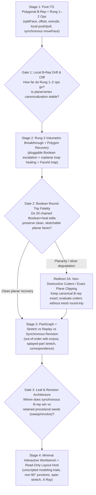

# Native modeling freedom and semantic architecture

**Research proposal only · Revised after PR #266 adversarial review · 2026-11-03 · owner review**

Prepared against `main` at `535e4bd1`. Research proposal only: no prototype code, permanent schema, dependency commitment, final UX or roadmap authorization is included in this change.

**Intent of this revision:** move from a narrow binary shootout (`M1` vs `M2`) to a **progressive, extractable experimental modeling foundation** designed to answer the core architectural questions blocking `T5`—how SketchUp-grade direct geometric freedom, non-destructive revisability, and [`@portfolio/layout-core`](../../packages/layout-core/src/layout-geometry.ts) architectural intelligence can coexist—while producing pure geometry, correspondence, and fixture engineering that `T5` can directly reuse or adapt.

---

## 1. Consequential unresolved architectural questions

### 1.1 Separating reusable work from genuinely novel mechanisms

Before writing new geometry code, we must separate capabilities Biskiq has **already proven** from the four distinct complexity tiers that Draft 1 conflated:

1. **Already proven and directly reusable (do not re-research):**
   - **Exact 2D predicates & deterministic linear extrusion:** [`predicates.ts`](../../packages/geometry-core/src/predicates.ts), [`profile.ts`](../../packages/geometry-core/src/profile.ts) and [`extrude.ts`](../../packages/geometry-core/src/extrude.ts) establish cross-browser 2D contour validation, quadratic smooth corners, and `FormMesh` region tagging.
   - **Single-contour `extrude` / `revolve` / `sweep`, closed-solid validation & rigid face-role hosting:** [`native-form-lab`](../../prototypes/native-form-lab/FINDINGS.md) ([`geometry/index.ts`](../../prototypes/native-form-lab/src/geometry/index.ts)) already proves arbitrary 3D `Frame` generation, convex profile-corner rounding, manifold edge inspection (`inspectMesh`), role-keyed paint broadcast on segment split, and `HostLink` fallback to `'unresolved'` at `lastFrame`.
   - **2D convex clipping & hole-bridging triangulation:** [`p3-depth`](../../prototypes/p3-depth/DESIGN.md) ([`plan.js`](../../prototypes/p3-depth/src/core/plan.js)) already implements dependency-free planar polygon clipping and reflex-bridge ear triangulation with interior holes.
   - **Attachment UX states & Object Focus scope journey:** [`object-composition-prototype`](../../prototypes/object-composition-prototype/HANDOFF.md) already explores wall-mount/broken/setdown UX and ID-based revision diffing; [PR #244's UX proposal](../native-object-creation-ux/PROPOSAL.md) and [`UX-SPEC.md`](../../prototypes/native-object-shaping/UX-SPEC.md) already frame the `World ↔ Object Focus` scope transition.

2. **Distinguishing multi-part composition from topological complexity:**
   A four-legged table with aprons, a slatted bench, or a multi-board bookcase requires **zero 3D Booleans** and **zero `genus > 0` topology**—only local multi-part composition and part-instance reuse. Topological complexity rises across four distinct rungs, each demanding different machinery:
   - **Rung 0 — Multi-part composition of `genus 0` solids:** independent or aligned sub-parts (tabletop + 4 instances of 1 leg + aprons). Needs component/part hierarchy and alignment/stretch rules, not CSG.
   - **Rung 1 — 2D planar topology on a single prism:** profiles with interior holes (frames, rings, perforated panels) and collinear edge splits. Needs 2D polygon arrangement + hole triangulation, still zero 3D CSG.
   - **Rung 2 — Local boundary editing on a planar-faced solid:** splitting an existing planar face with edges/loops, `Offset`ting a border loop, non-colliding `Push/Pull` (bosses and blind pockets strictly inside a host face), and synchronous `Move / Tilt Face` (miters, tapers, gable tops, pocket-depth edits). Solvable via **polygonal B-rep / half-edge surgery + plane re-intersection** without a triangle-mesh Boolean engine.
   - **Rung 3 — Volumetric breakthroughs, coplanar merges & cross-seam cuts:** pushing a pocket all the way through a parallel, stepped or angled back face to punch an opening; pushing a step until it meets and dissolves into an adjacent coplanar face; or cutting a rabbet/mortise across an existing edge seam. Here local half-edge rules hit combinatorial edge-face intersections and genus changes, requiring **volumetric Boolean / cell-arrangement resolution + coplanar polygon recovery**.

### 1.2 Why Draft 1's `M1 vs M2` framing was wrong—and the five real questions

Draft 1 pitted "structured constructive feature modeling (`M1`)" against "mutable polyhedral soup (`M2`)" as mutually exclusive engines. That framing conflated **two orthogonal axes**:

- **Composition axis:** *Single merged solid* vs *Component/Part assembly over leaf solids* (even expert SketchUp modeling relies on **Groups and Components** to stop table legs from sticking to tabletops and to edit all four legs as one definition).
- **Leaf-solid & revision axis:** *Constructive operation replay* (`seed + operations[]`, assumed in [`umbrella-plan.md`](../../docs/roadmap/t5-expressive-geometry/umbrella-plan.md) §5) vs *Stateful boundary solid + history-free synchronous editing* (where the live polygonal B-rep **is** the source, and dimensions/depths remain editable by moving live faces or stretch planes rather than replaying creation history) vs *Hybrid leaf coexistence* (procedural `sweep`/`revolve` leaves alongside directly edited B-rep leaves).

Building two parallel toy engines wastes effort. Instead, one modular experimental engine should answer **five consequential architectural questions**:

1. **Q1 — Canonical leaf representation:** Can a **planar-dominant polygonal B-rep** (faces with outer + hole loops, crisp feature edges, coplanar healing, persistent `FaceId`/`EdgeId` lineage, plus optional analytic metadata on curved/revolved groups) serve as Biskiq's general editable solid—and where must procedural generators (`revolve`, `sweep`, slice `reshape`) remain retained leaf definitions versus lowering into that B-rep?
2. **Q2 — History-free revisability vs operation replay:** How much useful revision (changing pocket depth, wall/frame thickness, miter angle, overall width/height) can be achieved **directly on a live B-rep without a construction tree**—via synchronous face-set offset/move, spatial stretch planes, and shared `Part` definitions—and under what exact edits does history-free editing fail where retained replay succeeds (or vice versa)?
3. **Q3 — The Rung 2 → Rung 3 Boolean boundary & round-trip drift:** How far do pure TypeScript polygonal B-rep operations (Rungs 1–2) take SketchUp-style modeling before users hit Rung 3 breakthroughs—and if Rung 3 escalates to a triangle-mesh Boolean kernel (such as `manifold-3d`), **can its triangulated output be healed back into drift-free, re-sketchable planar polygons with intact `FaceId` lineage across 20+ sequential edits**, or does mesh-CSG round-tripping progressively corrupt planarity and snap edges?
4. **Q4 — Non-uniform resize across assemblies and angled geometry:** Without semantic furniture types (`"table"`, `"leg"`) or a full CAD constraint solver, what are the real capabilities and failure boundaries of **spatial box-stretch (keep/stretch planes)** versus **part-local frame translation** when stretching orthogonal joinery, hollowed frames, and non-orthogonal (splayed/angled) assemblies?
5. **Q5 — Minimum semantic architectural host interface:** What is the **smallest read-only geometric interface** over real [`@portfolio/layout-core`](../../packages/layout-core/src/layout-geometry.ts) output (`compileWallFirstLayoutGeometry`) needed so arbitrary modeled objects can snap/align in situ against non-orthogonal walls and openings, adapt across a span without distorting part thicknesses, and preserve strict `Layout` vs `Scene` authority separation?

### 1.3 Candid pushbacks and challenged assumptions

Where engineering evidence pushes back against both Draft 1 and tempting simplifications in the review:

1. **Pushback on deferring Rung 3 volumetric breakthroughs too far:**
   A four-legged table needs no Booleans, **but SketchUp's signature single-body gesture—drawing a rectangle on a panel/wall of an object and pushing it until it snaps to the back face to punch a clean window/slot, or pushing across a step—is Rung 3**. If we stop at Rung 2 (blind pockets that refuse to cross another face or edge), we will build a system that looks general on blocks and fails on the third minute of real casework or joinery. We should stage Rung 2 *before* Rung 3 (so Rung 3 earns its keep), not exclude Rung 3.
2. **Pushback on "SketchUp freedom + effortless parametric revision" as a free lunch:**
   SketchUp itself does **not** preserve leg thickness when scaling an ungrouped table, nor can spatial box-stretch resize a `15°`-splayed mid-century chair leg without shearing its cross-section. Likewise, a swept curved handrail ([`native-form-lab`](../../prototypes/native-form-lab/FINDINGS.md)) wants retained `profile + carrier` editing, whereas a notched cabinet carcass with 12 cross-cutting rabbets makes operation replay brittle (`red feature tree` failure) and wants history-free B-rep face moves. Expecting **one** universal leaf mechanism to win every geometry class is likely false; our experiment should test **where pluralistic leaves under a uniform `PartGraph` + `FaceId` boundary beat any single dogma**.
3. **Pushback on mocking Layout *and* on assuming zero semantic grey zone:**
   - Draft 1 over-scoped T1/T2 lifecycle workflows (`planWallSplit` rebasing, wall-deletion `setdown` UI); **we cut those from this revision**. However, replacing `@portfolio/layout-core` with a mocked flat plane would hide two real geometric interactions that directly stress `T5`: **(a)** modeling/mitering in situ against non-90° `CompiledJunctionSurface`s, and **(b)** driving non-uniform object stretch from compiled alcove spans and `CompiledOpening` bounds.
   - We also flag an architectural truth the product must eventually confront: keeping Scene strictly non-mutating toward Layout ([`architecture.md`](../../docs/reference/architecture.md), [`scene-content.md`](../../docs/reference/components/scene-content.md)) means **a Scene object can never carve a recessed niche *into* a `LayoutWall`'s thickness**. Vitrine cavities live inside the Scene object's own depth; if Biskiq wants true wall-thickness niches, Layout itself will need a non-portal `WallRecess` sibling of `Opening` rather than cross-domain CSG.
4. **Pushback on naive "drop-in" extractability into `@portfolio/geometry-core`:**
   [`predicates.ts`](../../packages/geometry-core/src/predicates.ts) and [`profile.ts`](../../packages/geometry-core/src/profile.ts) enforce **zero geometric epsilons and zero transcendental `Math.*` functions** for bit-identical IEEE-754 output across engines. Arbitrary 3D plane-plane intersections (`tiltFace`, non-orthogonal miters), revolved/curved surfaces, and polygonal face-healing after 3D cuts inevitably confront floating-point plane tolerances (or rational/exact predicates vs canonicalized plane equations). Rather than pretending 3D B-rep code drops straight into today's zero-epsilon contract unchanged, the experiment must explicitly measure numerical drift and define what determinism contract `geometry-core` v2 actually requires.

---

## 2. Experimental architecture and mechanisms to test

Instead of two disposable prototypes, we propose building **one clean, layered experimental modeling engine** inside a standalone folder under [`prototypes/`](../../prototypes/README.md), separating UI-independent geometry/revision packages (`core/*` and `corpus/*`) from a thin interactive workbench (`workbench/*`):

### 2.1 Editable polygonal B-rep & leaf boundary contract (`core/brep/`)

- **Canonical polygonal solid:** Closed 2-manifold boundary representation with explicit planar `Face`s (outer CCW `Loop` + `0..k` CW hole `Loop`s), half-edge topology, explicit plane representations, crisp vs smooth `Edge` flags, and deterministic lowering to [`FormMesh`](../../packages/geometry-core/src/extrude.ts)-compatible indexed buffers (`positions`, `indices`, `regions` mapped to `FaceId`, sharp creases).
- **Explicit `FaceId` & `EdgeId` lineage graph:** Every topological edit emits machine-checkable lineage (`preserved`, `split: parent → [children]`, `merged: [parents] → child`, `created`, `retired`), generalizing [`native-form-lab`](../../prototypes/native-form-lab/FINDINGS.md)'s segment-key rules to arbitrary 3D face splits, offsets, pockets, and coplanar heals.
- **Leaf polymorphism behind one boundary:** Both a **stateful polygonal B-rep leaf** and a **retained procedural leaf** (adapting `extrude` / `revolve` / `sweep` from `native-form-lab`) implement the same evaluated `Solid + FaceId` contract—allowing direct comparison of when keeping a procedural seed helps vs when converting/editing as a stateful B-rep wins.

### 2.2 Direct modeling operator algebra & two-tier kernel (`core/ops/`)

A small, orthogonal set of geometric operators—containing **zero object-type logic**:

- **2D face-plane arrangement (`splitFace`, `offsetFaceLoop`):** Project onto any planar `Face`'s local orthonormal `Frame`; split faces by open edge chains or closed inner loops (reusing `robust-predicates` + hole-bridging triangulation); inset/outset loops to form borders, rails, stiles, and tabletop aprons in one gesture.
- **Tier 1 pure-TS B-rep solid ops (`extrudeLoop`, local `pushPullFace`, synchronous `moveFaces` / `tiltFace`):**
  - Extrude any outer+hole profile on an arbitrary 3D `Frame` into a new solid or child part.
  - Local `pushPullFace` for bosses, blind pockets, and flush coplanar step merges within Rung 2 topology, automatically dissolving redundant coplanar edges (`healCoplanarFaces`).
  - **Synchronous `moveFaces` / `tiltFace`:** Translate or rotate one or more existing faces (e.g., pocket floor, step riser, mitered end, outer wall) while recomputing intersections with adjacent support planes and validating against edge collapse or self-intersection—testing **history-free dimensional revision**.
- **Tier 2 pluggable volumetric breakthrough & Boolean resolver (`booleanResolve`):**
  - Invoked **only** when `pushPullFace` or solid-solid cut/union crosses Rung 2's boundary (e.g., pushing a pocket through a back/stepped face to open a window/slot, or cutting across an existing edge seam).
  - Isolates volumetric resolution (`manifold-3d` WASM vs lightweight pure-TS BSP/mesh clipping probe) behind a strict post-processing pipeline: **volumetric op → coplanar triangle clustering → polygon+hole `Loop` reconstruction → collinear vertex cleanup → `FaceId` provenance mapping**.

### 2.3 Multi-part composition, revision & stretch (`core/revision/`)

- **`PartGraph` (component-level structure over editable solids):**
  - An object can remain a single leaf solid or contain multiple named/unnamed `PartInstance`s referencing local `PartDefinition`s (so editing one table leg or louver updates all linked instances immediately, while `Make Unique` forks one instance). Touching parts **never** auto-fuse unless explicitly boolean-joined.
- **Controlled comparison of four revision & resize mechanisms:**
  1. *History-free synchronous face editing* (revising pocket depths, border widths, and thicknesses on a mutated B-rep regardless of creation order).
  2. *Operation-stack replay* (recording `seed + ops[]` and re-evaluating after upstream contour/parameter edits, measuring exact topological naming failure modes when downstream cuts cross upstream seams).
  3. *Spatial Stretch-Plane / Box-Stretch* (slicing a solid or `PartGraph` with 1–3 axis/frame stretch planes so interior spans grow while corner legs, stiles, rabbets, and holes translate rigidly without distortion).
  4. *Part-frame anchor translation* (comparing against Stretch-Planes on angled/splayed parts where planar slicing shears cross-sections).

### 2.4 Narrow authentic architectural host adapter (`core/arch-host/`)

Rather than simulating T1/T2 wall-split and wall-deletion repair workflows, `core/arch-host/` wraps **real [`@portfolio/layout-core`](../../packages/layout-core/src/layout-geometry.ts) `compileWallFirstLayoutGeometry` output** in a ~150-LOC read-only query interface exposing only what affects `T5` geometry:

- **Read-only architectural reference planes & edges:** Wall side planes/frames (including non-90° `CompiledJunctionSurface` trims/miters), `CompiledRoom` floor/ceiling elevations, and `CompiledOpening` jamb/sill/head bounds—consumable as **non-fusing construction/snap references** while sketching or pushing faces in situ.
- **Span & clearance feedback:** Given an assembly hosted on a Wall face or spanning two opposing Wall faces, drives `stretchAssembly` when the compiled room/alcove span changes and reports deterministic clearance intersections against `CompiledPhysicalWall.openings` (contrasting Layout's native `LayoutWallOpening` cut against a Scene object's self-contained B-rep cavity).

---

## 3. Extractable engineering vs disposable research scaffolding

Every module is partitioned upfront so `T5` can harvest proven math and tests without inheriting prototype UI debt or premature schemas:

| Module | Dependencies allowed | Extractability target & boundary |
| --- | --- | --- |
| **`core/brep/`** (polygonal B-rep, `FaceId`/`EdgeId` lineage, coplanar healing, `FormMesh` tessellator, manifold/planarity validator) | Pure TypeScript + `robust-predicates` + `earcut` (zero Svelte, Threlte, Three, or DOM) | **High — direct candidate for `@portfolio/geometry-core`**, subject to owner review of the 3D plane-intersection tolerance / determinism findings (§1.3). |
| **`core/ops/`** (`splitFace`, `offsetFaceLoop`, `extrudeLoop`, local `pushPullFace`, synchronous `moveFaces`/`tiltFace`) | `core/brep/` only | **High — direct algorithm & operator candidates** for `T5` object focus shaping and extrusion generalization. |
| **`core/ops/boolean/`** (WASM `manifold-3d` / CSG adapter + coplanar triangle-to-polygon B-rep recovery) | `core/brep/` + isolated Boolean backend | **Medium / Conditional — isolated behind an interface** so if mesh-CSG round-tripping proves lossy or WASM stays Worker-only, `core/brep/` remains clean and zero-WASM. |
| **`core/revision/`** (`PartGraph`, `stretchSolid`/`stretchAssembly`, replay vs synchronous harness, correspondence certificates) | `core/brep/` + `core/ops/` | **High — algorithmic & F.4-correspondence evidence** directly informing `T5` compound object representation and resize semantics without dictating `Scene` JSON codecs. |
| **`core/arch-host/`** (read-only surface frames, junction planes, Opening clearance over `CompiledLayoutGeometry`) | `@portfolio/layout-core` types/compiler only | **High — candidate specification/seed** for `T1` / `project-model`'s missing Wall/Ceiling surface read query ([`support.ts`](../../packages/project-model/src/scene-planning/support.ts), [`unit-resolution.ts`](../../packages/project-model/src/references/unit-resolution.ts)). |
| **`corpus/`** (deterministic construction, torture & out-of-order revision suites + metric collectors) | `vitest` + `core/*` | **High — directly portable regression & benchmark corpus** for future `geometry-core` / `T5` phases. |
| **`workbench/`** (Svelte 5 + Threlte interactive viewport, tool state, debug sliders, X-Ray inspector) | Svelte 5, Threlte, Three.js, `core/*` | **Intentionally disposable research harness** — zero authority over Stage/Focus shell UX ([PR #244](../native-object-creation-ux/PROPOSAL.md)) or production session stores. |

---

## 4. Proving generality, adversarial stress and workbench scope

### 4.1 Guarding against "prepared demo" bias

To ensure we test **general modeling freedom** rather than three hardcoded examples:

1. **Zero domain-specific logic in `core/*`:** No function, heuristic, or stretch rule may inspect object names, aspect ratios ("looks like a leg"), or scenario presets.
2. **Diverse open-form construction families:** The same six primitive actions (`sketch/split on face`, `offset loop`, `push/pull`, `move/tilt face`, `part/instance`, `stretch/scale`) must construct unfamiliar shapes across distinct structural topologies:
   - *Multi-part joinery:* 4-legged apron table, splayed-leg stool/chair frame, louvered or shelved rack (linked `PartInstance`s).
   - *Hollowed & perforated single solids (`genus ≥ 1`):* recessed vitrine, multi-pane window/picture frame, slotted architectural screen, stepped display plinth with intersecting cutouts.
   - *Non-orthogonal & angled solids:* mitered corner counter (`120°` alcove), pitched/tapered lectern, notched half-lap / rabbeted timber joint.
3. **Adversarial geometry & out-of-order revision torture suite (`corpus/`):**
   - **25-step sequential mutation chain** (`split → offset → pocket → breakthrough → flush-merge → move-face`) tracking cumulative planarity error $\max |n \cdot v - d|$, vertex count inflation, and sliver edges.
   - **Partial & angled breakthroughs:** pushing a pocket through a back face that is stepped (half exits into air, half cuts solid) or tilted at `15°`.
   - **Coplanar grazing & edge dissolution:** pushing a split step until it becomes exactly coplanar with an adjacent face, verifying clean polygon healing so a new sketch can immediately span across the dissolved seam.
   - **Out-of-order upstream conflict:** cut a secondary notch across a pocket's rim, *then* revise the pocket's depth and outer frame width—comparing synchronous `moveFaces` against `operations[]` replay.
   - **Splayed-member stretch falsifier:** apply axis-aligned `Box-Stretch` vs `PartGraph` frame-translation to an assembly containing `15°`–`45°` angled braces/legs, explicitly documenting shear distortion vs joint separation.

### 4.2 Interactive workbench: genuine modeling vs minimal inspection controls

Interactivity is essential because direct modeling lives or dies on **spatial inference, push-to-face depth snapping, and immediate comprehension of what moves vs stays fixed**. However, shell UX is explicitly out of scope:

| Genuine interactive implementation (core to the research question) | Minimal debug / inspection controls (avoiding UX & T1/T2 scope creep) |
| --- | --- |
| **3D raycast picking** of planar `Face`s, `Edge`s, `Vertex`es, `PartInstance`s (double-click to enter/exit `PartDefinition` scope, matching [PR #244](../native-object-creation-ux/PROPOSAL.md)'s part-scoping premise), and read-only `Layout` reference planes/edges. | **Plain floating debug strip** + hotkeys (`Line`, `Rect`, `Poly`, `Offset`, `Push/Pull`, `Move/Tilt Face`, `Part/Instance`, `Stretch`). Zero Stage Dock, Card chrome, or PLATE styling work. |
| **On-face sketching & inference:** 2D drawing on any hovered/locked face plane with snap to vertices, midpoints, parallel/perpendicular axes, and `Layout` wall/jamb lines, plus live **`Offset`** loop drag. | **3-slider Architectural Context Drawer** (`Alcove Span`, `Corner Angle 75°–135°`, `Opening Offset & Width`) driving real `compileWallFirstLayoutGeometry` recompilation—zero Wall-drawing or Wall-split UI tools. |
| **Snap-aware `Push/Pull` & synchronous `Move Face`:** Live drag along face normal with **depth snapping to any pointed reference face/vertex** (the crucial SketchUp gesture that makes "push flush to back face to punch an opening" exact rather than guesswork) + typed metric input. | **Geometry & Lineage X-Ray Drawer:** Toggles for `FaceId` provenance colors, polygonal B-rep edges vs raw render triangles, planarity/manifold health readout, stretch-plane gizmo visibility, and Replay vs Synchronous diff view. |
| **Interactive `Box-Stretch` plane handles vs proportional `Scale` handles**, plus linked `Duplicate Instance` / `Make Unique` part actions. | **JSON snapshot export/import** to save any ad-hoc interactive creation directly into `corpus/` as a deterministic regression fixture. |

---

## 5. Progressive 4-stage execution strategy with redirect gates

Each stage produces standalone reusable code and can **invalidate or redirect** downstream stages before further engineering is spent:

1. **Stage 1 — Editable Polygonal B-Rep & Pure-TS Direct Ops (Headless + `corpus/`):**
   Build `core/brep/` and Rung 1–2 `core/ops/` (`extrudeLoop` with holes, `splitFace`, `offsetFaceLoop`, non-tunneling `pushPullFace` with coplanar healing, synchronous `moveFaces`/`tiltFace`). Run iterative drift and Rung 2 boundary tests.
   - *Redirect trigger:* If chained angled `moveFaces`/`tiltFace` edits accumulate planarity error beyond clean face-loop triangulation, solve plane-primary vs vertex-primary canonicalization here before introducing Booleans.
2. **Stage 2 — Volumetric Breakthroughs & Coplanar Polygon Recovery (Headless + `corpus/`):**
   Add `core/ops/boolean/` (`manifold-3d` WASM + coplanar face-loop reconstruction + `FaceId` provenance recovery) for through-pushes and cross-seam cuts; run the 25-step chained breakthrough/re-sketch torture test.
   - *Redirect trigger (high value):* If round-tripping through triangle-mesh Booleans fragments coplanar faces or degrades edge snapping across repeated edits, **do not build an editor on destructive mesh-CSG round-trips**—redirect immediately to either **(a)** exact plane-clipped convex-cell / polyhedral clipping for planar solids or **(b)** retaining negative cutter volumes evaluated at tessellation time!
3. **Stage 3 — `PartGraph`, Stretch Semantics & Out-of-Order Revision Comparison (Headless + `corpus/`):**
   Build `PartGraph` instancing, `stretchSolid` / `stretchAssembly`, and the head-to-head out-of-order revision harness comparing *Synchronous B-Rep Face Moves* against *Seed+Ops Replay* (including procedural `revolve`/`sweep` leaves adapted from `native-form-lab`).
   - *Redirect trigger:* Determines which revision controls and hybrid leaf rules deserve interactive exposure in Stage 4, rather than wiring dead-end UI modes.
4. **Stage 4 — Interactive Workbench & Read-Only `@portfolio/layout-core` Trials:**
   Build `core/arch-host/` and `workbench/`, run unscripted construction and architectural-context trials (orthogonal bay, non-90° corner, `LayoutWallOpening` span/clearance), capture JSON fixtures from real interactive sessions into `corpus/`, and publish reproducible measurements in `FINDINGS.md` and `evidence.json`.

---

## 6. Research evaluation framework and retention path

### 6.1 Five evaluation dimensions (falsifiers and measurements, not arbitrary release gates)

A candidate mechanism failing on an adversarial case and exposing *why* is a **successful research outcome**, not a broken build. We evaluate across five reproducible dimensions:

1. **Topological & numerical stability curves:** Across $N = 1 \dots 25$ chained edits, record closed 2-manifold pass rate, maximum face-planarity deviation ($\max |n \cdot v - d|$ in meters), coplanar face-merge completeness (whether split/healed faces remain single pickable polygons), and vertex/triangle growth ratios.
2. **Modeling generality & operator boundary map:** Document exactly which geometry classes Rung 0 (`PartGraph`), Rung 1 (holes), Rung 2 (local B-rep + synchronous move), and Rung 3 (volumetric Boolean) unlock, and catalog the concrete failure cliffs of each.
3. **Revision & resize tradeoff matrix:** On identical out-of-order edit and non-uniform resize suites, compare *Synchronous B-Rep*, *Operation Replay*, *Stretch-Plane*, and *Part-Frame Translation* by **(a)** fraction of upstream/mid-stream edits completed without manual rebuild, **(b)** geometric invariant preservation (leg cross-sections, frame border widths, angled member shear), and **(c)** correspondence honesty (`0` silent `FaceId` swaps; explicit `collapsed` / `unresolved` reporting).
4. **Architectural host sufficiency & isolation:** Verify `0` Scene mutations or imports inside `@portfolio/layout-core`, test whether read-only plane/edge/clearance queries over `compileWallFirstLayoutGeometry` suffice for non-orthogonal corners and span adaptation, and document cross-domain boundary cases (such as wall-thickness niches vs proud/alcove casework).
5. **Empirical compute & comprehension profile:** Measure `p50 / p95` compute cost per operator as a function of face/part count (pure-TS vs WASM, main-thread vs Worker) and cold/gzipped payload sizes as reference curves for T5 planning, alongside qualitative interaction notes on face-splitting, push-to-depth snapping, part scoping, and stretch planes.

### 6.2 Retaining and consuming the results

- **Durable isolation:** Hosted in its own non-workspace folder under [`prototypes/`](../../prototypes/README.md) (`AGENTS.md` non-authority rule), keeping experimental packages (`manifold-3d` if tested in Stage 2) out of root `package-lock.json` and visitor/editor bundles while keeping `core/*` TypeScript modules clean for future extraction.
- **Governance compatibility (active rules vs PR #259 proposal):**
  - *Under rules currently in force* (`AGENTS.md` Rule 10, [`docs/README.md`](../../docs/README.md), [`docs/operations/README.md`](../../docs/operations/README.md)): `FINDINGS.md`, `evidence.json`, and `core/*` remain non-authoritative evidence until consumed through owner decision, bounded `T5`/`T1` replanning, and explicit contract cutover.
  - *Under PR #259's proposed lean workflow* (unmerged proposal, distinguished from active rules): each stage (`Stage 1 → 4`) acts as a bounded `needs-research` decision exit that directly informs `T5` capability records and Risk Tier classification without ceremonial slice churn.

---

## 7. Intentionally undecided questions and initial owner alignment

### 7.1 Kept intentionally open until empirical evidence exists

This proposal refuses to pre-decide:
- **Permanent `Scene` or `F.1` persisted schemas** (whether leaf B-reps serialize as compact winged polygons, half-spaces, hybrid procedural+B-rep descriptors, or constructive deltas).
- **Production dependency commitments** (whether `manifold-3d` or any WASM ships in authoring Workers, or whether visitor releases always consume pre-tessellated `FormMesh` derivatives).
- **Final `@portfolio/geometry-core` v2 determinism contract** (exact rational/adaptive predicates vs canonicalized double-precision plane tolerances once 3D tilted faces and Booleans are measured in Stages 1–2).
- **Final Object Focus UI chrome, toolbars, gestures, and keyboard grammar** (owned by future `T5` UX design building on [PR #244](../native-object-creation-ux/PROPOSAL.md)).

### 7.2 Three alignment checks before starting Stage 1

1. **Investment & extractable-kernel scope:** Does this 4-stage progressive architecture—investing real engineering in a framework-free `core/` (`brep`, `ops`, `revision`, `arch-host`) + adversarial `corpus/` before the thin Stage 4 `workbench/`—match the level of foundational rigor and reusable `T5` value you want?
2. **Stage-gated execution cadence:** Should we execute **Stages 1–2 first** (pure-TS polygonal B-rep + synchronous ops, then the Boolean-to-polygon round-trip gate) and report the empirical Gate 2 findings before proceeding into Stage 3–4, or run Stages 1–4 continuously unless a redirect gate trips?
3. **Architectural boundary scope:** Are you aligned with dropping T1/T2 wall-split/delete repair workflows in favor of the narrower read-only `@portfolio/layout-core` surface/junction/opening-clearance host adapter (§2.4)—treating true wall-thickness niches as a separate Layout-owned question rather than cross-domain CSG?
