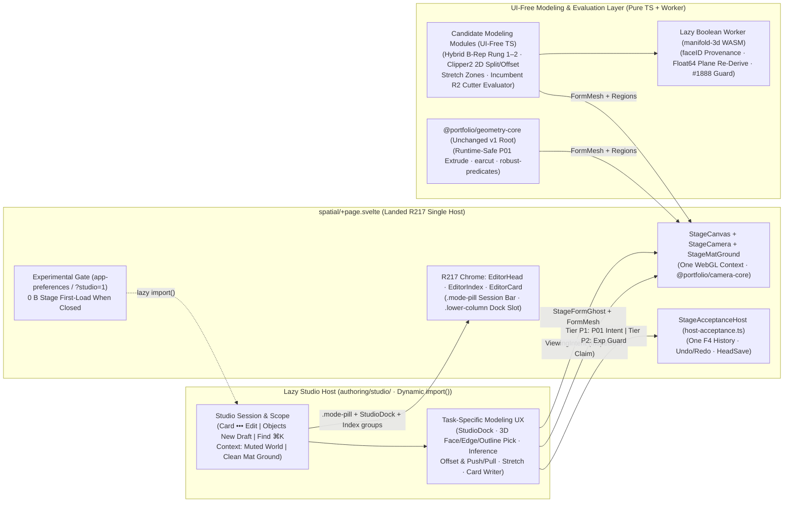
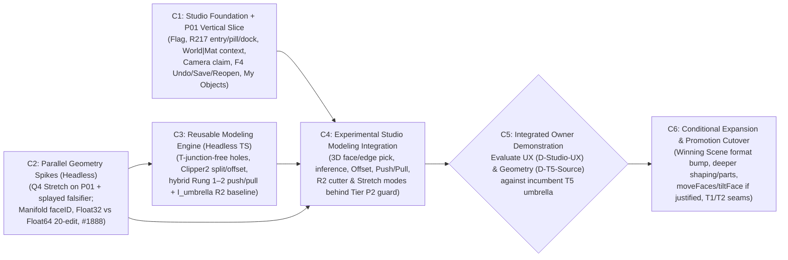

# Candidate T5 architecture: Native Object Studio & direct modeling foundation

**Research & architecture proposal · PR #266 follow-up revision · 2026-11-03 · owner review**

Prepared against `main` at `535e4bd1` (including landed `R217` shell slices through `S28`; where [`editor-shell-and-visual-system.md`](../../docs/reference/design-system/editor-shell-and-visual-system.md) lags behind `R217`, landed [`apps/editor`](../../apps/editor/src/routes/project/[projectId]/spatial/+page.svelte) code takes precedence as the authoritative shell baseline). Proposal only: no implementation code, schema bump, dependency installation, contract ratification or roadmap release is included in this change.

**Intent:** replace the standalone `prototypes/` plan with an **in-application, promotion-ready strategy**—developing a flag-gated **Native Object Studio** directly inside [`apps/editor`](../../apps/editor/src/lib/authoring/README.md) alongside a UI-free modeling engine—so proven UX and geometry capabilities merge incrementally into Biskiq and can directly supersede affected [`umbrella-plan.md`](../../docs/roadmap/t5-expressive-geometry/umbrella-plan.md) commitments without a post-prototype rebuild.

---

## 1. Strategic assessment: in-app Studio vs isolated prototype

### 1.1 Why building inside Biskiq beats a second standalone prototype

[`native-form-lab`](../../prototypes/native-form-lab/FINDINGS.md) already paid the standalone-prototype tax once: custom Threlte canvas, bespoke camera controller, JSON-snapshot undo, and mock persistence—none of which could merge into production. Building a second isolated app under `prototypes/` would repeat that throwaway scaffolding while leaving the hardest integration questions untested:

- **Workspace UX (`Studio` vs World-inline) requires real World context:** [PR #244](../native-object-creation-ux/PROPOSAL.md)'s core premise—entering from a placed Scene object with preserved identity and viewing angle, seeing real [`@portfolio/layout-core`](../../packages/layout-core/src/layout-geometry.ts) rooms recede as muted read-only context (or switching to `StageCanvas`'s clean cutting mat), and returning cleanly to World—cannot be judged honestly in an empty toy viewer.
- **Landed `R217` shell seams already provide the composition primitives:** `R217` (`S01–S28`) has already established sub-session bars (`.mode-pill` in `lookThroughSession`), `.lower-column` dock swapping (`StageDock` vs `ExperienceDock`), `EditorIndex` group swapping, `EditorCard` gesture-fading (`gesturing`) and `•••` menus, and `StageMatGround`'s measured cutting mat—making an in-app Studio dramatically cleaner to host than pre-`R217` docs suggested.
- **Real `F4`, `Save`, `Preview` and `My Objects` keep geometry honest:** Routing edits through [`host-acceptance.ts`](../../apps/editor/src/lib/authoring/stage/host-acceptance.ts), [`form-evaluation.ts`](../../apps/editor/src/lib/content/form-evaluation.ts), and [`MyObjectsSectionLazy.svelte`](../../apps/editor/src/lib/authoring/adapters/scene/library/MyObjectsSectionLazy.svelte) proves Undo/Redo, Save/reopen, Paper Plan footprints, and Visitor parity continuously rather than deferring integration surprises to the end.
- **Zero rebuild on success:** Production-safe seams (Studio scope host, Camera framing/return, lazy chunking, `P01` Studio editing, stretch and Rung 1–2 geometry) land as small, mergeable PRs rather than an unmergeable research branch.

### 1.2 Candid pushback: three coupling hazards we must refuse (a hybrid seam)

Integrating *everything* into production codecs and Stage imports on Day 1 would **weaken the geometry experiment and create avoidable churn**. An in-app strategy is preferable **only if we enforce three hard decoupling boundaries**:

1. **Do not churn canonical `Scene` v4 or `My Objects` v1 schemas before the Owner Demo (Two-Tier Persistence):**
   Mutating persisted [`SceneFormSource`](../../packages/project-model/src/scene.ts) for unproven B-rep loops or `R2` cutter arrays would force repeated format bumps and golden regenerations (`umbrella-plan.md:228-229`) before we know which representation wins. Instead:
   - **Tier P1 (merges to production `Scene` v4):** Studio's end-to-end vertical slice (`C1`) reads and writes canonical `T5.P01` `SceneFormSource` (outline anchors/smooth curves, plane, extent, `form.scale`, materials, `My Objects`). This proves 100% of Studio ↔ `F4` ↔ `Save` ↔ `World` plumbing on real production data with zero schema risk.
   - **Tier P2 (experimental-flag-only Studio source):** Richer representations under comparison (stretch zones, Rung 1–2 face splits/offsets/push-pulls, and `I_umbrella` `R2` cutter/adder bodies) run behind an **experimental codec/session guard** (persistable in local/dev experimental projects, refused by default cloud save) until the Owner Demo (`C5`) selects the winning representation for **one** deliberate `Scene` format bump.
2. **Do not touch `@portfolio/geometry-core`'s visitor root or Stage first-load (`+0 B` rule):**
   [`geometry-core-boundary.test.ts`](../../apps/editor/tests/lib/geometry-core/geometry-core-boundary.test.ts) restricts [`packages/geometry-core`](../../packages/geometry-core/src/index.ts) to `earcut` + `robust-predicates` because Visitor `/p/[publicationId]` (`≤ 250 KiB br`) and Stage (`439.0 KiB br`, already under exception above the `425 KiB br` cap) import it directly. All Studio UI and experimental/heavy geometry (`Clipper2`, `manifold-3d` Worker) **must** sit behind dynamic `import()` boundaries so Stage first-load and Visitor chunks gain **`0 B`** when Studio is inactive.
3. **Do not let Studio UI slow or bias the geometry comparison:**
   Geometry operators, `20`-edit numerical drift probes, and the `I_umbrella` vs direct-B-rep comparison remain **pure, headless TypeScript modules** tested in `vitest` (`C2`, `C3`) in parallel with Studio shell work (`C1`). UI convenience never masks topological fragility, and a great Studio UX never forces adoption of a brittle geometry kernel (or vice versa).

### 1.3 Explicit relationship to `umbrella-plan.md` (A1/A3/A4/A6) and the landed `R217` shell

This initiative **preserves Biskiq's core architectural invariants and composes natively with the landed `R217` shell**, while **explicitly challenging four `T5` umbrella commitments**:

| Invariant / commitment | Status in this proposal | Governance & required owner decision |
| --- | --- | --- |
| **One Stage `<Canvas>`, one Camera authority, one `Scene` unit, one `F4` history, one `HeadSave`, Visitor isolation & landed `R217` shell chrome** ([`architecture.md`](../../docs/reference/architecture.md), [`stage-shell-composition.test.ts`](../../apps/editor/tests/lib/authoring/stage-shell-composition.test.ts), [`editor-host-no-write.test.ts`](../../apps/editor/tests/lib/authoring/editor-host-no-write.test.ts)) | **Preserved 100%.** Studio is *not* a second SvelteKit app, second WebGL `<Canvas>`, `OrbitControls` rig, or shadow Scene document, and reuses landed `R217` `EditorHead`, `EditorIndex`, `EditorCard`, `.mode-pill`, `.lower-column`, and `StageMatGround` mechanics. | Enforced continuously by `npm run test:arch` on every PR (with landed `R217` code taking precedence where shell docs lag). |
| **Umbrella A1 & A6** (`umbrella-plan.md:25, 30, 33, 40-63`) | **Challenged explicitly (`D-Studio-UX`).** A1/A6 reject a dedicated studio workspace in favor of editing inside World's shared `StageDock` / `Objects` palette. We hypothesize a **dedicated in-app Object Studio sub-session** (own modeling dock/tools, precision readouts, `Context: World \| Mat` toggle, standalone unplaced entry) unlocks markedly better modeling flow while sharing the one `StageCanvas`, `Camera`, and `F4` stack. | Experimental flag until proven; promotion to default creator UX requires owner decision **`D-Studio-UX`** amending `umbrella-plan.md` A1/A6 (and folding Studio into shell docs alongside `R217`). |
| **Umbrella A3, A4 & proportional `scale`** (`umbrella-plan.md:27-28, 33-38, 154-166`; [`UX-SPEC.md`](../../prototypes/native-object-shaping/UX-SPEC.md) `:183`; [`roadmap-handoff.md`](../native-creative-depth/roadmap-handoff.md) `:323-327`; [`approaches-and-precedents.md`](../native-creative-depth/approaches-and-precedents.md) `:68, 79`) | **Challenged explicitly (`D-T5-Source`).** Tests hybrid `Float64`-plane/`(u,v)` planar face editing (`splitFace`, `offsetFaceLoop`, `pushPullFace`) and thickness-preserving stretch against the **true incumbent `T5` model (`I_umbrella`: object-space ops + non-destructive `R2` positioned cutters/adders + `T2` parts)**. | Experimental source guard until proven against [`north-star.md`](../../docs/reference/north-star.md) (`:129-132`, *demonstrated creative barrier*); promotion requires owner decision **`D-T5-Source`**. **UX (`D-Studio-UX`) and geometry (`D-T5-Source`) are judged independently.** |

---

## 2. Candidate Studio and modeling architecture on real Biskiq seams

### Concrete mapping to landed `R217` and engine seams

1. **Entry doors on landed `R217` surfaces ([`EditorCard.svelte`](../../apps/editor/src/lib/authoring/stage/shell/EditorCard.svelte), [`SceneTransformInstrument.svelte`](../../apps/editor/src/lib/authoring/adapters/scene/SceneTransformInstrument.svelte), [`EditorHead.svelte`](../../apps/editor/src/lib/authoring/stage/shell/EditorHead.svelte)):**
   When the experimental Studio preference (`?studio=1` or `app-preferences`) is enabled, three zero-overhead entry points appear: **(a)** `Edit in Studio` in `EditorCard`'s `menu` (`•••`) for any selected native form; **(b)** standalone **New Object in Studio** inside `SceneTransformInstrument`'s `Objects` palette (alongside S17A's `Box`/`Round`/`Free`/`Sphere` tiles and [`MyObjectsSectionLazy.svelte`](../../apps/editor/src/lib/authoring/adapters/scene/library/MyObjectsSectionLazy.svelte), requiring no `Layout` room); and **(c)** a scoped `HeadFindEntry` in `EditorHead`'s `Find` (`⌘K`). When inactive, nothing in Studio's module graph is fetched (`0 B` added to Stage first-load).
2. **Active Studio shell posture ([`spatial/+page.svelte`](../../apps/editor/src/routes/project/[projectId]/spatial/+page.svelte), [`ExperienceHomesHost.svelte`](../../apps/editor/src/lib/authoring/experience/ExperienceHomesHost.svelte), [`EditorIndex.svelte`](../../apps/editor/src/lib/authoring/stage/shell/EditorIndex.svelte)):**
   Studio mounts as a focused Stage sub-session combining two already-landed `R217` patterns:
   - **Session bar (`.mode-pill`, matching `R217.S28` `lookThroughSession`):** Top-center pill announces `Studio · <Object Name | New Object>`, toggles `Context: World | Mat`, and provides `Back to World (Esc)` (plus `Place in World` / `Save to My Objects` for unplaced standalone drafts).
   - **Lower column & chrome swap (matching `R217.S25` `ExperienceHomesHost`):** `EditorHead` stays live for `Undo`/`Redo` and `HeadSave`; `.lower-column` swaps World's `StageDock` for `StudioDock` + modeling tool palette (`Select`, `Sketch`, `Push/Pull`, `Offset`, `Stretch`, `Cut/Part`) while hiding World-only `StageHeightSheet` and `StageScaleBar`; `EditorIndex` scopes to the target object's parts/features (just as `EditorIndex` swaps to `ExperienceIndexGroups`); and `EditorCard` edits active feature/stretch dimensions while auto-fading on live 3D drags via `R217.S22`'s `gesturing` prop.
3. **Rendering & `World | Mat` context seam ([`StageCanvas.svelte`](../../apps/editor/src/lib/authoring/stage/shell/StageCanvas.svelte), [`form-evaluation.ts`](../../apps/editor/src/lib/content/form-evaluation.ts), [`form-geometry.ts`](../../apps/editor/src/lib/museum/entities/form-geometry.ts)):**
   Uses the **one `StageCanvas`** (`PCFShadowMap`). In **`Context: Mat`**, `VisitorLayoutShell` and non-target `StageEntities` hide so the edited object sits cleanly on `StageCanvas`'s landed dark cutting mat and world-anchored per-pixel grid (`StageMatGround`). In **`Context: World`**, surrounding rooms and Scene objects remain visible as dimmed, non-pickable spatial context (`scenePick` scopes active picking to the Studio target + optional read-only architectural reference planes), streaming live edits through `StageFormGhost` / `FormMesh`.
4. **Camera seam ([`StageCamera.svelte`](../../apps/editor/src/lib/authoring/stage/shell/StageCamera.svelte), [`stage-facade.ts`](../../apps/editor/src/lib/authoring/stage/stage-facade.ts)):**
   Acquires a Studio inspection claim via `stage.acquireInspection` and drives all framing (smooth arrival onto target bounds, local orbit/pan/zoom, align-to-face / section reading, and exact `Back to World` pose restoration) strictly through `stage.requestViewingIntent`—zero `OrbitControls` or side-channel matrices.
5. **Acceptance, history & library seam ([`host-acceptance.ts`](../../apps/editor/src/lib/authoring/stage/host-acceptance.ts), [`scene.adapter.ts`](../../apps/editor/src/lib/authoring/adapters/scene.adapter.ts)):**
   Every committed Studio edit dispatches an `AuthoringIntent` into the project's single `F4` coordinator. `Undo`/`Redo` works seamlessly inside Studio *and* after returning to World. Standalone **New Object in Studio** holds an unplaced draft session until the creator chooses **Place in World** or **Save to My Objects**.
6. **UI-free geometry, Worker & `T1`/`T2` boundaries ([`packages/geometry-core`](../../packages/geometry-core/src/index.ts), [`worker-client.ts`](../../apps/editor/src/lib/authoring/adapters/scene/import/worker-client.ts), [`t1-spatial-world/README.md`](../../docs/roadmap/t1-spatial-world/README.md) `:91-95`, [`t2-composition/README.md`](../../docs/roadmap/t2-composition/README.md)):**
   All modeling math, validation, correspondence, and stretch/boolean evaluators live in framework-free TypeScript modules, using the model-import Worker pattern for `manifold-3d` WASM (`155 KiB` brotli + `17 KiB` glue, [`probe-methods.md`](../native-creative-depth/probe-methods.md) `:129`). Studio never reconstructs room-facing wall side surfaces (`T1` owns the face-frame provider; [`CompiledJunctionSurface`](../../packages/layout-core/src/layout-geometry-types.ts) `:439-454` holds end-caps/trims/keels, not wall sides) and never forks `T2` / `F.1` `PartDefinition`/`PartInstance` ownership.

---

## 3. Converging UX and geometry research into one T5 direction

Existing studies stop pulling in different directions once separated by role:

- **Fast World start stays untouched ([`T5.P01`](../../docs/roadmap/t5-expressive-geometry/t5.p01-drawn-native-objects/README.md) & S17A):** Quick footprints (`Box`, `Round`, `Free`, `Sphere`) and World size rays remain immediate; a simple plinth never has to open Studio.
- **Studio entry, context & lifecycle build on [PR #244](../native-object-creation-ux/PROPOSAL.md):** Dual entry (**Edit in Studio** on a selected object + standalone **New Object** without requiring a Room), recognizable spatial continuity, explicit `Context: World | Mat` control, and grow-on-demand parts (*touching bodies do not silently fuse*).
- **Precision, reach & honest repair draw from [`UX-SPEC.md`](../../prototypes/native-object-shaping/UX-SPEC.md)—without its genus-0 lock:** Anchor-bracketed dimensions, explicit `Keep` regions, clear candidate/refusal feedback, and shared World/Studio history carry over, while Studio is free to improve presentation (direct 3D face/plane manipulation + optional section plane rather than mandatory 2D paper-slice takeover).
- **Geometry supplies the missing modeling verbs (PR #266's Rung 0–3 + `I_umbrella` + `Q4`):**
  1. **Rung 0 (Parts):** Multi-part assemblies solve 4-legged tables and benches with zero CSG.
  2. **Rung 1–2 (Planar holes, `Clipper2` split/offset, local `Push/Pull`):** Hybrid `Float64`-plane + in-face `(u, v)` B-rep (with upfront refusal on over-determined degree-4+ moves, §5.2) unlocks frames, rebates, blind pockets, and stepped casework.
  3. **Rung 3 / Route `R2` (`manifold-3d` booleans):** Tested head-to-head—1-pass non-destructive `I_umbrella` positioned cutter/adder bodies (`Float64` source → single evaluation) versus `Float64` plane-re-derived B-rep round-tripping, guarded by the Manifold #1888 volume/manifold validator ([`geometry-identity-and-performance.md`](../native-creative-depth/geometry-identity-and-performance.md) `:48`, `:184`).
  4. **Thickness-preserving Stretch (`Q4`):** Spatial stretch planes keep table legs square and vitrine borders fixed during non-uniform resize (`umbrella-plan.md:154-156` gap).

Crucially, **UX and geometry remain decoupled at promotion**: if Studio's workspace UX excels while `I_umbrella` (`R2` cutters + stretch + holes) beats stateful B-rep on revision reliability, **Studio ships on `I_umbrella` (`D-Studio-UX` = yes, `D-T5-Source` = R1/R2)**—and conversely if B-rep operators shine while lighter Focus chrome suffices.

---

## 4. Lean capability sequence, dependencies and parallelism

Improving on the 6-item sketch: **combine Studio foundation with `P01` vertical `F4` plumbing early** (so Studio is never an empty UI shell), while running **headless geometry spikes and core operators in parallel worktrees** so neither blocks the other:

| Capability (1–2 small PRs each) | Scope & deliverables | Dependencies & parallelism |
| --- | --- | --- |
| **C1 — Studio Foundation & End-to-End `P01` Vertical Slice** | Experimental flag ([`app-preferences.ts`](../../apps/editor/src/lib/platform/app-preferences.ts) / `?studio=1`); lazy `studio/` controller on [`spatial/+page.svelte`](../../apps/editor/src/routes/project/[projectId]/spatial/+page.svelte) (`EditorCard` `•••` **Edit in Studio** + `Objects` palette **New Object** + `Find` entry, `.mode-pill` session bar, `.lower-column` `StudioDock`, `Context: World \| Mat` on `StageMatGround`); Camera focus/return claim; live editing of canonical `T5.P01` `SceneFormSource` (outline anchors/arcs, extent, size) through real `F4` Undo/Redo, `HeadSave`, reload, and `My Objects`. | **Zero geometry dependency.** Runs immediately in Worktree A; production-safe to merge behind flag. |
| **C2 — Geometry Research Spikes (`Stretch Q4` & `Manifold R2`)** | Pure-TS + `vitest` spikes: **(a)** stretch-planes vs `form.scale` on `P01` forms + splayed-angle shear falsifier; **(b)** `manifold-3d@3.5.4` `Mesh.faceID` region survival, `Float32Array` naive drift vs `Float64` plane re-derivation vs 1-pass `R2` cutters across `20` chained edits, and #1888 grazing validator. | **Runs in parallel with C1** in Worktree B. Directly informs C3/C4 and `R2` admission. |
| **C3 — Core Modeling Engine & Adversarial Corpus** | UI-free TS modeling module: A5-deterministic 3-plane/+−×÷/sqrt math, T-junction-free hole extrusion (`earcut` + collinear side-stitching fixing [`probe-methods.md`](../native-creative-depth/probe-methods.md) `:91`), `Clipper2` (`geometry-library-harvest.md:178`) `splitFace` & concave `offsetFaceLoop`, hybrid `Float64`-plane/`(u,v)` Rung 2 `pushPullFace` + coplanar healing, `FaceId` correspondence, `I_umbrella` `R2` cutter evaluator, and the adversarial torture corpus. | **Starts in parallel with C1**; folds in C2's Rung 3 / `R2` findings before finalizing boolean escalation. |
| **C4 — Studio Modeling UX & Experimental Source Wire-up** | Connects C3 + C2 into C1's Studio: 3D face/edge/vertex raycast + spatial inference, on-face sketch (`Line`, `Rect`, `Circle`, `Poly`), interactive `Offset`, snap-to-face `Push/Pull`, `Stretch` handles, and mode switch/workflow for `I_umbrella` (`R2` cutters) vs direct face ops—persisted under the **Tier P2 experimental guard**. | Consumes C1 + C2 + C3. |
| **C5 — Integrated Owner Demonstration & Umbrella Gate** | Hands-on evaluation inside Biskiq across real projects (see §6.1), producing explicit owner rulings on **`D-Studio-UX`** (`umbrella-plan.md` A1/A6) and **`D-T5-Source`** (`A3/A4` vs `I_umbrella` + `R2` + `Q4`). | Gate before any permanent schema bump or C6 expansion. |
| **C6 — Conditional Expansion & Promotion Cutover** | *Only what C5 approves:* promote winning source into a single `Scene` format bump, retire losing experimental path, update shell/umbrella contracts, and—only where justified—add `P02` organic section shaping, `moveFaces`/`tiltFace`, `T2`-aligned multi-part assemblies, standalone draft persistence, and `T1` wall face-frame integration. | Post-C5 owner decision. |

### Workflow alignment: rules currently in force vs PR #259

- **Rules currently in force ([`AGENTS.md`](../../AGENTS.md), [`docs/roadmap/README.md`](../../docs/roadmap/README.md) `:33-47`):** Production implementation is under the 2026-10-22 **production implementation hold** (`now.md` is owner-written), `T5` has no active registered phase ([`t5-expressive-geometry/current.md`](../../docs/operations/t5-expressive-geometry/current.md)), and `parallel-track-gates.test.ts` governs `docs/roadmap/` and `docs/operations/`. Under active rules, starting `C1–C4` requires an explicit owner release / phase or cross-track registration.
- **PR #259's proposed lean workflow (unmerged proposal, distinguished from active rules):** Treats `T1–T5` as expertise lenses rather than handoff gates, letting one agent span `Stage`, `Scene`, `Camera`, `F4`, and `T5` geometry in an isolated worktree per capability, placing any needed capability plan in the **first commit of its draft PR** without separate authorization/closeout ceremony, and reserving owner gates for architectural/design shifts (`C5`).
- **Compatibility:** Partitioning `C1–C6` as small, worktree-isolated, arch-test-verified PRs works cleanly under **either** workflow without inventing new bureaucracy.

---

## 5. Incremental merge policy, experimental isolation and stop rules

### 5.1 Promotion & isolation matrix

| Layer | Merges incrementally to `main`? | Isolation mechanism before C5 | What requires explicit Owner Approval |
| --- | --- | --- | --- |
| **Experimental Studio flag & lazy loader** (`C1`) | **Yes** | Off by default (`app-preferences` / `?studio=1`); `0 B` in Stage first-load & Visitor bundles; `T5.P01` World workflow unchanged. | Exposing Studio entry in default creator UI (**`D-Studio-UX`**, amending `umbrella-plan.md` A1/A6). |
| **Studio scope, `R217` shell integration, Camera claim & `P01` `F4` editing** (`C1`) | **Yes** | Reuses landed `R217` shell seams (`.mode-pill`, `.lower-column`, `StageMatGround`, `EditorCard`); commits only valid `Scene` v4 (`T5.P01`) `SceneFormSource` via `F4` & `HeadSave`; passes `stage-shell-composition` & `editor-host-no-write`. | Changing default World `StageDock` / `EditorCard` behavior when Studio flag is off. |
| **Headless spikes, Rung 1–2 engine, `I_umbrella` `R2` evaluator & corpus** (`C2`, `C3`) | **Yes** (as editor/authoring-only or non-visitor modules) | [`packages/geometry-core`](../../packages/geometry-core/src/index.ts) root stays untouched (`geometry-core-boundary.test.ts` green); `Clipper2` / `manifold-3d` stay lazy/Worker-only. | Admitting new runtime dependencies into `@portfolio/geometry-core` or Visitor chunks; weak-copyleft review if ever needed. |
| **Experimental Studio modeling & Tier P2 source** (`C4`) | **Yes, gated** | Tier P2 source variants run only when experimental Studio mode is enabled and refuse unmarked production cloud overwrite, protecting existing projects. | **`D-T5-Source`** (`umbrella-plan.md` A3/A4 amendment + single `Scene` format version cutover + delivery derivative rule). |
| **Wall face-frames (`T1`) & Component/Part instances (`T2`)** (`C6`) | **Deferred to C6** | C1–C5 use World context visually + local Studio helpers without reconstructing `T1` wall sides or forking `T2` component tables. | `T1` face-frame provider contract & `T2` / `F.1` component admission. |

### 5.2 Retained technical stop and redirect criteria (from PR #266)

1. **Rung 1–2 integrity stop (`C3`):** No Rung 1–2 operator (`extrude` with holes, `splitFace`, `offsetFaceLoop`, local `pushPullFace`) enters `C4` Studio UI until it passes `0` open/T-junction edges and intact `FaceId` broadcast/unresolved correspondence across a `20`-edit chain.
2. **Manifold `Float32Array` & #1888 redirect (`C2` → `C3`):** If `C2` shows that `manifold-3d`'s `Float32Array` (`Mesh.vertProperties`) output causes topological degeneracies on `20` chained edits even when 3-plane vertices are re-derived from authoritative `Float64` planes, **do not wire destructive Manifold-to-B-rep round-tripping into Studio**—route all Rung 3 cuts/unions through **non-destructive `R2` cutter/adder bodies evaluated from `Float64` source**, guarded by the #1888 volume/manifold post-condition validator.
3. **Synchronous complexity stop (`C5` → `C6`):** Do **not** build Synchronous-Technology-style inferred face-constraint solvers (`approaches-and-precedents.md:79`); over-determined degree-4+ face moves refuse cleanly unless simple local topology rules suffice.

---

## 6. Earliest meaningful owner demonstration and open questions

### 6.1 What Capability C5 (Owner Demonstration) must prove inside Biskiq

Before any `umbrella-plan.md` commitment is superseded or `Scene` format version is bumped, **C5** demonstrates live inside `apps/editor`:

1. **Coherent Studio journey on real `R217` project infrastructure:** Open a real project with `Layout` rooms/walls/openings → select a `P01` object via `EditorCard` `•••` **Edit in Studio** (and separately invoke standalone **New Object in Studio** from `Objects` on an empty/existing project) → transition into **Object Studio** with smooth `@portfolio/camera-core` framing, testing both muted-`World` context and clean `Mat` cutting-mat backdrop → **Back to World** → verify `Undo` / `Redo` across the Studio boundary, `HeadSave` / cold reopen, Paper Plan footprint projection, Visitor Preview, and `My Objects` round-trip.
2. **Genuine modeling freedom beyond generators (with incumbent comparison):** Build and **revise out of order** representative open-form targets (4-legged apron table stretched `1.2 m → 2.0 m` with `60 mm` legs intact; recessed/rebated vitrine; multi-pane concave frame; stepped plinth with through-opening; plus adversarial splayed-member stretch), comparing **direct planar `Offset → Push/Pull`** side-by-side against **incumbent `I_umbrella` (`R2` positioned cutters + stretch)** on step count, mental model, and upstream revision survival.
3. **Architectural coexistence without domain fusion:** Model a custom counter/vitrine in visual reference to real compiled `Layout` walls and openings without mutating `Layout` or creating sticky-mesh fusion.
4. **Measured cost & isolation proof:** Report Stage first-load (`+0 B` with Studio closed), Studio lazy-chunk & Worker WASM footprints, `p50/p95` interactive preview/commit timings, and `100%` passing `test:arch` boundaries.

### 6.2 Intentionally undecided until C5 evidence exists

- Whether **Studio** becomes the default `T5` editing environment (superseding `umbrella-plan.md` A1/A6), narrows to a lighter scope, or stays an opt-in power posture (**`D-Studio-UX`**).
- Whether canonical `T5` source adopts **hybrid planar B-rep operations**, stays on **`I_umbrella` (`R1` profiles + `P02` shaping + `R2` non-destructive cutters + `Q4` stretch)**, or combines `R1/R2` with bounded planar face splits (**`D-T5-Source`**).
- Permanent `Scene` v5+ schema encoding, `Clipper2` TS-port vs WASM choice, and whether published visitor payloads evaluate cuts at runtime or consume compiled `FormMesh` derivatives under `T4`.

### 6.3 Three owner alignment checks before starting C1–C3

1. **Two-tier persistence boundary:** Are you aligned with **C1 proving full `F4` / `Save` / `My Objects` integration on canonical `Scene` v4 (`P01`) data**, while keeping **C4's experimental B-rep / `R2` / stretch source behind an experimental guard** until **C5** selects one winning schema for a clean format bump?
2. **Parallel launch (`C1` + `C2` + `C3`):** When authorized to start implementation, should we launch **C1 (Studio scope + `R217` shell integration + `P01` vertical slice)** and **C2/C3 (headless `Q4` stretch, `Manifold R2/Float32/#1888` spike, and Rung 1–2 engine)** concurrently in separate isolated worktrees?
3. **Execution governance:** Until PR #259 lands, do you want `C1–C4` released via a lightweight cross-track/T5 owner authorization under current rules, or held until PR #259's lean workflow merges?
