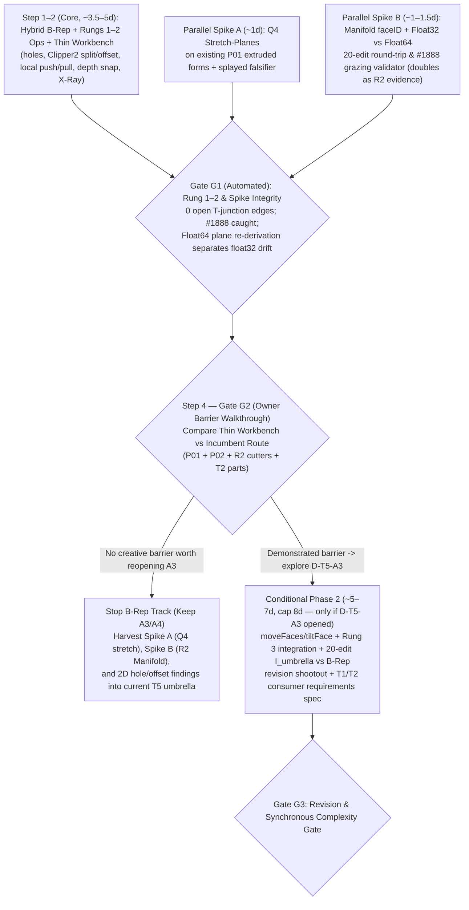

# Native modeling freedom and semantic architecture

**Research proposal only · Revised after PR #266 peer review · 2026-11-03 · owner review**

Prepared against `main` at `535e4bd1`. Research proposal only: no prototype code, permanent schema, dependency commitment, final UX or roadmap authorization is included in this change.

**Intent:** define a gated, honest experimental modeling program—timed while `T5` has no active phase ([`t5-expressive-geometry/current.md`](../../docs/operations/t5-expressive-geometry/current.md))—that tests **both** improvements compatible with the adopted [`umbrella-plan.md`](../../docs/roadmap/t5-expressive-geometry/umbrella-plan.md) **and** a bounded, explicit challenge to its prohibition on face-addressed solid editing, with an early interactive owner gate before expensive machinery is funded.

---

## 1. Relationship to the adopted T5 direction and prior evidence

### 1.1 Explicit challenge to `umbrella-plan.md` A3/A4 (and what would justify overturning it)

Part of this proposal explores **face-addressed direct solid editing** (splitting planar faces, offsetting loops, pushing/pulling sub-faces, persistent `FaceId`/`EdgeId` lineage, and—if gated in later—moving/tilting faces while adjacent planes re-intersect). **That directly challenges the `T5` direction currently in force**, and the proposal must say so plainly:

- **Where current planning rejects this:**
  - [`umbrella-plan.md`](../../docs/roadmap/t5-expressive-geometry/umbrella-plan.md) **Commitment A3** (`:27`, `:160-166`) binds edits strictly to *authored controls and object space*, declaring that *"generated faces, vertices and triangle indices are never addresses"* so admitted operations need no topological naming.
  - **Commitment A4** (`:28`) specifies *admitted representation routes, not a universal kernel*, and **"Rejected now"** (`:33-38`) explicitly excludes *"polygon modeling (vertex, edge and face editing...) as the creator model"* and *"a universal implicit or B-rep substrate"*.
  - [`UX-SPEC.md`](../../prototypes/native-object-shaping/UX-SPEC.md) (`:183`) states *"there is no raw vertex, face, spline-weight or handle-cloud editor"*.
  - [`roadmap-handoff.md`](../native-creative-depth/roadmap-handoff.md) (`:323-327`) recommends not scheduling *"arbitrary B-rep face push/pull with neighbor healing"* without new evidence and an owner decision, and [`approaches-and-precedents.md`](../native-creative-depth/approaches-and-precedents.md) (`:68`, `:79`) flags Solid Edge Synchronous Technology as **a warning case** (inferred face-move rules needing a large rule vocabulary and frequent manual overrides).
- **Why testing the challenge is legitimate now:**
  - [`architecture.md`](../../docs/reference/architecture.md) (`:196-198`) leaves representation mix and kernels open; `umbrella-plan.md` (`:38`) notes no rejection is permanent; [`north-star.md`](../../docs/reference/north-star.md) (`:134-140`) neither admits nor excludes by technique; and [`native-form-lab/FINDINGS.md`](../../prototypes/native-form-lab/FINDINGS.md) (`:111`) explicitly notes that *"P3 comparison with direct solid editing is also unrun."*
- **Required Owner Decision (`D-T5-A3`) and evidentiary standard:**
  - Adopting any face-addressed / B-rep-source model into `T5` requires an explicit owner decision (**`D-T5-A3`**) amending [`umbrella-plan.md`](../../docs/roadmap/t5-expressive-geometry/umbrella-plan.md) A3/A4 ([planning record](../../docs/reference/decisions/t5-object-focus-planning-2026-10-27.md)).
  - Under [`north-star.md`](../../docs/reference/north-star.md) (`:129-132`, *Evidence-led capability expansion*), overturning A3/A4 requires demonstrating a **concrete creative barrier** on target work that the **incumbent `T5` route** (`P01` extrude + `P02` object-space shaping + `R2` positioned solid-combination cutters/adders + `T2` part composition) cannot express cleanly, weighed alongside revision dependability, numerical correctness, browser cost, and failure/repair legibility.
  - **Every `T5` extractability claim for B-rep / face-addressed code in this proposal is strictly conditional on `D-T5-A3`.** Meanwhile, two companion spikes in Phase 1 (non-uniform stretch on `P01` forms and `manifold-3d` `faceID`/precision testing) yield direct `T5` / `R2` value *even if A3/A4 remain untouched*.

### 1.2 Reusable foundation vs genuinely unresolved mechanisms

1. **Prior work and measurements already in hand (cite and build from, do not repeat):**
   - **Shipped `@portfolio/geometry-core`:** [`predicates.ts`](../../packages/geometry-core/src/predicates.ts), [`profile.ts`](../../packages/geometry-core/src/profile.ts) and [`extrude.ts`](../../packages/geometry-core/src/extrude.ts) provide exact `orient2d`, quadratic smooth corners, `earcut` triangulation (which already supports hole bridging), and `FormMesh` region tagging under A5 IEEE arithmetic. *(Note: [`p3-depth`'s `plan.js`](../../prototypes/p3-depth/src/core/plan.js) uses `Math.hypot`, fixed epsilons, and convex-only `clipConvex`, violating A5 canonical rules—it is treated as **conceptual reference only**, not extractable code.)*
   - **2D booleans & polygon offsets:** [`geometry-library-harvest.md`](../geometry-library-harvest.md) (`:178`) already identifies **Clipper2** (BSL-1.0, snap-rounded integer model) as the primary candidate for 2D booleans and offsets—directly relevant to `offsetFaceLoop`, where insetting a concave polygon can split one loop into multiple disjoint loops.
   - **3D solid booleans & Manifold probes:** [`geometry-identity-and-performance.md`](../native-creative-depth/geometry-identity-and-performance.md) (`:36-38`, `:48`, `:184`) and [`probe-methods.md`](../native-creative-depth/probe-methods.md) (`:61-63`, `:91`, `:110-118`, `:129`) already establish `manifold-3d@3.5.4` (Apache-2.0) at **`155 KiB` brotli WASM + `17 KiB` glue**, **`6–17 ms` init**, `1.29–3.73 ms` p50 on the 40-opening wall, `133.7 ms` p50 on a `131,072`-triangle sphere union, `Mesh.faceID` survival across subtraction (`66` distinct face IDs preserved), `earcut`'s **`160` open T-junction edges** when extruding collinear hole vertices without side-stitching, and **Manifold issue #1888** (silent volume loss while returning `NoError` on near-coincident inputs).
   - **Profile families & scope UX:** [`native-form-lab`](../../prototypes/native-form-lab/FINDINGS.md) proves keyed `extrude`/`revolve`/`sweep`, cap lifetimes, and planar-role `HostLink` `'unresolved'` fallback; [`object-composition-prototype`](../../prototypes/object-composition-prototype/HANDOFF.md) explores attachment repair UX; [PR #244](../native-object-creation-ux/PROPOSAL.md) frames the `World ↔ Object Focus` scope transition.

2. **Separating composition from four rungs of solid complexity:**
   A four-legged table or slatted bench needs **parts (`Rung 0`), not Booleans**—matching [PR #244](../native-object-creation-ux/PROPOSAL.md)'s *"touching forms do not silently fuse"*:
   - **Rung 0 — Multi-part composition of `genus 0` bodies:** semantic ownership of definitions, instances, and component tables belongs to **`T2`** ([`t2-composition/README.md`](../../docs/roadmap/t2-composition/README.md), `umbrella-plan.md:339`), not `T5`.
   - **Rung 1 — 2D planar topology on a single prism:** outer + inner hole contours (`earcut` + T-junction-free collinear side-stitching) and 2D offsets (`Clipper2`). Zero 3D CSG.
   - **Rung 2 — Local planar face splitting & non-colliding Push/Pull:** drawing lines/loops on a planar face, `Offset`ting a border loop, and pushing bosses or blind pockets within host bounds with coplanar neighbor healing.
   - **Rung 3 — Volumetric breakthroughs, coplanar grazing & face tilting:** pushing a pocket through a back/stepped face, grazing coplanar cuts, or tilting/moving faces across multi-plane corners.

### 1.3 Fairly stating the incumbent `T5` route (`B2` correction)

An earlier draft compared direct B-rep editing against a *face-addressed `seed + ops[]` feature tree* that fails on topological naming. That was the wrong baseline: [`umbrella-plan.md`](../../docs/roadmap/t5-expressive-geometry/umbrella-plan.md) explicitly rejects feature trees (`:35`) and specifies **`I_umbrella`**:

- **Keyed generators (`R1`)** + **object-space bound operations** (`P02` `reshape` displacement fields and `keep` spatial regions, `:27`, `:163-167`), which re-evaluate *where they are in the object* on upstream profile edits and **need no topological naming**.
- **Route `R2` solid combination (`:190`, `:337`):** `cut` and `add` as **authored solid bodies positioned in object space**, evaluated non-destructively at tessellation time with `Mesh.faceID` mapped back to `SourceRoleKey` regions.
- **Per-axis proportional `scale` (`:154-156`)** + **`T2`-owned multi-part composition (`:339`)**.

In this revised proposal, **`I_umbrella` (object-space ops + non-destructive `R2` cutter/adder bodies + parts)** is a full, first-class contender that can genuinely win: because `R2` evaluates from clean `Float64` source in one pass rather than mutating a B-rep across edits, it avoids iterative `Float32` drift and topological naming entirely—leaving the real research question as **whether creator workflows hit a genuine expressiveness or comprehension barrier when modeling chained local steps/pockets via positioned `R2` cutter bodies versus direct face `Push/Pull`**.

---

## 2. Upfront technical decisions and mechanisms to test

### 2.1 Settling the B-rep representation and determinism rules upfront

1. **Hybrid Plane-Primary + 2D Frame-Pinned B-Rep (`core/brep/`):**
   - Pure plane-derived vertices fail on SketchUp-style coplanar face splits (where new vertices lie on `< 3` independent planes and are under-determined), while pure vertex meshes accumulate planarity drift. Conversely, tilting a face at a degree-4+ corner makes the vertex over-determined.
   - **Upfront representation choice:** Each planar `Face` owns an authoritative `Float64` plane frame `(origin, u, v, normal)` and outer + hole `Loop`s. **3-plane corners** (where three linearly independent faces meet) derive their 3D coordinates in `Float64` from their three planes; **under-determined vertices** (`< 3` independent planes: coplanar splits, inset loops, collinear edge splits) store exact 2D `(u, v)` coordinates in their host face's plane frame (guaranteeing `0` out-of-plane drift by construction).
   - **Upfront topology-change rule:** Stage 1 (Rungs 1–2) supports coplanar splits (`Clipper2` / exact 2D arrangement), T-junction-free cap/side stitching, and orthogonal `pushPullFace` within host bounds, and **explicitly refuses** over-determined degree-4+ face moves or self-intersecting collapses with typed refusal codes. Synchronous `moveFaces`/`tiltFace` (and whether degree-4+ corners refuse vs split into new bevel edges) is **not built in Phase 1**; it is gated behind the Step 4 Owner Barrier Gate.

2. **Determinism vs numerical robustness (clarifying A5):**
   - Under `umbrella-plan.md` A5 (`:218-222`), solving 3-plane intersections via `+ − × ÷` and `Math.sqrt` in fixed order is **already bit-identical** across JS engines, and angles (if `tiltFace` or `revolve` enter later) use a **fixed in-house polynomial** rather than `Math.sin/cos`.
   - The genuine numerical questions tested here are **robustness and boundary precision**, not JS engine non-determinism: **(a)** exact predicates vs explicit snap/tolerance rules when classifying coincidence on computed intersection points, and **(b)** `manifold-3d`'s **`Float32Array` (`Mesh.vertProperties`) quantization boundary**.

### 2.2 Accounting for `manifold-3d@3.5.4` realities (`Spike B`)

Inspecting `manifold-3d@3.5.4` directly shapes how Rung 3 / Route `R2` must be tested:
- **`faceID` already survives booleans:** `Mesh.faceID` carries input face IDs through CSG and preserves boundary edges between distinct `faceID`s during simplification ([`geometry-identity-and-performance.md`](../native-creative-depth/geometry-identity-and-performance.md) §5.2 item 6). Heuristic coplanar-triangle normal clustering is unnecessary; `FaceId`s pass in directly via `faceID`, requiring only boundary loop extraction per surviving `faceID` when reconstructing polygons.
- **`Mesh.vertProperties` is `Float32Array` (32-bit float):** Reading Manifold's output vertices directly back into a B-rep rounds coordinates to float32 on every edit, guaranteeing cumulative quantization drift over `20` chained edits regardless of algorithm quality. Spike B therefore explicitly compares:
  1. **One-pass `R2` non-destructive evaluation** (`Float64` base + `Float64` cutter bodies → single Manifold pass → render mesh, `0` iterative round-trips—directly serving as `umbrella-plan.md:337` `R2` entry evidence), against
  2. **Plane-re-derived B-rep round-tripping** (using Manifold's output `triVerts` + `faceID` strictly for *topology and face adjacency*, while re-computing 3-plane vertex coordinates in `Float64` from authoritative `Face` planes, isolating real algorithmic failures from float32 truncation).
- **Manifold issue #1888 validator:** Because near-coincident / coplanar-grazing booleans can silently lose volume while returning `NoError` (`geometry-identity-and-performance.md:48`), every boolean pass is wrapped in an independent closed-manifold + expected-volume-bounds post-condition check that converts silent corruption into a typed refusal.

### 2.3 Non-uniform stretch independent of B-rep (`Spike A` — Question Q4)

[`umbrella-plan.md`](../../docs/roadmap/t5-expressive-geometry/umbrella-plan.md) (`:154-156`) currently commits [`SceneFormSource`](../../packages/project-model/src/scene.ts) to proportional per-axis `scale`. Because **spatial stretch planes / kept-thickness zones** operate directly on profile/mesh coordinates, **Q4 does not depend on B-rep adoption**: Spike A tests stretch-plane resizing directly on shipped `P01` extruded forms and multi-form arrangements in Phase 1 (including the **splayed-leg / `45°` member falsifier**, contrasting single-body plane-stretch shear against rigid multi-part origin translation).

### 2.4 Respecting `T1` and `T2` cross-track ownership

- **Architectural host surfaces belong to `T1`:** [`t1-spatial-world/README.md`](../../docs/roadmap/t1-spatial-world/README.md) (`:91-95`) states that *"no consumer reconstructs architecture"* and registers `T1`'s face-frame provider once a consumer names its contract. Furthermore, [`CompiledJunctionSurface`](../../packages/layout-core/src/layout-geometry-types.ts) (`:439-454`) holds **wall-end caps, thickness/height steps, branch trims, and junction keels**—*not* the room-facing wall side surfaces (which derive from straight or `cubic-chain` centerline samples, wall thickness, and `CompiledJunctionInterface` trims, and are non-trivial). Accordingly, this proposal **does not reconstruct room-facing wall surfaces in `T5`**; Phase 1 uses simple analytic reference planes in the workbench, and if Phase 2 runs, its architectural output is a crisp **consumer-requirements specification for `T1`'s face-frame provider** (plus verifying that wall-thickness niches cannot be Scene-side CSG cuts into [`@portfolio/layout-core`](../../packages/layout-core/src/layout-geometry.ts)).
- **Definitions, instances & continuing relationships belong to `T2` + `F`:** `PartDefinition`, `PartInstance`, `Make Unique`, and any **continuing host-span resize relationship** (`stretchAssembly` driven by moving walls) are owned by **`T2`** ([`t2-composition/README.md`](../../docs/roadmap/t2-composition/README.md), `umbrella-plan.md:339`) under [`north-star.md`](../../docs/reference/north-star.md) (`:116-118`, *Composable relationships*). Any multi-body grouping in the prototype is disposable local harness state to test geometry behavior, never a competing `T5` component table or cross-domain relationship store.

---

## 3. Module boundaries, package imports and conditional extractability

The prototype lives in a self-contained folder under [`prototypes/`](../../prototypes/README.md) (outside root npm `workspaces` so `manifold-3d` and `clipper2-js`/`clipper2-wasm` never touch root `package-lock.json`). It consumes `@portfolio/geometry-core` (and `@portfolio/layout-core` types if Phase 2 runs) via explicit **Vite/Vitest `resolve.alias` to `../../packages/*/src`** in its local config, keeping workspace isolation intact.

| Prototype module | Allowed imports | Extractability & condition |
| --- | --- | --- |
| **`spikes/stretch-q4/`** (axis/frame stretch-planes vs per-axis `scale` on `P01` forms + splayed falsifier) | Pure TS + `@portfolio/geometry-core` | **Directly informs `T5` resize (`umbrella-plan.md:154-156`)** without reopening A3/A4. |
| **`spikes/manifold-r2/`** (`faceID` region table, `R2` 1-pass cutter eval vs `Float64` plane re-derivation over `20` chained edits, #1888 volume/manifold validator) | Pure TS + `manifold-3d` (isolated) | **Directly reusable as `umbrella-plan.md:337` Route `R2` entry evidence** even if B-rep editing is rejected at Gate G2. |
| **`core/brep/` & `core/ops/`** (hybrid `Float64`-plane / `(u,v)` B-rep, T-junction-free hole extrusion, `Clipper2` `splitFace`/`offsetFaceLoop`, local `pushPullFace`) | Pure TS + `robust-predicates` + `earcut` + `Clipper2` (zero Svelte/Threlte/Three/DOM) | **2D hole/offset findings reusable in `R1`; B-rep & face-addressed ops extractable ONLY IF owner decision `D-T5-A3` amends A3/A4.** |
| **`workbench/`** (thin Svelte 5 + Threlte interactive Rung 1–2 push/pull & `R2` cutter comparison stage + X-Ray inspector) | Svelte 5, Threlte, Three.js, `core/*`, `spikes/*` | **Disposable research harness** — zero shell/Card/UX authority ([PR #244](../native-object-creation-ux/PROPOSAL.md)). |
| **Conditional Phase 2 modules** (`moveFaces`/`tiltFace`, head-to-head `I_umbrella` vs B-rep 20-edit revision harness, `T1`/`T2` consumer contract spec) | Built **only** if Gate G2 passes | **Conditional research evidence** for `D-T5-A3`, `T1` face-frame provider requirements, and `T2` part/relationship seams. |

---

## 4. Progressive stage plan, sizing, stop-loss caps and gate rules

### Phase 1 — Pre-gate build & parallel spikes (~5.5–7.5 engineering days total; hard stop-loss cap: 8 days)

1. **Step 1 — Settle hybrid `core/brep/` & Rung 1–2 pure-TS ops (~2–3 days):**
   Implement the hybrid `Float64`-plane + `(u, v)` B-rep, T-junction-free hole extrusion (`earcut` + collinear side-vertex stitching fixing `probe-methods.md:91`'s 160-open-edge trap), `Clipper2`-backed `splitFace` and `offsetFaceLoop` (including concave loop-split lineage), and bounded orthogonal `pushPullFace` with coplanar face healing.
2. **Step 2 — Thin interactive workbench right on top of Step 1 (~1.5–2 days):**
   Put Rungs 1–2 into the owner's hands immediately (hover/pick planar face, sketch line/rect/poly, drag `Offset` border, drag `Push/Pull` with snap-to-face depth, plus an `R2` positioned-cutter comparison toggle and `FaceId`/wireframe X-Ray panel)—**before** spending a day on `moveFaces`/`tiltFace`, `PartGraph`, or Layout adapters.
3. **Step 3 — Parallel Spike A (`Q4` stretch, ~1 day) & Spike B (`manifold-3d` `faceID`/float32/#1888, ~1–1.5 days):**
   Run both headless `vitest` spikes in parallel: Q4 stretch zones on `P01` forms, and `20` chained boolean edits comparing 1-pass `R2` cutter evaluation against `Float32Array` naive readback vs `Float64` plane re-derivation (including Manifold #1888 coplanar-grazing detection).

### Explicit gate decision rules

- **Gate G1 — Automated Technical Gate (end of Step 3):**
  - *Stop / fix before owner walkthrough if:* Rung 1–2 operations emit `> 0` open/non-manifold edges across a `20`-edit chain, concave `offsetFaceLoop` splits silently drop `FaceId` broadcast lineage, or Spike B's post-condition validator fails to catch simulated/real #1888 volume loss.
  - *Redirect Rung 3 architecture immediately if:* Spike B shows that even `Float64` plane re-derivation cannot recover valid B-rep loops when `manifold-3d`'s `Float32Array` output merges near-coincident topologies—ruling out destructive Manifold-to-B-rep round-tripping in favor of **non-destructive `R2` cutter evaluation**.
- **Step 4: Gate G2 — Owner Creative-Barrier Gate (mandatory funding boundary):**
  - Owner walks through the thin workbench across the §5.1 test shapes and reviews the **Incumbent Route Comparison** + recorded **blocked intentions** (`umbrella-plan.md:337`).
  - **STOP rule:** If `P01` extrude + `P02` shaping + `R2` non-destructive cutters + `T2` parts (plus Spike A stretch and Rung 1 holes) can build the target work without a severe workflow/comprehension barrier, **stop B-rep work here**, keep A3/A4 intact, and feed Spikes A & B directly into `T5` successor planning.
  - **PROCEED rule:** Fund **Conditional Phase 2 (~5–7 days, hard stop-loss cap: 8 days)** *only* if Gate G2 identifies specific, high-value creator intentions blocked under A3 that justify evaluating `D-T5-A3`.
- **Gate G3 — Conditional Phase 2 Synchronous & Revision Gate (only if Phase 2 runs):**
  - *Stop / reject `moveFaces`/`tiltFace` if:* handling degree-4+ corners or neighbor re-intersections demands Synchronous-Technology-style intent-inference overrides (`approaches-and-precedents.md:79`), **or** if `I_umbrella` (object-space ops + `R2` cutters) achieves equal or higher upstream-revision survival with fewer `unresolved` states across the `20`-edit out-of-order corpus.

---

## 5. Generality corpus, incumbent-route comparison and evaluation dimensions

### 5.1 Test set with incumbent-route baseline (`M3` creator-value check)

Zero domain nouns (`table`, `leg`, `vitrine`) appear in `core/*`. Every benchmark family is evaluated **both** on how the incumbent route builds it and on adversarial variations:

| Geometry / task class | Built via incumbent route (`P01` + `P02` + `R2` cutters + `T2` parts)? | What the direct B-rep / Spike comparison specifically tests |
| --- | --- | --- |
| **1. Multi-part orthogonal joinery** (4-legged apron table, slatted bench, shelved rack) | **Yes — `P01` extrusions + `T2` parts (`0` Booleans).** Blocked today only on `T2` part grouping and proportional `scale` stretching leg thickness (`umbrella-plan.md:154-156`). | **Spike A (`Q4`):** Does stretch-plane resize on `P01`/multi-part forms solve leg/stile thickness preservation without needing B-rep at all? |
| **2. Splayed / angled assemblies** (`15°–45°` mid-century legs, diagonal cross-braces) | **Partially — `P01`/`R1` parts tilted in `T2`**, but non-uniform whole-assembly stretch shears angled cross-sections. | **Adversarial Q4 falsifier:** Quantifies shear under world-axis stretch planes vs rigid sub-part origin translation. |
| **3. Perforated panels & concave border frames** (multi-pane frame, concave L-frame with inset border) | **Partially — `R2` cutter bodies** can punch panes, though authoring 12 positioned cutter boxes vs 2D holes/`Offset` adds object clutter. | **Rung 1–2 (`Clipper2` + holes):** Tests whether 2D holes + concave `offsetFaceLoop` (where inset splits 1 loop into 2) is cleaner as a profile/R1 extension vs face editing. |
| **4. Stepped & recessed single-body casework** (vitrine with rebated lip + inner pocket, stepped plinth with cross-seam notch) | **Possible via stacked `R2` cutter/adder bodies**, but chained steps relative to *previous* cut floors require manually coordinating cutter positions in object space. | **Primary Gate G2 discriminator:** Owner walkthrough records whether chaining 4–6 face-relative `Offset → Push/Pull` steps reveals a genuine creative barrier against `R2` positioned cutters—and tests **out-of-order depth/width revision** across both models. |
| **5. Partial breakthroughs & coplanar grazing** (pocket pushed through a stepped/angled back; flush step merge; `20` chained edits) | **`R2` evaluates in 1 pass from `Float64` source**, avoiding `20`-step `Float32` accumulation, subject to Manifold #1888 on grazing faces. | **Spike B & Gate G1/G3:** Measures `Float32` vs `Float64` plane-re-derived drift across `20` chained edits, coplanar edge dissolution, and #1888 post-condition refusal accuracy. |
| **6. Non-90° architectural corner & wall niche boundary** (`120°` corner counter; vitrine next to `LayoutWallOpening`) | **Waits on `T1` face-frame provider + `T2` relationships**; wall-thickness niches blocked in Scene by domain boundary. | Clarifies minimal consumer frame/clearance data `T5`/`T2` need from `T1` without reconstructing architecture. |

### 5.2 Five evaluation dimensions (research measurements, not artificial release gates)

A failed mechanism that maps a real limit (e.g., proving `Float32` Manifold round-trips cannot sustain destructive B-rep editing, or proving `I_umbrella` + Spike A already covers 90% of creator intent) counts as **high-value research success**:

1. **Creator-value & blocked-intention log (Gate G2 primary output):** Side-by-side step count, cognitive objects managed (faces vs phantom `R2` cutter bodies), and explicit blocked intentions recorded during the owner walkthrough (`umbrella-plan.md:337` & `north-star.md:129-132`).
2. **Numerical & topological stability across `20` chained edits:** Closed 2-manifold rate (`0` open/T-junction edges), max face-planarity error ($\max |n \cdot v - d|$), coplanar merge cleanliness, and separation of `Float32Array` marshaling quantization from algorithmic bugs.
3. **Revision & resize tradeoff matrix (`I_umbrella` vs B-rep + Stretch):** Across identical out-of-order upstream outline/depth edits and non-uniform stretches, measure **(a)** edits completed without manual rebuild, **(b)** thickness/angle preservation (including splayed-member shear), and **(c)** correspondence honesty (`0` silent `FaceId`/region swaps; explicit `unresolved` reporting).
4. **Cross-track boundary cleanliness:** `0` architectural surface reconstructions claiming `T1` authority, `0` competing component/relationship stores claiming `T2` authority, and `0` Scene mutations of Layout.
5. **Empirical browser/Node cost curves:** `p50 / p95` latency and memory by face/cutter count, plus WASM size/init reference figures, recorded as curves for `T5` planning rather than pass/fail cutoffs (compatible with both active [`docs/operations/README.md`](../../docs/operations/README.md) bounded replanning and PR #259's proposed `needs-research → needs-decision` spike model).

---

## 6. Intentionally undecided questions and initial owner alignment

### 6.1 Left open until Phase 1 / Gate G2 evidence exists

- **Whether to open `D-T5-A3` at all** (keep `umbrella-plan.md` A3/A4 intact and harvest only `Q4` stretch + `R2` Manifold provenance + 2D holes/offsets, vs admit bounded face-addressed solid editing).
- **Permanent `Scene` codecs, `T2` component schemas, `T1` face-frame API shapes, and final Object Focus UX.**
- **Production dependency admission** (`Clipper2` port vs WASM; `manifold-3d` Worker lifecycle and visitor delivery derivatives).

### 6.2 Three alignment checks to start Phase 1

1. **Explicit A3/A4 challenge + `I_umbrella` baseline:** Does framing Phase 1 as an honest test against the incumbent `P01 + P02 + R2 cutters + T2 parts` route—with all B-rep extractability strictly conditional on owner decision `D-T5-A3` at Gate G2—match your intent?
2. **Phase 1 scope & `8`-day stop-loss cap:** Are you happy to greenlight **Steps 1–3 only** (hybrid Rung 1–2 B-rep + thin interactive workbench + parallel `Q4` stretch spike + `manifold-3d` `faceID`/`Float32`/#1888 spike, capped at `~5.5–7.5` days / `8` days max) and hold `moveFaces`/`tiltFace`, `PartGraph`, and cross-track harnesses behind **Step 4's Owner Walkthrough Gate (`G2`)**?
3. **`T1` / `T2` boundary discipline:** Confirm that Phase 1 uses simple reference planes and local array helpers rather than building `T1` wall-side reconstruction or `T2` component/relationship infrastructure?
