# Creator journey storyboard

**PR #244 · UX review revision · 2026-11-01**

Read alongside the [proposal](./PROPOSAL.md). All screens are static proposed UI, not screenshots of shipped Focus. **S** = shipped interaction foundation; **P** = P02 planned capability; **N** = new workspace proposal. Filenames retain the original package's numbering; follow the routes below, not numerical order.

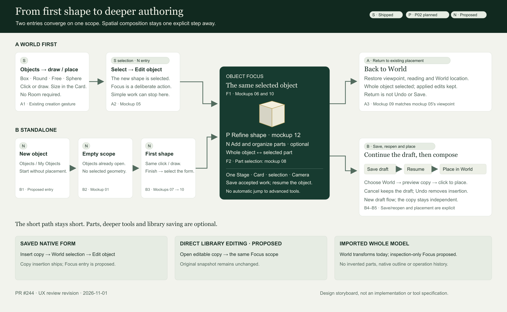

**A:** Objects → create → **05** selected → **06** Focus → **12** refine → optionally **08** part → **09** World.

**B:** Objects/My Objects → New object → **01** empty → **07** first outline → **10** accepted form → the same refinement/parts interactions → Save → Resume → Place in World.

The two examples intentionally use a modest plinth. A first object should not require piano-level hierarchy. The standalone example does not spontaneously acquire the museum around it.

## A. World-first entry

### 05 — An ordinary selected object reveals the next step

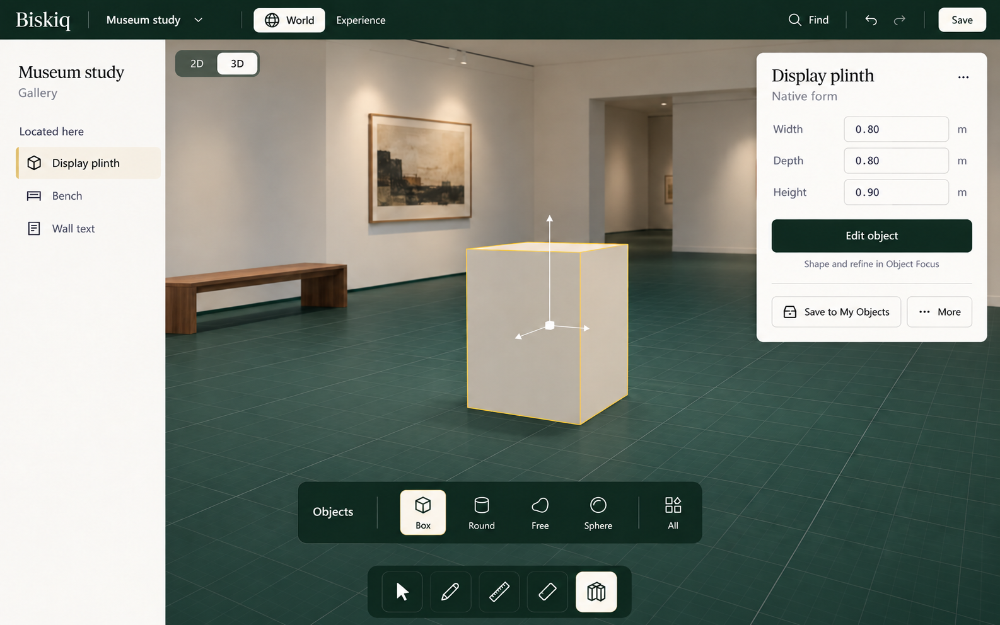

**Trigger:** Objects → Box → click/draw, then size/name the result. **S:** created geometry is selected while Objects remains armed. **N:** Edit object in the Card makes deeper work discoverable. The creator can continue sizing or composing in World without entering Focus. The “Museum study” project and gallery location are the context to recover later.

**Next:** choose Edit object, resolving any unfinished drawing first. Park the Objects surface, enter Select, and keep the selected identity.

### 06 — Change the scope, retain recognition

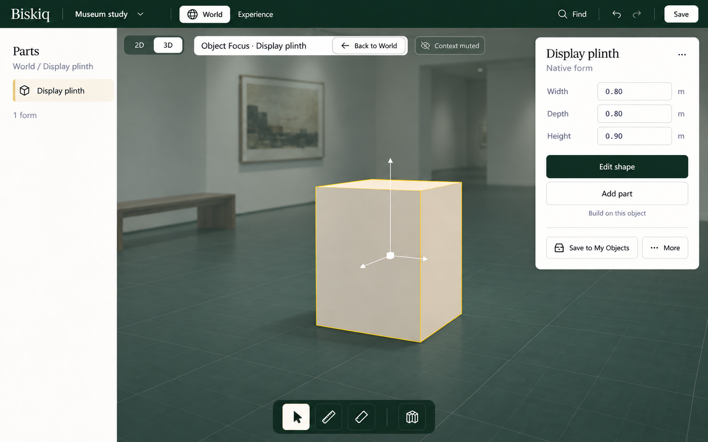

**P:** selected-form Focus/refinement intent. **N:** this entry treatment, Parts presentation and Context control. The plinth remains in its existing placement; Camera keeps its angle and frames closer. The museum is muted and unpickable. World remains the active lens. Parts initially has only one form. No section, recipe or advanced dashboard opens automatically.

**Next:** Edit shape for supported refinement, or Add part when composition is useful. Back to World is always identifiable.

### 12 — Edit shape is a task within the same object

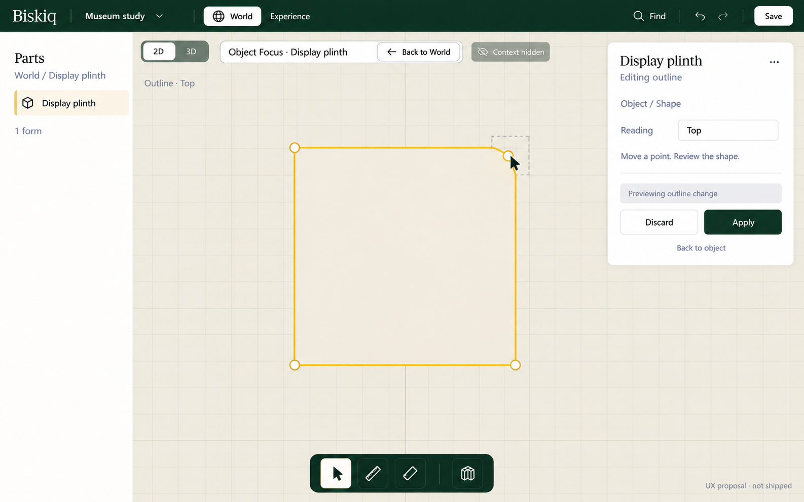

**P:** outline revision with explicit acceptance. **N:** representative task presentation. The creator deliberately chooses a top reading; the same selected identity stays in Parts/Card while the Stage shows its outline. Context is hidden for this reading. This is refinement of accepted geometry, unlike the uncreated outline in 07.

**Next:** Apply or Discard the candidate, then Back to object returns to the 3D object scope and its former context visibility. Back to World exits the entire scope; either exit resolves pending work first. The following assembly illustration retains the rectangular body, showing the **Discard → Back to object → Add part** branch. Discarding a trial is not losing the object.

The pictured curve, handle behavior and section layout are representative; this package specifies the workspace transition, not a mathematical operation.

## B. Standalone entry and first shape

### 01 — Start with the same creation surface

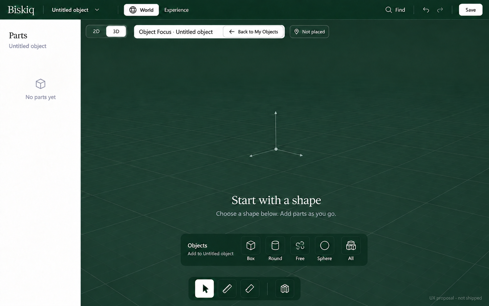

**N:** New object from Objects/My Objects. The Stage is empty, the name optional, and there is no selected-part Card. Objects is already disclosed. Back to My Objects and Not placed identify origin and state. There is no second central shape menu or architectural Pen masquerading as object creation.

**Next:** choose a shape. This draft is not a World placement.

### 07 — The first drawing is still creation

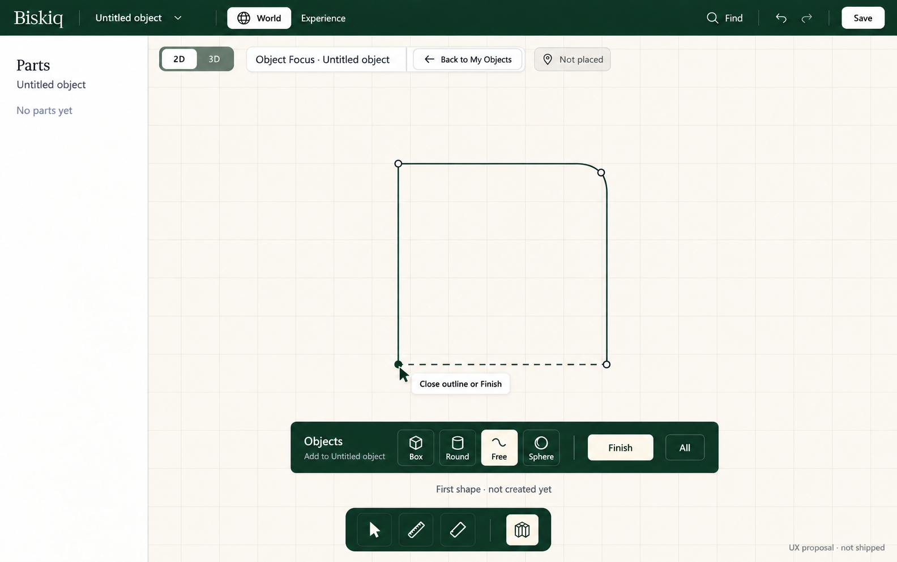

**S:** S17A's Objects/Free/Finish gesture vocabulary. **N:** its use inside an empty unplaced scope. Parts still says No parts yet; the pending outline is not an accepted body. Only Objects is armed. Finish accepts the first form; sizing follows through the ordinary Card.

**Next:** finish, name/size the form as desired, then deliberately return to Select and a 3D reading. There is no automatic jump to advanced modeling.

### 10 — Both entries now offer the same Focus

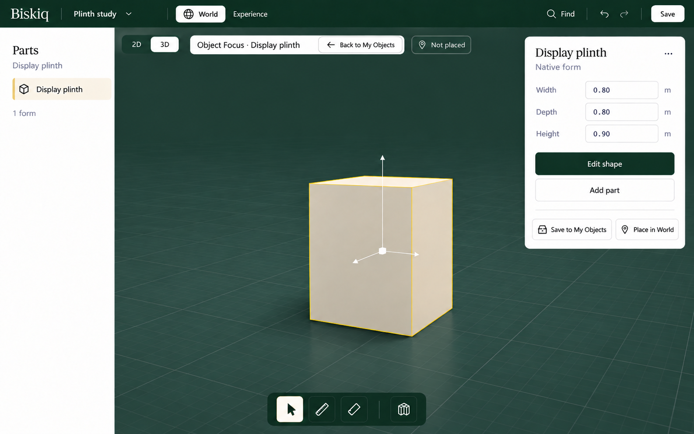

**N:** the standalone convergence state. Compare directly with 06: the same object-level selection, Card and tools; different surroundings, return destination and placement state. “Plinth study” and “Display plinth” are creator-assigned names, not required setup or automatic renaming.

**Next:** Edit shape uses the same task pattern as 12; Add part uses the same pattern as 08, on this neutral Stage. Head Save preserves the draft; Place in World is a separate decision.

## Common Focus: whole object or part

### 08 — Add a component without leaving the workspace

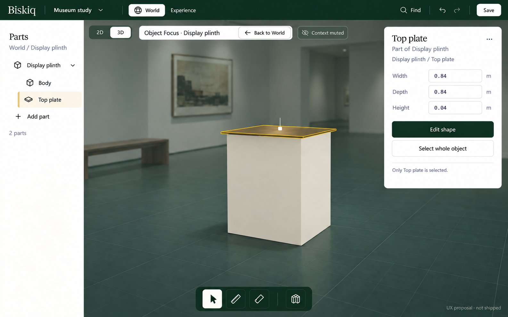

**N, beyond bounded P02:** Add part opens Objects with Add to: Display plinth, then the creator creates/names a top plate. The root now has Body and Top plate. Selecting the latter highlights only that geometry and changes the Card to Top plate / Part of Display plinth.

**Next:** Select whole object or the root row returns to whole-object editing; no Camera jump is required. Back to World still exits the complete object scope. This frame uses journey A's museum context; journey B gets the same selection behavior without surrounding World geometry.

## Return is a context restoration

### 09 — Back in the same World, with accepted changes

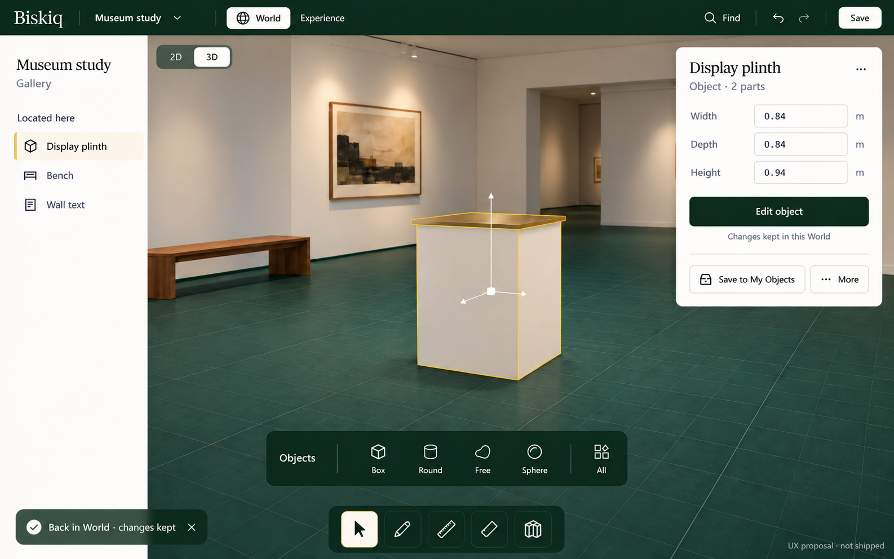

**N:** compare with 05. The gallery, viewpoint and placement match. The changed object has two parts, but ordinary World shows one selected object and its ordinary Card. Parts and refinement controls are gone. Objects browsing is restored without a selected shape tile; Select is active.

This is **Back to World**, not a new insertion. A standalone draft reaches composition through the distinct placement path below.

## Save, reopen and place: explicit transitions

| Creator action | Visible destination and consequence | Status |
| --- | --- | --- |
| Save in standalone Focus | Accepted draft saved; unsaved indicator clears on success | Save infrastructure exists; standalone lifecycle proposed |
| Leave → My Objects → In progress → Resume | Same draft in Focus; no promise of restored pending preview or Undo | Proposed discovery/reopen path |
| Place in World → choose World | World and its Objects placement preview; “Independent copy” explains reach | Proposed draft entry into placement |
| Click to place / cancel | Click yields ordinary World root selection; cancel retains draft; destination Undo removes insertion | Existing placement vocabulary; standalone connection proposed |
| Saved native item → Insert copy → Edit object | Ordinary World copy, then the same Focus entry | Copy insertion shipped; Focus entry proposed |
| Saved native item → Open editable copy | New draft in Focus; original snapshot unchanged | Proposed shortcut |
| Imported whole model → Inspect object | Same host, inspection-only label; whole-model capabilities only | Proposed host; native part/outline editing unavailable |

The flow map is the visual treatment for these lifecycle branches. No extra save dialog or library redesign is specified merely to add more screens.

## Retained product-ceiling illustrations

These are optional future depth, not required stops in either journey. Their original labels do not override the revised proposal or current S17A shell behavior.

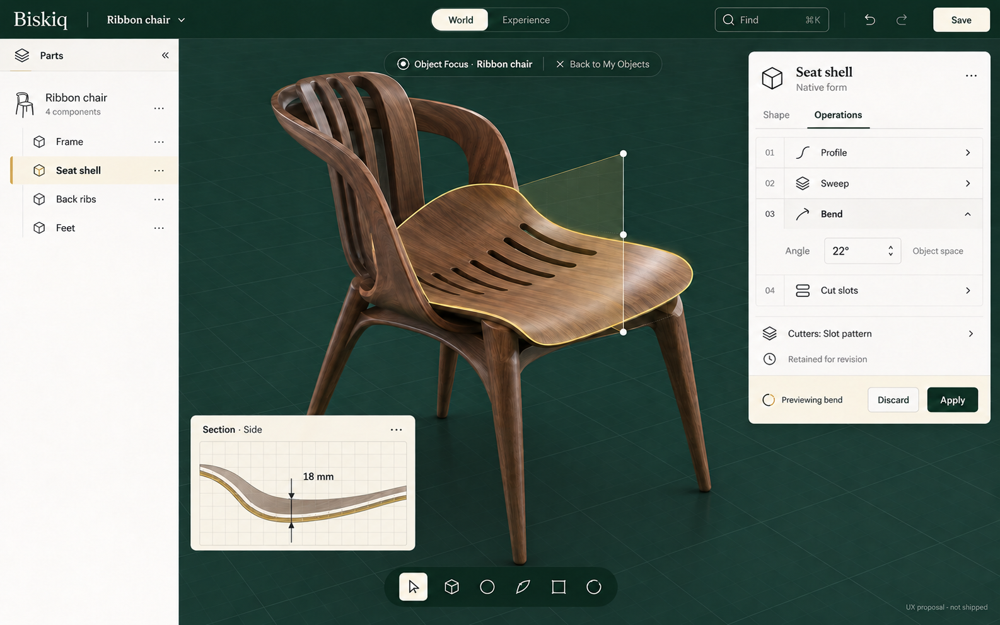

**02 — Retained:** illustrates a creator working deeply on one selected part. Operation names/order, numeric values, inset treatment and exact tools remain unapproved examples.

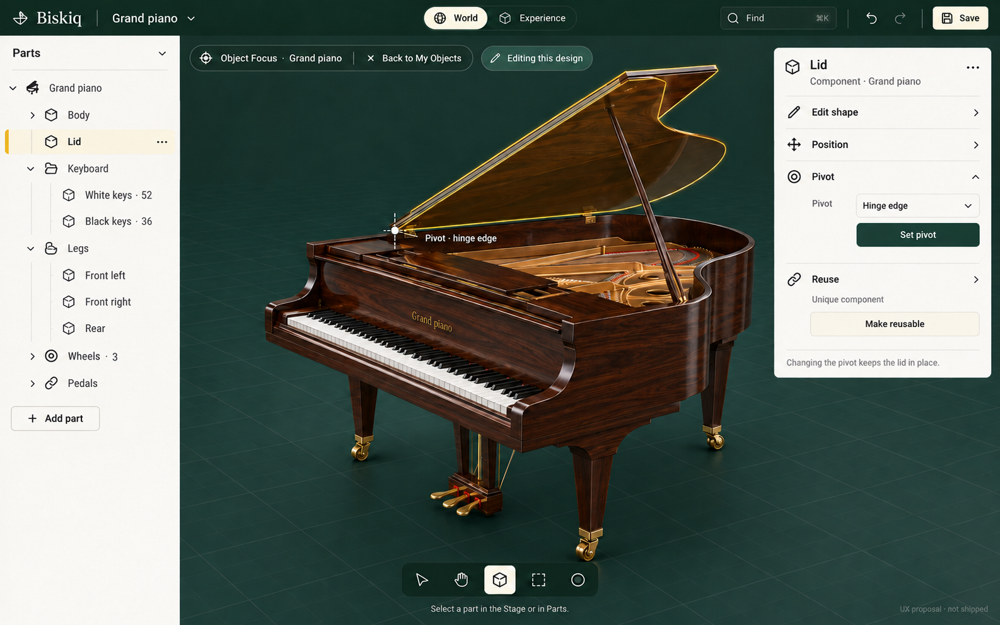

**03 — Retained:** illustrates why nested parts and whole/part selection matter. Pivot, repetition, reuse controls and component storage are not specified or ratified here. The lid is in a static pose; animation is deferred.

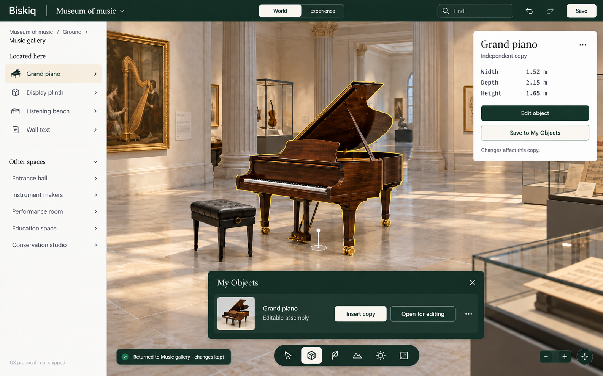

**04 — Retained:** product-ceiling composition/reuse illustration, not the entry/exit specification. **09 governs return continuity.** Its older “Open for editing” label is superseded by **Open editable copy**; assembly library saving remains future capability.

## Review notes

The package contains eleven interface PNGs plus one flow-map PNG and its editable SVG source. All were visually reviewed for scope, labels, selected-subject correspondence and continuity. [Provenance and prompts](./mockup-prompts.md) record generation and targeted corrections. Artwork is not executable geometry, exact pixel specification or evidence of accessibility, touch or performance acceptance.
