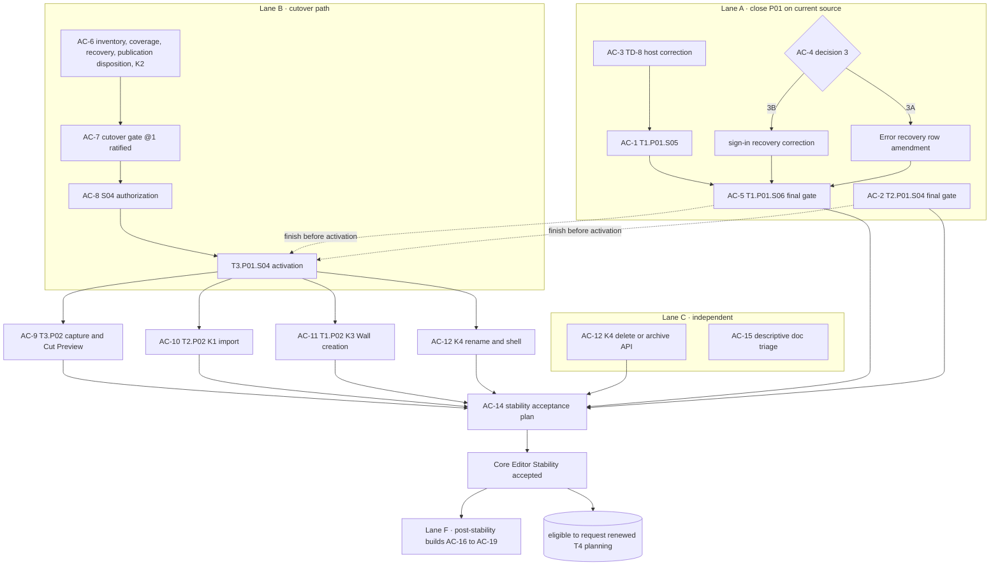

# Post-P01 engineering authorization roadmap

> One of two coordinated roadmaps. The [boundary and coordination record](./README.md) owns the
> **build / prototype / research further / defer** ledger and the
> [boundary test](./README.md#3-the-boundary-test) used here. The
> [prototype roadmap](./prototype-roadmap.md) explores the items this roadmap deliberately does not
> build.

## 1. Purpose and stance

This roadmap lets T1, T2 and T3 make the strongest justified progress after P01 **without waiting for
design exploration and without building what that exploration may overturn**.

- **Independently executable.** No item here waits for a prototype verdict. Where a plan contains a fork
  a prototype could settle, the [coordination record](./README.md#6-decision-points-where-the-roadmaps-meet)
  names the default the plan takes if no verdict exists when it is frozen.
- **Justified, not merely useful later.** An item is here only if it is required by a ratified promise,
  an owner ruling, a proposed Core Editor Stability criterion or a verified defect, or if it is an
  ordinary operation whose interaction the accepted contracts already govern, **and** its shape is the
  same under every live answer to the open design questions that touch it, **and** a present consumer
  exercises it.
- **Explicit stopping.** §7 names each branch where the next capability would need a speculative
  abstraction or a domain commitment that is still open, and recommends stopping there. Concluding that
  a direction needs another design or research round is a legitimate outcome, not a failure.
- **Proposal only.** Phase registration is a [bounded replanning](../../docs/operations/README.md#bounded-replanning)
  event, slice authorization needs an owner record, and gates move only by ratification and acceptance
  under the [gate register](../../docs/roadmap/README.md#gate-register). Nothing here performs any of
  them.

## 2. Verified starting point

### 2.1 Gates and phases at `5fee2a2d`

| Item | State | What remains |
| --- | --- | --- |
| F1–F4 @1, `T1.viewport-projection@1` | accepted | — |
| F5, `T3.camera-experience-cutover`, `T4.prepared-reader` | undrafted | The cutover gate must be drafted and ratified before T3.P01.S04 is authorized |
| T1.P01 | S01–S04 and S07 shipped (PR #148 merged) | **S05** existing straight-Wall manipulation: prerequisites met, needs authorization; it is the architecture-cycle terminal. **S06** exhaustive final gate |
| T2.P01 | S01–S03 shipped (PR #147 merged) | **S04** resize, duplicate/delete, source JSON reload and the Save journey; final gate; prerequisites met, needs authorization |
| T3.P01 | S01–S03, S05, S06 shipped | **S04** live ownership cutover: all six [authorization-path](../../docs/roadmap/t3-experience/t3.p01-camera-experience-foundation/t3.p01.s04-live-ownership-cutover/implementation-plan.md#authorization-path) items open; preflight drafts are "not evidence" |
| T3.P02 | Proposed phase, unregistered | Registers only after the cutover gate is ratified ([proposal](../../docs/roadmap/t3-experience/t3.p02-capture-and-cut-preview/README.md)) |
| T4 | planning, frozen by [R1-D](../../docs/reference/decisions/next-batch-authorization-2026-10-17.md#ruling-r1-d-t4-deferral-2026-10-17) | Two owner acts after Core Editor Stability acceptance |
| Core Editor Stability | Direction and K1–K4 ruled; 13 criteria rows proposed | Owner confirmation of the rows; an acceptance plan once contributing work ships ([milestone](../../docs/roadmap/core-editor-stability.md)) |

### 2.2 What the live editor does today

Source-verified (inspection only; no tests were run for this roadmap). **Live** means wired into the
`/project/[projectId]/spatial` route; **dormant** means the code exists but only tests or an inactive
subpath reach it.

| Domain | Live | Dormant | Absent |
| --- | --- | --- | --- |
| Layout | Five planners through `apps/editor/src/lib/authoring/adapters/layout.adapter.ts`: wall height and thickness, first-opening dimensions, wall/opening rename, one plinth preset; Plan reading `layout.plan@1` | Straight-wall length, angle, rigid and junction move; curve planners; wall delete, role change, enclosure; opening create, move, center, delete; split, dissolve; room move, rotate; align; duplicate (`packages/layout-core/src/layout-wall-first-precision.ts`, `packages/layout-core/src/layout-wall-topology-ops.ts`, `packages/layout-core/src/layout-wall-openings.ts`) | Any draw or creation tool; levels; delete in the editor |
| Scene | Place a box, cylinder or sphere on Room-floor support; move; yaw; numeric x/z/yaw | `place-on-floor`, `resize-on-floor`, `duplicate-one`, `delete-one` registered but never sent | Catalogue models (excluded: the piano's r186 contact verification failed, `apps/editor/src/lib/authoring/scene/object-definition-policy.ts`); own GLB import UI; material and light editing; attachments |
| Camera / Experience | Inspection camera through Camera output tickets and viewport evaluation | Unit envelope, unit acceptance and Save, Experience lowering, interpreter and companion, `ExecutionProgram`, guided/free/reduced-motion controllers, channel host | Any View capture, Presentation, Stop or Guide editing; the Experience lens shows "not available yet" |
| Preview / visitor | `/p/[publicationId]` cold runtime following the legacy navigation graph | `VisitorPreviewSurface` preview mode | In-editor Preview; a semantic destination list; publish UI |
| Persistence / API | Conditional current-source Save, Head Save with conflict and Reload; list, open, create, source JSON replace and download | Unit Save handler; publication and asset endpoints | Project rename and delete (API and UI); a working sign-in Save draft handoff |

### 2.3 Consequential debts and drift

| Item | Evidence | Consequence | Handled by |
| --- | --- | --- | --- |
| **TD-8** a task's scoped services go stale after an accepted install and refuse `Begin` | [tech-debt ledger](../../docs/operations/tech-debt/README.md); root cause in `apps/editor/src/lib/authoring/stage/stage-facade.ts` | Every new adapter and instrument (S05, T2.P01.S04, K3, T3.P02) inherits it; no slice owns it | AC-3 |
| **TD-6** migration runner race; **TD-7** foreign-row lock before the owner test | Tech-debt ledger | Both sit on the path S04 quiesces and migrates | AC-6 |
| Catalogue models not admitted | The piano's recorded r186 failure; the sofa and chair await verification | The stability "Scene composition" row names "admitted catalogue models"; today none is admitted | AC-2 |
| Sign-in Save recovery works only as a same-mounted-session retry | `writePendingCloudSave` in `apps/editor/src/lib/platform/project-persistence.ts` has no production caller; the spatial route never reads `resume-save` | The stability "Error recovery" row is unmet as written; S06 must verify, not implement | AC-4 (owner decision 3) |
| Guide-free Presentations dropped | `lowering.ts` emits only Presentations the selected Guide's Stops use; `interpreter.ts` completes on a null entry | A ratified promise ("a Presentation can exist without a Guide") contradicted; not among S06's disclosed residuals | AC-7, AC-9 (owner decision 1) |
| Look-through/capture versus visitor lighting and fog | `StageCanvas.svelte` fog `40..120` plus its own lights; `VisitorPreviewSurface.svelte` fog `22..54` | Capture fidelity cannot hold under two world presentations | AC-9 |
| Placement requires a Room floor | `layout-floor-support.ts` keeps only `room-floor` polygons | Contradicts "useful with an empty Layout" once composition outgrows the starter | AC-10 or AC-16 |
| Wall-chain and Room IDs are reused after deletion | `defaultChainAllocator` checks only the current document | Harmless today (no delete is wired); a silent-retarget risk once K3 wires creation and deletion | AC-11 |
| S06 pre-S04 decisions outside the six-item path | [S06 residuals](../../docs/roadmap/t3-experience/t3.p01-camera-experience-foundation/t3.p01.s06-experience-runtime-and-camera-handoff/acceptance.md#residuals): invocation selector home, authored-input homes, hold start at editorial or Camera-confirmed arrival | Unowned unless the gate draft takes them | AC-7 |
| Stale descriptive text | Read-only Stage text in `README.md`, `north-star.md`, `architecture.md` and PLATE; F contract "none shipped"; T1 baton and "authorized" wording for shipped slices; tech-debt index omits TD-8 | Misroutes future planning (triage case B) | AC-15 |

## 3. Critical path and lanes

The F2 cutover, **T3.P01.S04**, is the critical path. K1 and K3 follow it by ruling and T3.P02 by gate.
Work that can finish on current source should finish **before** activation: S05, S06 and T2.P01.S04 all
require `local-single-domain-v1`, which activation retires, so finishing first avoids re-declaration
and adapter migration mid-flight (sequencing finding K6).

### 3.1 Lane A · close P01 on current source

All four items are ready for owner action now. They share Stage host files, so they follow the
existing shared-file protocols ([batch B](../../docs/roadmap/cross-track-execution.md#authorized-batch-b-2026-10-17)
is the precedent); TD-8's correction lands first because S05's gesture instrument and T2.P01.S04's
actions are exactly the paths it breaks.

### 3.2 Lane B · the cutover path

The six authorization-path items stay in their plan's order. This roadmap adds three recommendations
for the gate draft (AC-7): take the S06 pre-S04 decisions explicitly; settle where Guide-free
Presentations are preserved; and make K1 and K3 declare the gate (or a start-checked slice dependency)
so "after the F2 cutover" is enforced rather than remembered. The gate draft currently lists only
T3.P02 and T4 as consumers.

### 3.3 Lane C · small independent work

K4's delete/archive half and the descriptive doc triage have no cutover dependency. K4's rename half
does: today a project name lives both in the API's `projects.name` column
(`apps/api/src/project-persistence.ts`) and in the saved source's `project.name`, and the unit envelope
is the natural moment to decide which one is authoritative.

### 3.4 Lane D · the P02 wave after the cutover

Three phase registrations and one slice pair, each independently plannable once S04 activates. §4 gives
their shapes.

### 3.5 Lane E · Core Editor Stability acceptance

When Lanes A–D ship, the owner authorizes the acceptance plan under the
[product milestone acceptance](../../docs/operations/README.md#product-milestone-acceptance) event. The
only additions this roadmap proposes to the criteria are wording that follows owner decisions 1 and 3
and the catalogue question (AC-13). It adds no Research 6 capability rows.

### 3.6 Lane F · justified post-stability builds

R1-D freezes T4 only. T1–T3 phases after stability can be registered whenever the owner chooses; the
candidates in AC-16 to AC-19 pass the boundary test today and need no prototype. Their internal decision
points are listed in the coordination record.

## 4. Shapes for the P02 wave

### 4.1 T3.P02 · First capture and Cut Preview

**Base scope** as [proposed](../../docs/roadmap/t3-experience/t3.p02-capture-and-cut-preview/README.md):
capture a View and bind a Presentation plus optional Stop in one acceptance; reuse a Presentation in
distinct Stops; reorder by identity; holds and continuation; edit labels and text; two Experiences; a
Cut Guide; isolated Preview with semantic navigation and reduced motion, exiting through the Camera
return token.

**Add (justified now):**

- **Guide-free minimum (owner decision 1).** Every valid authored Presentation is accounted for, and
  every supported one is reachable in Preview through an explicit semantic destination index and a Camera
  Cut. No fabricated Stops; no second writable order. The exact program representation and any
  `ExecutionProgram`/interpreter/companion amendment are drafted by this first consumer for owner
  ratification. This shape is the same under every discovery design X1a might adopt, and AM-6 already
  requires semantic navigation to every admitted destination.
- **One world presentation for capture, Preview and visitor.** Capture, Look-through and Preview render
  under the same world-presentation state. Drafting aids may differ; the captured result may not. This
  replaces two hard-coded rigs with one shared default; it does not make lighting authored.
- **Frame this (optional verb).** A Camera-owned, solve-once framing of the selected subject(s) or
  space, proposed and then confirmed through Look-through, producing an ordinary View.

**Must not include:** constellation or marker discovery design beyond the index (X1a), a reading-layout
instrument or scroll profile (X1b; T4), conditions or Gates (X6, RR-7), local timing or performances
(X5, RR-3), advanced path or anchor authoring, media, or any T4 activation.

### 4.2 T2.P02 · K1 bounded GLB import

**Base scope** as ruled: one flat GLB with embedded or adjacent maps; upload, validate and stage;
explicit scale, pivot and footprint; approve; place, save and reload like a catalogue model; F2 resource
locks and `unit-acceptance-v1`; no T4 release closure.

**Owner decision 2: still images.** Recommended: admit an **image resource** (PNG, JPEG, WebP; pixel
size, aspect and provenance) through the existing asset upload, sniffing and storage path, and one
**image panel** Scene definition placed with the same support as any other object. Do **not** add images
as Presentation media yet: where images belong in reading content is X4's and RR-6's question. Option
2A (GLB only, images as the first post-stability T2 slice) remains a valid choice if planning finds the
cost higher than expected.

**Optional (owner choice): Room-free ground support.** A ground datum (and plinth-top support) so
composition works in an empty Layout, as ratified. It is small, invariant across every placement design
and could ship here; otherwise it opens AC-16.

**Must not include:** assemblies or components, role binding, other formats, provider search, release
closure, Presentation media, surface placement or `placedOn`.

TP2's asset findings, if available, may sharpen K1's honest capability states. They never enlarge K1.

### 4.3 T1.P02 · K3 bounded straight-Wall creation

**Base scope** as ruled and as listed in [T1.P01's next boundary](../../docs/roadmap/t1-spatial-world/t1.p01-stage-foundation/README.md#deliberately-deferred-scope-and-next-boundary):
creator-neutral Draw into closed enclosures with derived Rooms and floors; add Openings; delete Walls;
explicit connections, never coordinate adoption; a Layout unit version under F2; a disposition for
legacy `partition` Walls; a decision on non-enclosing rings; connectivity-policy reconciliation; Room
lineage; retirement of the legacy Layout types, codec, room-frame and compiler adapter.

**Add (justified now):**

- **Canonical ID non-reuse** for Walls, Junctions and Rooms (monotonic allocation or a retired-ID
  record) before creation and deletion ship, because F.1 references must never silently retarget.
- **Wire existing canonical planners** for wall delete and opening create, move, center and delete
  instead of writing new ones.

**Owner rulings needed at registration:** how T1.P02 configures its architecture-cycle window (the
cycle rules describe only "the first relevant T1 phase plan"), and whether the unassigned Plan-cut
drawing residual joins this phase.

**Must not include:** curved drawing, levels, overhead forms, Section, or any vertical semantics beyond
what F.1 already addresses.

### 4.4 K4 · project rename and delete

T3 owns persistence and API in a separate small slice; T1 owns the shell integration. Delete or archive
with confirmation can proceed before the cutover. Rename waits for the decision on where the name lives
(§3.3).

## 5. Foundations: build the intersection, not the union

A foundation qualifies only if a **present** consumer uses it and its shape is common to every plausible
direction. "Future features might use it" is not a reason.

### 5.1 Minimal foundations worth building

| Foundation | Present consumer | Neutral to | Where |
| --- | --- | --- | --- |
| Lowering keeps every valid Presentation | T3.P02 Preview | Every discovery and reading design (X1a, X1b) | AC-7 or AC-9 |
| Semantic destination index reaching every Presentation | T3.P02 Preview; AM-6 accessibility | Constellations, markers, scroll pages | AC-9 |
| One world-presentation state for capture, Preview and visitor | T3.P02 capture | Authored lighting, looks, Light this | AC-9 |
| Plain Presentation text | T3.P02 labels and text | Rich content records, reading layout | AC-9 |
| Image resource | T2.P02 image panel | Image as Scene object or as Presentation media | AC-10 |
| Ground datum support | T2 placement in an empty Layout | Every surface and hosting design | AC-10 or AC-16 |
| Canonical ID non-reuse | K3 creation and deletion | Every relationship and hosting design | AC-11 |
| Read-only exact face query (refuses rather than clamps) | Surface placement | A0, A1 and B alike | AC-16 |
| Solve-once Camera framing | Frame this | Fixed or assisted framing later | AC-9 |

### 5.2 Foundations not to build yet

| Candidate foundation | Why it fails the test now | What would justify it |
| --- | --- | --- |
| `placedOn` provenance record | Shape depends on X2's A0/A1/B verdict | X2 adopts A1 |
| Correspondence publication, impact-index classifiers | No persisted relationship has been adopted | X2 adopts B and RR-4 closes |
| Activating the dormant channel host and negotiation, or new Scene channel families | No consumer before performances; the family shape is TP1's question | TP1 succeeds and X5 or X12 is adopted |
| A rich content-block model for Presentations | Reading and media design open (X1b, X4, X14) | RR-6 closes |
| Level-qualified Layout structures beyond F.1's addressing | Level model open | RR-1 closes |
| Slab, ceiling or roof primitives | Slab/ceiling ownership explicitly open | RR-2 closes |
| Component identity, roles, kit records | Asset truth and reuse value unproven | TP2, X7 and RR-5 |
| A second Stage capability beyond `stage-instrument-v1` | No consumer has asked for one | A registered slice needs it |
| Unit-envelope slots for future domains | Speculative fields in a cross-domain format | A first consumer drafts them |
| Benchmark infrastructure | Stability needs observed responsiveness, not machine-time gates | A separate owner decision |

## 6. Authorization candidates

Each row is one owner act. "Ready" means its stated prerequisites are true at `5fee2a2d` or become true
when the named predecessor lands.

| ID | Owner act | Scope | Ready | Must not include |
| --- | --- | --- | --- | --- |
| **AC-1** | Authorize T1.P01.S05 | Existing straight-Wall length, angle and rigid move with shared Junctions, as planned | Now | Curved-Wall handles; Room authoring |
| **AC-2** | Authorize T2.P01.S04, and decide catalogue admission | As planned. Catalogue: either a separately reviewed metadata correction and r186 contact verification so admitted catalogue models exist, or an explicit record that stability admits native primitives only (then AC-13 adjusts the row) | Now | New Save state or protocol |
| **AC-3** | Assign TD-8 to a narrow T1 host correction | Rebuild the panel host-side (the ledger's fix option 1) with its owed tests, as a non-exposure correction slice like the S07 precedent or as explicit S05 scope | Now; before AC-1 and AC-2 land | Re-acquiring services from inside an instrument |
| **AC-4** | Owner decision 3: sign-in Save recovery | **3B (recommended):** authorize a bounded T1 shell reader and T3 draft writer so recovery survives `/auth` navigation. **3A:** amend the Error recovery row to same-mounted-session retry, with a dated qualification of S04's evidence | Now; before AC-5 | Turning S06 into an implementation slice |
| **AC-5** | Authorize T1.P01.S06 | Exhaustive final gate | After AC-1, AC-3 and AC-4's outcome | New capability |
| **AC-6** | Authorize the S04 evidence work | (1) live AM-7 inventory and retained-bytes census; (2) migration and refusal coverage; (3) quiescence and recovery plan, assigning TD-6 and TD-7; (4) publication compatibility disposition and the owner's K2 gap decision | Now | Activation; any T4 work |
| **AC-7** | Ratify `T3.camera-experience-cutover@1` | As drafted, plus: the S06 pre-S04 decisions; where Guide-free Presentations are preserved (in @1 or in T3.P02's first-consumer amendment); K1 and K3 consuming the gate or a start-checked dependency | After AC-6 | Discovery or reading design |
| **AC-8** | Authorize T3.P01.S04 | Activation, caller migration, live writer switch | After AC-7 | — |
| **AC-9** | Register T3.P02 | §4.1 | After AC-7 (registration); slices after AC-8 | §4.1's exclusions |
| **AC-10** | Register T2.P02 (K1) with decision 2 | §4.2 | After AC-8 | §4.2's exclusions |
| **AC-11** | Register T1.P02 (K3) | §4.3, with the architecture-cycle window ruling | After AC-8 | §4.3's exclusions |
| **AC-12** | Authorize K4 | Delete or archive now; rename after the name-home decision; T1 shell integration | Delete now; rename after AC-8 | Duplicate, sharing, templates |
| **AC-13** | Confirm the 13 stability rows | With wording that follows decisions 1 and 3 and AC-2's catalogue choice | Now | Research 6 capability rows |
| **AC-14** | Authorize the stability acceptance plan | Journeys, fixtures and observations per the milestone page | When Lanes A–D ship | Benchmark infrastructure |
| **AC-15** | Approve a descriptive doc-triage PR | §2.3's stale text, reconciled to current behavior; no destination text changes | Now | Rewriting landed contracts to the destination |
| **AC-16** | Register a post-stability T2 placement phase | Ground and plinth-top support (if not in AC-10); T1 read-only exact face query; solve-once **Place on this surface** writing an ordinary world-local pose. Decision point: `placedOn` (X2) | After stability, or earlier by owner choice | Live hosting; impact-report classifiers |
| **AC-17** | Register post-stability T2 composition depth | Multi-select and group transforms with stable pivots; align and distribute; replace (definition swap preserving placement); material and light property editing that preserves values; a Scene-owned environment default after T3.P02's shared world presentation. Detailed 3D authoring UI is designed inside the slice under PLATE and the instrument grammar, which already call it an uncovered T2 gap | After stability | Light this, looks, variants |
| **AC-18** | Register post-stability T1 spatial depth | Section/cutaway and Unroll as World readings (a viewport-projection extension; AM-5 excluded them from v1), backed by the accepted Spatial Authoring journeys; curved-Wall manipulation and drawing on the dormant planners and PLATE §0.8.4; the remaining dormant canonical planners (room move and rotate, align, duplicate, split, dissolve) | After K3 | Levels; overhead forms; inspection capture into Presentations |
| **AC-19** | Register post-stability T3 Camera depth | Travel path and anchor authoring on Conservatory's accepted path grammar, through the one Camera authority | After T3.P02 | A movement controller before X15; a second timeline |

## 7. Where to stop

Each line below is a recommendation to **stop building** at a precise point until the named design or
research work closes. These are the places where continuous development would require speculative
abstractions or commitments the next design rounds are likely to overturn.

| Branch | Build up to | Stop before | Because | Reopens when |
| --- | --- | --- | --- | --- |
| **Experience depth** | T3.P02 (§4.1) and AC-19 | A T3 phase for Gates and conditions, performances and local timing, scroll or reading pages, participation, rich content or spatial labels | Each changes the program format or the shell, and each is unsettled | X1a, X1b, X5, X6, X14 verdicts; RR-3, RR-6, RR-7 |
| **Persistent relationships** | Solve-once surface placement (AC-16) | `placedOn`, live hosting, correspondence publication, impact-report UI | Which relationship persists is the open design question | X2 verdict; RR-4 for B |
| **Vertical and overhead architecture** | K3 and AC-18 | Levels, stairs, voids, slabs, ceilings, roofs | Slab/ceiling ownership and the level model are open; this branch **needs another design and research round before implementation** | RR-1 and RR-2 close |
| **Semantic assets and reuse** | K1 flat GLB and image resources | Components, roles, kits, re-export continuity | Real-file component identity is unproven | TP2, X7, RR-5 |
| **Look development** | Property editing and an environment default (AC-17) | Light this, looks, variants, session A/B | Interaction value unjudged; four lifecycles must stay distinct | X8, X13 |
| **Visitor movement** | Guided travel and free look | Click-to-move, walking, collision | No movement controller exists; value unjudged | X15 verdict; a walkable-geometry question if walking is adopted |
| **Delivery** | Nothing | Publish UI, scroll/embed profiles, prepared reader, F5 | R1-D | Stability acceptance and two owner acts |
| **Dormant machinery** | Activation by a consuming slice | Activating or extending code because it exists | The reconciliation counted roughly nine thousand lines with no product caller, and §2.2 confirms the main families; activation without a consumer creates maintenance without value | A registered consumer |

## 8. Evidence and limits

**Verified** at `5fee2a2d` by source and document inspection: gate states, phase registers, slice plans,
the S04 authorization path, the stability page and K-rulings, the tech-debt ledger, the Layout, Scene,
Camera, Experience, visitor and API surfaces listed in §2.2, and the specific defects in §2.3. **Not
done:** no test lane, browser journey or measurement was run for this roadmap; no prototype was built.
Live-versus-dormant classification follows importer and caller searches and could miss a dynamic
import; the docs and arch gates were run only on this PR's documents.

**Judgment:** the boundary placements in §5 and §7, the recommendations in AC-2, AC-4, AC-7, AC-10 and
the ordering inside each lane. The owner may accept, reorder or cut any of them; none takes effect
without its own owner act.
