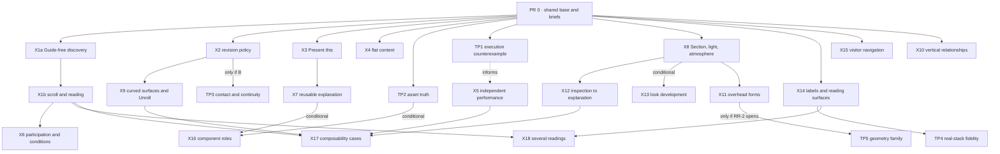

# Research 6 prototype roadmap

> One of two coordinated roadmaps. The [boundary and coordination record](./README.md) owns the single
> **build / prototype / research further / defer** ledger and the rules that move items between those
> columns. The [engineering authorization roadmap](./engineering-authorization-roadmap.md) owns what is
> built. This roadmap owns how every **PROTOTYPE** item is explored, judged and turned into a decision.

## 1. Purpose and stance

Research 6 left Biskiq with more good questions than settled designs. Most of the unsettled ones are
questions of **feel, legibility and fit with the vision**: whether creators can predict what a wall edit
does to content, whether a Guide-free page reads as a coherent experience, whether a local timing
instrument helps or clutters, whether a Section view earns its place. Those questions are best answered
by putting a runnable interaction in front of the person who owns the vision.

This roadmap is therefore deliberately **ambitious and open-ended**:

- it covers all five Research 6 study directions and every open question the
  [unified reconciliation](../research-6-unified-reconciliation.md) left on the build boundary;
- it has **no predetermined number of prototypes**: §5 lists the initial portfolio, §8 says how verdicts
  spawn, merge and stop prototypes;
- **the owner judges** each prototype for whether it is **intuitive, acceptable and aligned with the
  vision**. There are no participant studies, numerical UX thresholds, schedules or budgets. Creator
  sessions stay available as an owner choice, never as a gate.

Two kinds of question are outside owner judgment and are kept separate so a convincing demo cannot
answer them by accident: **technical feasibility** (answered by the technical probes in §6) and
**authority or format questions** (answered by the focused research rounds and amendment candidates in
the [coordination record](./README.md#5-focused-research-rounds)).

## 2. How a prototype is judged

### 2.1 The judging packet

Every prototype PR delivers the same packet, so judging is fast and comparable:

| Part | Content |
| --- | --- |
| Question | One sentence, plus the ledger rows the verdict can move. |
| Alternatives | Side-by-side treatments, always including the **ordinary or simpler baseline**, and a conventional comparator where §4.2 says one applies. |
| Journeys | Deep-linkable states (`?state=` style URLs) and a presenter that walks each alternative through the same task, following the object-composition `HANDOFF` and spatial-authoring Presenter patterns. |
| Owner prompts | The specific intuitive / acceptable / vision questions for this prototype (each entry in §5 lists them). |
| Honesty ledger | What is real, pinned-real, simulated, prepared or not represented (§3.2), and every shortcut taken. |
| Invariant checks | The §2.4 checks relevant to this prototype, run by the author before review, with results. |
| Verdict block | Empty until the owner fills it (§2.2). |
| Consequences | What each possible verdict does to the ledger, the engineering roadmap and any amendment candidate. |

### 2.2 Verdicts

| Verdict | Meaning | Consequence |
| --- | --- | --- |
| **Adopt** | The direction is intuitive, acceptable and on-vision as shown. | The ledger item moves to its "if adopted" disposition, usually a build candidate or an amendment candidate. |
| **Adopt with changes** | Right direction; named changes required. | As Adopt, with the changes written into the decision packet. A further round is optional, not required. |
| **Iterate** | Promising, but a named problem blocks a verdict. | One targeted revision with the problem stated. Iteration stops when the problem is fixed or shown unfixable. |
| **Reject** | Not intuitive, not acceptable or off-vision. | The ledger item moves to defer or refuse, with the reason recorded. The simpler baseline stands. |
| **Park** | No decision is useful now. | The item keeps its current disposition and names the trigger that would reopen it. |

A verdict is recorded in the prototype README's status banner (reviewed revision, date, verdict,
changes), the way Conservatory's acceptance is recorded, and the PR proposes the matching ledger change
in the coordination record. Verdicts can split by axis ("adopt the repair language, reject live
following"), as the spatial-authoring functional acceptance did.

### 2.3 What a verdict can and cannot do

A verdict **can** move a ledger item, resolve a decision point that an engineering plan already names,
motivate an amendment candidate, open a focused research round, spawn a follow-up prototype or retire a
direction.

A verdict **cannot** amend a ratified authority, authorize implementation, certify feasibility,
performance or accessibility, turn mock data into a format, or turn a simulated mechanism into a
shipped one. Those follow the normal routes: owner ratification through the owning contract's
procedure, phase registration and slice authorization, and production acceptance. This mirrors the
[prototype family boundary](../../prototypes/README.md) and Conservatory's acceptance language.

### 2.4 Hard invariant failures

These stop a candidate regardless of how it feels. A prototype that needs one of them to work is
stopped and recorded as a finding (a counterexample worth having), not adopted:

- a second Camera writer or evaluator, or pose/FOV interpolation outside Camera evaluation (including
  scroll writing the Camera directly);
- a second editorial order, such as an ordered `presentations[]` outside a Guide, or invisible Stops
  that make Guide-free work;
- ownership or relationship inferred from proximity, grouping or Room containment, or silent retargeting
  of an identity;
- a partially accepted compound edit, or a compound edit that needs more than one Undo;
- visitor interaction or runtime state writing authored source; implicit visit memory;
- Scene reconstructing Layout topology, or a renderer-side architectural compiler;
- editor machinery presented as part of a visitor surface.

Truthful refusal is always a valid outcome. A prototype that refuses an unsupported case is more useful
than one that hides it.

## 3. Prototype kinds and honesty labels

### 3.1 Kinds

| Kind | Judged by | Stack | Imports |
| --- | --- | --- | --- |
| **Interaction prototype** | Owner verdict (§2.2) | Static ES modules and vendored Three, like Conservatory; Conservatory tokens and shell grammar | Mock data and one mock evaluator per prototype; no production imports |
| **Technical probe** | Evidence against stated invariants and adversarial cases; the owner records a disposition, not a taste verdict | TypeScript with a local runner kept inside the probe directory | Pinned runtime-safe production modules through a documented local alias at a recorded commit |
| **Integration prototype** | Both: owner verdict on the interaction, evidence on the claims | Svelte 5 / Threlte where the claim is about the real stack | Pinned production modules; still never imported by production |

**Production never imports prototype code; prototypes may import pinned runtime-safe production
modules.** A probe documents one runner/alias setup, the exact source revision and the command, so
kernel reuse is reproducible without touching production build wiring or the npm workspaces. A
prototype reader can execute pinned fixtures without becoming a publication reader.

### 3.2 Honesty labels

Every visible behavior and every claim carries one label, in the UI where practical and always in the
README's honesty ledger:

- **Real**: the production mechanism, running.
- **Pinned-real**: a production module imported at a recorded commit, for example
  [`interpreter.ts`](../../packages/project-model/src/units/experience/interpreter.ts),
  [`lowering.ts`](../../packages/project-model/src/units/experience/lowering.ts),
  [`experience-controllers.ts`](../../packages/camera-core/src/experience-controllers.ts),
  [`viewport.ts`](../../packages/camera-core/src/viewport.ts),
  [`layout-plan-representation.ts`](../../packages/layout-core/src/layout-plan-representation.ts) or
  [`acceptance.ts`](../../packages/project-model/src/units/acceptance.ts).
- **Simulated**: a stand-in that behaves as the design intends; it proves nothing about feasibility.
- **Prepared**: a hand-made fixture, such as a mesh canopy standing in for native overhead geometry.
- **Not represented**: deliberately left out, named so its absence is not mistaken for a design.

## 4. Shared material

### 4.1 Briefs

Retained from the earlier draft of this PR, so every prototype is judged on content that resembles real
creative work rather than on a demo built for it:

- **Explain a mechanism or process.** Two instances of a small pump or kinetic assembly, a casing/part
  reveal, several viewpoints, short explanatory text, one visitor choice, and later a replacement
  component. No Room. One instance keeps running while the other is paused or inspected.
- **Shape and explain a space.** A small pavilion, exhibition or event proposal with an approach, a
  compressed threshold, a focal object **and** an empty spatial vista (a zero-object View), an overhead
  treatment and one vertical relation. Two intentional atmospheres, one explained sightline, then a
  geometry change. Not a museum-only brief.
- **Flat-content control.** A small image/text collection with no meaningful 3D dependency. A
  conventional page is allowed to win.

The populated Conservatory world (Salon, Rotunda, Gallery) remains available as a familiar baseline.

### 4.2 Comparators

Where a prototype asks whether a spatial treatment earns its cost, it shows the **same content** in a
conventional page or slide sequence beside it. Where it asks whether a new instrument earns its cost, it
shows the **ordinary operations** that would otherwise do the job. A prototype never compares a polished
Biskiq treatment with an empty starting point.

### 4.3 Reuse map

| Source | Reuse for | Never reuse as |
| --- | --- | --- |
| [Conservatory](../../prototypes/experience-ux-alternative/README.md) | Tokens, Head / Index / Stage / Card overlay / invoked instrument grammar, scenario and width menus, visitor chooser, seeds (`seedPopulated`, `seedEmpty`, `seedStress`) | A data format, a Camera evaluator, a history model or a rendering strategy (it uses snapshot Undo and several WebGL contexts) |
| [Spatial Authoring](../../prototypes/spatial-authoring/README.md) | Rotunda arc walls, Unroll, Section, Ceiling Lift, Back/Resume chains, journeys A–F by deep link; modules copied into a new sibling (its README forbids further V2 development in place) | Its older shell; its analytic caps and per-frame re-tessellation as geometry |
| [Object Composition](../../prototypes/object-composition-prototype/README.md) | Reach preview, this-use/definition rows, provenance chains, repair choices, bench comparison, presenter-plus-state-URL handoff | Its "tiny bay compiler" as Layout; its simulated ingest as asset truth |
| [Experience Authoring donor](../../prototypes/experience-authoring/README.md) | Pacing, detour and return behavior evidence | Its UX, which is not the accepted direction |

### 4.4 What the shared base is not

One small base PR (§7) carries the briefs, comparators, copied Conservatory tokens, the judging-packet
and honesty-ledger templates and the pinned-import convention. It is **not** an application framework,
a universal scene model, a shared relationship graph or a new history service. Each prototype stays
independently runnable on its own port and can be deleted without breaking another.

## 5. The portfolio

Grouped by the creative question each answers. IDs continue the reconciliation's lineage: **X1** is its
scroll-page comparison, split into discovery and reading; **X2** is its conditional A1/B comparison,
promoted to an owner-judged prototype because its verdict decides an engineering decision point. Every
entry names the ledger rows it can move; the row names match the
[coordination record's ledger](./README.md#4-the-disposition-ledger).

### 5.1 Can I make something worth showing from what I already have?

#### X3 · Present this

**Question.** Does a one-gesture *Present this* (subject(s) or space → proposed placement, framed View,
Presentation with title and caption, optional Stop) preserve authorship, or does it make every result
look the same?
**Decides.** *Present this* (prototype → build candidate); Frame this as fixed versus assisted framing.
**Alternatives.** Ordinary separate steps across World and Experience with good defaults; *Present this*
as a reviewable proposal that shows each domain step before one acceptance; the same proposal with
assisted (recomputing) framing. Cases: zero subjects (an architectural sightline), one subject, several
subjects in one relation, and a second, deliberately different result from identical content.
**Owner judges.** Is it clear what the gesture will change before accepting? After accepting, is each
part plainly ordinary, editable state in its own place? Can you push the result away from the default
without fighting the assistance? Does it read as directed spatial composition rather than a placard
viewer?
**Real / simulated.** Compound acceptance and one Undo may be pinned-real through the unit acceptance
module; framing quality is simulated unless a probe solves it.
**If adopted.** *Present this* becomes a post-stability T2/T3 build candidate, and the framing verdict
settles the Frame this decision point in T3.P02. **If rejected.** Ordinary steps stand; Frame this ships
as a plain solve-once verb.
**Depends on · spawns.** Base only. Spawns X7.

#### X4 · Flat content in space

**Question.** When a creator's material is images and text, does a spatial treatment earn its cost, and
where should images live: as Scene panels, as Presentation media in a reading surface, or both?
**Decides.** Still images as Presentation media; the image half of owner decision 2; inputs to the
Experience content model.
**Alternatives.** The flat-content brief as (a) image panels placed in a simple space, (b) a Guide or
Guide-free page whose Presentations carry images and text, (c) the conventional page.
**Owner judges.** Which version would you actually make for this material? Does the spatial version add
meaning or only novelty? Is the split between "image as an object in the world" and "image as content a
visitor reads" intuitive?
**Real / simulated.** Simulated; image upload is not represented.
**If adopted.** Image panels: confirms the engineering roadmap's image-resource plus panel scope. Image
media: becomes an input to focused research round RR-6 before any content-model build.
**If rejected.** A tie favors the simpler treatment for that material; Biskiq stops trying to make flat
work spatial by default.
**Depends on · spawns.** Base only. Feeds X1b and X18.

### 5.2 Can I direct attention without taking away agency?

#### X1a · Guide-free discovery

**Question.** Can a visitor find and understand a set of Presentations with no Guide, and what is the
right shape for that discovery?
**Decides.** Guide-free discovery UX beyond the minimum semantic index (constellation, spatial markers,
contextual entry); a decision point inside T3.P02.
**Alternatives.** The minimum the engineering roadmap builds regardless (an unordered semantic index
reaching every Presentation through a Camera Cut); that index plus spatial markers; a Presentation
constellation with contextual entry. No second writable order and no invisible Stops in any of them.
**Owner judges.** Does free exploration feel like an intended experience or like a missing tour? Does
the visitor know what exists and where it is? Is it acceptable that order only exists when a Guide does?
**Real / simulated.** The current interpreter completes a Guide-free run on entry, so this is an
authoring/discovery simulation or uses a clearly labeled disposable activation adapter that still calls
canonical Camera evaluation. It never claims runtime support.
**If adopted.** The adopted shape becomes an option T3.P02 can take or a T3 follow-on build candidate.
**If rejected.** T3.P02 keeps the minimum index only.
**Depends on · spawns.** Base only. Feeds X1b and X18.

#### X1b · Scroll and reading page

**Question.** When a creator wants an ordered, reading-led experience, do auto-laid Guide sections
suffice, or does a bounded invoked reading-layout instrument earn its place? How do held choices,
detours and reverse scrolling behave?
**Decides.** Scroll-driven Guide and reading-layout instrument (prototype → shell amendment candidate
or reject); inputs to RR-6; delivery-profile questions recorded for T4 only.
**Alternatives.** Variant A, auto-laid scroll sections from Conservatory's Guide and Presentation cards;
Variant B, a bounded invoked reading-layout sheet over the same records; both with one held Stop whose
inline choice branches through `set-state` or `navigate-to`, a detour and return, reverse scroll, a
no-overflow page and reduced motion.
**Owner judges.** Does scroll feel like reading a spatial essay, or like scrubbing a camera? Does Variant
B give control you would miss without it, or just a second place to edit? Does reverse scroll ever
"un-make" a choice in a way that feels wrong?
**Real / simulated.** Scroll maps to Stop index and Travel fraction through one mock Camera evaluator;
scroll never writes pose or FOV. W3C scroll timelines go inactive without a scrollable range and must
avoid layout cycles ([Scroll-driven Animations](https://www.w3.org/TR/scroll-animations/)), so the
prototype includes content growth and a page with no overflow; a visual scroll percentage never stands
in for semantic state.
**If adopted.** Variant B becomes a PLATE amendment candidate (it must name the rule it changes and pass
PLATE's conformance test). Seek, scrub and profile questions are recorded for T4 when R1-D lifts; no T4
work starts.
**If rejected.** Auto-laid sections stand; no new instrument.
**Depends on · spawns.** Benefits from X1a. Feeds X18 and RR-6.

### 5.3 Can independent activity and participation stay intelligible?

#### X5 · Independent performance and local timing

**Question.** Can a mechanism keep running across Camera cuts while the visitor pauses travel, inspects
a part, changes a supported parameter and resumes, and does a local timing instrument help a creator
shape that, or are state cards enough?
**Decides.** Independent performances and local timing (prototype → amendment candidates and RR-3).
**Alternatives.** State-led cards only; an optional invoked local timing instrument over the same
performance intent; "Rehearse here" from defaults versus from a particular recorded history.
**Owner judges.** Is it obvious which things share a clock and which do not? Does the timing instrument
make revision easier, or add a second thing to keep in sync? Is the visitor ever confused about what is
paused?
**Real / simulated.** Simulated interaction; feasibility comes from TP1, never from this prototype.
Research on animation comparisons shows motion can look better simply because it carries more
information than its static control ([Tversky, Morrison and Bétrancourt](https://serc.carleton.edu/download/files/676/Tversky_2002.pdf)),
so the alternatives carry the same information. Pause and stop controls for ongoing motion are tested
separately from reduced motion ([Pause, Stop, Hide](https://www.w3.org/WAI/WCAG22/Understanding/pause-stop-hide)).
**If adopted.** A local timing instrument becomes a PLATE rule-change candidate plus an F program-kind
candidate (both through their owners' procedures), and the execution questions go to RR-3. No timeline
is inferred from Conservatory's mock.
**If rejected.** State cards stay the grammar for this workload; the decision record's ceiling for local
timing tracks is unchanged, only not pursued now.
**Depends on · spawns.** Informed by TP1, not blocked by it.

#### X6 · Participation and conditions

**Question.** Can a non-programmer express "after the visitor has seen X", "two of three found" or a
visitor-set parameter in their own terms, rehearse it, and trust it after revision?
**Decides.** Conditions and visitor state authoring (prototype → RR-7 before any T3 Gates phase).
**Alternatives.** Semantic condition phrases that lower to declared state; an explicit variable editor;
both with loose-end diagnostics and "preview as a visitor who has…" rehearsal from explicit initial
state. Includes the storytelling study's three-room mystery plus one revision step.
**Owner judges.** Can you read a condition back and know when it fires? After moving or deleting a
Presentation, do you trust what the diagnostics say? Is the phrase form a help or a cage?
**Real / simulated.** Simulated authoring; the shipped program supports boolean and choice state only,
so counts are labeled as a proposed operator.
**If adopted.** RR-7 settles the operator set and lowering; the result feeds T3 Gates planning.
**If rejected.** The variable editor and plain choices stand; conditions stay deferred.
**Depends on · spawns.** Benefits from X1b's held choice.

### 5.4 Can I change my mind without rebuilding the experience?

#### X2 · Revision policy: A0, A1 and B

**Question.** When a wall under placed content moves, splits or is deleted, what should happen, and can
the creator predict it?
**Decides.** Surface-placement provenance (`placedOn`, the reconciliation's A1) and live hosting (B);
the impact-report language; fixed versus assisted framing under revision. Its verdict resolves the A0/A1
decision point in the post-stability surface-placement build candidate.
**Alternatives.** A0, pose only (a negative control for lost intent); A1, world-local pose plus
non-rebasing provenance, conservative diagnosis and explicit Re-seat / re-pick / Detach; B, declared
live attachment evaluated by the owner. The same wall move, split, delete and Undo in each, with equal
diagnostic quality. The impact report uses the ratified four states (Unchanged, Recomputed, Needs
Review, Unresolved) and preserves the original target identity.
**Owner judges.** Before each edit, could you say what would follow and what would stay? After it, did
the result match? Does repair feel like understanding the model or like cleaning up after it? Is A1's
explicit repair acceptable for the vision, or does Biskiq's revision promise require content that
follows?
**Real / simulated.** Simulated geometry; proximity never stands in for ownership. A repair preview is
not an acceptance.
**If adopted (A1).** `placedOn` becomes part of the surface-placement build candidate, through a Scene
contract change and an F.1 reference-kind amendment drafted by that first consumer.
**If adopted (B).** RR-4 and TP3 open; implementation stays deferred until they close.
**If A0 suffices.** Surface placement ships pose-only, with the reason recorded.
**Depends on · spawns.** Base only. Spawns TP3 (only if B), feeds X9.

#### X7 · Reusable explanation

**Question.** Can an explanation built once (View, Presentation, reveal state) be rebound to a different
subject with less effort and more confidence than duplicating and repairing it?
**Decides.** Reusable explanations, roles and kits (prototype → RR-5; implementation deferred).
**Alternatives.** Duplicate-and-repair; role-based rebinding with explicit binding review. Includes one
genuinely different subject and one incompatible asset, so the prototype cannot win on perfect fixtures.
**Owner judges.** Is it clear what a rebinding will change in this instance versus its shared
definition? When binding fails, is the failure understandable? Is this worth the concepts it adds?
**Real / simulated.** Simulated; no correspondence is inferred from names or node order.
**If adopted.** RR-5 defines identity and role semantics before any T2 build.
**If rejected.** Kits stay deferred; duplication is the reuse story.
**Depends on · spawns.** X3. Feeds X16.

### 5.5 Can I shape a space's character, not just arrange its contents?

#### X8 · Section, light and atmosphere

**Question.** On identical geometry, which instruments actually give creators control over enclosure,
light and attention: ordinary 3D controls, a Section/cutaway reading, target-first light placement
("Light this"), or a combination?
**Decides.** Light this (prototype → build candidate); session A/B for looks (feeds X13); confirms the
Section reading as a creator instrument (already a build candidate on accepted V2 evidence).
**Alternatives.** Staged on identical geometry: ordinary controls; then Section alone; then target-first
light placement solved once into ordinary light values; then, only if the task still needs it, ceiling
or profile control. Two intentional atmospheres; a view-dependent highlight solved at the current view.
**Owner judges.** Which step made the result better, rather than only different? Can you move away from
the default light deliberately? Does the highlight stay where you expect when you walk away from the
view it was solved for?
**Real / simulated.** Section can be pinned-real for Plan cut parameters; lighting is simulated.
A view-dependent highlight never silently becomes a live lighting constraint.
**If adopted.** Light this becomes a Scene build candidate after basic light editing; a persistent light
relationship would instead go through RR-4's relationship policy.
**If rejected.** Ordinary light editing is the scope.
**Depends on · spawns.** Base only. Spawns X12 and X13.

#### X9 · Curved surfaces and Unroll arrangement

**Question.** Is Unroll the right place to arrange content on curved or long walls, compared with
in-place manipulation in 3D?
**Decides.** Unroll as an arrangement instrument for surface placement (prototype → build candidate with
surface placement).
**Alternatives.** In-place surface drag in 3D; Unroll with a picture-in-picture 3D check; both followed by
a visitor sightline check. Reuses the Rotunda and Unroll modules from Spatial Authoring.
**Owner judges.** Do you know where an item is in 3D while placing it in Unroll? Does a curved wall feel
easier to compose flat? Is the round trip back to 3D clean?
**Real / simulated.** Pinned-real Plan representation where useful; placement simulated.
**If adopted.** Unroll joins the surface-placement build candidate as its precise arrangement view.
**If rejected.** Surface placement stays in-place only.
**Depends on · spawns.** X2's verdict on provenance.

#### X10 · Vertical relationships

**Question.** How should creators work with things that span heights: a suspended subject across two
height zones, a mezzanine view, a stair landing?
**Decides.** Nothing on its own; it supplies interaction evidence for focused research round RR-1 on
levels and vertical frames, which must happen before any T1 levels phase.
**Alternatives.** Explicit height or level context (chromatic level overlay with active/above/below
treatments); bounded surface stepping; inspect and return without losing scope.
**Owner judges.** Do you always know which height you are editing? Does the overlay help, or is it noise?
**Real / simulated.** Prepared two-height scene; not native levels, level identity or a second compiler.
**If adopted.** The adopted interaction is an RR-1 requirement, not a build candidate.
**If rejected.** RR-1 still runs before levels; it loses one candidate interaction.
**Depends on · spawns.** Base only.

#### X11 · Overhead forms

**Question.** Does native control of ceilings, canopies and roofs change the result enough to justify a
geometry family, or do flat caps plus imported or prepared forms serve the briefs?
**Decides.** Whether RR-2 (overhead geometry family and slab/ceiling ownership) opens now or stays
deferred.
**Alternatives.** Zero-click flat cap; a prepared canopy or vault; a straight-skeleton hip from an apex
handle; an interior liner that "unzips" with an automatic section.
**Owner judges.** Is overhead form part of the creative work you want Biskiq to own, or a place where
imported content is enough?
**Real / simulated.** Prepared and labeled; the straight skeleton may be a simulated solve.
**If adopted.** RR-2 opens, and TP5 compares bounded geometry families on the same required shapes.
**If rejected.** Overhead forms stay deferred; flat caps and imports are the answer for now.
**Depends on · spawns.** Benefits from X8. May spawn TP5.

#### X12 · Inspection becomes explanation

**Question.** Can a Section, reveal or exploded inspection the creator makes while working become an
authored Presentation, by explicit capture of its semantic parameters, and then return cleanly to
ordinary authoring?
**Decides.** Capture of representation parameters into Presentations (prototype → RR-3 input; any
format change is an F.3 or program amendment).
**Alternatives.** A plain View capture only; explicit capture of eligible inspection parameters, with a
visible statement of what is and is not captured. Temporary editor state is never copied.
**Owner judges.** Is it clear what the visitor will see versus what was only your working view? Is the
return to authoring exact?
**Real / simulated.** Simulated capture; pinned-real Plan parameters where useful.
**If adopted.** RR-3 decides how captured parameters live in the program.
**If rejected.** Views stay the only capture.
**Depends on · spawns.** X8.

#### X13 · Look development and alternatives (conditional)

**Opens when** X8 or the first lighting build candidate needs it. **Question.** Do creators need to hold
two looks side by side (editor-session A/B), keep persisted variants, or offer visitor-controlled
looks, and can the four lifecycles stay distinct in the UI? **Alternatives.** Undo-based iteration;
session A/B with one ordinary acceptance; persisted variants; visitor looks as typed resources. **If
adopted.** A focused research question on the four lifecycles before any build. **If rejected.** Undo
iteration stands.

### 5.6 Can the visitor read, navigate and stay oriented?

#### X14 · Spatial labels and reading surfaces

**Question.** For the same content, when is a world-surface label, a tethered callout or a screen
reading surface right, and does essential content stay readable when labels are occluded or culled?
**Decides.** Spatial labels and callouts (prototype → build candidate with RR-6's content model);
inputs to TP4.
**Alternatives.** The three treatments with identical content; proximity collapse; focus and reading
continuity when a label is hidden; reduced motion.
**Owner judges.** Which treatment would you choose for each piece of content, and is that choice easy to
make and change? Can you always read what matters?
**Real / simulated.** Overlay alignment is simulated here and measured in TP4.
**If adopted.** A build candidate once RR-6 settles content records.
**If rejected.** Screen reading surfaces and the semantic index carry content alone.
**Depends on · spawns.** Base only. Feeds X18 and TP4.

#### X15 · Visitor navigation

**Question.** How should a visitor move when not following a Guide: free look, click-to-move to semantic
destinations, walking, or an elastic tour that pauses when the visitor wanders and resumes on request?
**Decides.** The movement profile controller (prototype → build candidate); whether walkable geometry
needs research.
**Alternatives.** Guided travel only; free look; click-to-move to destinations; walk; elastic dwell versus
a modal tour/free split. Every mode realizes intent through one mock Camera evaluator.
**Owner judges.** Does each mode feel like the same world, or like different products? Is rejoining a
tour obvious? Does walking add enough to justify collision and walkable-surface work?
**Real / simulated.** Simulated; the shipped free controller only releases and rejoins Camera ownership
and has no movement.
**If adopted (click-to-move).** A post-stability T3 build candidate. **If adopted (walk).** A focused
research question on walkable geometry and collision before any build. **If rejected.** Guided travel
and free look stand.
**Depends on · spawns.** Base only.

### 5.7 What can imported content honestly promise?

#### X16 · Component roles (conditional)

**Opens when** TP2 shows that semantic components exist in real files often enough to matter, or X7 is
adopted. **Question.** Is creator-approved role binding (this node is "the rotor") understandable and
worth it, compared with root-only composition? **If adopted.** RR-5 defines component identity before
any ingest beyond K1. **If rejected.** Root-only import with honest capability disclosure stands.

### 5.8 Do the pieces compose?

#### X17 · Composability cases

Run only after the component prototypes they combine have verdicts. Each case removes one capability at
a time where that helps attribute a failure:

| Combined case | Why isolated prototypes miss it | Discriminating evidence |
| --- | --- | --- |
| Scroll + held choice + free inspection + resume | Scroll progress can become hidden history or override a hold | The same semantic destination stays reachable; the chosen branch and phase are explicit; reverse scroll invents no prior choice; reduced motion keeps meaning |
| Host revision + light aim + fixed or assisted frame | Correct transforms can still destroy the intended composition | Only declared relationships follow; fixed work stays fixed; impact is explained; missing targets stay repairable |
| Section/Unroll + selection + explicit capture | A representation can lie about what a drag edits, or leak session state | Picking maps to source or refuses; capture holds eligible parameters only; return restores context without changing source |
| Two activity instances + Camera handoff + cancellation | Endpoint tests miss private phase and stale cleanup | Independent phase survives; one current Camera writer; an old run cannot release a new run's channels |
| Rebind + source replacement + Undo/reload | A fixture can hide unstable identity and partial acceptance | Same captured identities on Redo; unsupported roles refuse; no half-installed composition; reload does not depend on a transient cache |
| Responsive text + spatial overlays + projection | Each layer can work while their coordinates and focus disagree | Render, hit and DOM alignment; stable semantic reading; no click-through; no fixed-viewport dependence |

#### X18 · One composition, several readings

**Question.** Can one composition serve a directed explanation, an unordered inspection and an accessible
reading path without three things to maintain? **Decides.** Whether multiple Experiences over one world
(already in T3.P02's scope) need more than separate Guides. **Depends on.** X1a, X1b, X14.

## 6. Technical probes

Probes answer feasibility questions that no owner verdict can. Each states its claim, its adverse
cases and its stop condition; each reports **established**, **refused** or **still simulated** per
claim. None creates production eligibility.

| Probe | Claim tested | Minimum adverse cases | Stop condition | Feeds |
| --- | --- | --- | --- | --- |
| **TP1 · Execution counterexample** | One experimental Scene channel family (for example a procedural rotor) can run through the pinned reducer, lowering, Camera controllers and output tickets with private run identity and explicit clock samples | Two independent run phases; pause one without the other; cancellation and late callbacks; stale epoch cannot reclaim output; reset/seek; project replacement mid-run; deterministic ordered-event replay; source hashes unchanged by visitor interaction | A single global progress variable, a second Camera writer or a parallel general executor is needed: stop with an exact seam report | X5, X12, RR-3, any F.3 family amendment |
| **TP2 · Asset truth** | What real GLB files actually carry: hierarchy, transforms, component identity, clips, units, pivots | Flat mesh; nested rigid assembly; repeated names; textured model; two instances of one definition; clip-bearing model; re-export with reordered or removed parts and changed units or pivot; nonuniform transforms or shear; one incompatible file | Correspondence depends on mutable names or order; every reuse needs hand repair | K1 planning (honest capability states only; K1 is not enlarged), X16, RR-5 |
| **TP3 · Contact and continuity** (only if X2 favors B) | Layout-produced correspondence can keep hosted content on its surface through revision and reload | Finite extents and orientation; both wall sides; Opening voids; T and bevel junctions; split boundary; delete and recreate; Undo/Redo; non-adjacent revisions; reload | Scene would have to reconstruct topology, or an exact face evaluator clamps instead of refusing | RR-4 |
| **TP4 · Real-stack fidelity** | Adopted visitor interactions survive Svelte 5/Threlte with real Camera matrices and canonical Layout output | DOM/WebGL/hit alignment through one viewport rectangle and projection; disposal after repeated replacement; stale asset completion rejected; keyboard and touch; reduced motion; focus continuity; a real mid-range mobile device where available | Stale hits, click-through, lost focus or steady resource growth: attribute before optimizing | X14 build candidate; later T4 inputs (recorded, not acted on) |
| **TP5 · Geometry family** (only if X11 opens RR-2) | A bounded overhead family can extend the canonical compiler with stable identity | Concavity; holes and openings; curved boundaries; degeneracy; self-intersection; wall-top agreement; rebuild cost | The family needs a second compiler or renderer-side reconstruction; prefer truthful refusal outside the family | RR-2 |

Probe observations never become machine-time CI gates. Durable benchmark infrastructure would need its
own owner decision under the [test contract](../../apps/editor/tests/README.md).

## 7. Dependencies and PR sequence

The order below is **by decision value and dependency**, not by date. Prototypes higher in the list
settle decision points that engineering plans will reach sooner. Items on the same level can run in
parallel in separate directories. PRs may split or merge when review clarity demands; the count is not
fixed.

| Order | PR contents | Depends on | Why here |
| --- | --- | --- | --- |
| 0 | Shared base: briefs, comparators, tokens, judging-packet and honesty-ledger templates, pinned-import convention, family README with a verdict index | Owner authorization of the round | Every later PR reuses it; it is small by design |
| 1 | **X1a** Guide-free discovery | 0 | Its verdict can shape T3.P02's navigation option; T3.P02 does not wait for it |
| 1 | **X2** Revision policy | 0 | Settles the A0/A1 decision point before surface placement is planned |
| 1 | **X3** Present this | 0 | Settles Frame this fixed versus assisted inside T3.P02, and the post-stability compound workflow |
| 1 | **TP2** Asset truth | 0 | Cheap; gives K1 planning honest capability states without enlarging K1 |
| 2 | **X4** Flat content | 0 | Informs owner decision 2's image scope and RR-6 |
| 2 | **X1b** Scroll and reading | X1a helpful | The most consequential open Experience UX question |
| 2 | **TP1** Execution counterexample | 0 | Feasibility evidence before X5 can be adopted |
| 2 | **X8** Section, light and atmosphere | 0 | Decides Light this; gates X11, X12, X13 |
| 3 | **X5** Independent performance | TP1 informative | Needs TP1's result before an adoption can motivate amendments |
| 3 | **X14** Labels and reading surfaces | 0 | Feeds TP4 and RR-6 |
| 3 | **X15** Visitor navigation | 0 | Decides the movement controller's shape |
| 3 | **X6** Participation and conditions | X1b helpful | Must precede any T3 Gates planning |
| 4 | **X9** Curved surfaces and Unroll | X2 | Only meaningful once provenance is decided |
| 4 | **X10** Vertical relationships · **X11** Overhead forms | X8 helpful for X11 | Inputs to RR-1 and RR-2; neither authorizes geometry |
| 4 | **X12** Inspection to explanation | X8 | Feeds RR-3 |
| 4 | **X7** Reusable explanation | X3 | Feeds RR-5 |
| 5 | **X17**, **X18**, **TP4** | Their components' verdicts | Integration only after components are judged |
| — | **X13**, **X16**, **TP3**, **TP5** | Their triggers | Opened only when the named verdict or research round calls for them |

## 8. Spawning, merging and stopping

- **Spawn** a prototype when a ledger item sits on the boundary with no verdict, when a verdict names a
  follow-up, or when an engineering plan names a decision point that an interaction could settle. The
  new entry follows §5's format and gets a row in §7.
- **Merge** prototypes when their alternatives share a task and separating them would make the owner
  judge the same thing twice.
- **Stop** a prototype when it needs a §2.4 invariant failure to work; when it would need production
  infrastructure (a general executor, a relationship engine, a new history service) before the
  counterexample can be shown, in which case it stops with an exact seam report and a smaller
  counterexample; or when a second iteration does not remove the blocking problem.
- **Do not polish past the question.** Once the owner can judge, further visual work is out of scope.
- **Negative results are kept.** A rejected prototype stays in the family with its verdict, because it
  prevents the same idea from returning unexamined.

## 9. From verdict to engineering

| Prototype | If adopted, it becomes | Through |
| --- | --- | --- |
| X1a | An option for T3.P02's navigation, or a T3 follow-on build candidate | T3.P02 slice planning (decision point) |
| X1b | A PLATE amendment candidate for a reading-layout instrument; RR-6 input; T4 notes | Owner ratification of the shell rule change |
| X2 | `placedOn` in the surface-placement build candidate (A1), or RR-4 plus TP3 (B) | First-consumer Scene and F.1 amendment |
| X3 | *Present this* build candidate; Frame this framing mode | T2/T3 post-stability registration; T3.P02 decision point |
| X4 | Confirmation of image panels; RR-6 input for image media | T2.P02 planning; RR-6 |
| X5 | PLATE rule change and F program-kind candidates; RR-3 | Owner ratification; first consumer |
| X6 | RR-7 | Before T3 Gates planning |
| X7, X16 | RR-5 | Before any reuse or ingest build beyond K1 |
| X8 | Light this build candidate | T2 lighting planning |
| X9 | Unroll arrangement inside the surface-placement candidate | T1/T2 planning |
| X10, X11 | RR-1, RR-2 | Focused research rounds |
| X12 | RR-3 | Focused research round |
| X14 | Spatial-label build candidate after RR-6 | T3 planning |
| X15 | Movement controller build candidate, or a walkable-geometry research question | T3 planning |

**Engineering never waits on this table.** Every build item in the engineering roadmap is executable on
its own evidence. Where an engineering plan contains a decision point a prototype can settle, the
[coordination record](./README.md#6-decision-points-where-the-roadmaps-meet) names the default it
takes if no verdict exists when its plan is frozen.

## 10. Safeguards that still allow discovery

| Concern | Rule for prototypes | What would justify an amendment candidate |
| --- | --- | --- |
| Identity and persistence | Use F.1-qualified references for supported real paths; label fixture fields and provisional mappings; serialize authored fixture intent apart from events, outputs, selection and simulation controls | A concrete supported use that current reference shapes cannot represent, with alternatives |
| Transforms and relationships | Scene placement is world-local; internal frames are explicit; state whether a pose is authored or evaluated from a declared relation | A demonstrated capability needing a new frame, channel or relationship policy |
| Layout | One compiler; representations consume its output; mock geometry is labeled non-native | The smallest new Layout family needed for an adopted task |
| Camera and time | Controllers emit intent; Camera owns route, projection and pose; local performance time never becomes independent Camera interpolation | An unsupported motion or mapping with canonical evaluation preserved |
| F.4 acceptance | Assisted creation resolves into reviewable domain operations; compound claims use one expected revision, atomic acceptance and one Undo | A first-consumer intent extension; never partial multi-domain acceptance |
| F.3 execution | Domain-owned channels and explicit operators; deterministic evaluation; stale epochs cannot reclaim output | A narrow family or operator with a real conflict example and conformance cases |
| Visitor isolation | Local viewing has its own session and runtime-safe dependencies | No weakening is justified; meeting this is a reason to change the prototype |
| Shell | Keep World \| Experience, the selected-identity Card, invoked task context, explicit capture and return and visible edit reach; try a conformant invoked instrument first | Repeated high-value tasks fail the conformant treatment and a bounded alternative is adopted; the candidate names the rule it changes |

## 11. Deliberately not prototyped now

| Not now | Why | Reconsider when |
| --- | --- | --- |
| A rebuild of Conservatory or of all five studies | Duplicates accepted specimens and hides interaction effects | A comparison needs a treatment retained evidence cannot express |
| A general relationship engine, constraint graph or universal state snapshot | Ratified ownership is clear; relationships differ in validity and lifetime | Several adopted consumers reveal one shared need without merging authorities |
| A complete roof, level or SDF system | Expensive before the useful family and interaction are known | X10/X11 verdicts and RR-1/RR-2 justify one bounded family |
| Physics staging, puppeteering, action recording | Nondeterminism undermines precise revision; X5 tests independent time more cheaply | A task fails with snapping and solve-once assistance |
| Captured venues | Opaque, unrelightable, unproven | The owner's own projects mostly start from existing places |
| Material node graphs, decal suites, optical simulation, shutters, sun solving | Not needed to judge attention and variation | X8 names a specific control that changes outcomes |
| XR, a universal free-walk controller | Separate geometry and input research | X15 shows walking is essential |
| Agents, autonomous generation, custom scripting | Would confound the value of the direct operations | Direct operations are adopted and stable enough for a bounded comparison |
| Libraries, kit marketplaces, collaboration backends | Reuse value is unproven | X7 and RR-5 show repeated reuse |
| Release previews, packages, share routes, delivery profiles | Outside R1-D; local viewing does not need them | Stability is accepted and the owner renews T4 planning |

These are sequencing choices, not ceilings. Local timing, native architecture, semantic reuse and
participation remain important even where a first task succeeds without them.

## 12. Evidence and limits

This roadmap rests on the merged [unified reconciliation](../research-6-unified-reconciliation.md),
the [integrated synthesis](../biskiq-integrated-product-synthesis.md), the five studies
([scene composition](../creative-scene-composition-ux.md),
[storytelling](../spatial-storytelling-ux.md),
[spatial interfaces](../spatial-interface-authoring-ux.md),
[multi-level](../multi-level-spatial-authoring-ux.md),
[roofs and volumes](../expressive-roof-volume-authoring-ux.md)), the retained prototypes' READMEs and
source inspected at `5fee2a2d`. The studies' interaction examples shape the portfolio; their speed,
percentage and legibility figures are not adopted as criteria, consistent with the reconciliation's
evidence corrections. glTF stores hierarchy, transforms and keyframes but not playback order, loops or
time mapping ([glTF 2.0](https://registry.khronos.org/glTF/specs/2.0/glTF-2.0.html)), which is why TP2
and X5 keep imported clips separate from Biskiq's playback policy.

No prototype was built, no creator or audience was observed, no browser was measured and no test was
run to write this roadmap. Its portfolio and order are product and engineering judgments for the owner
to accept, reorder or cut.
