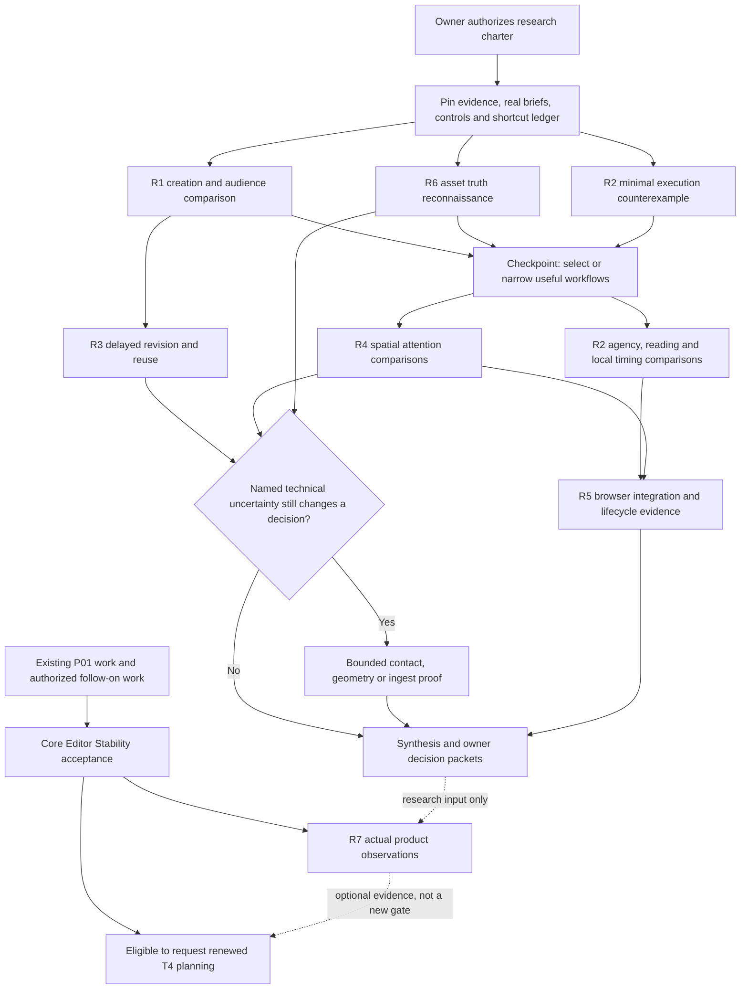

# Research 6: an exploration program for Biskiq's creative ceiling

**Recommendation:** investigate whether Biskiq can make a spatial idea easy to express, understandable or compelling to an audience, and substantially easier to revise and reuse. Test those claims together, through two contrasting creative briefs. Use a small family of connected experiments, with separate technical proofs where interaction prototypes cannot supply credible evidence.

The strongest next investment is **a continuing creative project followed through creation, direction, interruption, revision and reuse**. A successful first presentation is only the beginning. The important question is whether deeper capabilities preserve a creator's intention when content, geometry, timing or audience needs change.

This calls for more than the reconciliation's X1 scroll-page comparison, but less than implementing every study's proposed feature. I recommend two reusable interactive settings—an explanation/participation setting and a space/attention setting—supported by bounded source, execution, geometry and browser investigations. They share content, tasks and evidence conventions, not a new application framework. Expensive technical branches open only when their result could change a decision.

**Authorize research in stages, protect P01 capacity, and preserve negative results.** The first decision-quality evidence should arrive in the first working week after authorization. A recommended research pod can deliver the main synthesis in roughly six to eight working weeks, with earlier decisions released continuously. This is an effort estimate, not a forecast of track completion. Post-stability product observation has an event dependency and no invented date.

The research must be allowed to show that a particular spatial workflow is unhelpful, that a simpler instrument is sufficient, or that an accepted interaction assumption needs an owner amendment. It must not be allowed to hide those outcomes behind an increasingly impressive demonstration.

## Decision basis and important departures from Research 6

Evidence labels throughout this proposal:

- **Verified:** inspected repository source, contracts, acceptance records or current PR metadata. Source/test inspection does not mean tests were executed in this task.
- **Prior evidence:** an earlier recorded run or observation, with its limitations retained.
- **Inference:** a technical conclusion supported by inspected evidence, still requiring the stated proof where consequential.
- **Hypothesis:** an unvalidated product or interaction proposition.
- **Owner decision:** a scope, contract or priority choice that research cannot authorize.

The normative destination already supports independent performances, visitor participation, reusable experience kits and revision-aware relationships. These are not new architectural discoveries. The ratified strategy explicitly calls for two real workflows with actual audiences and distinguishes activation from successful revision/reuse. It also allows optional local timing instruments; a permanent prohibition on timelines would impose a research preference on the product's representable behavior. See the [ratified strategy and creative model](../docs/reference/decisions/northstar-ratification-2026-09-27.md#3-product-strategy), [current North Star](../docs/reference/north-star.md) and [F contracts](../docs/reference/composition-execution.md).

I disagree with four implications of the reconciliation's recommended program, while retaining its architectural corrections:

| Prior emphasis | Recommended change | Why it changes the research investment |
| --- | --- | --- |
| X1 is the principal immediate prototype; most other directions await consuming phases. | Keep X1 as a nested comparison; begin a bounded test of independent execution, revision and spatial attention now. | Production eligibility and research value are different. Early disposable evidence can prevent a future phase from committing to an inadequate interaction model. It creates no new production eligibility. |
| Creator observation primarily follows Core Editor Stability. | Observe real briefs and disposable interactions before stability; separately observe the actual product after acceptance. | Waiting is appropriate for assessing the product. It is unnecessary for testing future value, edit-scope comprehension or a choice between interactions. Those claims must remain separate. |
| Solve-once placement is the preferred near-term direction; live hosting needs later demand. | Retain A1 as a credible baseline, but compare revision policies early in tasks that naturally contain revision. | A first-session study systematically under-samples the benefit of continuity. This does not justify implementing B or extending P01. |
| Fast content entry and presentation dominate prioritization. | Protect those basics, while testing whether reusable explanations, deliberate expressive variation and independent activity create the differentiated value. | Otherwise the program can validate an efficient viewer while never testing the reason to build a deeper creative studio. |

These departures are judgments about research allocation, not claims that the earlier priorities are wrong for production. The [unified reconciliation](./research-6-unified-reconciliation.md) remains valuable evidence, particularly its source findings, A1/B distinctions and rejection of invented authorities.

## The opportunity space, reorganized around decisions

Research 6's A–E taxonomy mixes outcomes, representations, authoring techniques and state lifetimes. It is useful for coverage, but poorly suited to assigning independent projects. The higher-value organization is a set of creative questions whose answers cross domains.

| Creative question | Capabilities that could combine | Consequential uncertainty | Investigation |
| --- | --- | --- | --- |
| Can I make something worth showing from what I already have? | Native space, imported object or image set; Frame/Present this; text; useful visual defaults | Does assistance preserve authorship and work for zero, one and several subjects? Does spatiality earn its cost? | R1; asset reconnaissance in R6 |
| Can I direct attention without taking away agency? | Presentations, Guide order, reading layout, spatial labels, choices, inspection/return | Which parts should be ordered, free, timed or visitor-controlled? Can these coexist intelligibly? | R2 with R1 audience tasks |
| Can I change my mind without rebuilding the experience? | Explicit placement provenance, optional attachment, assisted versus fixed framing, named states, impact explanation | Which intentions should remain fixed or follow, and can creators predict the result? | R3; conditional contact proof |
| Can I shape a space's character, not just arrange its contents? | Section/Unroll, enclosure, light, materials, sightlines, vertical relationships | Which instruments create expressive control that ordinary manipulation cannot provide economically? | R4; conditional geometry proof |
| Can a successful construction work again with different content? | Roles, reusable definitions/resources, scoped overrides, supported clips, replacement | Is semantic reuse useful across genuinely different inputs, or only within hand-prepared fixtures? | R3 + R6 |
| Can the browser deliver the intended result honestly? | Canonical projection, DOM/WebGL composition, reduced motion, event replay, declared assets | Do meaning, interaction and visual fidelity survive device constraints and lifecycle changes? | R5 + R2 technical work |

Three less obvious opportunities deserve explicit tests:

1. **Inspection can become authored explanation.** A section, reveal or supported component inspection might be the most useful presentation the creator makes. Test the explicit capture of eligible semantic parameters, followed by return to ordinary authoring. Do not copy temporary editor state into a Presentation.
2. **Repair can teach the model.** Showing why a View, light or placement changed may help creators understand and control relationships. Compare that with merely repairing the result automatically. A repair interface may be a core creative instrument rather than error handling.
3. **One composition can support several audience readings.** A directed explanation, an unordered inspection and an accessible reading path may share meaning without sharing one total order or one clock. Test whether this creates useful reuse or just three things to maintain.

The unit of experiment is not necessarily a feature. An enclosure/light/View task may establish that Section is useful while a sophisticated roof solver is unnecessary. A reuse task may establish that explicit replacement with repair is valuable while automatic component matching is unsafe.

## What is already established—and what is not

The repository is materially further along than some base-section descriptions suggest. Several reference introductions still describe the post-#115 read-only product or say foundation code is absent. The newer accepted capability records and inspected source show bounded implementations. Treat those discrepancies as descriptive reconciliation work; do not rewrite destination or historical acceptance to make the story simpler.

| Claim | Evidence at this snapshot | Research consequence |
| --- | --- | --- |
| Separate semantic authorities, one Camera evaluator, canonical Layout compilation, world-local Scene, isolated visitor machinery | Ratified [architecture](../docs/reference/architecture.md), [F](../docs/reference/composition-execution.md), and boundary suites | Constraints for experiments, not questions to re-prove with another architecture essay. An amendment requires a concrete counterexample and explicit owner disposition. |
| Canonical Plan representation and Camera-owned projective viewport evaluation exist | [Layout representation](../packages/layout-core/src/layout-plan-representation.ts), [viewport](../packages/camera-core/src/viewport.ts), accepted viewport scope | Reuse them. Ordinary Plan does not establish arbitrary Section/Unroll, levels, overhead geometry or reliable interaction through every representation. |
| Deterministic reducers, state/guards, run epochs and Camera handoff have accepted implementations | [interpreter](../packages/project-model/src/units/experience/interpreter.ts), [controllers](../packages/camera-core/src/experience-controllers.ts), [runtime acceptance residuals](../docs/roadmap/t3-experience/t3.p01-camera-experience-foundation/t3.p01.s06-experience-runtime-and-camera-handoff/acceptance.md#residuals) | Do not repeat a generic state-machine feasibility exercise. Test independent activity, interruption, authored input closure and browser integration. Current free control releases/rejoins Camera; it is not locomotion or collision avoidance. |
| Compound Camera/Experience source acceptance is implemented and tested | [unit acceptance](../packages/project-model/src/units/acceptance.ts), [conformance cases](../apps/editor/tests/lib/authoring/unit-acceptance-conformance.test.ts) | View + Presentation + optional Stop is a credible foundation. It is not evidence that the browser exposes the workflow or that arbitrary multi-domain recipes already work. |
| F.3's current families are bounded | [families](../packages/project-model/src/channels/families.ts) declares Layout Plan and Camera inspection; [Camera output](../packages/project-model/src/channels/camera-output.ts) owns output tickets | Light/object/representation choreography needs narrow domain-owned extensions. Existing addressing does not provide a generic relationship evaluator or all arbitration operators. |
| Guide-free source is representable but execution loses it | [lowering](../packages/project-model/src/units/experience/lowering.ts) retains only Guide-used Presentations; [interpreter](../packages/project-model/src/units/experience/interpreter.ts) completes a null-entry run; [companion](../packages/project-model/src/units/experience/companion.ts) exposes Stop destinations | No usability experiment is needed to justify preserving authored content. Mechanism and authoring/reachability UX remain open. Do not hide the gap with fabricated Stops. |
| Current placement is narrower than the destination | [Scene planners](../packages/project-model/src/scene-planning/operations.ts); [floor support](../packages/layout-core/src/layout-floor-support.ts) filters to `room-floor` | Empty Layout, wall/object support and general assembly manipulation are not implied by existing planners. Label manual fixture placement honestly. |
| Stable topology continuation is incomplete | [allocator](../packages/layout-core/src/layout-wall-chain.ts) checks current IDs; [F.4 correspondence](../packages/project-model/src/f4/types.ts) contains entity before/after relations, no parametric mapping | Canonical ID reuse needs an owning-track finding independently of hosting. Persistence and exact host correspondence require new evidence, not another assertion that F.1/F.4 solve them. |
| Conservatory supplies an accepted shell and reproducible journeys | [prototype](../prototypes/experience-ux-alternative/README.md), [shell contract](../docs/reference/design-system/editor-shell-and-visual-system.md#experience-design-acceptance) | Reuse its grammar. Mock data, stand-in Camera, in-memory history and multiple WebGL contexts do not establish production integration, creator usefulness or performance. |
| Earlier prototypes already explore deep spatial and object interactions | [Spatial Authoring](../prototypes/spatial-authoring/README.md), [Object Composition](../prototypes/object-composition-prototype/README.md) | Harvest specimens and counterexamples. Do not rebuild the same visual demo. The object prototype explicitly simulates ingest, compiler and source revisions, and reports no user study. |

**E2 deserves narrower reuse than “hosting proved.”** The recorded spike ran 25 cases against real Layout planners/compiler and supports bounded geometric feasibility. It did not establish persisted relationships, browser behavior or creator value. Inspection of its retained test-only files also shows that its experimental “published” dissolve mapping reconstructs traversal/length information, and its allocator probe reproduces allocator behavior. Neither is a shipped provider interface. A new proof must target owner-produced correspondence, contact/orientation, identity across reload and unsupported cases—not repeat the same 25 cases under a new name. See [E2 provenance and obligations](./research-6-unified-reconciliation.md#23-e2-what-the-hosting-spike-did-and-did-not-establish).

**Known correctness work remains a separate queue.** Guide-free loss routes to T3.P02 first-consumer scope and ratification, with the undisclosed gap also supplied as input to the cutover gate draft; this does not assign its implementation to T3.P01.S04. Sign-in Save recovery requires the existing owner choice between a genuinely narrower criterion and separately authorized recovery work; capture/Preview visual mismatch routes to the Camera/Preview consumer; ID non-reuse routes to Layout planning. Source confirms different fog ranges in [StageCanvas](../apps/editor/src/lib/authoring/stage/shell/StageCanvas.svelte) and [VisitorPreviewSurface](../apps/editor/src/lib/visitor/VisitorPreviewSurface.svelte). None should wait for a favorable research result. None is silently added to P01 by this proposal.

## Portfolio and common experimental material

Use two primary briefs and one deliberately unglamorous control. These are recommended starting assignments, to be replaced with participants' equivalent real work during recruitment:

- **Explain a mechanism or process:** two instances of a small pump or kinetic assembly, a casing/part reveal, several viewpoints, short explanatory content, a visitor choice, and later a replacement component. Start without a Room. One instance must continue while the other is paused or inspected.
- **Shape and explain a space:** a small pavilion/exhibition/event proposal with an approach, a compressed threshold, a focal object or empty spatial vista, an overhead treatment and one vertical relation. Make two intentional atmospheres, explain a sightline, then change geometry. It is not a museum-only brief.
- **Flat-content control:** a small image/text collection with no meaningful 3D dependency. Let a conventional page win. This tests whether Biskiq can avoid making spatiality a tax and whether image-first entry deserves near-term priority.

For each brief, prepare an attractive conventional page or slide sequence with equivalent information. For the mechanism/spatial interaction brief, also retain a maintained interactive Three.js starter as the revision/reuse baseline. Equalize assets, intended output, preparation time and assistance; record any irreducible differences. Do not compare a polished Biskiq fixture with an empty coding folder.

There are **seven research records below, not seven required applications**. R1/R2 share the explanation setting; R3/R4 share the space setting and continue earlier projects. R5 supplies measurements across both. R6 begins as cheap asset reconnaissance. R7 observes the shipped product later. Technical subtests are separately runnable so a UI success cannot conceal a kernel failure.

### R1 — First result, authorship and audience value

**Decision:** which entry workflows and compound assistance deserve future creator investment, and for which tasks does spatial composition improve the outcome?

**Method and comparisons.** Start with six creators across design/exhibition/event work, product/educational explanation, and independent art/editorial work. Include inexperienced and practiced creators. Assign each one primary real brief, a common short creation/edit-scope task, and a delayed continuation; do not ask everyone to test the whole portfolio. Within each relevant comparison use matched content for ordinary operations with useful defaults versus a bounded *Present this* action producing editable ordinary results. Counterbalance treatment order and distribute space-only, single-subject, multi-subject and image-first tasks across the sample. The image-first task must not pretend a product importer exists. Ask for a second, deliberately different result from identical starting content.

Assistance proposes content/placement/View/Presentation and an optional Stop as a reviewable composition. The experiment must expose what it changes and allow correction. A manually seeded result may establish interaction preference, but cannot establish algorithmic framing or atomic acceptance. Tag it accordingly.

Evaluate outputs with audiences against the matched conventional baseline. Mechanism/design tasks ask audiences to identify essential relationships and make an inference or choice. Art/atmosphere tasks use the creator's stated intention, perceptual contrast and exploratory agency; do not reduce artistic value to a factual quiz.

**Minimum evidence:** two real briefs; recorded first and revised artifacts; creator intervention/error log; creator prediction of edit scope; audience task outcomes; comparison with the same content in the control. A polished walkthrough by the researcher is insufficient.

**Falsifiers and stopping:** if creators cannot produce a meaningful variation without dismantling the assistance, reject the proposed assistance grammar. If comparable audience outcomes require less effort and less confusion in the conventional version, deprioritize spatial treatment for that task. If asset preparation dominates both attempts, stop improving the authoring demo and route the obstacle to R6. One weak segment does not invalidate all creative work; report segment-level results.

**Leaves unresolved:** general import, production onboarding, payment/retention, publication, and automatic composition quality beyond the tested fixtures.

### R2 — Direction, participation and independent time

**Decision:** how far Conservatory's state/card/Guide grammar can carry interactive explanation; when a reading-layout or local timing instrument earns its complexity; which execution seams need future first-consumer work.

Use the R1 explanation project. This record has two separable passes:

**Interaction pass.** Compare unordered Presentation discovery with an ordered Guide only for tasks that actually require those different experiences. Within ordered reading, compare auto-laid Guide sections with a bounded invoked reading-layout instrument. Include a held choice, detour, return, reverse scroll and direct semantic navigation. This preserves X1's useful comparison without treating non-linear discovery and an ordered essay as interchangeable treatments.

Then keep a mechanism running across Camera cuts while the visitor pauses travel, inspects a part, changes a supported parameter and resumes. Compare state-led controls with an optional local timing instrument over the same performance intent. Use explicit session declarations for conditions; compare convenient condition authoring with explicit variable controls, never implicit hidden visit memory. “Rehearse here” must identify whether it starts from defaults or replays a particular recorded history.

**Technical pass.** Use the actual reducer, lowering, Camera controllers/output and F.4 acceptance for supported behavior. Extend only the missing domain-owned behavior in explicitly experimental modules. Start with **one** experimental Scene channel family—for example, a procedural rotor—with declared fixture/authored input, private run identity, reducer events, explicit clock samples, arbitration and evaluated renderer output. Prove that trace before adding visibility or light contributions. Private Svelte/Three animation loops do not establish execution composition. Two independent run phases, cancellation and late callbacks are the hard case. The next increment can add a real clip and one narration track if the timing question remains unresolved.

The current interpreter cannot honestly run Guide-free discovery. Either keep that scenario an authoring/discovery simulation or use a clearly identified experimental activation extension. The latter must still call canonical Camera evaluation and cannot be counted as production semantics. Do not build a parallel general executor to obtain the desired demo.

**Minimum technical evidence:** deterministic ordered-event replay; run/epoch-scoped cleanup; repeated Stop visits; pause one activity without pausing another; explicit exclusive-channel refusal or declared handoff; reset/seek behavior; project replacement during activity; source hashes unchanged by visitor interaction; one accepted result/one Undo for a supported compound edit. Show authored, fixture-supplied and evaluated inputs separately. Arrival versus editorial-time assumptions must be explicit because S06 leaves that decision open.

**Falsifiers and stopping:** any need to write Camera pose/FOV directly from scroll, add a second Camera evaluator or introduce a competing editorial order fails the implementation approach. Independent declared performance clocks and local timing instruments remain allowed. Any stale run changing a newer contribution fails feasibility. If a single global progress variable is necessary to keep the mechanism coherent, the proposed execution approach has failed the brief. If local timing adds burden without helping revision, retain cards for that workload. If the deeper mechanism requires general runtime infrastructure before a counterexample can be tested, stop with an exact seam report and a smaller counterexample.

**Leaves unresolved:** general performance authoring, collision-safe locomotion, all channel families, arbitrary scripting and any delivery profile or release format.

### R3 — Revision policies, repair and reuse

**Decision:** which relationships merit persistence and automatic continuation; whether repair is understandable; whether a reusable explanation survives different content.

Continue the same projects after a delay of several days. Widen/move a wall, split a host, remove a part, replace the subject, change a resource revision and rebind an explanation to another assembly. Ask the creator before each edit what should remain fixed and what should follow. Include a fixed composition, an assisted frame and an explicitly attached item. These are relationship-specific choices already allowed by ratification, not a new generic dependency feature.

Compare **A1** (world-local authoritative pose plus optional non-rebasing placement provenance, diagnosis and explicit Re-seat/re-pick/Detach) with **B** (declared attachment evaluated by the owner using valid correspondence). Use the same revisions and equal-quality diagnostics. A pose-only A0 serves as a negative control for lost provenance, not the preferred production candidate. Compare role-based reuse with ordinary duplication/manual repair; include an incompatible asset so the prototype cannot win through perfect fixture preparation.

Keep three outcomes separate: the host-policy comparison measures predictable continuation and repair; fixed-versus-assisted framing measures preservation of visual intention; recipe-versus-duplication measures second-use effort and scope comprehension. Participants receive the comparisons relevant to their brief. A1 sufficiency can stop B hosting work without settling assisted framing or reusable explanations.

First test these interactions with labeled simulations. The minimum implementation must distinguish Unchanged, Recomputed, Needs Review and Unresolved, preserve the original target identity, and never describe proximity as ownership. Preview of a repair is not acceptance. Show whether the proposed change affects this instance, its shared definition or its presentation.

**Conditional technical branch: exact contact and continuity.** Open when creators repeatedly need automatic continuation, when the A1/B decision is near, or when a named consuming phase needs the result. Extend E2 into finite item extents, orientation, both wall sides, Opening voids, T/bevel junctions, split-boundary contact, delete/recreate, Undo/Redo, non-adjacent revisions and reload. Require Layout-produced identity/correspondence or explicit refusal. An experimental Layout-owned adapter must be labeled; Scene may not reconstruct topology. An exact face evaluator must reject out-of-range contact rather than clamp it. Compare surviving-host re-seat with live rebasing; successful ID resolution alone proves neither.

**Minimum evidence:** creator scope predictions and observed repairs; first-result versus revision effort; two intentional outcomes; a second binding to genuinely different input; one recorded failure; for technical claims, serialized fixtures, owner mapping, contact/orientation errors, revision-chain replay and truthful unsupported cases. Do not invent a persistent history service to keep the experiment alive: if current-source information cannot support continuation after reload, record that missing mechanism.

**Falsifiers and stopping:** silent retargeting or accepted partial repair stops technical progression. If repair and rebinding consistently cost more than rebuilding, narrow or reject that reuse mechanism. If A1 is sufficient on the tested revisions, stop B work for that consumer. If B clearly reduces repair but requires unbounded correspondence machinery, propose a narrower supported host class; do not turn value evidence into blanket authorization.

**Leaves unresolved:** a generic relationship engine, durable library distribution, arbitrary geometry correspondence, collaborative history and long-term retention. A requested second use is a signal, not proof of retention.

### R4 — Spatial instruments that shape attention

**Decision:** which representation and effect-oriented instruments deserve future Layout/Scene work, and whether expressive enclosure needs a new native geometry mechanism soon.

Use the space brief to combine a sightline, approach/reveal, overhead form and light treatment. Start with the retained Spatial Authoring specimens. Test three purposeful operations, not a preference poll over view modes:

1. Arrange content on a curved surface: in-place manipulation versus an Unroll reading, then check the visitor sightline.
2. Shape enclosure and light through staged comparisons on identical geometry: ordinary 3D controls versus Section/cutaway alone; then add target-first light placement; add ceiling/profile control only if the remaining task requires it. This identifies which instrument earns investment instead of attributing a bundled improvement to all three.
3. Resolve a vertical relationship: a suspended subject across two height zones, comparing explicit height/level context with a bounded surface-stepping interaction; inspect and return without losing scope or orientation.

Use prepared geometric alternatives when necessary. A mesh canopy or staged two-height scene establishes perceptual/interaction evidence only; it is not native Layout, level identity or a second compiler. Label those substitutions in the UI/evidence. Avoid showing automatic columns, daylight simulation or arbitrary lofting unless actually implemented and relevant to the decision.

Preserve two alternatives for effect-first assistance: solve once into editable ordinary values, and an explicit persistent relationship where justified. Test whether a creator can intentionally move away from the default. View-dependent highlight targeting should normally solve at the current view; it must not silently become a live lighting constraint.

**Conditional geometry branch.** If native form control materially changes the result and imported/prepared alternatives fail the revision task, compare a bounded family of planes/extrusions/profiles with a weighted-skeleton or guided-loft candidate on the *same* required shapes. Use an isolated experimental extension of the canonical Layout compiler, not a renderer-side architectural reconstruction. Test concavity, holes/openings, curved boundaries, degeneracy, self-intersection, wall-top agreement, stable source identity and rebuild cost. A levels branch separately tests vertical qualification, spanning content and explicit frames; it is not automatically bundled with roofs. Prefer truthful refusal outside a supported family over an apparently universal gesture.

**Minimum evidence:** creators achieve two distinct intended effects; audience/independent reviewer can distinguish the intended focal relation or atmosphere; source picking agrees with displayed representation or refuses; dimensions/edit reach remain intelligible; explicit capture of an inspection and restoration of authoring context. Technical branches require valid canonical outputs and documented unsupported families, not attractive renders alone.

**Falsifiers and stopping:** if representations increase scope/spatial errors without improving the intended result, simplify or reject the instrument. If the effect is equally controllable with ordinary planes and defaults, defer advanced geometry. If a proposed inverse edit has no truthful source mapping, restrict that representation to inspection or an explicit owner-supported edit instead of fabricating an inverse.

**Leaves unresolved:** general roof synthesis, structural/lighting simulation, full multi-level authoring, stairs/ramps, arbitrary SDF modeling and production topology formats.

### R5 — Browser fidelity, meaning and lifecycle cost

**Decision:** whether the winning interactions survive the actual browser/render stack, and which concrete bottleneck deserves future engineering.

Run small real Svelte 5/Threlte integrations for the interactions that pass the first design review. Use the real Camera matrices and canonical Layout output. The renderer consumes evaluated state; Svelte effects must not become competing clocks or mutate accepted source. DOM overlays, hit testing and Three rendering must use the same viewport rectangle, generation and projection result. Dispose owned geometries/materials/listeners and reject stale asset completions after replacement.

Compare a simple DOM overlay with a bounded visibility/activation policy before considering pooling, workers or sprite conversion. Test a spatial label, a tethered callout and a screen reading surface with the same content. Preserve semantic reading and focus when visual labels are occluded or culled; hidden visual geometry cannot silently remove the only route to essential content.

Workloads should include approximately 10, 50 and 100 labels, a small and a dense scene, transparent image planes, curved/opening-heavy architecture and repeated Preview/replace cycles. Those are experimental fixtures, not promised limits. Record actual geometry, texture bytes, active lights, DOM nodes, device/browser/DPR and cold/warm conditions. Include desktop Chromium, Safari and a real mid-range mobile device where available; emulation is not a substitute for mobile cost evidence.

Measure input-to-visible delay, frame-time distribution, long tasks, compile/evaluation cost, draw calls and resource counts before/after repeated lifecycle cycles. Use browser traces and a small local runner, not a revived repository PERF lane. Research observations do not create machine-time CI gates; any durable benchmark infrastructure needs its own owner decision under the [test contract](../apps/editor/tests/README.md).

**Minimum evidence:** a reproducible browser journey with overlays/hits aligned through Plan, intermediate projection and 3D; consistent world-presentation inputs between authoring capture and isolated viewing; keyboard/touch interaction; reduced-motion alternative; focus/reading continuity; no continuing resource growth after settled repeated replacement. Start with known viewport/property expectations, then verify actual rendered results.

**Falsifiers and stopping:** stale hit targets, click-through, lost focus, unexplained visual disagreement or steady resource growth stop that candidate. A workload failure triggers attribution, not immediate optimization. If labels fail because of content design, fix the design before funding infrastructure. If a candidate needs constant high-cost rendering with no acceptable lower-cost presentation, narrow its device/profile ambition in the research result; do not draft a T4 profile.

**Leaves unresolved:** production performance budgets, full accessibility conformance, device-market coverage, prepared delivery, resource closure and publication compatibility.

### R6 — Asset truth and the limits of semantic reuse

**Decision:** which promises are safe for imported content, and whether deeper component support is worth investment beyond bounded GLB import.

Begin immediately with a small corpus and source inspection, not a new ingest pipeline: a flat mesh, nested rigid assembly, repeated component names, textured model, two instances of one definition, clip-bearing model, and a re-export with reordered/removed parts or changed units/pivot. Include participants' original files as soon as recruitment permits, preserve their unprepared versions, and record acquisition, cleanup time and assistance. Capture file facts and the available transformation/component identity evidence. Include one intentionally incompatible input. Curated fixtures can identify technical failures before recruitment; claims about real asset readiness await original creator content and include its preparation cost.

Root-only composition is a legitimate baseline. Compare it with explicit creator-approved role binding. Do not imply that mesh decomposition, semantic components or stable re-export identity can be inferred from node names or indices. An optimized render derivative must remain distinct from editable source identity. Nested nonuniform transforms or shear must be preserved under a declared supported mechanism or refused; do not silently coerce them into today's uniform-resize interaction.

**Conditional implementation:** only if R3 indicates useful cross-input reuse, add a bounded parser/adapter experiment and re-export continuity test. Separate this from K1's production importer and from the resource lock/acceptance mechanisms already accepted. Imported clips provide motion data, not Biskiq's playback, interruption or channel policy.

**Minimum evidence:** asset capability/loss report; original and changed bytes identified; root/frame/scale policy; explicit mapping or repair result; component replacement and one failed binding; successful rendering and reload for any claimed implementation.

**Falsifiers and stopping:** automatic correspondence depends on mutable names/order, motion is driven by private renderer callbacks that bypass declared evaluation/arbitration, or every reuse requires hand-authored asset repair. Renderer mutation that realizes an evaluated output is legitimate. If root-only handling serves the selected briefs, stop at honest capability disclosure. If semantic assets are essential but scarce, asset preparation becomes a product risk requiring investigation before advanced authoring expansion.

**Leaves unresolved:** general ingest formats, asset search, marketplace/library services, arbitrary rigs and production migrations. Findings may inform K1 planning; they do not enlarge its ruled GLB scope.

### R7 — Observe the actual stability product

**Trigger:** recorded Core Editor Stability acceptance. This is separate from prototype studies and is not a new T4 gate.

Observe creators making, revising, Previewing, saving and reopening work with their own admitted content. Recruit across at least three non-gallery categories, retaining some earlier participants and adding fresh ones to separate training effects. Start with three to five sessions; expand only where a decision remains ambiguous. Do not add simulated A1/B behavior to this test.

Compare observed friction with prototype predictions. If basic selection, import, Camera framing or Save overwhelms advanced demand, prioritize that evidence. If repeated revisions expose missing continuity, use R3's comparison or open it with actual project examples. If the product cannot reach the intended result, distinguish a missing capability from an interaction failure.

**Minimum evidence:** actual product revision, participant-created artifacts, browser journeys, errors/assistance, revision effort and requested follow-up use. **Stop:** once recurring obstacles and contradictory predictions are identified well enough to choose the next investigation. This is observation, not a statistical market verdict or acceptance rerun.

## How the experiments establish composability

Do not treat isolated success as combined success. Conversely, do not build a single large showcase in which every failure has ten possible causes. Use component checks first, then a small number of deliberately demanding combinations, with one capability removed at a time where useful.

| Combined case | Why isolated tests miss it | Required discriminating evidence |
| --- | --- | --- |
| Scroll + held choice + free inspection + resume | Scroll progress can accidentally become state history or override a hold | Same semantic destination remains reachable; chosen branch and phase are explicit; reverse scroll does not invent prior choices; reduced motion preserves meaning |
| Host revision + light aim + fixed/assisted Camera frame | Correct transforms can still destroy the intended composition | Only explicitly declared relationships follow; fixed work stays fixed; impact is explained; missing targets survive as repairable state |
| Section/Unroll + selection + explicit presentation capture | Pretty representation can lie about what a drag edits or leak session state | Displayed picking maps to source or refuses; capture includes eligible semantic parameters only; return restores inspection without changing source |
| Two activity instances + Camera handoff + cancellation | Endpoint tests miss private phase and stale cleanup | Independent phase survives; one current Camera writer; an old run cannot release a new run's channels |
| Rebind recipe + source replacement + Undo/reload | A fixture can hide unstable identity and partial acceptance | Same captured identities on Redo; unsupported roles refuse; no half-installed composition; reload does not depend on a transient correspondence cache |
| Responsive text + spatial overlays + canonical projection | Each layer can work while their coordinates and focus disagree | Render/hit/DOM alignment, stable semantic reading, no click-through and no dependence on a fixed viewport |

Shared infrastructure is deliberately small: pinned source fixtures and asset manifests; named task/event scripts; source/output/epoch traces; reset/replay; evidence labels; and a shortcut ledger. Use the existing acceptance and evaluation boundaries. Do not create a generic plugin system, universal scene model, standalone relationship graph or new source history to share prototype code.

## Evidence standard and review rules

Every result states the claim it supports. Evidence is not a single ladder on which one successful prototype graduates automatically to production:

| Claim | Necessary evidence | Insufficient substitute |
| --- | --- | --- |
| Contract/implementation fact | Owning contract plus relevant source/callers and bounded tests or recorded acceptance | Research prose or a type name |
| Algorithm feasibility | Adversarial input corpus, independent expected outcomes, supported bounds and failures | One attractive example |
| Cross-domain integration | Real owners, accepted snapshot, replay/lifecycle trace and browser call-site proof | Independent unit tests |
| Interaction quality | Observed tasks, fair alternatives, error recovery and revision | Owner aesthetic preference alone |
| Creator/audience value | Real intent, useful output, audience outcome and subsequent change/reuse | Speed, delight or asset count alone |
| Performance/operability | Recorded device/workload traces, lifecycle behavior and attributed failure | FPS on the developer's laptop or a source estimate |
| Production readiness | Later authorized scope, contract ratification where needed, repository verification and production acceptance | Any research result in this document |

Before the first pilot, fix task rubrics and decision rules. Recommended exploratory defaults are:

- A hard invariant failure—silent identity substitution, partial acceptance, source mutation by runtime or competing Camera authority—blocks the technical claim immediately. A truthful refusal is a valid bounded outcome.
- On the common six-creator task, use four successful creation/change completions with at most one neutral recovery prompt, and four correct edit-reach explanations, as initial usability screening aids. Advancement also requires a useful advantage against the simpler control in paired outcomes, assistance or revision burden; a candidate cannot win by clearing a count while its control performs better. Do not pool different treatments/briefs into four-of-six claims. With two creators per practice group, segment observations are warnings and hypotheses, not segment validation.
- Require deliberate divergence on the common task: aim for at least four creators producing two distinguishable outputs matching different stated intentions. For specialized tasks report each case and the comparator rather than inventing a pooled denominator. If only the default works, call it a template success.
- Start audience comparison with 12–18 people using matched but non-identical content/tasks to limit learning effects. Counterbalance order; keep content and assistance equivalent. Report critical-relation accuracy, inference/choice, orientation recovery and qualitative confusion separately. Advance a spatial treatment only with a useful advantage on the brief's primary outcome, or a clearly valued expressive outcome without unacceptable comprehension/access loss. A tie favors the simpler treatment for that brief. Do not manufacture significance from this sample.
- A candidate may receive one targeted revision and a second bounded round when the failure has a specific fix. Do not keep polishing until every participant agrees. Mixed results cause segmentation or a smaller claim.

These thresholds are proposed research choices. The authorized charter may revise them **before** observations; later changes must be recorded with reasons rather than retrospectively rescuing a result. Accessibility participants and relevant assistive technologies are needed for corresponding user claims. An owner review can choose a design direction when recruitment is unavailable, but cannot be relabeled observed creator usefulness.

The participant matrix is therefore intentionally incomplete: all six do the short common task; two focus on spatial explanation/agency, two on space/attention, and two on a brief selected to challenge those assumptions, including flat-content or art-led work. Each returns for its own revision/reuse task. Where an optional instrument or specialized comparison has only one or two exposures, retain the result as a case study and recruit a targeted second round before making a broad design choice. The planned design effort includes up to six targeted follow-up sessions, not six people exhaustively covering every combination.

Use an independent reviewer at the early fork and final synthesis. Give the reviewer the failed traces, simulated-state ledger and control outputs as well as the best demo. The final result for each record is **advance, narrow, defer, reject, or unresolved**, with the next decision and maximum justified claim.

## Schedule, dependencies and protection of live engineering

**Planning assumption:** one dedicated research engineer, one designer/research lead, and roughly half-time access to a second technical specialist for geometry/assets/browser work. These people are additional capacity or explicitly allocated research capacity; they are not presumed available from P01. Plan roughly 30–44 combined technical person-days and 24–32 design/research person-days for the main program, excluding conditional geometry/contact/ingest branches and the later product round. Recruitment starts immediately and can dominate calendar time. Six to eight weeks is the base-capacity scenario; reserve up to two additional calendar weeks for recruitment or a specifically approved evidence gap, with an explicit re-estimate at C1/C2 rather than automatic extension.

| Base allocation | Technical person-days | Design/research person-days |
| --- | --- | --- |
| Protocol, controls, fixtures and R6 reconnaissance | 4–6 | 4–5 |
| R1/R2 explanation interactions and minimal execution proof | 10–14 | 7–9 |
| R3/R4 revision and spatial comparisons | 6–9 | 6–8 |
| R5 selected integration and browser observations | 7–10 | 3–4 |
| Analysis, evidence packaging and independent review | 3–5 | 4–6 |
| **Total** | **30–44** | **24–32** |

Recruitment/participant-session work is included in the design allocation; waiting for availability is not person-time. Review effort includes preparation and reconciliation, with an independent reviewer scheduled separately for the short C1/C4 reviews. These estimates assume prepared controls and bounded specimen reuse, not building general authoring/import infrastructure.

The first tranche takes approximately 8–12 technical days and 8–10 design/research days over two weeks. It buys useful evidence even if every advanced branch is stopped. Estimate ranges express uncertainty; each PR plan replaces them with its bounded deliverables.

| Window from authorization | Independent activity | Output/checkpoint | Protected boundary |
| --- | --- | --- | --- |
| Days 1–3 | Pin accepted code/evidence; recruit real briefs; inspect R6 corpus; assemble matched controls; isolate the smallest R2 counterexample | C0: known gaps, executable versus simulated map, first asset/identity findings | No phase/gate/reference changes; no shell rebuild |
| Days 4–10 | R1 pilot if recruited; R2 independent-phase/rejoin proof; initial R4 interaction specimens using retained evidence | C1: technical failure list and first creator/audience signal if sessions occur; otherwise mark value unresolved and defer value-dependent expansion | Basic product fixes do not depend on this outcome |
| Weeks 3–4 | R2 reading/agency/timing comparison; R3 follow-up changes; R4 Section/Unroll/enclosure comparisons; start R5 in real stack | C2: useful combinations, exact shell pressure, evidence for or against persistent relationships | Separate prototype ownership; no P01 shared-module edits |
| Weeks 5–6 | R5 browser/lifecycle verification; targeted second participant round; narrowly triggered technical proofs if they fit | C3: composability review; advance/narrow/stop each candidate | Stop expanding fixtures/features; no release-format work |
| Weeks 7–8, only if needed | Finish one specifically justified uncertainty or recruitment-delayed round; reconcile independent review | C4: final owner decision packets, rejected approaches, bounded future planning inputs | No automatic ratification or phase registration |
| Event-driven | R7 after stability; later transfer selected findings into normal consuming-phase planning | C5: compare actual product with research predictions | R1-D still governs T4 resumption; research completion is not a prerequisite |

Conditional branches are individually budgeted: contact/identity proof roughly 3–5 technical days; a selected native geometry family 5–8; structured ingest/re-export continuity 3–5. Do not open all three merely because they are listed. Open a branch only with a named decision, credible alternatives and a falsifier that the cheaper evidence cannot settle. If several are justified, extend the program explicitly instead of concealing the work in the base estimate.

**Current engineering coordination, verified at the stated snapshot:**

| Live boundary | Scheduling consequence |
| --- | --- |
| T1.P01 has shipped S01/S02/S03/S04/S07; S05/S06 remain proposed. PR #148 is merged. | A stale baton instruction to await that merge is not a research dependency. S05 and final verification still require their own authorization; research does not amend their scope. |
| T2.P01 S01/S02 shipped; S03 authorized and PR #147 open; S04 proposed. | Let S03 continue. The phase register's “not started” text is work-state drift, not evidence that permission is absent. Do not make P01 wait for advanced object UX experiments. |
| T3.P01 S01/S02/S03/S05/S06 shipped; final cutover S04 proposed. | The six open preauthorization requirements—real inventory, migration/refusal, recovery, publication disposition, gate ratification and separate authorization—remain the critical production path. A prepared inventory file is not executed inventory. |
| T3 cutover retires current-source adapters and migrates callers/unfinished requirements. | Pin research imports to a known commit. Rebase or adapt once at a chosen checkpoint; do not chase every P01 change. Production slices redeclare applicable scopes through their normal process. |
| K1 import, K3 Wall creation, K4 project lifecycle and T3.P02 contribute to stability beyond P01. | Do not equate completion of three P01s with Core Editor Stability. Give findings to these planning events when useful, without turning them into extra gates. |
| R1-D freezes all T4 planning and implementation until recorded stability acceptance and renewed owner authorization. | Local visitor-interaction experiments may study meaning/control, but create no release envelope, prepared reader, delivery profile, publication route or T4 plan. Preserve delivery implications as unresolved questions only. |

Sources: [gate register](../docs/roadmap/README.md#gate-register), [T1 phase](../docs/roadmap/t1-spatial-world/t1.p01-stage-foundation/README.md), [T2 phase](../docs/roadmap/t2-composition/t2.p01-supported-composition/README.md), [T3 phase](../docs/roadmap/t3-experience/t3.p01-camera-experience-foundation/README.md), [S04 prerequisites](../docs/roadmap/t3-experience/t3.p01-camera-experience-foundation/t3.p01.s04-live-ownership-cutover/implementation-plan.md#prerequisite), [stability milestone](../docs/roadmap/core-editor-stability.md), [R1-D](../docs/reference/decisions/next-batch-authorization-2026-10-17.md#ruling-r1-d-t4-deferral-2026-10-17), [PR #147](https://github.com/Biskiq/spatial-sketch-editor/pull/147), [PR #148](https://github.com/Biskiq/spatial-sketch-editor/pull/148).

The 13 stability acceptance-area rows still await explicit owner confirmation. Sign-in recovery disposition is an existing correctness/criterion decision; T1's final gate verifies the chosen behavior and must not become a hidden implementation slice. Research findings can be delivered before a registration decision, but no existing track must wait unless the owner explicitly makes a finding consequential to its scope.

### Alternative schedules and recommendation

| Schedule | First useful insight | Benefit | Cost/risk | Recommendation |
| --- | --- | --- | --- | --- |
| Wait for stability, then explore | After an unknown engineering milestone | Strongest real-product context; little adapter churn | Future planning may commit before creative evidence exists; advanced capabilities remain untested | Use only if no protected research capacity exists |
| UX first, technical work later | First week | Fast comparison of broad creative possibilities | Compelling impossible interactions can bias decisions; runtime/identity failures arrive late | Suitable for R4 geometry mockups, insufficient for the whole program |
| Build one integrated high-ceiling studio first | Several weeks or longer | Richest eventual demonstration | Becomes a parallel product; expensive failures are hard to attribute; threatens P01 capacity | Reject |
| Paired design and technical probes, staged integration | First week, deeper combined evidence by weeks 3–4 | Early falsification, independent progress, selective investment and source honesty | Requires disciplined fixture/version management and explicit simulation labels | **Recommended** |

If only one technical researcher is available, serialize the kernel/browser and geometry/asset branches: the base 30–44 technical days alone require six to nine working weeks, so plan roughly eight to eleven weeks with review/coordination reserve, before any triggered branch or recruitment delay. Alternatively stop after C2 with a narrower decision packet. Do not obtain the six-week appearance by borrowing P01 engineers or dropping adverse-case evidence. If recruitment slips, deliver technical findings and owner-reviewed design choices on time but leave creator-value claims unresolved.

## Proposed PR boundaries

These are reviewable packages, not registered slices or a fixed PR count. Preserve the distinction between interaction evidence and technical claims even when artifacts share a directory.

| Package | Cohesive contents | Dependency and review question |
| --- | --- | --- |
| P-A: Research charter and fixtures | Final questions, participant briefs, matched controls, evidence labels, selected assets/provenance, branch triggers and protocol | First. Does each investment discriminate a real decision? Does scope protect P01/R1-D? |
| P-B: Technical counterexamples and asset facts | Minimal R2 execution traces plus R6 corpus findings; any reproducible missing-interface cases | Can run alongside interactive work after P-A. What is established, refused or still simulated? Split if unrelated technical ownership makes review unclear. |
| P-C: Explanation/participation setting | R1/R2 interactions and their initial observations, including X1 alternatives and scope/return behavior | After P-A; can use labeled simulations while P-B proceeds. Does the interaction solve the real brief, and what claim does the executable actually support? |
| P-D: Space/revision setting | R4 instruments and R3 change/rebinding tasks using common projects; explicit adoption/disposal of prior specimens | R4 preparation can run parallel with P-C using separate artifact ownership; R3 observations depend on earlier participant-created projects and the follow-up delay. Does the combined task add value beyond ordinary controls? |
| P-E: Real integration and browser evidence | Selected P-C/P-D interactions wired to actual evaluators; R5 traces, replay/refusal and lifecycle evidence | After relevant P-B facts and candidate selection. Does the result survive real source, state and browser constraints? It need not wait for every UX branch. |
| P-F, only when triggered: one consequential technical proof | Exact hosting/contact, one native geometry family, or semantic ingest continuity with adverse cases | A separate package per independently reviewable mechanism, or combine tightly coupled ones. Does it close the named uncertainty without expanding authority? |
| P-G: Reconciled decision packet | Findings, counterevidence, scope of claims, proposed design amendments and future consumer inputs | After sufficient evidence, even if some candidates fail. No normative edits or registration bundled into this PR. |

Small early findings can merge before the setting is complete. If P-C and P-E are small enough to review together without obscuring simulated versus real behavior, combine them. Do not make PR boundaries mirror the five source studies, and do not require a giant final PR to see the first result.

After authorization, runnable retained artifacts belong in the existing prototype family with their own build/run instructions and shortcut ledger; they remain outside npm workspaces. **Production must never import probe code; probes may import pinned runtime-safe production modules.** Document one local runner/alias setup, exact source revision and command so kernel reuse is reproducible without changing production build wiring. A prototype reader can execute pinned local fixtures without becoming a publication reader. Evidence records keep source/runtime versions and refresh only affected claims after a base update. Future code PRs follow the repository test contract and required complete lanes; experimental tests supplement that contract rather than narrowing it.

## Architectural safeguards that still permit discovery

| Concern | Experimental rule | What would warrant an amendment candidate |
| --- | --- | --- |
| Identity and persistence | Use F.1-qualified references for supported real paths. Label new fixture fields and provisional mappings. Serialize authored fixture intent separately from events, outputs, selection and simulation controls. | A concrete supported use that current reference/frame shapes cannot represent, with alternatives and migration implications |
| Transforms and relationships | Scene world placement remains world-local; internal frames are explicit. State whether a pose is authored or evaluated from a declared relation. No second authoritative pose or implicit Room parent. | A demonstrated domain capability needing an additional frame/channel/relationship policy |
| Layout | One compiler; representations consume its output. Mock geometry is explicitly non-native. No Scene reconstruction of wall/roof/level truth. | The smallest new Layout capability/family needed for a validated task |
| Camera and time | Controllers emit intent; Camera owns route/projection/pose evaluation. Local performance time and editorial progression do not become independent Camera interpolation. | A concrete unsupported motion or mapping with canonical evaluation and ownership preserved |
| F.4 acceptance | Prototype-assisted creation resolves into reviewable domain operations; real compound claims use a single expected revision, atomic acceptance and one Undo | A first-consumer intent/interface extension; never permission for partially accepted multi-domain source |
| F.3 execution | Domain-owned channels and explicit operators; deterministic event/state evaluation; stale epochs cannot reclaim output | A narrow family/operator with a real conflict example and conformance cases |
| Visitor/editor separation | Local viewing has its own execution session and runtime-safe dependencies. No editor session/history or helpers imported for convenience | No weakening is currently justified; an experiment encountering this is evidence to change its implementation |
| Shell | Preserve World \| Experience, selected-identity Card, invoked task context, explicit capture/return and visible edit reach | Repeated high-value tasks demonstrably fail the conformant treatment, and a bounded alternative improves them |

The shell is accepted; its capacity for future workflows is not fully tested. Try a conformant invoked reading/timing/repair instrument first. Test interference among selection, active Guide, local task and return, including narrow layouts. A permanently visible timeline, extra lens or detached studio is not the default answer. If a temporary instrument or context cannot support a valuable repeated task, produce an amendment candidate with the exact invariant in tension, conformant attempts, comparison evidence, proposed replacement and regression cases. Do not quietly ship the departure inside a “prototype refinement.”

Svelte/Threlte integration is part of R5's evidence, not a reason to rebuild all UI before R1. Earlier static prototypes can supply specimens; they cannot certify store ownership, async loading, Camera matrix adoption or resource disposal. Likewise, a successful experimental schema can inform a first-consumer amendment but is not the migration path itself. Production adoption later needs a deliberate field-by-field ownership/format mapping, baseline policy, validation, unresolved-state handling and retirement of experimental adapters.

## Highest-risk assumptions and responses

| Assumption | How it could invalidate the program | Early response |
| --- | --- | --- |
| Spatiality improves the intended result | Audience gains are aesthetic novelty; a page communicates more clearly | R1 matched controls; retain expressive outcomes where the brief calls for them; narrow the target job rather than force 3D everywhere |
| Creators need continuing revision/reuse | Projects are mostly disposable; elaborate continuity has little practical value | Follow-up change and second-binding task; later voluntary return evidence; stop infrastructure expansion if demand is absent |
| Prepared assets resemble real inputs | Semantic components, pivots and clean topology are rare or costly to obtain | R6 reconnaissance in week one; include incompatible/opaque content; account for preparation effort in comparisons |
| Accepted kernels compose cheaply | Fixture-only inputs and missing Scene families conceal an execution redesign | R2 adverse-case proof early; isolate the smallest missing mechanism before UI investment |
| Relationship behavior can stay understandable | Automatic recomputation surprises creators or violates visual intention | R3 prediction-before-edit, fixed versus assisted comparisons, explicit scope and repair |
| One interaction grammar serves novice and practiced work | Cards are approachable but become cumbersome for timing, dense content or repeated repair | Test optional invoked precision on the same definitions, and two intentional outputs; prepare a bounded amendment if warranted |
| Browser fidelity is affordable | DOM overlays, shadows, textures or continuous motion dominate cost on real devices | R5 attribution before optimization; simplify output or constrain the claim honestly |
| The program has independent capacity | Parallel research delays the milestone and provides late evidence anyway | Protect named P01 allocations; reduce concurrency/extend calendar transparently; use the staged schedule |
| Simulation will not bias owner decisions | A polished mock appears to prove missing execution or geometry | Visible evidence labels, independent technical traces, failed fixtures and separate review of real versus simulated behavior |

## What happens after the evidence

Each retained candidate ends with a small decision packet: the creator problem, alternatives tested, real versus simulated mechanism, strongest supporting and contrary evidence, supported scope, remaining uncertainty, proposed next consumer, and whether it needs a contract amendment. Rejecting a candidate is an equally useful outcome.

| Recipient | Appropriate output | Not implied |
| --- | --- | --- |
| Existing Conservatory shell | Specific control, scope, density or return findings within the contract; separately justified amendment candidates | Reopening the entire shell or retroactively failing #114 |
| Future creator instruments | Ranked task/interaction evidence, ordinary operations required and high-value failure cases | Approval to implement every prototype gesture |
| T1 | Qualified identity/contact findings; representation and selected native geometry needs; level/frame counterexamples | Changes to current P01, implicit Room ownership, a new compiler or a registered geometry phase |
| T2 | Asset capability limits, placement/revision policy evidence, world-presentation and reuse requirements | Expansion of K1 or production attachment/assembly infrastructure |
| T3 | Guide-free reachability requirements, content/entry/return findings, independent-time and choice evidence, local instrument needs | New executable formats or a second authored order/timeline |
| T4, only after R1-D resumption | Observed audience/control/device needs and unresolved delivery questions available for renewed planning | An F5 draft, reader/profile design, resource-closure plan or publication work now |
| Longer horizon | Evidence for reusable explanations, authored inspection, performances and participatory parameters, with explicit triggers | Marketplace, collaborative runtime, agent framework or general simulation commitments |

Use the normal sequence: owner judges the evidence; selected design/domain changes are drafted by the appropriate first consumer; required F/domain/shell amendments are explicitly ratified; a future phase/slice is registered and authorized; production implementation earns its own acceptance. Landed descriptive contracts keep their current meaning until a real cutover. No prototype state, schema, local history or Camera helper is copied into production by default.

The program ends at C4 when every opened question has a defensible disposition and an owner decision can be made. It does not keep running to eliminate all uncertainty. R7 and any later authorized follow-up remain separately triggered work.

## Deliberate exclusions and dormant opportunities

| Do not do now | Reason | Reconsider when |
| --- | --- | --- |
| Another broad market/competitor survey | Five studies and reconciliation already supply the landscape; it would not settle the observed technical/value gaps | A particular alternative changes a live product decision and primary evidence is missing |
| Rebuild Conservatory or all five studies as standalone prototypes | Duplicates accepted specimens and hides interaction effects | A bounded comparison requires a treatment the retained evidence cannot express |
| General relationship engine, constraint graph or universal state snapshot | Ratified ownership is already clear; concrete relationships have different validity and lifetime | Several proven consumers reveal a specific shared implementation need, without merging authorities |
| Complete roof/level/SDF system | High cost before the useful form family and interaction are known | R4 demonstrates a valuable task that simpler native forms or imported content cannot support |
| Physics as default staging | Dynamic neighbors and nondeterministic settling can undermine precise revision | A task fails with snap/collision assistance; then test bounded solve-once settling with captured results, not a live physics authority |
| Captured venues as a parallel platform | Relighting, semantic editability and annotation on opaque captures are unproven costs | Recruited creators primarily start from existing places; compare a single capture against native/imported alternatives |
| Full material node graph, general decals/UV suite or optical simulation | Not needed to test attention and intentional variation | R4 identifies a specific finish/shutter/material control that changes outcomes; then isolate that technical question |
| Puppeteering/physics bake, transcript retiming and complex multimedia show control | The independent-time counterexample can be tested much more cheaply | R2's useful task cannot be expressed with supported clips/local timing; use one concrete recording or audio-replacement case |
| Universal free-walk/collision controller, XR | Current release/rejoin is not locomotion; these would add separate geometry/input research | Audience tasks demonstrably require movement that orbit, semantic navigation and canonical travel cannot serve |
| Agent SDK, autonomous scene generation or custom scripting | Assistance quality can first be tested with inspectable ordinary intents; orchestration would confound capability value | The direct operations are useful and stable enough for a bounded human-versus-agent comparison on identical revisions |
| Production library, kits marketplace, collaboration backend | Rebinding and revision value must be demonstrated before distribution infrastructure | R3/R7 show repeated reuse or actual review coordination needs |
| T4 drafts, release preview/package implementation, new public share route | Explicitly outside R1-D authorization; local audience testing does not require them | Stability accepted, renewed T4 planning authorized, then separate implementation authorization |

These are sequencing choices, not permanent ceilings. In particular, local timing, native architecture, semantic reuse and participatory experiences remain important opportunities even if a first novice task can be completed without them.

## External evidence that materially changes the method

Only targeted adjacent evidence was added; no new market scan was performed.

- Tversky, Morrison and Bétrancourt's review shows why animation comparisons must control information and interactivity: attractive motion can appear beneficial because it supplies more information than the static control. This motivates matched controls, discrete-state alternatives and audience tasks; it does not predict Biskiq's outcome. [Animation: Can It Facilitate?](https://serc.carleton.edu/download/files/676/Tversky_2002.pdf)
- The W3C scroll-animation model has inactive timelines when there is no scrollable range and explicitly addresses layout cycles. Therefore R2/R5 test responsive content growth, no-overflow pages, reverse scrolling and holds; a visual scroll percentage cannot safely stand in for semantic state/history. This is an engineering inference, not a proposal to adopt CSS scroll timelines as Biskiq's execution engine. [Scroll-driven Animations](https://www.w3.org/TR/scroll-animations/)
- W3C distinguishes controls for ongoing movement from disabling interaction-triggered motion. R2/R5 therefore test pause/stop, semantic alternatives and reduced motion separately, including reading while an object continues moving. This is a research requirement, not a claim of whole-product conformance; SC 2.3.3 is AAA. [Pause, Stop, Hide](https://www.w3.org/WAI/WCAG22/Understanding/pause-stop-hide), [Animation from Interactions](https://www.w3.org/WAI/WCAG22/Understanding/animation-from-interactions.html)
- glTF stores hierarchy, transforms and animation keyframes but does not specify playback ordering, loops or time mapping. Imported animation cannot supply the missing Biskiq lifecycle policy. Its transform restrictions also make a mixed-transform corpus useful before promising editable components. [Khronos glTF specification](https://registry.khronos.org/glTF/specs/2.0/glTF-2.0.html)

## Evidence audit and limits of this proposal

This task inspected the repository at `1e8b5b62`, the merged reconciliation and integrated synthesis, all five studies' substantive direction/experiment material, ratified North Star/F/shell boundaries, current gate/phase/authorization records, retained prototype documentation and relevant implementation/test sources. Three independent Sol 6.1 medium probes covered product opportunities, technical seams and scheduling/UX; their results were reconciled rather than adopted as votes.

Key source locations for reproducing the consequential checks at this revision:

| Evidence | Location and relevant span |
| --- | --- |
| Guide-derived Presentation filtering | [lowering.ts](../packages/project-model/src/units/experience/lowering.ts), lines 220–254 |
| Null-entry completion | [interpreter.ts](../packages/project-model/src/units/experience/interpreter.ts), lines 303–307 |
| Entity correspondence shape | [f4/types.ts](../packages/project-model/src/f4/types.ts), lines 126–138 |
| Canonical allocator current-set behavior | [layout-wall-chain.ts](../packages/layout-core/src/layout-wall-chain.ts), lines 227–237 |
| Floor support restricted to Room floors | [layout-floor-support.ts](../packages/layout-core/src/layout-floor-support.ts), lines 194–237 |
| Runtime-safe representation and compiled input | [layout-plan-representation.ts](../packages/layout-core/src/layout-plan-representation.ts), opening contract and evaluator |
| Matrix adoption in the real stack | [StageCamera.svelte](../apps/editor/src/lib/authoring/stage/shell/StageCamera.svelte), lines 1–36; [viewport.ts](../packages/camera-core/src/viewport.ts) |
| Bounded channel families/output ownership | [families.ts](../packages/project-model/src/channels/families.ts), lines 1–82; [camera-output.ts](../packages/project-model/src/channels/camera-output.ts) |
| Fixture-only execution inputs and arrival residual | [S06 acceptance](../docs/roadmap/t3-experience/t3.p01-camera-experience-foundation/t3.p01.s06-experience-runtime-and-camera-handoff/acceptance.md#residuals), lines 76–91 |
| Accepted shell versus uncovered detailed 3D authoring | [shell contract](../docs/reference/design-system/editor-shell-and-visual-system.md), lines 235–249, 668–722 |
| Mock object/assembly limitations | [Object Composition README](../prototypes/object-composition-prototype/README.md), implemented/simulated and verification sections |

The five source studies are [scene composition](./creative-scene-composition-ux.md), [spatial storytelling](./spatial-storytelling-ux.md), [visitor/spatial interfaces](./spatial-interface-authoring-ux.md), [multi-level authoring](./multi-level-spatial-authoring-ux.md) and [roofs/enclosures](./expressive-roof-volume-authoring-ux.md). Their interaction examples inform the portfolio; their unsupported speed, optical, legibility or performance claims are not adopted as acceptance thresholds. The [integrated synthesis](./biskiq-integrated-product-synthesis.md) and [reconciliation's evidence corrections](./research-6-unified-reconciliation.md#74-research-6-evidence-corrections-carried-from-pr-153-spot-checked-against-the-studies-citations) explain why that distinction matters.

E2's retained worktree files and stored output were inspected, not re-executed. The reconciliation records its earlier independent rerun. GitHub metadata was read to confirm PR #147 open and #148 merged. No creator/audience study, browser experiment, performance measurement or fresh kernel test run was performed for this planning task. Estimates and portfolio rankings are engineering/product judgments. This document is the only repository artifact created; no program implementation, normative revision, roadmap registration, commit, push or PR merge is part of this work.
