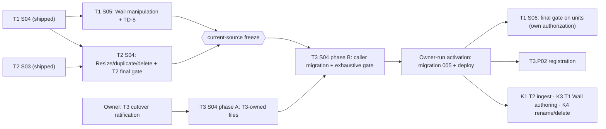

# Batch C coordination proposal — 2026-10-19

> **Archived 2026-10-23.** Relative links in this file were written from `docs/roadmap/` and may not
> resolve from the archive; current routes start at [the roadmap](../../../roadmap/README.md).

**Status:** the owner approved both records as written on 2026-10-19 (C3 post-cutover; the
Guide-free fix in S04). This proposal remains the reasoning; it registers, authorizes, ratifies and
accepts nothing itself. The decisions live in the two records:

- [Batch C authorization](../reference/decisions/batch-c-authorization-2026-10-19.md):
  `T1.P01.S05` ∥ `T2.P01.S04`, the current-source freeze and the `T1.P01.S06` route.
- [T3 cutover ratification](../reference/decisions/t3-cutover-ratification-2026-10-19.md): clean-reset
  disposition of AM-7, `T3.camera-experience-cutover@1` (AM-9), the K2 gap and `T3.P01.S04`
  authorization.

The execution rules (shared-file ownership, merge order, cycle) live in the
[batch C protocol](./cross-track-execution.md#authorized-batch-c-2026-10-19). This file holds the
evidence and the reasoning.

## 1. Verified state (`main` `5fee2a2d`, 2026-10-19)

Checked against Git, not the batons:

| Fact | Evidence |
| --- | --- |
| PR #148 (`T1.P01.S04`) merged; accepted head `2d37adef` and review fix `aa26e04a` are ancestors of `main`; `closed/T1.P01.S04` is on the remote | `git merge-base --is-ancestor`; `git ls-remote --tags` |
| PR #147 (`T2.P01.S03`) merged; anchor `2747f169` is an ancestor of `main` | same |
| PR #149 (T3 S04 preflight) merged: six authorization-path items open, gate `undrafted` | S04 plan; gate register |
| Required scopes for S05 and T2 S04 are `active` at ancestors of `main`: `references-v1` `ee463d0b`, `local-single-domain-v1` `8ec0c5f1`, `conditional-save-current-v1` `8dd53260`, `viewport-projection-v1` `ab8504aa` | gate register; ancestry check |
| T3 S04's five unit scopes are `active`: `unit-envelope-v1`/`unit-resolution-v1` `6dcb6d6d`, `unit-acceptance-v1`/`conditional-save-units-v1` `d7ab6984`, `camera-handoff-v1` `ff5a14da` | same |
| `closed/T2.P01.S03` and `closed/T1.P01.S07` exist only locally | `git ls-remote` (the owner pushes tags) |

The T1 baton was stale: it still asked for PR #148's merge. This PR replaces it.

**Repository findings that change the plans** (source, not docs):

1. **The AM-7 converter is inactive and test-only.** `packages/project-model/src/migration/`
   (about 835 lines, `./migration` export) is imported only by
   `source-migration-conformance.test.ts` and `program-entry-closure.test.ts`. No route, API path or
   boot uses it.
2. **The API stores six authored tables**: `projects`, `project_versions`, `save_receipts`, `assets`,
   `publications`, `releases` (migrations 001–004), plus R2 object bytes. `users` is identity, not
   authored data. Migrations run by hand (`npm run migrate`), not on start, and the runner has a known
   two-process race (TD-6).
3. **Deployment is split**: the API on Render, the editor on Vercel. "Deploy readers, API and runtime
   together" cannot be literally atomic. Safety has to come from the database schema and strict
   version refusal in both directions, not from deployment timing.
4. **T2.P01.S04's persistence half already exists.** T1 shipped *Download source JSON*, *Open source
   JSON* (through the replacement guard) and *Reload remote* in the Head and the spatial route. What
   T2 S04 still has to build is Resize, duplicate/delete, and the integrated journey and final-gate
   proof. The S02 operations `resize-on-floor`, `duplicate-one` and `delete-one` already exist.
5. **TD-8** (task services go stale after an accepted install and refuse `Begin`) sits in the Stage
   host. Every new instrument in this batch (S05's Wall handles, T2 S04's Resize) inherits it.
6. **T1 S04's recorded sign-in resume is half-wired.** `writePendingCloudSave` has no production
   caller, and the spatial route never reads `resume-save`. This contradicts the S04 acceptance text,
   so it is triaged as a source-vs-record contradiction and recorded as TD-9. It is not fixed here.
7. **Lowering drops Guide-free Presentations.** `units/experience/lowering.ts` emits only
   Presentations used by the selected Guide's Stops. The North Star promises that "a Presentation can
   exist without a Guide." Nothing triggers this yet: no source can produce such a Presentation
   before T3.P02 capture.

## 2. Challenges to the inherited plans and to the requested grouping

**C-1. The whole AM-7 inventory/migration path is unjustified once the owner rules that saved data is
disposable.** F.2 already says that before the Source Baseline, formats change without historical
readers. A named migration exception needs "a documented product reason, covered data, validation,
recovery and retirement criteria." With no covered data, there is no product reason, so the
exception is never invoked. That removes the deployed-inventory census, the conversion matrix's
legacy rows and their fixtures, the converter, the CAS conversion install, backups, the restore
rehearsal and the per-publication compatibility table. Four of PR #149's five preflight artifacts
exist only to serve that exception.

What does **not** go away is everything the exception was protecting *around*:

- one source epoch;
- current-format-only admission with typed refusals;
- no sniffing, fallback, dual write or feature flag;
- atomic retirement of the current-source adapters with all their callers;
- one new history baseline;
- AM-4's unit acceptance and Save semantics;
- the `/p/` and visitor isolation.

These move into AM-9 as the cutover contract, and AM-7 is marked superseded rather than silently
edited.

**C-2. Make the reset structural, not procedural.** The old plan relied on a writer fence, quiescence
and coordinated deployment. Finding 3 says deployment cannot be atomic, so the guarantee should not
depend on it. Proposed instead: one forward migration under an advisory lock. In one transaction it
deletes every authored row and installs a schema that admits only the F2 envelope, for example a new
`NOT NULL` source-format column that old writers never set. Any old API that is still running then
fails its writes structurally. Either deployment order produces refusals, never misreads. This is
smaller than a fence procedure and stronger, because it does not depend on operators getting timing
right.

**C-3. Do not run the T1 final gate (`T1.P01.S06`) on current source.** The unmerged research in PR
#154 proposes finishing S05, S06 and T2 S04 before activation. For S05 and T2 S04 that is right:
they are features, and T3 S04 migrates their callers (K6). S06 is different. It is an exhaustive gate
with no features of its own. Run before the cutover, its evidence goes stale the moment T3 S04
replaces the source adapter and the starter boot. It would also put an exhaustive run on the cutover's
critical path. T1's next phase (K3) already waits for the F2 cutover, so a post-cutover S06 delays
nothing. Proposed: S06 runs once, after T3 S04 is accepted. It re-declares unit scopes and consumes
`T3.camera-experience-cutover@1` in its own authorization record. The batch C record keeps the
pre-cutover order as the owner's alternative.

**C-4. T3 S04 must not run fully in parallel with batch C, but it need not wait idle either.**
T3 S04 rewrites the Stage read facade, F4 admission, Save mount and starter boot, which are the host
files S05 and T2 S04 write. Proposed: a two-phase execution.

- **Phase A** may start once authorized, on T3-owned files only: `apps/api/**` and migrations, the
  project-model unit/program/save modules, `visitor/**`, and retiring flow-order exports.
- **Phase B** is the caller migration. It starts only after both batch C slices have merged (the
  *current-source freeze*), rebases onto them, and merges last.

**C-5. The requested single PR is right for coordination but should stay separable.** The batch C
authorization is routine. The T3 ratification is a contract change that deserves slower review, so
coupling them could hold up T1/T2 behind contract review. The coordination still belongs in one place:
the freeze, the S06 route and the file ownership couple all three. The PR is therefore one PR in two
commits, the batch C coordination first and the T3 reconciliation second. If the owner wants batch C
to start before the T3 decisions are settled, the second commit moves to its own PR. The first commit
then needs only its links to the T3 record replaced by links to the S04 plan.

**C-6. Assign the orphaned defects to the slices that touch their code.**

| Defect | Assigned to | Why there |
| --- | --- | --- |
| TD-8 | `T1.P01.S05`, as its first increment | T1 owns the host. T1 may land it as a standalone fix before S05 if T2 S04 needs it first. |
| TD-6 | `T3.P01.S04` | A destructive migration must be single-runner. |
| TD-7 | `T3.P01.S04` | It switches the live writer, so it fixes or explicitly dispositions the lock order. |
| TD-9 | T1's Head integration | `T3.P01.S04` delivers working F2 recovery (deletion alone does not count). `T1.P01.S06` verifies the journey. |
| Guide-free Presentations | `T3.P01.S04`, before activation | The alternative is the first T3.P02 slice. |

**C-7. Leave the S06 (T3 runtime) pre-S04 residuals to T3.P02.** The open items are the authored
Cut/Travel selector home, homes for presentation text, state and lifecycle, and the hold start. They
were pre-S04 decisions only because the converter had to map legacy data into those homes. With the
reset, there is nothing to map. They become amendments for the first authoring consumer, T3.P02.
AM-9 fixes the activated default: holds start at editorial arrival, as shipped, and lowering keeps
taking closed bindings.

## 3. Execution DAG

Every edge is an ownership or capability dependency. `S05 → FRZ` and `T2S04 → FRZ` encode K6: T3 S04
migrates landed callers once instead of chasing new ones. The cycle window closes at S05's acceptance
(it is the terminal). That close is an owner event, and it blocks nothing in this DAG.

## 4. Merge order

1. `T1.P01.S05` and `T2.P01.S04` in either order. If both are ready together, merge S05 first so that
   T2's final-gate evidence is recorded on the combined Stage. Each reruns the complete merge gate on
   then-current `main`.
2. **Freeze.** No further current-source caller lands until T3 S04 merges. No other T1/T2 slice is
   authorized in that window.
3. `T3.P01.S04` (one implementation PR, phase A then phase B). The complete gate, `check:api`,
   DB-backed `test:api` with zero skips, and a reset rehearsal on the Compose stack. The merge commit
   is the code cutover.
4. **Activation**, run by the owner: migration 005 on the deployed database, then the API and editor
   deploys. Both deployment orders refuse rather than misread (C-2).
5. `T1.P01.S06` under its own authorization; T3.P02 registration; K1/K3/K4 planning.

## 5. Residual risks

| # | Risk | Owner and mitigation |
| --- | --- | --- |
| C-R1 | Batch C slips, and T3 S04 phase B waits. | Phase A proceeds. The owner may re-sequence explicitly; an unfinished slice then re-declares unit scopes (K6). |
| C-R2 | The reset deletes data the owner later wants. | The disposability ruling names its exact scope. The owner may take a private snapshot first; it is operational prudence, not an acceptance obligation, and nothing reads it. |
| C-R3 | No publishing from activation until T4.P01.S05, which waits for Core Editor Stability (R1-D). | K2 accepts this in principle, and the T3 record asks for explicit approval of the now-empty gap. |
| C-R4 | TD-8 makes T2 S04's journeys flaky before S05's fix lands. | T1 may land the TD-8 fix standalone first (C-6). T2 records the base it ran on. |
| C-R5 | Phase A and phase B land as one oversized PR. | Phase B starts only when phase A is green. The two can be reviewed as separate commit ranges inside the one PR. |
