# T1 V3c — Shed and Gable authoring QA

Date: 2026-11-28  
Branch: `t1-v3c-region-form-authoring`  
Base: `origin/main` at the V3b merge (`#438`)

Scope: creator-facing Shed and Gable creation through the existing Roof tool, exact
Card values and derived pitch, Edit shape joints, Fit roof to walls / Fit walls to
roof, cancellation, and Undo/Redo. The editor-only section is built on the canonical
V3a evaluators; no second geometry evaluator or authoring authority was added. The
Section reading uses A6's existing `face` intent; A6 itself was not changed.

## Result

The V3c gate passes in the running editor. All four J8 Walls read **Meets** after
the two one-shot fits, each accepted fit and each joint gesture is one history
entry, and the thin-roof refusal writes no history. The refusal now names the
blocking Wall and its overrun instead of quoting subject ids.

## Stage evidence

| Evidence | Observed |
| --- | --- |
| 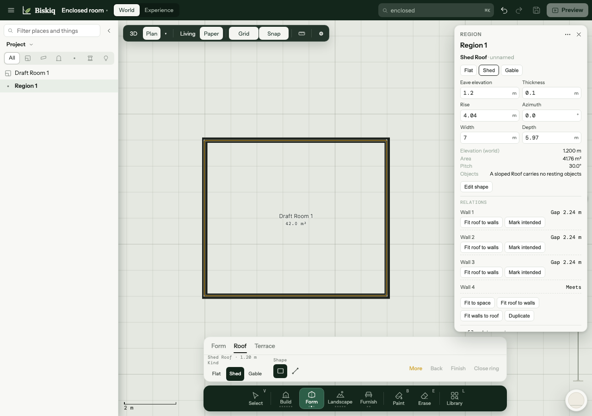 | **Shed** is available in the Roof tool and in the Card. This 7 × 5.97 m Roof has rise 4.04 m and derived pitch 30.0°. The Roof tool remains armed after acceptance. |
| 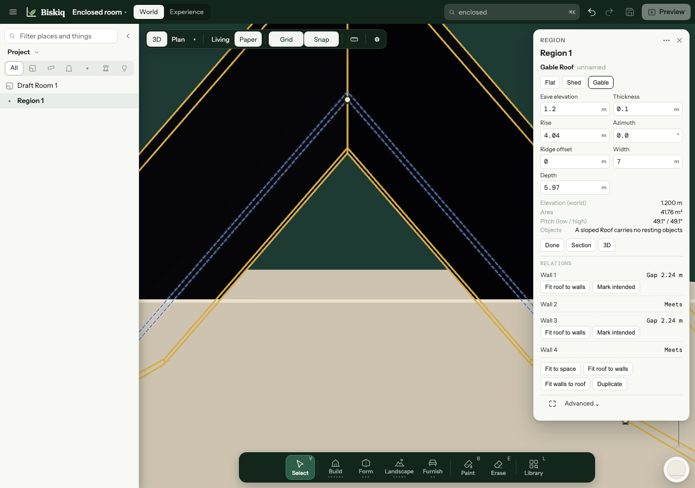 | The shed-only midpoint **＋** inserts a ridge in one click. The Card becomes **Gable**, rise stays 4.04 m, ridge offset is 0, and the derived pitches are 49.1° / 49.1°. |
| 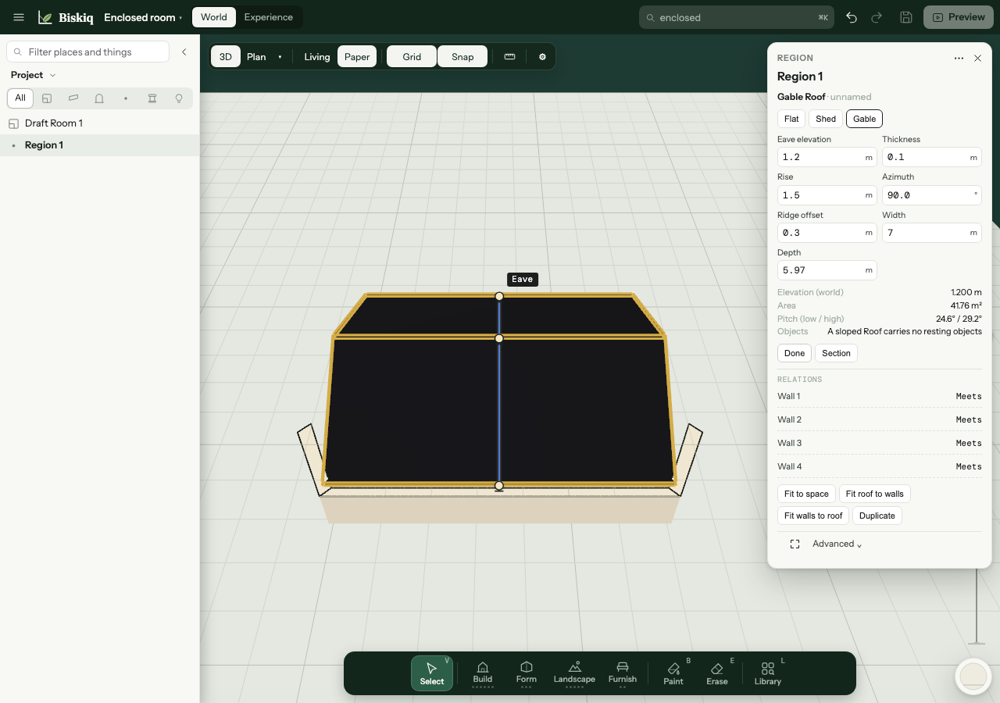 | Edit shape leaves the active Ink task for Select and shows only the roof-local section joints: low eave, ridge and high eave. Ordinary corner/body/turn marks are suppressed. |
| 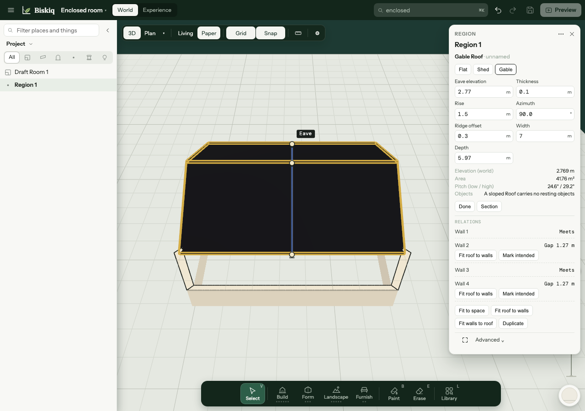 | Dragging a Gable eave raises both eaves: eave elevation goes 1.2 → 2.77 m while rise and ridge offset stay unchanged. The two affected Walls now read their honest gaps. |
| 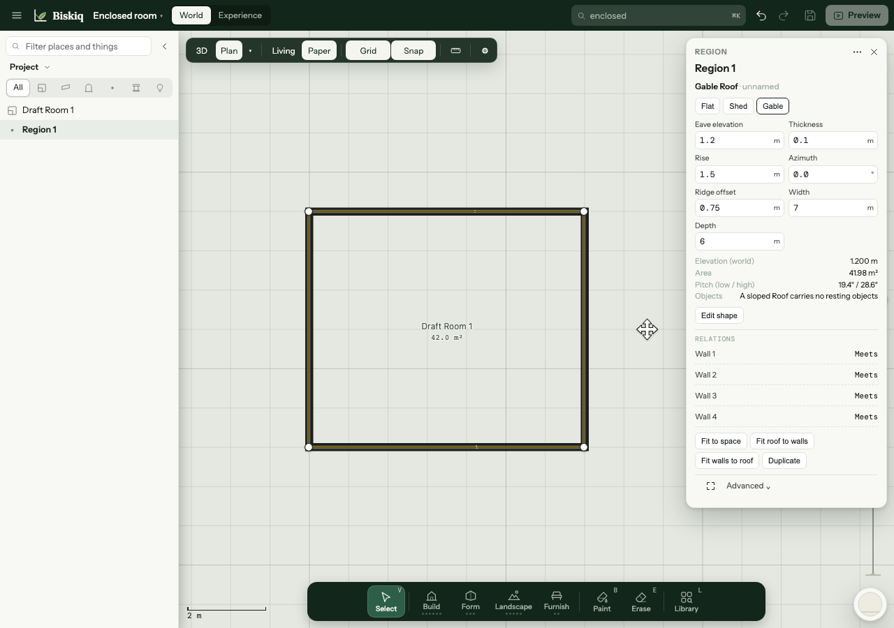 | Exact Card entry: rise 1.5 m, azimuth 0.0°, ridge offset 0.75 m, width 7 m, depth 6 m. The derived asymmetric pitches are 19.4° / 28.6°. |
| 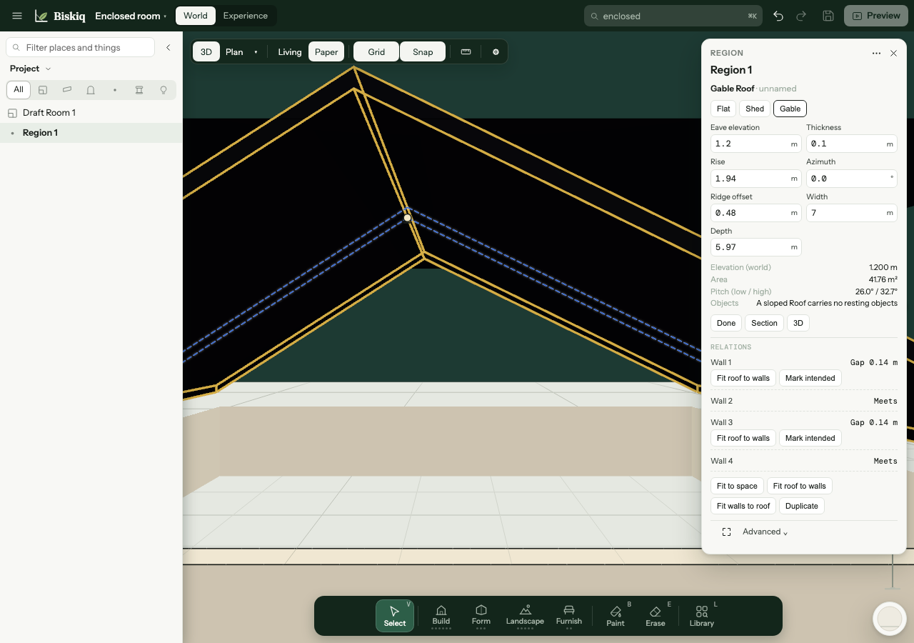 | A6's Face intent frames the Section reading. The ridge joint was dragged to rise 1.94 m and ridge offset 0.48 m; Card pitch is 26.0° / 32.7°. |
| 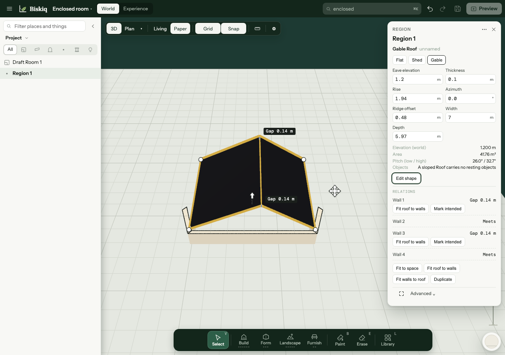 | The Plan Card and the 3D reading agree: same rise, offset and asymmetric pitches, with the compiled Roof on the authored footprint. |
| 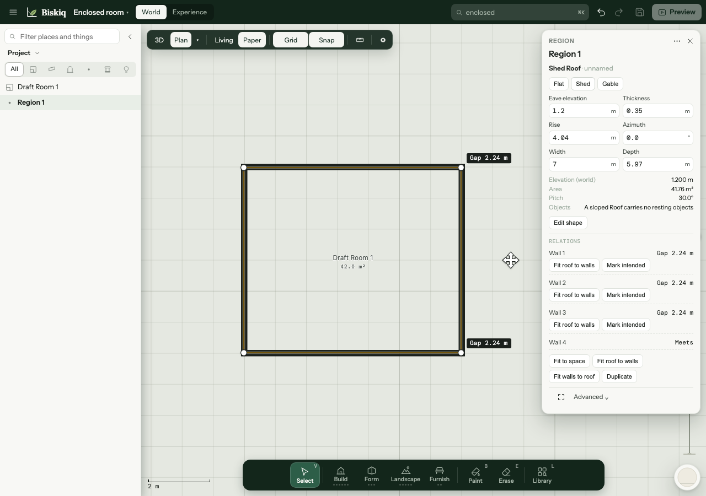 | Switching Gable → Shed keeps footprint, eave elevation and thickness. The new Shed takes its form defaults (rise 4.04 m, azimuth 0°, pitch 30.0°) and hides ridge offset. |
| 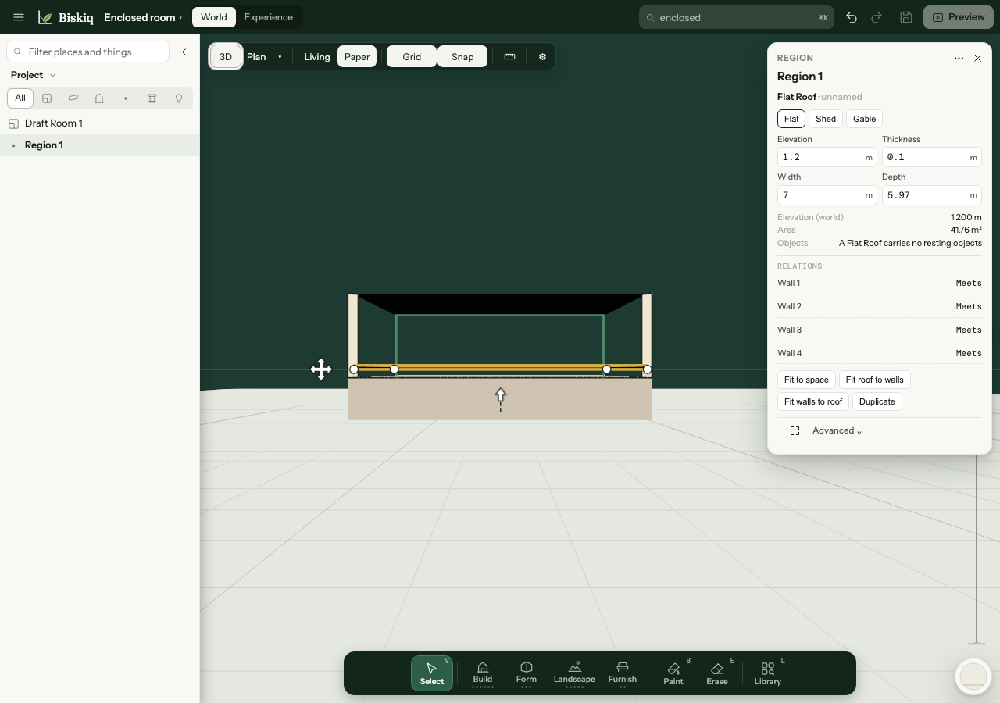 | Dragging the Gable ridge onto the eave line removes it. The result is a **Flat Roof** and all four Walls read **Meets**. |
| 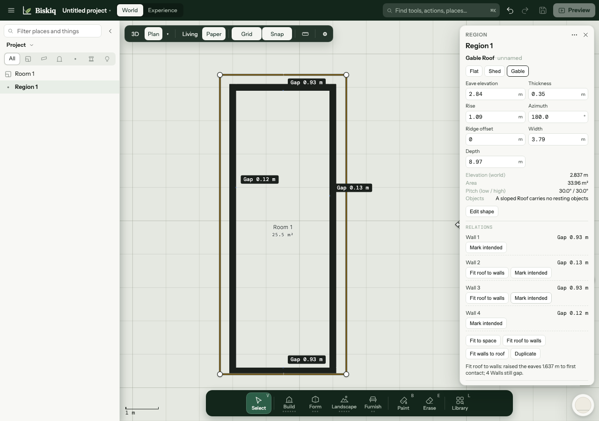 | J8 3 × 8.5 m hall: Fit roof to walls raises the eaves 1.637 m to first contact and reports that four Walls still gap (0.93, 0.13, 0.93 and 0.12 m). |
| 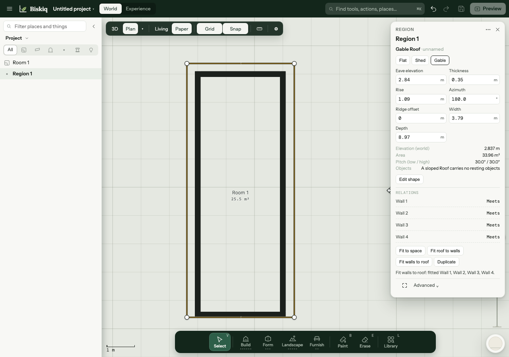 | Fit walls to roof fits Wall 1, Wall 2, Wall 3 and Wall 4. All four relation rows read **Meets**. |
| 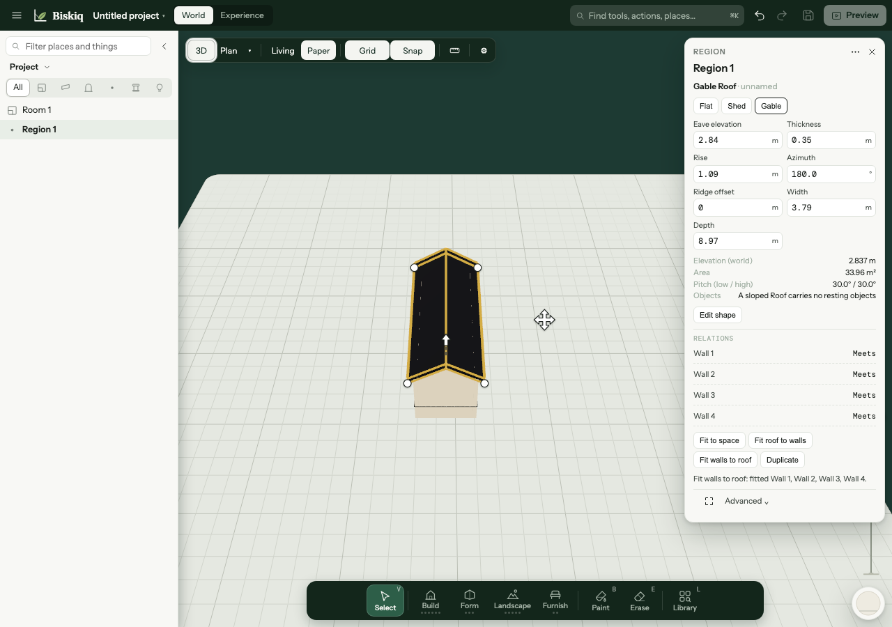 | The same J8 result in 3D: level eave Walls and gable end Walls under the roof, with all four relations **Meets**. |
| 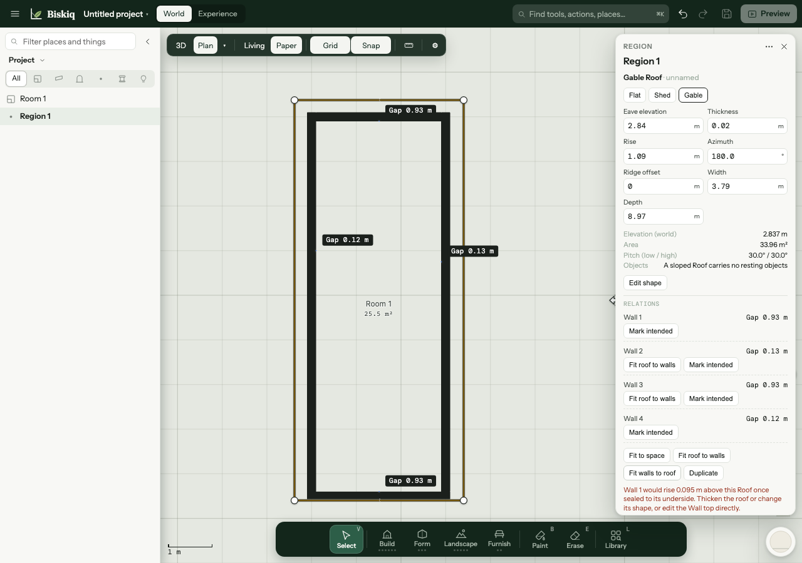 | With 0.02 m Roof thickness, Fit walls to roof refuses atomically: “Wall 1 would rise 0.095 m above this Roof once sealed to its underside. Thicken the roof or change its shape, or edit the Wall top directly.” No history entry is written. |

Cancellation: a Gable Roof draft was dragged into preview and Escape was pressed
before release. No Region was created, no history entry appeared (the header still
said “Nothing to undo yet”), and the Roof tool stayed armed for another draw.

Undo/Redo: the asymmetric ridge gesture was one entry. Undo restored rise 1.5 m and
ridge offset 0.75 m exactly; Redo restored 1.94 m and 0.48 m. Form switches were
likewise one entry each: after the Flat switch, Undo restored the previous Gable,
and Redo restored Flat.

## Automated checks

Run from the branch worktree:

```text
npm run check:layout-core   # pass
npm run check               # 0 errors, 6 pre-existing Svelte warnings
npm run lint:ci             # pass
npm run build:editor        # pass
npx vitest run apps/editor/tests/lib/authoring/stage/layout-region-authoring.test.ts packages/layout-core/tests/layout-region-planners.test.ts
# 68 tests pass (30 editor, 38 layout-core)
```

The focused editor file covers Shed birth, Card field ids, Gable form switching,
Edit shape marks, eave and ridge drags with one history entry, shed midpoint
insertion, ridge collapse, A6 Face / Put back, and the fit refusal wording. The
layout-core file covers the create-with-form planner and its refusals.

The browser console contained only the pre-existing WebGPU-unavailable and
accessibility warnings; no runtime errors were produced during these flows.

## Reproduction

1. Start the editor at `http://127.0.0.1:5199` and open a new World project.
2. Press Meta/Ctrl+K, type `enclosed`, and load the Room starter.
3. **Form → Roof**, choose **Shed** or **Gable**, then Box-drag a Roof over the
   Room on Plan.
4. Use the Card fields for exact elevation, thickness, rise, azimuth, ridge offset,
   width and depth. Sloped forms show the derived pitch, never a stored one.
5. **Edit shape** closes the Roof task and exposes the section joints. Drag an eave
   for elevation, or a Gable ridge vertically for rise and horizontally for ridge
   offset. On a Shed, click the midpoint **＋** to insert a Gable ridge. Drag a Gable
   ridge onto the eave line to collapse it.
6. **Section** applies A6's Face frame; **3D** / **Done** puts the camera back.
7. J8 used a 3 × 8.5 m hall and a Gable Roof with thickness 0.35 m. **Fit roof to
   walls** is the first one-shot fit; **Fit walls to roof** is the second. Undo and
   Redo each fit independently.
8. Set the Roof thickness to 0.02 m and repeat the fits to see the atomic refusal.

The screenshots use the editor's development project at 1280 × 900. Conditional Save
is unavailable in that local session, as its header states; that is pre-existing and
unrelated to V3c.
