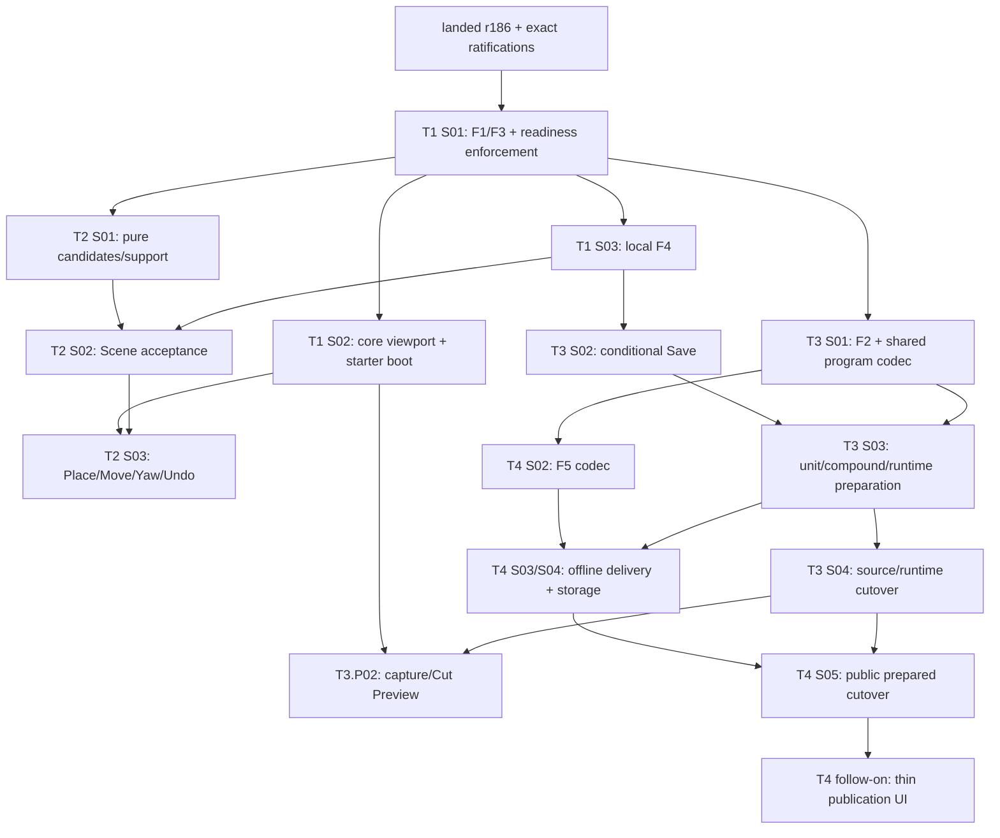

# Cross-track execution — proposed allocation, readiness and DAG

**Status:** coordinated cross-track allocation, owner-confirmed 2026-10-15. The F amendments it
references (AM-1–AM-8) and the capability-readiness rule are owner-ratified
([decision record](../reference/decisions/f-ratification-2026-10-15.md)); this artifact owns the
provider allocation, capability dependencies and execution DAG only, and is not an F contract.
Exact interfaces stay in [`../reference/composition-execution.md`](../reference/composition-execution.md)
(AM-1–AM-8); the readiness rule stays owned by
[`f-foundation-contracts/README.md`](./f-foundation-contracts/README.md#capability-readiness). It
registers no gate, phase or slice, and each provider is wired through its own authorized track
phase. Candidate IDs below remain provisional until their phase registers them. Registered now:
T1.P01 (`T1.P01.S01` shipped; S02/S03 authorized 2026-10-16), T2.P01 (S01 authorized) and T3.P01
(S01–S04, S01 authorized); the proposal's T3 S05/S06 are the unregistered candidate T3.P02. The
four slices authorized 2026-10-16 run under the [parallel batch protocol](#parallel-batch-2026-10-16).
Cross-PR links identify proposals, never accepted prerequisites.

Planning proceeds on the landed r186 base: the separate
[Three.js r186 foundation upgrade (PR #122)](https://github.com/Biskiq/spatial-sketch-editor/pull/122)
merged into `main` as `74efb98b` (closeout PR #123, `d69825fe`), standardizing three 0.186.1 /
`@types/three` 0.186.0 with Threlte unchanged and explicit `PCFShadowMap` at both shadow canvases.
Each authorized implementation plan records that base and verifies affected
Camera/Threlte/render/loader behavior against it; this post-#116 planning baseline is not that
compatibility evidence.

## Provider and acceptance matrix

`@1` denotes a proposed first major, not a ratified version. A provider never consumes its own
output. Shared formats land in existing runtime-safe packages; no track-local protocol.

| Gate/version | Sole proposed provider | Direct prerequisites | Acceptance scope and consumers |
| --- | --- | --- | --- |
| F1.reference@1 | T1.P01.S01 | Ratified F1 amendment | `references-v1`: source-independent identity/resolution/frame qualification and bounded current-domain resolvers. All tracks consume it; new unit/public resolvers require separate accepted capabilities below. |
| F2.unit-envelope@1 | T3.P01.S01 | F1 `references-v1`, F3 `inspection-v1` for shared typed program/channel shapes | `unit-envelope-v1`: actual strict envelope/lock/unit codecs, Experience execution-program codec and pure conversion candidates. No live reader/writer activation. T3 coordination and T4 source/program codecs consume it. |
| F3.channels@1 | T1.P01.S01 | Ratified F3 amendment; F1 is supplied coherently in this same provider | `inspection-v1`: addresses, typed descriptors, negotiation and exclusive epoch-qualified ownership; Layout/Camera inspection families. T1 viewport uses it. T3 extends Camera/session conformance without a second provider. |
| F4.intent-acceptance@1 | T1.P01.S03 | F1 `references-v1`; explicit F4 timing/admission amendment | The enduring `acceptance-invariants-v1` layer plus the retiring `local-single-domain-v1`: one local acceptance/history boundary admitting registered Layout or Scene planners over the current source adapter. T1/T2 use it; T3's unit capabilities require the enduring layer. It proves neither unit/resource compound acceptance nor cloud Save. |
| F5.release-envelope@1 | T4.P01.S02 | F1 `references-v1`, F2 `unit-envelope-v1`, F3 `inspection-v1` | `prepared-envelope-v1`: release/profile/payload codecs, canonicalization and capability negotiation using T3's shared program codec. T4 compiler/reader/storage consume it; schema acceptance is not live delivery acceptance. |
| T1.viewport-projection@1 | T1.P01.S02 | F1 `references-v1`, F3 `inspection-v1` | Rendered Plan/3D projection, source-independent facade, ordinary representation, selection/task/gesture host and Camera output protocol. T2 UI and T3 authoring consume it; Scene support and authored Camera operations are excluded. |
| T3.camera-experience-cutover@1 | T3.P01.S04 | F1 `unit-resolution-v1`, F2 `unit-envelope-v1`, F3 `camera-handoff-v1`, F4 `unit-acceptance-v1` and `conditional-save-units-v1`, plus their base capabilities | Atomic source/runtime activation, existing caller migration, occurrence behavior and legacy-order retirement. T3 authoring and T4 public activation consume it. No viewport dependency for this provider. |
| T4.prepared-reader@1 | T4.P01.S05 | F1 `release-addresses-v1`, F2 `unit-envelope-v1`, F3 `camera-handoff-v1`, F5 `prepared-envelope-v1`, accepted T3 cutover, and all base capabilities | Coherent prepared API/resource/pointer/cold-browser activation and retirement of source delivery. Thin publication UX follows; full T3 authoring is unnecessary. |

## Capability-readiness amendment

The current gate checker reads `Consumes` gate/version and overall state, not incremental
capability scope. It cannot prove that accepted local F4 also implements cloud or compound
behavior. Do not rely on a green current checker to admit such a consumer.

Propose only two additive fields: **Accepted capabilities** on each gate/version row and
**Requires** on each slice row. The latter names exact pairs, written here as
`F4.intent-acceptance@1:local-single-domain-v1`. `Consumes` retains ordinary Gate@Version syntax.
No additional gate, parallel registry or per-track acceptance protocol is introduced.

Each Accepted-capabilities entry links a durable record containing capability ID/version,
contract/amendment anchor, admitted source kinds, prerequisites, extension slice, actual shared
exports, conformance, independent acceptance and ancestor implementation commit. Pending scopes
stay in plans and do not appear as accepted entries. Existing evidence is retained when another
scope is added; the gate's sole provider is unchanged. A scope can also be explicitly retired,
with historical evidence retained and no new consumer eligible for it.

Eligibility requires the exact gate **and every required capability**, with its prerequisite
closure, to be accepted in the current tree **and at the trusted base** (`git merge-base HEAD main`).
The slice cannot add its own prerequisite evidence.This applies to new starts/in-progress/accepted
consumers; shipped historical slices retain their original scopes/evidence, as with historical gate
majors. Retiring an adapter removes its active admission, not historical evidence or base invariants.

For F.4, retirement splits two layers that `local-single-domain-v1` initially bundles. The enduring
layer is recorded as its own scope on the same F.4 entry —
`F4.intent-acceptance@1:acceptance-invariants-v1`, which never retires: opaque accepted revision,
content-digest comparison, atomic install with one undo result, stale/ABA rejection and one
chronological history. It persists across the source transition and is the prerequisite of
`unit-acceptance-v1` and `conditional-save-units-v1`. The retiring layer is the current-source
adapter admission (`local-single-domain-v1` current-source planning/validation and
`conditional-save-current-v1` persistence), which T3 S04 retires together with all its callers; after
that point no new or in-progress consumer may Require either retiring scope, while shipped slices keep
their evidence. The checker records retirement as a terminal state on the retiring scope's own entry
— no parallel registry, no permanent legacy admission — and fails any new or in-progress Requires
naming a retired scope. The read-only converter still retires with the covered inventory before the
Source Baseline.
Acceptance of an interface is distinct from
ratification, implementation and consumer eligibility. `T1.P01.S01` installs the two-field
validation and controls for missing/unimplemented scope, consumer self-satisfaction, retired scope
and the trusted base (owner-ratified 2026-10-15): a consumer needing incremental readiness now
fails the arch-lane gate rather than relying on review alone. This file changes neither the live
register nor its checker. The rule's
normative statement and checker definition live in
[`f-foundation-contracts/README.md`](./f-foundation-contracts/README.md#capability-readiness); this
file keeps only the proposed allocation, the capability dependencies and the enforcement handoff,
and does not restate F semantics.

Compatible optional kind/family/source-adapter admissions retain the gate major and get explicit
new capability evidence. Breaking required identity, revision, result, coordinate or lifecycle
semantics needs a new major, retained old evidence and consumer re-declaration. A capability name
cannot disguise an incompatible semantic change. A consumer must declare what it actually uses.

| Capability added after the base | Extension slice | Exact scope / prerequisites |
| --- | --- | --- |
| F1.reference@1:unit-resolution-v1 | T3.P01.S01 | Camera/Experience/resource kinds and supplied F2 lock resolution; preserves missing/repair identity. Extends `references-v1`. |
| F1.reference@1:release-addresses-v1 | T4.P01.S02 | Publication/pinned-release semantic addresses with concrete release context and removed/repair results. Extends `references-v1`; needs shared unit/program identity. |
| F4.intent-acceptance@1:conditional-save-current-v1 | T3.P01.S02 | Create-only / expected-saved-base persistence of current source using full shared validation, atomic server OCC and retry receipts. Needs `local-single-domain-v1`; not F2, Stage or source activation. |
| F4.intent-acceptance@1:unit-acceptance-v1 | T3.P01.S03 | F2-backed single-domain and compound Camera/Experience acceptance, complete reference/lock validation, admitted resource staging and whole-operation history. Needs F2 and the enduring `acceptance-invariants-v1`, never the retiring `local-single-domain-v1`/`conditional-save-current-v1`, so the capability stays eligible once the current-source adapter retires. |
| F4.intent-acceptance@1:conditional-save-units-v1 | T3.P01.S03 | Same conditional Save protocol over F2 source; needs unit-acceptance-v1/base invariants and reuses prior Save protocol evidence, not active current-source admission. Inactive until S04; never a second live writer. |
| F3.channels@1:camera-handoff-v1 | T3.P01.S03 | Inspection, guided/free, Follow, Look-through and Preview ownership/return with stale-run cleanup; bounded Experience session semantics use the shared program. Needs `inspection-v1` and F2 program codec; real Stage integration is later T3.P02 evidence. |

**Slice prerequisites and exported-capability prerequisites are different claims.** A slice's
`Requires` names what that slice's implementation consumes; a capability's declared prerequisites
are what any later consumer needs from it. T3.P01.S03 therefore consumes the still-active
`local-single-domain-v1` and `conditional-save-current-v1` while it prepares the F2 unit
implementation, but the `unit-acceptance-v1`/`conditional-save-units-v1` capabilities it exports
declare F2 and `acceptance-invariants-v1` only — never the retiring admission.

Initial local F4 admission includes registration and conformance for both Layout and Scene,
not T2's complete placement capability. T2 S02 registers its actual operations. No resource/lock
mutation or multi-domain dispatch succeeds under `local-single-domain-v1` alone.

## Common acceptance, persistence and Stage laws

Accepted revision is opaque `{projectId, revisionId}`; content digest compares canonical authored
contents; session epoch guards callback lifetime. They are distinct, including across Undo/Redo
and source replacement. F4 intent/result signatures expose a validated source-independent snapshot
facade, never require today's ProjectDocument. Current and F2 source adapters own decoding,
materialization and full composed validation; they do not duplicate domain planners or history.

All operations prepare against one expected local revision, capture identities/external inputs,
validate the composed project, and install one snapshot/undo result. Layout support reads do not
make Scene placement a Layout mutation. Camera View + Presentation + optional Stop is one T3
compound operation. Repairable authored bindings are explicit; required execution requires closure.
Undo/Redo use fresh revisions and one bounded chronological stack; no-op/refusal/cancel adds none.

Local accepted editing remains immediate. Conditional Save captures an immutable local snapshot
and its revision/digest plus a create-only or exact saved-base precondition. Server ownership,
revision comparison, shared full validation and metadata append are atomic. A saved-base token
is durable persistence metadata, distinct from local revision, SQL ordinal and publication OCC.
The server recomputes the canonical digest and rejects revision identity reused for different
contents. Save returns the persisted source revision/digest and new saved-base token. A newer local edit
while Save is in flight remains dirty; a prior-session response cannot mark it saved or replace it.
Identical retry returns its receipt without another version; changed-payload retry refuses.
Conflict preserves both local accepted work/history and remote source; reload/explicit resolution
is required, with no automatic merge. Save does not create a second authoring Undo stack or force
every edit through the server. Before F2, accepted revision metadata stays outside the strict
current source document; after F2 the same captured revision is carried by its envelope.

Stage has one validated read facade and one canonical selection/task/gesture host. Camera owns
output acquisition, supersession, return and cancellation. Inspection, Follow, Look-through and
Preview are declared controller roles, not competing pose writers. A reading-transition hook
uses each operation's declared continue/revalidate, suspend-proposal or cancel policy; the host
runs it once before changing projection. Lens/project exit cancels writers. T2 cancels its pointer
gesture while retaining its armed task/selection; T1 may continue a valid mapping or suspend the
proposal. No private transition, projection, selection or navigation infrastructure is admitted.

## Source-first migration and activation ownership

T3 S01 prepares the **sole** old-source conversion candidate and mapping report. T3 S03 prepares
new-source planners/runtime/controllers/Save adapters without live activation. T3 S04 inventories
local/source packages, cloud projects/versions, pending saves, releases/publications and retained
bytes; obtains the covered-data exception and owner disposition; quiesces writers and CAS-installs
Camera extraction, Experience order, Scene removal and locks together. It migrates every existing
T1/T2 caller and replaces the current-source Stage/F4/Save/starter adapters. In-progress consumer
plans re-declare the already accepted F2/unit capabilities from S03 before activation. This is
caller integration, not Camera authoring, and it does not consume its own T3 gate. T2 definition
inputs then come from immutable project pins; Scene-only placement admits pinned/procedural entries.
The F2 starter/migration may install an explicitly captured bounded palette once; absent pins are
unavailable, and further resource admission remains staged T2 follow-on work.

No ordinary Undo crosses the administrative source-format transition. Retain original bytes and
a coordinated source/deployment recovery handle; invalidate old callbacks/history, and establish
one new source baseline. Old clients fail explicitly. Normal readers/writers accept only the new
format. T3 removes legacy node-order orchestration; its read-only converter retires when the
covered inventory is completed/discharged and recovery verified, before Source Baseline.

T4 has no default legacy Experience converter or retained selection map. It lowers F2 units and
T3's authored identities into the **same T3 execution program** used by Preview. T4 S03/S04 may
exercise closed F2 candidate fixtures and inactive storage before T3 activation. T4 S05 waits for
the accepted T3 cutover, then owns prepared publication/API/resource/browser activation and source
snapshot delivery retirement. One Camera engine and one Experience interpreter serve both paths.

A temporary publication gap is allowed only after actual release/publication inventory and owner
acceptance. During an approved empty-release gap, new source publication returns typed
prepared-reader-required, cold public reads return their explicit unavailable/not-found outcome,
and status/Unpublish remain honest; the real /p/ route and isolation checks remain. If any covered
release exists, T3 activation stops for a concrete T4/owner compatibility disposition, including
bounded conversion and a coordinated delivery barrier where necessary. Do not presume emptiness,
discard data, silently reinterpret old bytes or keep a competing old visitor engine. T4's barrier
fences mutations, switches prepared metadata/artifacts/resources and cold reader together, and
retires all authored delivery callers. Recovery after new-format edits rolls forward or explicitly
restores disclosed backups; prepared activations roll back to a compatible prepared runtime/pointer
with fresh OCC revisions. No permanent dual-format reader/writer or source fallback.

## Execution DAG and earliest product milestones

T4 S01 is docs-only drafting and can run now. After the shared providers merge, independent
viewport, local acceptance, unit-codec and Scene-candidate work proceeds in parallel. Save waits
for local F4, not F2. T4 F5 waits for the shared program codec, not the T3 runtime cutover. Actual
consumer starts require the precise capabilities accepted on main at trusted base; sibling plans,
ratified text, offline harnesses and a consumer's own register edits are not readiness.

T2 simple transform payloads use domain types, not a general F3 execution system. T1 local F4
needs neither F2 nor F3. T2/T3 UI waits for the viewport, not all of T1. T4 final activation waits
for T3 S04, not T3 authoring/phase closure. Shared-file integration ownership: T3 owns source/Save
and visitor semantic changes through S04; T4 then owns delivery/publication changes, reusing T3
execution. Storage additions can merge inactive beforehand; overlapping callers are reviewed
against each new main rather than merged as independent competing implementations.

1. Starter gallery → T2 Place/Move/Yaw/Undo → early conditional Save/reload is the first creator
   journey. T2 S04 integrates its complete bounded phase with Save; JSON recovery is also available.
2. T3 capture View/Presentation/optional Stop → Cut Guide → isolated Preview is next; existing
   supported Travel is evaluated, while advanced path authoring is a named T3 follow-on.
3. T4 prepare/activate → cold public link → update/unpublish proves delivery. API-driven foundation
   precedes the T4-owned thin publication UI. Bounded single-model ingest is the T2-owned next phase,
   requires F2/unit acceptance and T4 resource delivery, and precedes the promised creator/audience trial.

These phases do not complete the full creator-to-visitor product. Durable external links require
an explicit Release Baseline; Source Baseline follows stabilized source formats, not these merges.

## Parallel batch 2026-10-16

The owner authorized `T1.P01.S02`, `T1.P01.S03`, `T2.P01.S01` and `T3.P01.S01` to run in parallel
([decision](../reference/decisions/parallel-slice-authorization-2026-10-16.md)). Each consumes only
the accepted `references-v1`/`inspection-v1` on post-PR #126 `main`; none consumes another, so none
may wire, import or depend on another's unmerged output. A slice that finds it needs to stops and
reports instead.

**Shared-file ownership.** One writer per shared module for the batch's duration:

| Area | Writer in this batch | Rule for everyone else |
| --- | --- | --- |
| `@portfolio/camera-core` | `T1.P01.S02` | read-only |
| Editor route, host, Stage and shell modules | `T1.P01.S02` | read-only |
| `@portfolio/layout-core` | new modules only: `T1.P01.S02` (Plan representation), `T2.P01.S01` (floor-support query) | nobody changes the compiler, its tolerances or an existing query |
| `@portfolio/project-model` | new modules only: `T1.P01.S03` (F4 contracts, admission, content identity), `T2.P01.S01` (Scene planning), `T3.P01.S01` (units, program, converter, additive reference extension) | nobody changes landed reference/channel behavior or the Scene v1 codec |
| [`package.json`](../../packages/project-model/package.json) `exports` of project-model | `T3.P01.S01` adds its subpaths | any other addition appends |
| Editor F4 coordinator/history module | `T1.P01.S03` | — |
| Editor object-definition policy and admitted inventory | `T2.P01.S01` | — |
| Barrels [`project-model`](../../packages/project-model/src/index.ts), [`layout-core`](../../packages/layout-core/src/index.ts) and [`test-lanes.ts`](../../apps/editor/test-lanes.ts) | append-only | the second merger resolves the textual conflict |
| Boundary tests (public surface, project-model, camera-core) | additive assertions per slice | no slice weakens an existing assertion |
| Landed `reference/*` contracts | none during the batch | `T1.P01.S02` updates `architecture.md` §Product routes at its own closeout |

**Content identity.** `T1.P01.S02` and `T1.P01.S03` both need the current-source content identity
that S03 owns: `sha256Bytes` over the strict writer's normalized source with ID-keyed Layout
identity maps ordered and only `layout.identity.cursor` excluded from the digest. Full canonical
source retains the cursor for persistence/history; hash equality is authored-content equality,
not full-source byte equality. Whichever merges first lands the single project-model export with its invariance
tests; the other rebases and reuses it. `T3.P01.S01` uses the same hash primitive for unit
`contentRevision` and defines no current-source identity.

**Merge protocol.** Each slice merges on its own after independent acceptance and routine closeout;
there is no batch merge and no imposed order. Every merge reruns the complete merge gate in
[`tests/README.md`](../../apps/editor/tests/README.md#what-a-change-requires) on the then-current
`main`, whatever the slice's iteration tier; a slice whose shared module changed underneath it
rebases and reruns before merging. Integration of the viewport host with F4 (accepted install, Undo/
Redo commands, replacement baseline, selection requalification, Camera-output rebase) is
`T1.P01.S04`'s first increment by default.

**Cycle.** `T1.P01.S02` is a listed exposure: its first authorized implementation opens the T1.P01
window through the runbook start step. `T1.P01.S03`, `T2.P01.S01` and `T3.P01.S01` are not exposures
and open nothing; an open window and its pending verdicts block none of them.

**Remaining risks** (owners named; none blocks the batch's start):

| # | Risk | Owner and mitigation |
| --- | --- | --- |
| R1 | `T1.P01.S02` is large and on the critical path of every viewport consumer. | S02 implementer proposes a registered split rather than silently deferring criteria. |
| R2 | `T3.P01.S01` is large, and Experience 1 / `ExecutionProgram@1` freeze before the interpreter and authoring UI exist. | Codec-level fixtures for every AM-6 case now; a later required-meaning change is a versioned F amendment. A split (converter as its own slice) is the owner's option. |
| R3 | `T2.P01.S03` authorized before `T1.P01.S04` would leave host↔F4 wiring unowned. | Owner assigns it explicitly at that authorization. |
| R4 | Contact-metadata verification may exclude the non-unit-normalization model. | `T2.P01.S01` records the exclusion; the phase proceeds with analytical primitives and verified models. |
| R5 | `T3.P01.S02`'s Save control needs a home in the T1 shell Head. | **Settled 2026-10-16** ([record](../reference/decisions/s02-pair-authorization-2026-10-16.md)): T3 owns persistence and client Save state; T1's host↔F4 wiring slice owns the Head integration. `T1.P01.S02` never calls the unconditional `PUT`. |
| R6 | T3.P02 cannot register until `T3.camera-experience-cutover@1` is drafted and ratified. | T3 drafts it with `T3.P01.S04`'s authorization request. |
| R7 | Per-accept validation, serialization and hashing may be costly on dense projects. | `T1.P01.S03` records a measured observation on the densest fixture (TD-5's lesson). |
| R8 | Client/server canonical-byte or digest-version skew would make equal contents compare unequal. | `T3.P01.S02` carries the declared content-identity scheme and refuses a mismatch explicitly (`identity-scheme-mismatch` / `content-identity-mismatch`), never as a conflict. |
| R9 | Barrel and lane-list merge conflicts. | Append-only rule; second merger resolves. |
| R10 | The window `T1.P01.S02` opens may stay open for a long time. | Pending verdicts block no other track (cycle disposition below). |

## Parallel pair 2026-10-16

The owner authorized `T2.P01.S02` and `T3.P01.S02` to run in parallel
([decision](../reference/decisions/s02-pair-authorization-2026-10-16.md)) on post-PR #129 `main`
(`1315b1a2`), while `T1.P01.S02` (PR #128) is still open under the batch above. Each slice consumes
only accepted `references-v1` and `local-single-domain-v1`. Neither consumes the other or #128, so
neither may wire, import or depend on their unmerged output. A slice that finds it needs to stops
and reports instead.

**Shared-file ownership** (in addition to #128's batch rows, which stand until it merges):

| Area | Writer | Rule for everyone else |
| --- | --- | --- |
| `project-model` `src/scene-planning/` | `T2.P01.S02` | read-only |
| `project-model` Save protocol subpath module and its `package.json` `exports` entry | `T3.P01.S02` | appending another subpath is fine |
| `content-identity.ts` | `T3.P01.S02` adds one additive scheme constant, under T1 review | nobody changes the digest's meaning |
| `project-model` `src/f4/**`, the current-source adapter and `apps/editor/src/lib/authoring/f4/**` (T1-owned, shipped) | none | read-only; a needed change is a stop-and-report to T1 |
| `apps/api/**`, migrations, `apps/editor/src/lib/platform/project-persistence.ts` and the editor client Save state | `T3.P01.S02` | read-only; T1's read-only boot relies on the additive `GET` shape |
| Editor routes, host, Stage and shell modules | `T1.P01.S02` (#128) | read-only for both slices: no route, Head or host edit |
| Root barrels and [`test-lanes.ts`](../../apps/editor/test-lanes.ts) | append-only | the second merger resolves the textual conflict |
| Boundary tests (public surface, project-model) | additive assertions per slice | no slice weakens an existing assertion |

**Merge protocol.** As for the batch: each slice merges on its own after independent acceptance and
routine closeout. Every merge reruns the complete merge gate on the then-current `main`;
`T3.P01.S02` also runs the DB-backed API suite with zero skips. The Head Save integration is T1's
and starts only after `conditional-save-current-v1` is accepted. Neither slice is a cycle exposure.

## Owner ratifications and cycle disposition

**Owner-ratified 2026-10-15** ([decision record](../reference/decisions/f-ratification-2026-10-15.md));
the recommendation below is preserved as the original proposal text. That decision ratified exact
F1–F5 shapes/providers, the two-field readiness amendment, early Layout/Scene F4 and
Save timing, source-independent revision/facade/output contracts, local-edit/conditional-Save mode,
canonical starter-gallery entry, shared bounded program/profile, and covered migration/recovery/
converter retirement. Recommended answers are the allocations and scopes above. A publication gap
requires actual inventory plus a separate owner decision at activation, not blanket approval here.

T1 keeps proposed exposures S02/S04/S05, expected opener S02 and terminal S05. Starter creation is
validated project boot from a canonical template, not live Wall drawing or junction-commit wiring;
M4's editor half remains unexposed. Configure only after registration; keep selected and unopened
until a listed authorized implementation starts. No global cycle/lifecycle edit is made now. A
pending cycle verdict does not block unrelated tracks; changed exposure IDs require reconciliation
before configuring the window, never an automatic fourth exposure.
