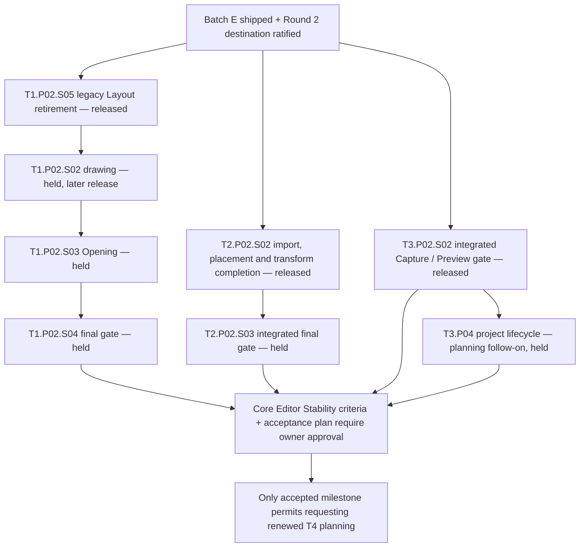

# Cross-track execution — allocation, readiness and current DAG

**Role:** one current coordination route for provider allocation, capability dependencies,
shared-file ownership and merge order. Track/phase registers own lifecycle and exact scope;
the [release list](./now.md) owns launch conditions; the [gate register](./README.md#gate-register)
owns accepted interfaces/evidence. This file creates no gate or acceptance record.

The owner authorized and released the three primary lanes below on 2026-10-23
([decision](../reference/decisions/post-batch-e-authorization-2026-10-23.md)). Every omitted
production scope remains under the [hold](./README.md#production-implementation-hold).
Round 2 shell ratification is destination design, not blanket implementation permission.

## Provider and acceptance matrix

The sole providers and exact accepted capability scopes remain in the gate register.
This allocation table routes consumers without duplicating that evidence or claiming T4 readiness.

| Interface | Sole registered provider | Current allocation / consumer boundary |
| --- | --- | --- |
| F1.reference@1 | T1.P01.S01 | Shared reference identity/resolution; T3's accepted unit-resolution extension serves current unit consumers. T4 release addresses remain future capability work |
| F2.unit-envelope@1 | T3.P01.S01 | Shared strict unit/lock/program codecs; current authoring consumes accepted unit capabilities |
| F3.channels@1 | T1.P01.S01 | Shared inspection ownership; T3's Camera-handoff extension supplies shared runtime/controller semantics |
| F4.intent-acceptance@1 | T1.P01.S03 | One chronological acceptance/history boundary; current consumers require active unit acceptance and conditional unit Save, not retired current-source admission |
| F5.release-envelope@1 | T4.P01.S02 (proposed) | Prepared release/profile/payload capability is not accepted; no current consumer may assume it |
| T1.viewport-projection@1 | T1.P01.S02, accepted through S07 bridge | Shared Stage/Plan/3D/projection seam for T2/T3; renderer integration is consuming-slice evidence |
| T3.camera-experience-cutover@1 | T3.P01.S04 | Accepted clean source/runtime cutover; production deployment/epoch activation remains a separate owner-run operation |
| T4.prepared-reader@1 | T4.P01.S05 (proposed) | Future prepared API/resource/cold-browser activation; held and not a prerequisite for editor Preview or bounded own-model import |

## Capability readiness

The [F capability-readiness rule](./f-foundation-contracts/README.md#capability-readiness)
owns eligibility. `Consumes` declares Gate@Version; `Requires` names every actual exact
capability scope and its prerequisite closure. Both must already be accepted/active in the
current tree and at the trusted base. A consumer cannot satisfy its own prerequisite by
editing a register, and an accepted gate does not imply every future capability is ready.

Compatible optional admissions need explicit capability evidence on the existing gate.
Breaking identity/revision/result/coordinate/lifecycle semantics requires the F amendment
path and a new major where required; a capability label cannot hide that break. Retired
current-source F4/Save admission stays historical and is ineligible for new consumers.
The provider's identity remains unchanged when an extension is accepted. Exact interfaces
stay in [F](../reference/composition-execution.md), never a track-local protocol.

## Common acceptance, persistence and Stage laws

Accepted revision, canonical content digest and session epoch are distinct. Operations
prepare against an expected revision, capture identities/external inputs, validate the
composed project and install one snapshot/undo result. Refusal/cancel/no-op writes nothing;
Redo replays captured input. Support reads do not turn Scene placement into Layout mutation.
Preview uses shared lowering/evaluation and no authored write or alternate Camera authority.

Conditional Save captures an immutable snapshot, revision/digest and create-only or exact
saved-base precondition. Atomic server OCC, full validation and retry receipts preserve
local accepted work on conflict; a stale response cannot mark a newer edit/session saved.
Save does not create a second history or force local editing through the server.

Stage has one validated facade, canonical selection and task/gesture host. Camera owns
output, supersession, return and cancellation. Reading/project/lens changes resolve active
writers through declared continue/revalidate, suspend or cancel policy. No consumer adds a
private projection, navigation graph, selection store or independent pose interpolation.

## Next parallel batch

**Integrated base:** Batch E is shipped on `main`, including T3.P03 S01/S02, T1.P02.S01,
T2.P02.S01 and T3.P02.S01; their scoped owner-overrides and residuals live in their acceptance
records. PR #181 ratified the Round 2 destination shell. This is evidence of those scopes,
not proof of every creator journey or of hardware performance. Each lane records/rechecks
its own trusted base through its owning runbook before implementation.

| Released lane | Owning plan | Bounded responsibility / dependency |
| --- | --- | --- |
| T1.P02.S05 | [Legacy Layout retirement](./t1-spatial-world/t1.p02-native-wall-creation/t1.p02.s05-legacy-layout-retirement/implementation-plan.md) | Retire old authored types/codec/room-frame/compiler adapter, preserve algorithm proof and current format; must merge before drawing |
| T2.P02.S02 | [Import, Place and existing transform completion](./t2-composition/t2.p02-own-model-import/t2.p02.s02-import-review-approve-place/implementation-plan.md) | Consume admitted whole-object GLB resources, complete bounded placement/transform behavior and retained precision proof; no T4 dependency |
| T3.P02.S02 | [Integrated final gate](./t3-experience/t3.p02-capture-and-cut-preview/t3.p02.s02-integrated-final-gate/implementation-plan.md) | Complete first Guide and Camera handover/return residuals, then independent integrated Capture/Preview acceptance; no T4 dependency |

T1's execution order is owned by the [T1.P02 register](./t1-spatial-world/t1.p02-native-wall-creation/README.md#slice-register);
the roadmap's [where-things-stand index](./README.md#current-coordination-and-proposal-provenance)
routes shipped, held and blocked scopes. No lane may implement a sibling's held scope to
satisfy its own acceptance.

**Files two released lanes both touch.** These are serialized, not split:

| File | Lanes | Rule |
| --- | --- | --- |
| `packages/project-model/src/scene-planning/frame.ts` | T1.P02.S05 (writer), T2.P02.S02 (reader) | S05 owns the `normalizeLayoutRoomYaw` move. T2 does not edit `frame.ts`; if it must, it waits for S05's merge and rebases |
| `packages/project-model/src/units/planning.ts` and units barrels | T2.P02.S02 (resource staging grant), T3.P02.S02 (Experience intents) | Additive edits only. The first lane to merge lands as is; the second rebases, resolves with the other domain's review and reruns its complete gate |
| Stage host/shell (`routes/project/[projectId]/spatial/+page.svelte`, `authoring/stage/**`) | T2 (Card facts, Library/Find), T3 (Capture/Guide dock, Preview handover) | Each lane carries a bounded T1-reviewed patch inside its own PR; merge in acceptance order, later lane rebases and reruns |
| `apps/api/src/app.ts` | T2.P02.S02 only in this batch | T3.P02.S02 adds no API route; T3.P04 takes API ownership only after T2.P02.S02 merges (explicit handoff), T3.P02.S02 is accepted and T3.P04 has its own release |
| Visitor/Preview runtime (`museum/assets/AssetModel.svelte`, `visitor/**`) | T2 (approved-model resolution input), T3 (Preview lifecycle, `VisitorPreviewSurface.svelte`) | Distinct files where possible; shared files serialized in acceptance order; visitor/public boundary tests unchanged |
| `apps/editor/perf/**` harness, fixtures and flows | All three lanes (new flows), H0 workflow owner T3 | New flow files per lane; shared harness/fixture edits serialized with T3 review |
| `apps/editor/tests/helpers/**` and shared fixtures | T1.P02.S05 (legacy fixture retirement), others as needed | Serialize; each edit triggers every-lane + full suite; S05's fixture conversions land first when both touch one helper |

Each lane records its shared-file claim (writer, expected patch base, reviewer) in its own
baton before editing one of these files. DB-backed `test:api` runs use an isolated per-lane
database or Compose stack ([local development](../local-development.md#backend-in-docker-recommended), "Parallel worktrees"),
never a shared one another lane may reset. New dependencies follow the owner's
[permissive-only admission ruling](../reference/decisions/post-batch-e-authorization-2026-10-23.md#licensing-direction).

## Shared files and merge protocol

| Surface | Writable owner for this batch | Consumer/review boundary |
| --- | --- | --- |
| Legacy Layout vocabulary, compiler and `packages/project-model/src/project-layout-semantics.ts` registry exception | T1 retirement lane | T2/T3 review the minimal registry type/caller migration; preserve empty-registry refusal and world-local identity frames; coordinate Scene yaw ownership with T2 |
| Stage host, session, input, contributions and shared shell | T1 | T2/T3 own bounded reviewed patches for their registered consumers; schedule shared-file edits with T1 and retain one host/selection/Camera authority |
| Scene transform/resource admission, GLB import and relevant API/resource routes | T2 during import S02 | Shared F4/Save changes reviewed by T3; no foreign-domain rewrite or publication/resource-release closure |
| Camera/Experience lowering, Guide, Preview lifecycle and return | T3 | T1 reviews host integration; keep shared evaluator and isolated runtime |
| Future C3 project lifecycle persistence/API | T3 after explicit handoff from T2 | Transfer shared API editing ownership when import changes merge; C3 remains held and needs its own release |
| Test contract, runtime-safe shared packages and boundary checks | Existing concern owner | Touch only required call sites with owner review; no duplicate protocol, silent boundary weakening or private test substitute |

Parallel work means independent domain edits. Serialize editing shared files; name the writer
and expected patch base before touching them. Owners review bounded patches, then rebase onto
current `main` and rerun the **complete declared implementation-PR merge gate**, including
heavy and unconditional arch, package/editor checks/build and DB-backed API zero-skip proof
where required by [tests/README](../../apps/editor/tests/README.md#what-a-change-requires).
Focused checks are iteration evidence only. Record exact tested revision and integration diff.

Merge one lane at a time; later lanes rebase on earlier merged work and resolve shared-file
changes through the owner. Use **P1 merge commits** where closeout anchors require preservation;
no squash/rebase merge may discard those anchors. Verify recovery paths/ancestry after merge.
A green earlier base or a sibling's acceptance does not prove the final integration. Slice
closeout updates only the owning baton; cross-track status stays in its owning registers.

## Residuals and planning follow-ons

- **Performance:** keep each acceptance's explicit unmeasured rows. S01's F2 S/M open timings
  remain assigned to T1.P02.S04 on the owner's MacBook Air M2, 16 GB, against H0's baseline.
  H0 harness/bundle workflow shipped; unclaimed flow traces, hard rows and calibration remain
  consumer evidence, not implied by a correctness pass. Import/transform/Preview lanes own
  their changed-flow measurements. No new waiver is granted by this coordination.
- **Activation:** accepted source/runtime code is available to consumers independently of a
  deployed epoch activation. Activation remains an owner-run operation with the accepted
  publication gap and recovery policy; no deployment or activation is claimed here.
- **C3:** [T3.P04](./t3-experience/t3.p04-project-lifecycle/README.md) is a planning-only follow-on
  for rename/delete and guarded lifecycle, T3 persistence/API plus T1 shell integration.
  Complete scope/plan and transfer shared API ownership after import; do not launch it early.
- **T1/T2 continuation:** face-frame provider/solve-once wall placement, part admission and
  annotation, vertical/coordinate qualification and overhead families are planning triggers
  in the owning tracks. They are not accepted providers or newly released scopes.
- **Core Editor Stability and T4:** owned by [the milestone](./core-editor-stability.md) and the
  [T4 baton](../operations/t4-release/current.md); this batch neither accepts the milestone nor
  creates its acceptance workspace.
- **Cycle/closure:** no track completion, owner architecture verdict, phase closure or baseline
  is created here. Re-arming a mechanism in its consuming slice is not a verdict.

## Decision provenance

The [post-Batch-E authorization](../reference/decisions/post-batch-e-authorization-2026-10-23.md)
owns this batch's release. Accepted design stays in the ratified reference contracts.
Earlier dated proposals, authorization protocols and original allocation reasoning are
[archived historical evidence](../archive/roadmap/coordination-2026-10/cross-track-execution-2026-10-23.md),
not parallel current routes. The [2026-10-22 convergence ratification](../reference/decisions/product-convergence-ratification-2026-10-22.md)
and [Round 2 ratification](../reference/decisions/production-shell-round-2-ratification-2026-10-23.md)
preserve decision provenance; their original dated planning packages are in the same archive.
