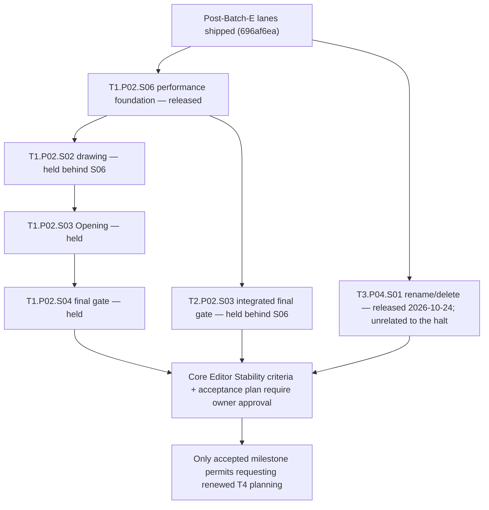

# Cross-track execution — allocation, readiness and current DAG

**Role:** one current coordination route for provider allocation, capability dependencies,
shared-file ownership and merge order. Track/phase registers own lifecycle and exact scope;
the [release list](./now.md) owns launch conditions; the [gate register](./README.md#gate-register)
owns accepted interfaces/evidence. This file creates no gate or acceptance record.

The owner authorized and released `T1.P02.S06` on 2026-10-24 under a temporary performance-first
halt ([decision](../reference/decisions/performance-foundation-authorization-2026-10-24.md)); the
three post-Batch-E lanes released on 2026-10-23
([decision](../reference/decisions/post-batch-e-authorization-2026-10-23.md)) are shipped. Every
omitted production scope remains under the [hold](./README.md#production-implementation-hold).
Round 2 shell ratification is destination design, not blanket implementation permission.

## Provider and acceptance matrix

The sole providers and exact accepted capability scopes remain in the gate register.
This allocation table routes consumers without duplicating that evidence or claiming T4 readiness.

| Interface | Sole registered provider | Current allocation / consumer boundary |
| --- | --- | --- |
| F1.reference@1 | T1.P01.S01 | Shared reference identity/resolution; T3's accepted unit-resolution extension serves current unit consumers. T4 release addresses remain future capability work |
| F2.unit-envelope@1 | T3.P01.S01 | Shared strict unit/lock/program codecs; current authoring consumes accepted unit capabilities |
| F3.channels@1 | T1.P01.S01 | Shared inspection ownership; T3's Camera-handoff extension supplies shared runtime/controller semantics |
| F4.intent-acceptance@1 | T1.P01.S03 | One chronological acceptance/history boundary; current consumers require active unit acceptance and conditional unit Save, not retired current-source admission |
| F5.release-envelope@1 | T4.P01.S02 (proposed) | Prepared release/profile/payload capability is not accepted; no current consumer may assume it |
| T1.viewport-projection@1 | T1.P01.S02, accepted through S07 bridge | Shared Stage/Plan/3D/projection seam for T2/T3; renderer integration is consuming-slice evidence |
| T3.camera-experience-cutover@1 | T3.P01.S04 | Accepted clean source/runtime cutover; production deployment/epoch activation remains a separate owner-run operation |
| T4.prepared-reader@1 | T4.P01.S05 (proposed) | Future prepared API/resource/cold-browser activation; held and not a prerequisite for editor Preview or bounded own-model import |

## Capability readiness

The [F capability-readiness rule](./f-foundation-contracts/README.md#capability-readiness)
owns eligibility. `Consumes` declares Gate@Version; `Requires` names every actual exact
capability scope and its prerequisite closure. Both must already be accepted/active in the
current tree and at the trusted base. A consumer cannot satisfy its own prerequisite by
editing a register, and an accepted gate does not imply every future capability is ready.

Compatible optional admissions need explicit capability evidence on the existing gate.
Breaking identity/revision/result/coordinate/lifecycle semantics requires the F amendment
path and a new major where required; a capability label cannot hide that break. Retired
current-source F4/Save admission stays historical and is ineligible for new consumers.
The provider's identity remains unchanged when an extension is accepted. Exact interfaces
stay in [F](../reference/composition-execution.md), never a track-local protocol.

## Common acceptance, persistence and Stage laws

Accepted revision, canonical content digest and session epoch are distinct. Operations
prepare against an expected revision, capture identities/external inputs, validate the
composed project and install one snapshot/undo result. Refusal/cancel/no-op writes nothing;
Redo replays captured input. Support reads do not turn Scene placement into Layout mutation.
Preview uses shared lowering/evaluation and no authored write or alternate Camera authority.

Conditional Save captures an immutable snapshot, revision/digest and create-only or exact
saved-base precondition. Atomic server OCC, full validation and retry receipts preserve
local accepted work on conflict; a stale response cannot mark a newer edit/session saved.
Save does not create a second history or force local editing through the server.

Stage has one validated facade, canonical selection and task/gesture host. Camera owns
output, supersession, return and cancellation. Reading/project/lens changes resolve active
writers through declared continue/revalidate, suspend or cancel policy. No consumer adds a
private projection, navigation graph, selection store or independent pose interpolation.

## Next parallel batch

**Integrated base:** the post-Batch-E lanes are shipped on `main` at `696af6ea`: T1.P02.S05
(PR #183), T3.P02.S02 (PR #184) and T2.P02.S02 (PR #185, acceptance recorded by PR #186). Their
scoped owner-overrides, deferred rows and residuals live in their acceptance records. This is
evidence of those scopes, not proof of every creator journey or of hardware performance. Each lane
records and rechecks its own trusted base through its owning runbook before implementation.

| Released lane | Owning plan | Bounded responsibility / dependency |
| --- | --- | --- |
| T1.P02.S06 | [Performance foundation](./t1-spatial-world/t1.p02-native-wall-creation/t1.p02.s06-performance-foundation/implementation-plan.md) | Peak-first, setup-free measurement on the M2; L/XL and realistic-load workloads; per-stage scaling evidence; algorithm work inside the one compiler and its consumers with equal-output proof; full-permissive library exploration; transferred S02 and T3 performance obligations; no product feature or format change |
| T3.P04.S01 | [Project rename and delete](./t3-experience/t3.p04-project-lifecycle/t3.p04.s01-project-rename-and-delete/implementation-plan.md) | Owner-scoped rename/delete, project-scoped resource cleanup and a bounded T1-reviewed shell patch; starts after [the release](../reference/decisions/t3-phase-close-and-p04-authorization-2026-10-24.md) merges, with T2's API handoff and the two [planning rulings](./t3-experience/t3.p04-project-lifecycle/t3.p04.s01-project-rename-and-delete/planning-resolution-2026-10-24.md) before that behaviour freezes; no gate and no format change |

**Performance-first halt.** The [decision record](../reference/decisions/performance-foundation-authorization-2026-10-24.md#performance-first-halt-temporary)
defines S06's direct inheritors: T1.P02 S02/S03/S04, T2.P02.S03, and Core Editor Stability with T4
behind it. None is released or started until S06 is accepted and merged. Strictly unrelated work,
such as T3.P04 or owner phase closeouts, continues only through its own owner release. Inheritors
rebase on S06's merged tree and measure on its method.

T1's execution order is owned by the [T1.P02 register](./t1-spatial-world/t1.p02-native-wall-creation/README.md#slice-register);
the roadmap's [where-things-stand index](./README.md#current-coordination-and-proposal-provenance)
routes shipped, held and blocked scopes. No lane may implement a sibling's held scope to
satisfy its own acceptance.

**Shared files S06 touches.** S06 is the only released lane. A later release of strictly unrelated
work edits any of these files only as a serialized patch against S06's recorded claim. The file's
owner reviews it, as the [decision record](../reference/decisions/performance-foundation-authorization-2026-10-24.md#performance-first-halt-temporary)
requires:

| File or resource | Writer | Rule |
| --- | --- | --- |
| `apps/editor/perf/**` harness, fixtures and flows | S06 | H0 workflow owner T3 reviews shared harness and fixture edits; new flow files per lane |
| `packages/layout-core/**`, the Layout unit, Layout adapters, Stage admission/host, `apps/editor/src/lib/layout/**` | S06 (T1) | One compiler; equal-output differential and count oracles; inheritors rebase on S06 |
| Scene, import and render code (`authoring/adapters/scene/**`, `museum/assets/**`), Camera/Experience/Preview and `visitor/**` | T2 / T3 owners | S06 touches these only through a bounded patch reviewed by that owner; otherwise it records a named finding |
| Dependency manifests and lockfile | S06, admitted packages only | [Full permissive licensing](../reference/decisions/performance-foundation-authorization-2026-10-24.md#full-permissive-licensing); each package, version and license recorded |
| `apps/editor/tests/helpers/**` and shared fixtures | S06 as needed | Serialize; each edit triggers every lane plus the full suite |
| `apps/api/**` | none in this batch | T3.P04 takes API ownership only after its own release and the explicit handoff from T2 |
| Reference-machine measurement time (M2) | S06 | Machine-wide perf lock; no concurrent heavy lane during a measurement pass |

Each lane records its shared-file claim (writer, expected patch base, reviewer) in its own
baton before editing one of these files. DB-backed `test:api` runs and S06's resource seeding use
an isolated per-lane database or Compose stack ([local development](../local-development.md#backend-in-docker-recommended), "Parallel worktrees"),
never a shared one another lane may reset. New dependencies follow the owner's
[permissive-only admission ruling](../reference/decisions/post-batch-e-authorization-2026-10-23.md#licensing-direction),
narrowed for S06 to [full permissive licensing](../reference/decisions/performance-foundation-authorization-2026-10-24.md#full-permissive-licensing).
The post-Batch-E three-lane tables are recoverable with `git show 696af6ea:docs/roadmap/cross-track-execution.md`.

## Shared files and merge protocol

| Surface | Writable owner for this batch | Consumer/review boundary |
| --- | --- | --- |
| Layout compiler, kernels, representation and Stage admission | T1 (S06 in this batch) | T2/T3 review any bounded patch that changes their callers; one compiler, equal-output proof, no format change |
| Stage host, session, input, contributions and shared shell | T1 | T2/T3 own bounded reviewed patches for their registered consumers; schedule shared-file edits with T1 and retain one host/selection/Camera authority |
| Scene transform/resource admission, GLB import and relevant API/resource routes | T2 (no released lane) | S06 reads the import recipe and resources format only to seed its workloads; shared F4/Save changes reviewed by T3; no foreign-domain rewrite or publication/resource-release closure |
| Camera/Experience lowering, Guide, Preview lifecycle and return | T3 | T1 reviews host integration; keep shared evaluator and isolated runtime; S06 measures these flows and reports T3-owned misses |
| Measurement harness (H0 workflow) | T3 | S06 edits the shared harness and fixtures through T3 review |
| C3 project lifecycle persistence/API | T3 after explicit handoff from T2 | Released as `T3.P04.S01` on 2026-10-24; shared API editing transfers after the handoff, and the slice does not edit the harness, Stage or S06's shell claim |
| Test contract, runtime-safe shared packages and boundary checks | Existing concern owner | Touch only required call sites with owner review; no duplicate protocol, silent boundary weakening or private test substitute |

Parallel work means independent domain edits. Serialize editing shared files; name the writer
and expected patch base before touching them. Owners review bounded patches, then rebase onto
current `main` and rerun the **complete declared implementation-PR merge gate**, including
heavy and unconditional arch, package/editor checks/build and DB-backed API zero-skip proof
where required by [tests/README](../../apps/editor/tests/README.md#what-a-change-requires).
Focused checks are iteration evidence only. Record exact tested revision and integration diff.

Merge one lane at a time; later lanes rebase on earlier merged work and resolve shared-file
changes through the owner. Use **P1 merge commits** where closeout anchors require preservation;
no squash/rebase merge may discard those anchors. Verify recovery paths/ancestry after merge.
A green earlier base or a sibling's acceptance does not prove the final integration. Slice
closeout updates only the owning baton; cross-track status stays in its owning registers.

## Residuals and planning follow-ons

- **Performance:** keep each acceptance's explicit unmeasured rows. T1.P02.S06 takes, as
  measurement on the owner's MacBook Air M2 (16 GB):
  - S02's deduplication and experiment;
  - T3.P02.S02's deferred Scope A rows;
  - T3.P03.S02's L/XL and M/L drag gap.

  S01's F2 S/M open timings remain assigned to T1.P02.S04, which cites and rechecks S06's numbers.
  T2.P02.S02's owner-run rows remain with T2.P02.S03 on S06's method. Unclaimed flow traces, hard
  rows and calibration remain consumer evidence, not implied by a correctness pass. No new waiver is
  granted by this coordination.
- **Activation:** accepted source/runtime code is available to consumers independently of a
  deployed epoch activation. Activation remains an owner-run operation with the accepted
  publication gap and recovery policy; no deployment or activation is claimed here.
- **C3:** [T3.P04](./t3-experience/t3.p04-project-lifecycle/README.md) is **authorized and released**
  as `T3.P04.S01` (2026-10-24) for rename/delete and guarded lifecycle, T3 persistence/API plus T1
  shell integration. It is strictly unrelated to the halt, starts after its coordination PR merges,
  and still needs T2's API handoff and the two owner rulings its planning resolution names before
  that behaviour is frozen. Launch nothing beyond that release row.
- **T1/T2 continuation:** face-frame provider/solve-once wall placement, part admission and
  annotation, vertical/coordinate qualification and overhead families are planning triggers
  in the owning tracks. They are not accepted providers or newly released scopes.
- **Core Editor Stability and T4:** owned by [the milestone](./core-editor-stability.md) and the
  [T4 baton](../operations/t4-release/current.md); this batch neither accepts the milestone nor
  creates its acceptance workspace.
- **Cycle/closure:** no track completion, owner architecture verdict, phase closure or baseline
  is created here. Re-arming a mechanism in its consuming slice is not a verdict.

## Decision provenance

The [performance foundation authorization](../reference/decisions/performance-foundation-authorization-2026-10-24.md)
owns this batch's release and the performance-first halt; the
[post-Batch-E authorization](../reference/decisions/post-batch-e-authorization-2026-10-23.md)
owns the shipped lanes' release. Accepted design stays in the ratified reference contracts.
Earlier dated proposals, authorization protocols and original allocation reasoning are
[archived historical evidence](../archive/roadmap/coordination-2026-10/cross-track-execution-2026-10-23.md),
not parallel current routes. The [2026-10-22 convergence ratification](../reference/decisions/product-convergence-ratification-2026-10-22.md)
and [Round 2 ratification](../reference/decisions/production-shell-round-2-ratification-2026-10-23.md)
preserve decision provenance; their original dated planning packages are in the same archive.
