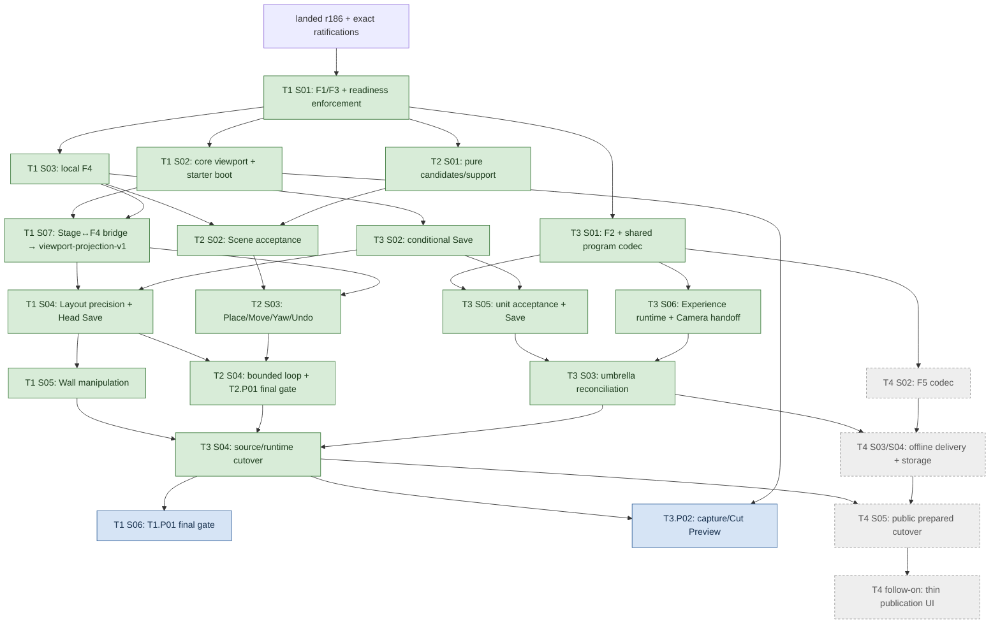
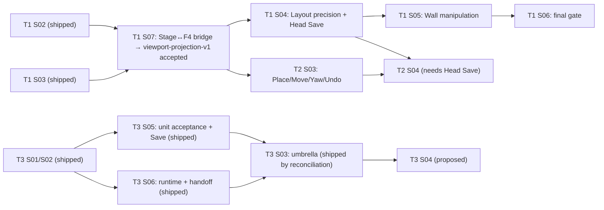
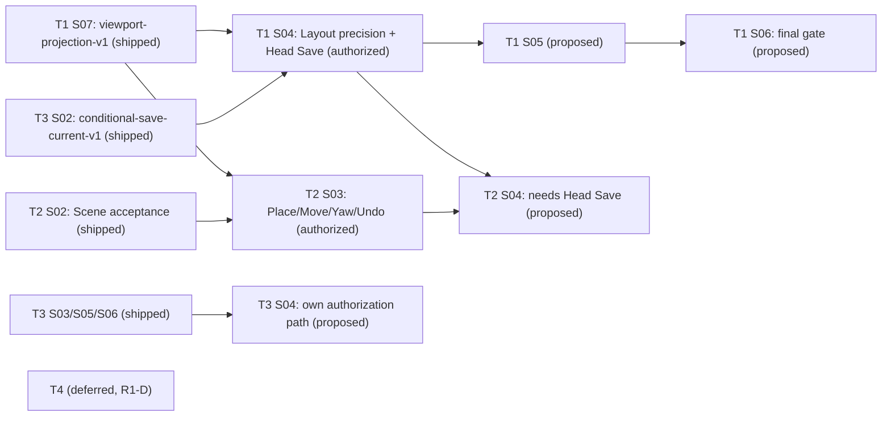
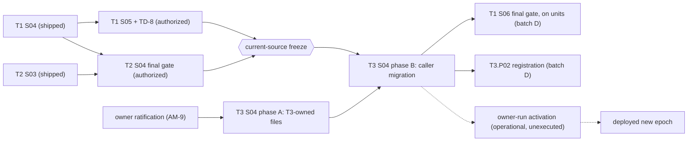
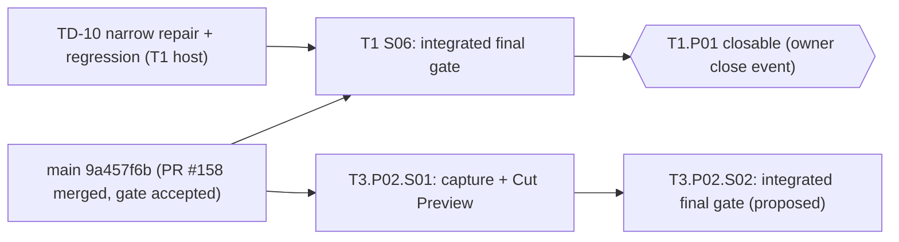

# Cross-track execution — proposed allocation, readiness and DAG

**Owner production hold, 2026-10-22:** the [roadmap hold](./README.md#production-implementation-hold)
overrides implementation launch/resume implied by earlier batch authorizations below. PR #173's
[expanded convergence scope](./product-convergence-2026-10-21.md#scope-and-sequence) will reconcile
this canonical DAG, affected roadmaps and the next batch after focused research and architectural
decisions. Step 1 adds this routing/hold notice only; no new DAG or batch has been decided yet.
Historical evidence and accepted gate identities remain unchanged. Merge alone does not release the hold.

**Status:** coordinated cross-track allocation, owner-confirmed 2026-10-15. The F amendments it
references (AM-1–AM-8) and the capability-readiness rule are owner-ratified
([decision record](../reference/decisions/f-ratification-2026-10-15.md)); this artifact owns the
provider allocation, capability dependencies and execution DAG only, and is not an F contract.
Exact interfaces stay in [`../reference/composition-execution.md`](../reference/composition-execution.md)
(AM-1–AM-8); the readiness rule stays owned by
[`f-foundation-contracts/README.md`](./f-foundation-contracts/README.md#capability-readiness). It
registers no gate, phase or slice, and each provider is wired through its own authorized track
phase. Candidate IDs below remain provisional until their phase registers them. Registered now:
T1.P01 (S01–S05 and S07 shipped, S04 through batch B and S05 through batch C; **S06 authorized
2026-10-20 as batch D**), T2.P01 (**closed 2026-10-20**; S01–S04 shipped, S03 through batch B and S04
through batch C) and T3.P01 (**closed 2026-10-20**; S01–S06 shipped, S03 reconciled through its
owner-authorized split halves and S04 through the AM-9 two-phase authorization), plus
**T3.P02 registered 2026-10-20** with `S01` authorized and `S02` `proposed`. All T4 work is deferred
by ruling R1-D. Batch B shipped under the [batch B protocol](#authorized-batch-b-2026-10-17); batch C
(`T1.P01.S05` ∥ `T2.P01.S04`, authorized 2026-10-19) and the two-phase T3.P01.S04 (authorized
2026-10-19 under AM-9) shipped under the [batch C protocol](#authorized-batch-c-2026-10-19), and
batch D (`T1.P01.S06` ∥ `T3.P02.S01`, authorized 2026-10-20) runs under the
[batch D protocol](#authorized-batch-d-2026-10-20). The four slices authorized first on 2026-10-16 run under the
[parallel batch protocol](#parallel-batch-2026-10-16); `T2.P01.S02` and `T3.P01.S02` run under the
[parallel pair protocol](#parallel-pair-2026-10-16).
Cross-PR links identify proposals, never accepted prerequisites.

Planning proceeds on the landed r186 base: the separate
[Three.js r186 foundation upgrade (PR #122)](https://github.com/Biskiq/spatial-sketch-editor/pull/122)
merged into `main` as `74efb98b` (closeout PR #123, `d69825fe`), standardizing three 0.186.1 /
`@types/three` 0.186.0 with Threlte unchanged and explicit `PCFShadowMap` at both shadow canvases.
Each authorized implementation plan records that base and verifies affected
Camera/Threlte/render/loader behavior against it; this post-#116 planning baseline is not that
compatibility evidence.

## Provider and acceptance matrix

`@1` denotes a proposed first major, not a ratified version. A provider never consumes its own
output. Shared formats land in existing runtime-safe packages; no track-local protocol.

| Gate/version | Sole proposed provider | Direct prerequisites | Acceptance scope and consumers |
| --- | --- | --- | --- |
| F1.reference@1 | T1.P01.S01 | Ratified F1 amendment | `references-v1`: source-independent identity/resolution/frame qualification and bounded current-domain resolvers. All tracks consume it; new unit/public resolvers require separate accepted capabilities below. |
| F2.unit-envelope@1 | T3.P01.S01 | F1 `references-v1`, F3 `inspection-v1` for shared typed program/channel shapes | `unit-envelope-v1`: actual strict envelope/lock/unit codecs, Experience execution-program codec and pure conversion candidates. No live reader/writer activation. T3 coordination and T4 source/program codecs consume it. |
| F3.channels@1 | T1.P01.S01 | Ratified F3 amendment; F1 is supplied coherently in this same provider | `inspection-v1`: addresses, typed descriptors, negotiation and exclusive epoch-qualified ownership; Layout/Camera inspection families. T1 viewport uses it. T3 extends Camera/session conformance without a second provider. |
| F4.intent-acceptance@1 | T1.P01.S03 | F1 `references-v1`; explicit F4 timing/admission amendment | The enduring `acceptance-invariants-v1` layer plus the retiring `local-single-domain-v1`: one local acceptance/history boundary admitting registered Layout or Scene planners over the current source adapter. T1/T2 use it; T3's unit capabilities require the enduring layer. It proves neither unit/resource compound acceptance nor cloud Save. |
| F5.release-envelope@1 | T4.P01.S02 | F1 `references-v1`, F2 `unit-envelope-v1`, F3 `inspection-v1` | `prepared-envelope-v1`: release/profile/payload codecs, canonicalization and capability negotiation using T3's shared program codec. T4 compiler/reader/storage consume it; schema acceptance is not live delivery acceptance. |
| T1.viewport-projection@1 | T1.P01.S02 | F1 `references-v1`, F3 `inspection-v1` | Rendered Plan/3D projection, source-independent facade, ordinary representation, selection/task/gesture host and Camera output protocol. T2 UI and T3 authoring consume it; Scene support and authored Camera operations are excluded. |
| T3.camera-experience-cutover@1 | T3.P01.S04 | F1 `unit-resolution-v1`, F2 `unit-envelope-v1`, F3 `camera-handoff-v1`, F4 `unit-acceptance-v1` and `conditional-save-units-v1`, plus their base capabilities | Atomic source/runtime activation, existing caller migration, occurrence behavior and legacy-order retirement. T3 authoring and T4 public activation consume it. No viewport dependency for this provider. |
| T4.prepared-reader@1 | T4.P01.S05 | F1 `release-addresses-v1`, F2 `unit-envelope-v1`, F3 `camera-handoff-v1`, F5 `prepared-envelope-v1`, accepted T3 cutover, and all base capabilities | Coherent prepared API/resource/pointer/cold-browser activation and retirement of source delivery. Thin publication UX follows; full T3 authoring is unnecessary. |

## Capability-readiness amendment

The current gate checker reads `Consumes` gate/version and overall state, not incremental
capability scope. It cannot prove that accepted local F4 also implements cloud or compound
behavior. Do not rely on a green current checker to admit such a consumer.

Propose only two additive fields: **Accepted capabilities** on each gate/version row and
**Requires** on each slice row. The latter names exact pairs, written here as
`F4.intent-acceptance@1:local-single-domain-v1`. `Consumes` retains ordinary Gate@Version syntax.
No additional gate, parallel registry or per-track acceptance protocol is introduced.

Each Accepted-capabilities entry links a durable record containing capability ID/version,
contract/amendment anchor, admitted source kinds, prerequisites, extension slice, actual shared
exports, conformance, independent acceptance and ancestor implementation commit. Pending scopes
stay in plans and do not appear as accepted entries. Existing evidence is retained when another
scope is added; the gate's sole provider is unchanged. A scope can also be explicitly retired,
with historical evidence retained and no new consumer eligible for it.

Eligibility requires the exact gate **and every required capability**, with its prerequisite
closure, to be accepted in the current tree **and at the trusted base** (`git merge-base HEAD main`).
The slice cannot add its own prerequisite evidence.This applies to new starts/in-progress/accepted
consumers; shipped historical slices retain their original scopes/evidence, as with historical gate
majors. Retiring an adapter removes its active admission, not historical evidence or base invariants.

For F.4, retirement splits two layers that `local-single-domain-v1` initially bundles. The enduring
layer is recorded as its own scope on the same F.4 entry —
`F4.intent-acceptance@1:acceptance-invariants-v1`, which never retires: opaque accepted revision,
content-digest comparison, atomic install with one undo result, stale/ABA rejection and one
chronological history. It persists across the source transition and is the prerequisite of
`unit-acceptance-v1` and `conditional-save-units-v1`. The retiring layer is the current-source
adapter admission (`local-single-domain-v1` current-source planning/validation and
`conditional-save-current-v1` persistence), which T3 S04 retires together with all its callers; after
that point no new or in-progress consumer may Require either retiring scope, while shipped slices keep
their evidence. The checker records retirement as a terminal state on the retiring scope's own entry
— no parallel registry, no permanent legacy admission — and fails any new or in-progress Requires
naming a retired scope. The inactive converter retires in T3 S04 without running (AM-9).
Acceptance of an interface is distinct from
ratification, implementation and consumer eligibility. `T1.P01.S01` installs the two-field
validation and controls for missing/unimplemented scope, consumer self-satisfaction, retired scope
and the trusted base (owner-ratified 2026-10-15): a consumer needing incremental readiness now
fails the arch-lane gate rather than relying on review alone. This file changes neither the live
register nor its checker. The rule's
normative statement and checker definition live in
[`f-foundation-contracts/README.md`](./f-foundation-contracts/README.md#capability-readiness); this
file keeps only the proposed allocation, the capability dependencies and the enforcement handoff,
and does not restate F semantics.

Compatible optional kind/family/source-adapter admissions retain the gate major and get explicit
new capability evidence. Breaking required identity, revision, result, coordinate or lifecycle
semantics needs a new major, retained old evidence and consumer re-declaration. A capability name
cannot disguise an incompatible semantic change. A consumer must declare what it actually uses.

| Capability added after the base | Extension slice | Exact scope / prerequisites |
| --- | --- | --- |
| F1.reference@1:unit-resolution-v1 | T3.P01.S01 | Camera/Experience/resource kinds and supplied F2 lock resolution; preserves missing/repair identity. Extends `references-v1`. |
| F1.reference@1:release-addresses-v1 | T4.P01.S02 | Publication/pinned-release semantic addresses with concrete release context and removed/repair results. Extends `references-v1`; needs shared unit/program identity. |
| F4.intent-acceptance@1:conditional-save-current-v1 | T3.P01.S02 | Create-only / expected-saved-base persistence of current source using full shared validation, atomic server OCC and retry receipts. Needs `local-single-domain-v1`; not F2, Stage or source activation. |
| F4.intent-acceptance@1:unit-acceptance-v1 | T3.P01.S05 | F2-backed single-domain and compound Camera/Experience acceptance, complete reference/lock validation, admitted resource staging and whole-operation history. Needs F2 and the enduring `acceptance-invariants-v1`, never the retiring `local-single-domain-v1`/`conditional-save-current-v1`, so the capability stays eligible once the current-source adapter retires. |
| F4.intent-acceptance@1:conditional-save-units-v1 | T3.P01.S05 | Same conditional Save protocol over F2 source; needs unit-acceptance-v1/base invariants and reuses prior Save protocol evidence, not active current-source admission. Inactive until S04; never a second live writer. |
| F3.channels@1:camera-handoff-v1 | T3.P01.S06 | Inspection, guided/free, Follow, Look-through and Preview ownership/return with stale-run cleanup; bounded Experience session semantics use the shared program. Needs `inspection-v1` and F2 program codec; real Stage integration is later T3.P02 evidence. |

**Slice prerequisites and exported-capability prerequisites are different claims.** A slice's
`Requires` names what that slice's implementation consumes; a capability's declared prerequisites
are what any later consumer needs from it. `T3.P01.S03`'s two registered halves owned the
implementation and are shipped; S03's original obligations are reconciled. `T3.P01.S05` builds the F2 unit admission and Save and
consumes F2 plus the enduring `acceptance-invariants-v1`; it does not consume the retiring
`local-single-domain-v1`/`conditional-save-current-v1` admissions. `T3.P01.S06` consumes
`inspection-v1` and the F2 program codec. The `unit-acceptance-v1`, `conditional-save-units-v1` and
`camera-handoff-v1` capabilities declare F2, `acceptance-invariants-v1` and `inspection-v1` as
appropriate — never a retiring admission and never each other's unaccepted output.

Initial local F4 admission includes registration and conformance for both Layout and Scene,
not T2's complete placement capability. T2 S02 registers its actual operations. No resource/lock
mutation or multi-domain dispatch succeeds under `local-single-domain-v1` alone.

## Common acceptance, persistence and Stage laws

Accepted revision is opaque `{projectId, revisionId}`; content digest compares canonical authored
contents; session epoch guards callback lifetime. They are distinct, including across Undo/Redo
and source replacement. F4 intent/result signatures expose a validated source-independent snapshot
facade, never require today's ProjectDocument. Current and F2 source adapters own decoding,
materialization and full composed validation; they do not duplicate domain planners or history.

All operations prepare against one expected local revision, capture identities/external inputs,
validate the composed project, and install one snapshot/undo result. Layout support reads do not
make Scene placement a Layout mutation. Camera View + Presentation + optional Stop is one T3
compound operation. Repairable authored bindings are explicit; required execution requires closure.
Undo/Redo use fresh revisions and one bounded chronological stack; no-op/refusal/cancel adds none.

Local accepted editing remains immediate. Conditional Save captures an immutable local snapshot
and its revision/digest plus a create-only or exact saved-base precondition. Server ownership,
revision comparison, shared full validation and metadata append are atomic. A saved-base token
is durable persistence metadata, distinct from local revision, SQL ordinal and publication OCC.
The server recomputes the canonical digest and rejects revision identity reused for different
contents. Save returns the persisted source revision/digest and new saved-base token. A newer local edit
while Save is in flight remains dirty; a prior-session response cannot mark it saved or replace it.
Identical retry returns its receipt without another version; changed-payload retry refuses.
Conflict preserves both local accepted work/history and remote source; reload/explicit resolution
is required, with no automatic merge. Save does not create a second authoring Undo stack or force
every edit through the server. Before F2, accepted revision metadata stays outside the strict
current source document; after F2 the same captured revision is carried by its envelope.

Stage has one validated read facade and one canonical selection/task/gesture host. Camera owns
output acquisition, supersession, return and cancellation. Inspection, Follow, Look-through and
Preview are declared controller roles, not competing pose writers. A reading-transition hook
uses each operation's declared continue/revalidate, suspend-proposal or cancel policy; the host
runs it once before changing projection. Lens/project exit cancels writers. T2 cancels its pointer
gesture while retaining its armed task/selection; T1 may continue a valid mapping or suspend the
proposal. No private transition, projection, selection or navigation infrastructure is admitted.

## Source-first migration and activation ownership

> **Rewritten 2026-10-19 on ratification of [AM-9](../reference/composition-execution.md#am-9-shared-camera-and-experience-cutover)**
> ([T3 cutover record](../reference/decisions/t3-cutover-ratification-2026-10-19.md)). The owner
> ruled saved data disposable, so AM-7's inventory, covered-data exception, quiescence/CAS
> conversion and converter retirement no longer apply. The earlier text is recoverable at `5fee2a2d`.

T3 S01 prepared an old-source conversion candidate, which stays inactive and test-only and retires in
S04 without ever running. T3 S05 prepared the new-source unit planners, acceptance and Save adapters,
and T3 S06 the Experience runtime, Camera handoff and profile controllers, both without live
activation; S03's umbrella reconciled the original scope once both closed. T3 S04 installs AM-9's
clean source epoch: one transactional reset migration under an advisory lock that removes all
authored rows and fences the schema to the F2 envelope, current-format-only admission with typed
refusals, and atomic retirement of the current-source Stage/F4/Save/starter adapters with every
existing T1/T2 caller. In-progress consumer plans re-declare the already accepted F2/unit
capabilities from S05/S06. This is caller integration, not Camera authoring, and it does not consume
its own T3 gate. T2 definition inputs then come from immutable project pins; Scene-only placement
admits pinned/procedural entries. The F2 starter may install an explicitly captured bounded palette;
absent pins are unavailable, and further resource admission remains staged T2 follow-on work.

No ordinary Undo crosses the source-format transition: every project starts at a new-format
baseline. Old clients, files and drafts fail explicitly. Normal readers/writers accept only the new
format, and skew between the independently deployed API and editor refuses rather than misreads.
T3 removes legacy node-order orchestration. No converter, reverse serializer or old-format reader
survives.

T4 has no default legacy Experience converter or retained selection map. It lowers F2 units and
T3's authored identities into the **same T3 execution program** used by Preview. T4 S03/S04 may
exercise closed F2 candidate fixtures and inactive storage before T3 activation. T4 S05 waits for
the accepted T3 cutover, then owns prepared publication/API/resource/browser activation and source
snapshot delivery retirement. One Camera engine and one Experience interpreter serve both paths.

The publication gap is approved (2026-10-19, K2/R4) and is empty by construction, because the reset
removes every publication and release row. During an approved empty-release gap, new source publication returns typed
prepared-reader-required, cold public reads return their explicit unavailable/not-found outcome,
and status/Unpublish remain honest; the real /p/ route and isolation checks remain. Never silently reinterpret old bytes or keep a competing old visitor
engine. T4's barrier
fences mutations, switches prepared metadata/artifacts/resources and cold reader together, and
retires all authored delivery callers. Recovery after new-format edits rolls forward or explicitly
restores disclosed backups; prepared activations roll back to a compatible prepared runtime/pointer
with fresh OCC revisions. No permanent dual-format reader/writer or source fallback.

## Execution DAG and earliest product milestones

Status key (2026-10-20): green nodes are shipped — batch B (`P`, `UI`) in PRs #148/#147, batch C
(`W`, `T2F`) and `CUT` (T3 S04) in PR #158. Blue nodes are batch D's authorized work: `G`
(`T1.P01.S06`) and `PRE` (`T3.P02.S01`) are authorized and unimplemented. The `W → CUT`, `T2F → CUT`
and `CUT → G`/`CUT → PRE` edges are the batch C current-source freeze and the post-cutover route for
S06 and T3.P02. Grey dashed nodes are T4 work deferred by ruling R1-D until
[Core Editor Stability](./core-editor-stability.md) is accepted. The status key restates the phase
registers; it never overrides them. Every edge is a real capability or ownership dependency. `S → P`
is the Head Save integration mounting T3's client Save state, and no batch adds another cross-track
edge. **No edge leaves the owner-run deployment**: batch D corrected the batch C diagram's
`owner-run activation → S06/T3.P02` arrows, because activation is an operational step on already
accepted code, not a readiness gate.

T4 S01 was docs-only drafting that could run early; under R1-D it waits, with the rest of T4, for
Core Editor Stability. After the shared providers merged, independent
viewport, local acceptance, unit-codec and Scene-candidate work proceeds in parallel. Save waits
for local F4, not F2. T4 F5 waits for the shared program codec, not the T3 runtime cutover. Actual
consumer starts require the precise capabilities accepted on main at trusted base; sibling plans,
ratified text, offline harnesses and a consumer's own register edits are not readiness.

T2 simple transform payloads use domain types, not a general F3 execution system. T1 local F4
needs neither F2 nor F3. T2/T3 UI waits for the viewport, not all of T1. T4 final activation waits
for T3 S04, not T3 authoring/phase closure. Shared-file integration ownership: T3 owns source/Save
and visitor semantic changes through S04; T4 then owns delivery/publication changes, reusing T3
execution. Storage additions can merge inactive beforehand; overlapping callers are reviewed
against each new main rather than merged as independent competing implementations.

1. Starter gallery → T2 Place/Move/Yaw/Undo → early conditional Save/reload is the first creator
   journey. T2 S04 integrates its complete bounded phase with Save; JSON recovery is also available.
2. T3 capture View/Presentation/optional Stop → Cut Guide → isolated Preview is next; existing
   supported Travel is evaluated, while advanced path authoring is a named T3 follow-on.
3. T4 prepare/activate → cold public link → update/unpublish proves delivery. API-driven foundation
   precedes the T4-owned thin publication UI. Bounded single-model ingest is the T2-owned next phase,
   requires F2/unit acceptance and T4 resource delivery, and precedes the promised creator/audience trial.

These phases do not complete the full creator-to-visitor product. Durable external links require
an explicit Release Baseline; Source Baseline follows stabilized source formats, not these merges.

## Parallel batch 2026-10-16

The owner authorized `T1.P01.S02`, `T1.P01.S03`, `T2.P01.S01` and `T3.P01.S01` to run in parallel
([decision](../reference/decisions/parallel-slice-authorization-2026-10-16.md)). Each consumes only
the accepted `references-v1`/`inspection-v1` on post-PR #126 `main`; none consumes another, so none
may wire, import or depend on another's unmerged output. A slice that finds it needs to stops and
reports instead.

**Shared-file ownership.** One writer per shared module for the batch's duration:

| Area | Writer in this batch | Rule for everyone else |
| --- | --- | --- |
| `@portfolio/camera-core` | `T1.P01.S02` | read-only |
| Editor route, host, Stage and shell modules | `T1.P01.S02` | read-only |
| `@portfolio/layout-core` | new modules only: `T1.P01.S02` (Plan representation), `T2.P01.S01` (floor-support query) | nobody changes the compiler, its tolerances or an existing query |
| `@portfolio/project-model` | new modules only: `T1.P01.S03` (F4 contracts, admission, content identity), `T2.P01.S01` (Scene planning), `T3.P01.S01` (units, program, converter, additive reference extension) | nobody changes landed reference/channel behavior or the Scene v1 codec |
| [`package.json`](../../packages/project-model/package.json) `exports` of project-model | `T3.P01.S01` adds its subpaths | any other addition appends |
| Editor F4 coordinator/history module | `T1.P01.S03` | — |
| Editor object-definition policy and admitted inventory | `T2.P01.S01` | — |
| Barrels [`project-model`](../../packages/project-model/src/index.ts), [`layout-core`](../../packages/layout-core/src/index.ts) and [`test-lanes.ts`](../../apps/editor/test-lanes.ts) | append-only | the second merger resolves the textual conflict |
| Boundary tests (public surface, project-model, camera-core) | additive assertions per slice | no slice weakens an existing assertion |
| Landed `reference/*` contracts | none during the batch | `T1.P01.S02` updates `architecture.md` §Product routes at its own closeout |

**Content identity.** `T1.P01.S02` and `T1.P01.S03` both need the current-source content identity
that S03 owns: `sha256Bytes` over the strict writer's normalized source with ID-keyed Layout
identity maps ordered and only `layout.identity.cursor` excluded from the digest. Full canonical
source retains the cursor for persistence/history; hash equality is authored-content equality,
not full-source byte equality. Whichever merges first lands the single project-model export with its invariance
tests; the other rebases and reuses it. `T3.P01.S01` uses the same hash primitive for unit
`contentRevision` and defines no current-source identity.

**Merge protocol.** Each slice merges on its own after independent acceptance and routine closeout;
there is no batch merge and no imposed order. Every merge reruns the complete merge gate in
[`tests/README.md`](../../apps/editor/tests/README.md#what-a-change-requires) on the then-current
`main`, whatever the slice's iteration tier; a slice whose shared module changed underneath it
rebases and reruns before merging. Integration of the viewport host with F4 (accepted install, Undo/
Redo commands, replacement baseline, selection requalification, Camera-output rebase) is
`T1.P01.S04`'s first increment by default (reassigned to `T1.P01.S07` by ruling D2 of 2026-10-17).

**Cycle.** `T1.P01.S02` is a listed exposure: its first authorized implementation opens the T1.P01
window through the runbook start step. `T1.P01.S03`, `T2.P01.S01` and `T3.P01.S01` are not exposures
and open nothing; an open window and its pending verdicts block none of them.

**Remaining risks** (owners named; none blocks the batch's start):

| # | Risk | Owner and mitigation |
| --- | --- | --- |
| R1 | `T1.P01.S02` is large and on the critical path of every viewport consumer. | S02 implementer proposes a registered split rather than silently deferring criteria. |
| R2 | `T3.P01.S01` is large, and Experience 1 / `ExecutionProgram@1` freeze before the interpreter and authoring UI exist. | Codec-level fixtures for every AM-6 case now; a later required-meaning change is a versioned F amendment. A split (converter as its own slice) is the owner's option. |
| R3 | `T2.P01.S03` authorized before `T1.P01.S04` would leave host↔F4 wiring unowned. | Owner assigns it explicitly at that authorization. |
| R4 | Contact-metadata verification may exclude the non-unit-normalization model. | `T2.P01.S01` records the exclusion; the phase proceeds with analytical primitives and verified models. |
| R5 | `T3.P01.S02`'s Save control needs a home in the T1 shell Head. | **Settled 2026-10-16** ([record](../reference/decisions/s02-pair-authorization-2026-10-16.md)): T3 owns persistence and client Save state; T1's host↔F4 wiring slice owns the Head integration. `T1.P01.S02` never calls the unconditional `PUT`. |
| R6 | T3.P02 cannot register until `T3.camera-experience-cutover@1` is drafted and ratified. | T3 drafts it with `T3.P01.S04`'s authorization request. |
| R7 | Per-accept validation, serialization and hashing may be costly on dense projects. | `T1.P01.S03` records a measured observation on the densest fixture (TD-5's lesson). |
| R8 | Client/server canonical-byte or digest-version skew would make equal contents compare unequal. | `T3.P01.S02` carries the content-identity scheme as transport metadata, pinned by a golden-digest test, and refuses a mismatch explicitly (`identity-scheme-mismatch` / `source-version-mismatch` / `content-identity-mismatch`), never as a conflict. |
| R9 | Barrel and lane-list merge conflicts. | Append-only rule; second merger resolves. |
| R10 | The window `T1.P01.S02` opens may stay open for a long time. | Pending verdicts block no other track (cycle disposition below). |

## Parallel pair 2026-10-16

The owner authorized `T2.P01.S02` and `T3.P01.S02` to run in parallel
([decision](../reference/decisions/s02-pair-authorization-2026-10-16.md)) on post-PR #129 `main`
(`1315b1a2`), while `T1.P01.S02` (PR #128) is still open under the batch above. Each slice consumes
only accepted `references-v1` and `local-single-domain-v1`. Neither consumes the other or #128, so
neither may wire, import or depend on their unmerged output. A slice that finds it needs to stops
and reports instead.

**Shared-file ownership** (in addition to #128's batch rows, which stand until it merges):

| Area | Writer | Rule for everyone else |
| --- | --- | --- |
| `project-model` `src/scene-planning/` | `T2.P01.S02` | read-only |
| `project-model` Save protocol subpath module and its `package.json` `exports` entry | `T3.P01.S02` | appending another subpath is fine |
| `content-identity.ts` and its test | none in the pair: T3's scheme constant lives in its Save subpath | #128 still carries a stale copy; per the batch's content-identity rule it drops it on rebase and reuses the landed export |
| `project-model` `src/f4/**`, the current-source adapter and `apps/editor/src/lib/authoring/f4/**` (T1-owned, shipped) | none | read-only; a needed change is a stop-and-report to T1 |
| `apps/api/**`, migrations, `apps/editor/src/lib/platform/project-persistence.ts` and the editor client Save state | `T3.P01.S02` | read-only; T1's read-only boot relies on the additive `GET` shape |
| Editor routes, host, Stage and shell modules | `T1.P01.S02` (#128) | read-only for both slices: no route, Head or host edit |
| Root barrels and [`test-lanes.ts`](../../apps/editor/test-lanes.ts) | append-only | the second merger resolves the textual conflict |
| Boundary tests (public surface, project-model) | additive assertions per slice | no slice weakens an existing assertion |

**Merge protocol.** As for the batch: each slice merges on its own after independent acceptance and
routine closeout. Every merge reruns the complete merge gate on the then-current `main`;
`T3.P01.S02` also runs the DB-backed API suite with zero skips. The Head Save integration is T1's
and starts only after `conditional-save-current-v1` is accepted. Neither slice is a cycle exposure.

## Authorized batch 2026-10-17

**Batch A is owner-authorized 2026-10-17** ([decision](../reference/decisions/next-batch-authorization-2026-10-17.md)):
`T1.P01.S07` and `T3.P01.S03`. S03's two follow-ups, `T3.P01.S05` and `T3.P01.S06`, were separately
owner-authorized on 2026-10-17 ([record](../reference/decisions/s03-split-followup-authorization-2026-10-17.md));
S03's umbrella was reconciled and closed after both halves shipped. Batch A is complete: S07 shipped
in PR #137, and S03 shipped through S05 (PR #140) and S06 (PR #141). Batch B was authorized later by
its own record ([§Authorized batch B](#authorized-batch-b-2026-10-17)). All T4 work, including `T4.P01.S01`, is
deferred by ruling R1-D until [Core Editor Stability](./core-editor-stability.md) is accepted. These are the shared-file and merge rules for the batches of the
[2026-10-17 next-batch proposal](./next-batch-2026-10-17.md). The decisions, rationale and launch conditions live
in that proposal, not here. Batch A is `T1.P01.S07` and `T3.P01.S03`. Batch B is `T1.P01.S04` and `T2.P01.S03`, startable only after S07 ships
and `viewport-projection-v1` is accepted at their trusted base. Both conditions hold on `main` since
PR #137.

This was the batch A delta as authorized: it replaced the `V --> UI` edge with `V → S07 → UI` and
added S07 as S04's predecessor. The [execution DAG](#execution-dag-and-earliest-product-milestones)
now incorporates it. The T3 edges here follow that DAG's direction: the split halves feed the
umbrella reconciliation.

**Batch A shared-file ownership** (for its duration):

| Area | Writer | Rule for everyone else |
| --- | --- | --- |
| Editor routes, host, Stage, shell and Head modules | `T1.P01.S07` | read-only; a needed change is a stop-and-report to T1 |
| Existing `@portfolio/camera-core` modules (`viewport.ts`, `camera-motion.ts`, `camera-route.ts`, …) | `T1.P01.S07`, only where the wiring requires it | read-only for `T3.P01.S05` and `T3.P01.S06`; a needed change is a stop-and-report to T1 |
| New `@portfolio/camera-core` modules (guided/free/reduced-motion controllers) | `T3.P01.S06` | evaluate through the existing Camera authority; no second pose/FOV interpolation |
| `project-model` `src/f4/**` and `src/units/**` (the additive unit-acceptance extension) | `T3.P01.S05` | `T1.P01.S07` consumes public exports; any host-facing addition is additive, and the second merger resolves; landed `local-single-domain-v1` behavior changes for neither. `T3.P01.S06` is read-only here |
| `project-model` `src/channels/**` (F3) | `T3.P01.S06` (additive `camera-handoff-v1`) | `inspection-v1` and the ticket protocol S07 rebases on stay byte-compatible; S07 reruns its probes if T3 merges first. `T3.P01.S05` is read-only here |
| `project-model` Save subpath, `apps/api/**`, migrations and editor `authoring/save/**` | `T3.P01.S05` | read-only for `T3.P01.S06`; no live unit route is enabled |
| `docs/roadmap/t4-release/**` | none (T4 deferred, R1-D) | frozen |
| Root barrels, `package.json` exports and [`test-lanes.ts`](../../apps/editor/test-lanes.ts) | append-only | the second merger resolves the textual conflict |
| Boundary tests (public surface, project-model, camera-core) | additive assertions per slice | no slice weakens an existing assertion |
| Gate register rows | each slice's closeout edits only its own gate rows (S07: `T1.viewport-projection`; S05: F4 entries; S06: the F3 entry) | same table, distinct rows; the second merger resolves |

**Merge protocol.** As in the earlier batches, each slice merged on its own after independent
acceptance and routine closeout, with no imposed order inside a batch. Every merge reran the complete
merge gate on the then-current `main`. `T3.P01.S05` also ran the DB-backed API suite with zero
skips.

**S03 split follow-up ownership (2026-10-17).** S05 and S06 register inside their own implementation
PRs and carry one coordinated registration commit; no planning-only PR exists. They are not cycle
exposures. S05 owns the F4/F2/unit/Save surfaces above and must leave the live Save route
current-source-only; S06 owns the F3 channels surface and new camera-core runtime modules. S03's umbrella row, plan and
acceptance record stayed in place until both were accepted, then closed by reconciliation. The
original S03 batch-A rules for editor routes/host/Stage/T1-owned modules, retired gates and T4 stay
in force for both.

**Cycle.** None of these slices is an exposure except `T1.P01.S04`, which is already listed. Its start
records no new opening, because the window has been open since S02. S07 is deliberately not added:
the window is at its bound of three.

## Authorized batch B 2026-10-17

**Batch B is owner-authorized 2026-10-17** ([decision](../reference/decisions/batch-b-authorization-2026-10-17.md)):
`T1.P01.S04` (existing Layout precision, with the Head Save integration in scope) and `T2.P01.S03`
(first coherent editing surface). They run in parallel, and neither consumes the other. Both consume
`T1.viewport-projection@1:viewport-projection-v1`, accepted at `ab8504aa` through S07 (PR #137), and
the F1/F4 local scopes. S04 additionally requires `conditional-save-current-v1` (ruling D3). The
record verifies every prerequisite against `main` `a8e4d45e`. Each slice still re-checks eligibility
at its own trusted base through its runbook start step.

T3.P01.S04 and T4 are drawn without batch B edges on purpose: batch B neither waits for them nor
feeds them. T3.P01.S04 later migrates the current-source adapters of any T1/T2 slice still
unaccepted at activation (K6). That is S04's obligation, not a batch B prerequisite.

**Batch B shared-file ownership** (for its duration):

| Area | Writer | Rule for everyone else |
| --- | --- | --- |
| PLATE Head (Save integration, unsaved-work signalling, sign-in draft resume) | `T1.P01.S04` | read-only; T3 owns the Save protocol, server and client state machine, and T1.P01.S04 builds none of them |
| Layout adapter modules (Dimensions instrument, Card name writer, capability-Find entries, Place → Layout plinth) | `T1.P01.S04` | read-only for `T2.P01.S03` |
| Scene adapter modules (Place/Move/Yaw/Undo surface) | `T2.P01.S03` | read-only for `T1.P01.S04` |
| Place/Find/Card/instrument registration | each slice, only through S07's contribution points | append-only registration; the second merger resolves |
| Host core, routes and shell modules | `T1.P01.S04` (Save mount, Card-name contribution, Layout proposal lease) and `T2.P01.S03` (only the additive pointer/surface/task-close seams and the route's contributed-task mirror named in the [T2 host-seam exception](../reference/decisions/t2-s03-host-seams-2026-10-17.md) and its 2026-10-18 addendum, plus the one candidate-mesh contribution and `StageCanvas` render block named in the [renderer exception](../reference/decisions/t2-s03-renderer-exception-2026-10-17.md)) | any other change is a stop-and-report; the second merger resolves the shared files; no second renderer, selection, navigation or acceptance authority |
| `layout-core` and `project-model` | new modules only | nobody changes the compiler, an existing query or `src/scene-planning/` semantics |
| `apps/api/**`, migrations and the Save subpath | none (T3-owned) | read-only; the local [Compose backend](../../README.md#backend-in-docker-recommended) runs it unchanged |
| `docs/roadmap/t4-release/**` | none (T4 deferred, R1-D) | frozen |
| Root barrels, `package.json` exports and [`test-lanes.ts`](../../apps/editor/test-lanes.ts) | append-only | the second merger resolves the textual conflict |
| Gate register | none | batch B accepts no capability and edits no gate row |

**Shared files after the two host exceptions.** The batch no longer has disjoint diffs: both
slices write `stage/stage-facade.ts` and the spatial route (T2's write includes the route's
contributed-task mirror approved in the host-seam exception's addendum), and T2 additionally writes
`stage/shell/StageCanvas.svelte` under the renderer exception. The combined tree was tested before
either merge (check clean, `test:fast` 1894/1894, `test:arch` 163/163), so the additions compose;
each merge still reruns the full gate on the then-current `main`.

**Merge protocol.** Each slice merges on its own after independent acceptance and routine closeout,
with no imposed order inside the batch. Every merge reruns the complete merge gate on the
then-current `main`. A slice that touches `apps/api/**` reruns `npm run check:api` and the DB-backed
`npm run test:api` with zero skips; the Compose database (`npm run test:api:stack`) is an accepted
target. `T1.P01.S04` must be accepted before `T2.P01.S04` starts. `T1.P01.S05` waits for S04.

**Cycle.** `T1.P01.S04` is the only exposure. Its start records no new opening, because the window has
been open since S02, and its exposure row and mechanism verdicts are recorded at its closeout.
`T2.P01.S03` is not an exposure.

## Authorized batch C 2026-10-19

**Owner-authorized 2026-10-19.** Two records carry the decisions:

- the [batch C record](../reference/decisions/batch-c-authorization-2026-10-19.md):
  `T1.P01.S05` ∥ `T2.P01.S04`, the current-source freeze and the `T1.P01.S06` route;
- the [T3 cutover record](../reference/decisions/t3-cutover-ratification-2026-10-19.md): the AM-9
  clean source epoch and `T3.P01.S04` in two phases.

Both were approved as written (C3 post-cutover; Guide-free fix in S04). The evidence and reasoning are in the
[batch C proposal](./batch-c-2026-10-19.md). Prerequisites were verified against `main` `5fee2a2d`.

`W → FRZ` and `T2F → FRZ` are K6 made explicit: T3.P01.S04 migrates landed callers once. The
`CB → G` and `CB → PRE` edges are the post-cutover route ruling C3 established. **Reconciled
2026-10-20 (batch D ruling D4):** this diagram previously drew `ACT → G` and `ACT → PRE`, which made
a deployed activation a gate on engineering work. That reading contradicts the more specific ratified
text — C3 (“after `T3.P01.S04` is accepted”), R5 (“the merge is the code cutover … activation is a
separate owner-run step”) and AM-9 §6 — so the arrows now leave the accepted code, and activation is a
dashed operational branch that gates nothing. Activation has not been executed. The four distinct
states are recorded in the
[batch D record](../reference/decisions/batch-d-authorization-2026-10-20.md#d4--sequencing-code-local-verification-deployment-and-the-next-consumers).

**Shared-file ownership** (for batch C and S04 phase A; phase B takes over after the freeze):

| Area | Writer | Rule for everyone else |
| --- | --- | --- |
| Host core: `stage/stage-facade.ts`, `stage-session.ts`, `stage-input.ts`, `stage-contributions.ts`, `stage-adapter-host.ts`, `host-acceptance.ts`, `stage/shell/**` and the spatial route | `T1.P01.S05` (Wall handles, pointer capture, the TD-8 fix) | `T2.P01.S04`: additive registration only, through S07's contribution points and the existing [T2 host seams](../reference/decisions/t2-s03-host-seams-2026-10-17.md) and [renderer exception](../reference/decisions/t2-s03-renderer-exception-2026-10-17.md), unextended. A new seam is a stop-and-report to T1. S04 phase A: read-only. |
| Layout adapters (`authoring/adapters/layout*`, `authoring/layout/**`) and `@portfolio/layout-core` | `T1.P01.S05` | read-only; nobody changes the compiler or its tolerances |
| Scene adapters (`authoring/adapters/scene*`, `authoring/scene/**`) and project-model `src/scene-planning/**` (additive only) | `T2.P01.S04` | read-only |
| Current-source F4/Save: project-model `src/f4/**`, `content-identity.ts`, `src/save/**`, editor `authoring/f4/**` and `authoring/save/**`, `platform/project-persistence.ts` | none until the freeze; then S04 phase B | read-only; a needed change is a stop-and-report |
| `apps/api/**` and migrations; project-model `src/units/**`, `src/program/**` and `src/migration/**`; `lib/visitor/**`; legacy flow-order exports in camera-core and project-model | `T3.P01.S04` phase A | read-only for batch C |
| Root barrels, `package.json` exports and [`test-lanes.ts`](../../apps/editor/test-lanes.ts) | append-only | the second merger resolves the conflict |
| Boundary tests | additive assertions per slice | no slice weakens an existing assertion |
| Gate register | batch C: none; S04: its cutover row and the F4 retirement entries at its own closeout | — |
| `docs/roadmap/t4-release/**` | none (R1-D) | frozen |

**Merge protocol.**

1. `T1.P01.S05` and `T2.P01.S04` merge in either order after independent acceptance and routine
   closeout. If both are ready together, S05 merges first. Every merge reruns the complete merge gate
   on then-current `main`.
2. **The freeze.** After both have merged, no current-source caller lands until S04 merges.
3. `T3.P01.S04` is one implementation PR. Phase B rebases onto the frozen `main` and merges last. On
   top of the exhaustive tier it runs `check:api`, a DB-backed `test:api` with zero skips, and a
   reset-migration rehearsal on the Compose stack (`npm run test:api:stack`). Its merge is a merge
   commit (P1).
4. Activation on the deployed environment is a separate owner-run step. Both deployment orders refuse
   rather than misread: AM-9 relies on a schema fence and strict version refusal, not on deploy
   timing.

**Cycle.** `T1.P01.S05` is the configured terminal exposure. Its start opens nothing new. Its
closeout records the S05 exposure row, which makes the window closable; the owner's mechanism
verdicts are a separate event. `T2.P01.S04` and `T3.P01.S04` are not exposures.

## Authorized batch D 2026-10-20

**Owner-authorized 2026-10-20** ([record](../reference/decisions/batch-d-authorization-2026-10-20.md),
D1–D4). Two slices run in parallel on the post-cutover base `origin/main` `9a457f6b` (PR #158):

| Slice | Phase | Plan | Consumes / Requires |
| --- | --- | --- | --- |
| `T1.P01.S06` — Integrated final gate (the phase's declared final gate) | T1.P01 | [plan](./t1-spatial-world/t1.p01-stage-foundation/t1.p01.s06-integrated-final-gate/implementation-plan.md) | `F1.reference@1`, `F2.unit-envelope@1`, `F4.intent-acceptance@1`, `T1.viewport-projection@1`, `T3.camera-experience-cutover@1` / `unit-resolution-v1`, `unit-envelope-v1`, `unit-acceptance-v1`, `conditional-save-units-v1`, `viewport-projection-v1` |
| `T3.P02.S01` — First capture and Cut Preview | T3.P02 | [plan](./t3-experience/t3.p02-capture-and-cut-preview/t3.p02.s01-first-capture-and-cut-preview/implementation-plan.md) | the same six gates / the same five scopes plus `camera-handoff-v1` |

**Prerequisites verified at `9a457f6b`.** `T3.camera-experience-cutover@1` is `accepted` with
`T3.P01.S04` as sole provider at `06a8aac8`; every `Requires` scope is `active`; `T2.P01.S04` and
`T3.P01.S04` carry accepted final-gate evidence; and the accepted revisions are ancestors of `main`.
TD-10 is open in the tree and is T1's first increment (D2).

**Shared-file ownership.** One writer per row; everything else is read-only for the other slice.

| Area | Writer | Rule for everyone else |
| --- | --- | --- |
| Host core: `stage/stage-facade.ts`, `stage-session.ts`, `stage-input.ts`, `stage-contributions.ts`, `stage-adapter-host.ts`, `host-acceptance.ts`, `stage/shell/**`, the spatial route (including the TD-10 repair) | `T1.P01.S06` | `T3.P02.S01`: additive registration only through AM-5's task/Find/instrument points and the accepted viewport facade. A new host seam is a stop-and-report to T1, never an edit. |
| Layout adapters (`authoring/adapters/layout*`, `authoring/layout/**`) and `@portfolio/layout-core` | nobody in batch D | read-only; the compiler and its tolerances do not change |
| Scene adapters (`authoring/adapters/scene*`, `authoring/scene/**`) and project-model `src/scene-planning/**` | nobody in batch D | read-only; S06 verifies the shipped behaviour, it does not re-open it |
| `project-model` `src/units/**` (Experience unit, lowering, runtime), `src/f4/**`, `src/save/**`, and `@portfolio/camera-core` | `T3.P02.S01`, additive | `T1.P01.S06` is read-only. An incompatible shared-shape change is a new gate major and a re-declared consumer: stop and report. |
| New T3 authoring surface directories and their adapters | `T3.P02.S01` | `T1.P01.S06` does not edit them; it verifies the host journeys that reach them |
| `apps/api/**` and migrations | nobody in batch D | read-only; S06 exercises the shipped F2 Save path, T3.P02.S01 consumes it |
| Root barrels, `package.json` exports, [`test-lanes.ts`](../../apps/editor/test-lanes.ts) | append-only | the second merger resolves the conflict |
| Editor tests and boundary suites | each slice adds its own files and assertions | no slice weakens an existing assertion; a shared fixture is owned by the slice that first needs it |
| Gate register, phase registers, batons | each slice edits only its own rows and its own track's baton | no cross-track register edits |
| `docs/roadmap/t4-release/**`, `prototypes/**` | nobody | frozen (R1-D); the PR #154 prototype program is untouched |

**Merge protocol.**

1. Each slice runs its runbook start step at its own trusted base, then implements, is reviewed
   independently against its own acceptance criteria, and runs its own `slice-closeout`.
2. Each merges as its own P1 merge commit after independent acceptance, rerunning the complete merge
gate on then-current `main`. There is no imposed order: the slices consume nothing from each other.
3. `T1.P01.S06`'s acceptance makes `T1.P01` closable and is not a T1 phase closure; a separate owner
   event closes it. `T3.P02.S01`'s acceptance is not the phase gate and claims no capability entry.
4. `T3.P02.S02` stays `proposed`. It starts only from its own owner authorization after S01 is
   accepted, and its `Requires` are unchanged by anything in this batch.
5. Neither slice's acceptance evidence may include the other's unaccepted implementation. S06 proves
   the authoring foundation that already shipped, T3.P02.S01 proves capture and Cut Preview, and the
   creator loop's integrated result is `T3.P02.S02`'s.

**Not in batch D.** T1 Wall creation (K3), T2 GLB import (K1), project lifecycle (K4) and all T4 work
stay subsequent candidates: registered and authorized only by their own owner events.

## Owner ratifications and cycle disposition

**Owner-ratified 2026-10-15** ([decision record](../reference/decisions/f-ratification-2026-10-15.md));
the recommendation below is preserved as the original proposal text. That decision ratified exact
F1–F5 shapes/providers, the two-field readiness amendment, early Layout/Scene F4 and
Save timing, source-independent revision/facade/output contracts, local-edit/conditional-Save mode,
canonical starter-gallery entry, shared bounded program/profile, and covered migration/recovery/
converter retirement. Recommended answers are the allocations and scopes above. A publication gap
requires actual inventory plus a separate owner decision at activation, not blanket approval here.

T1 keeps proposed exposures S02/S04/S05, expected opener S02 and terminal S05. Starter creation is
validated project boot from a canonical template, not live Wall drawing or junction-commit wiring;
M4's editor half remains unexposed. Configure only after registration; keep selected and unopened
until a listed authorized implementation starts. No global cycle/lifecycle edit is made now. A
pending cycle verdict does not block unrelated tracks; changed exposure IDs require reconciliation
before configuring the window, never an automatic fourth exposure.
