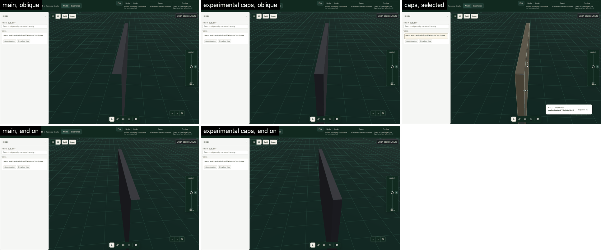
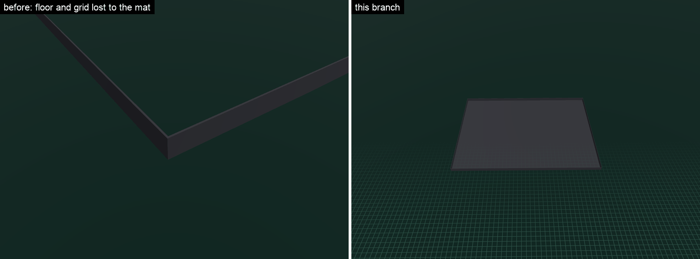
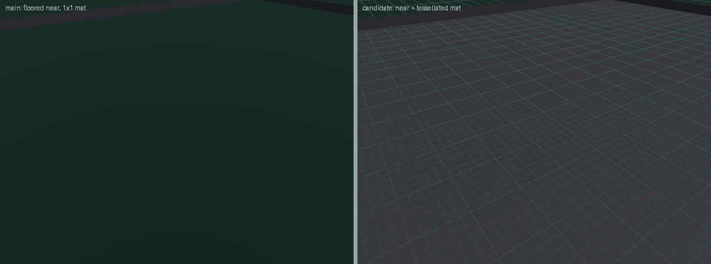
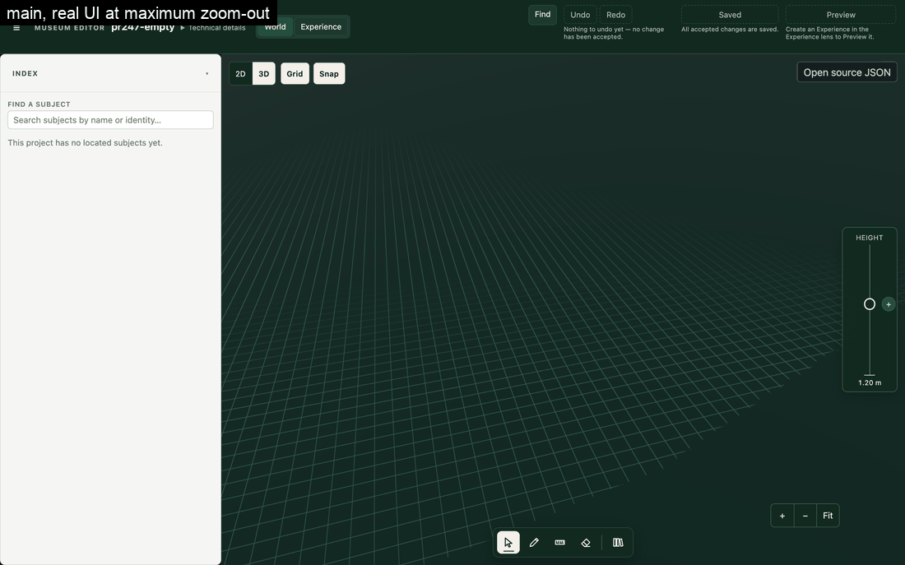
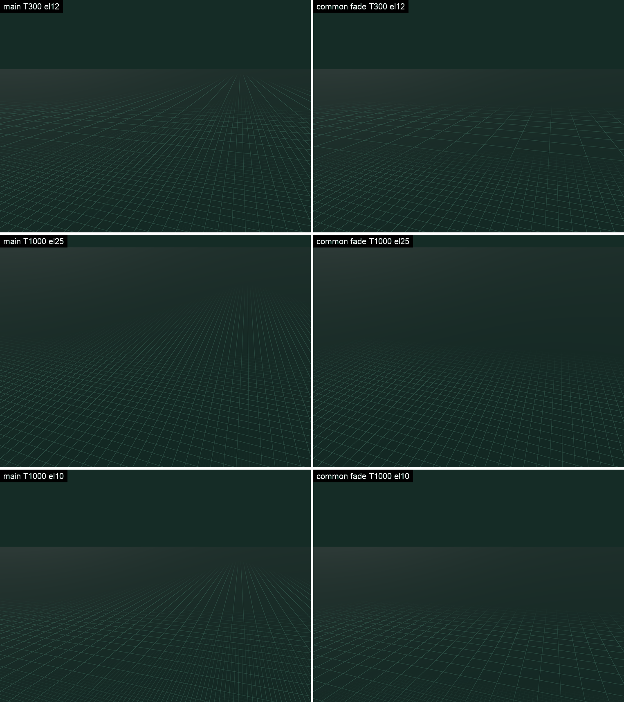
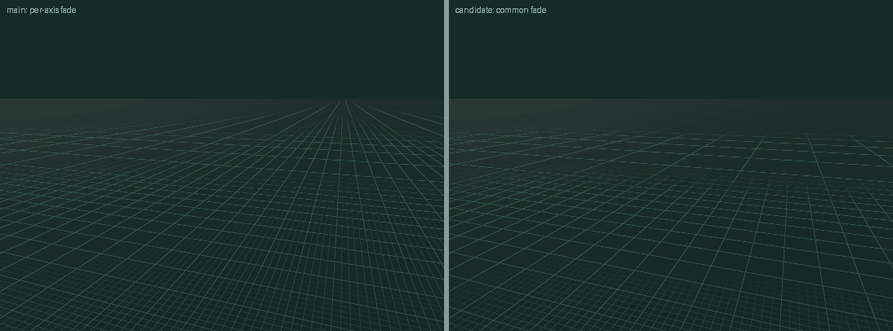
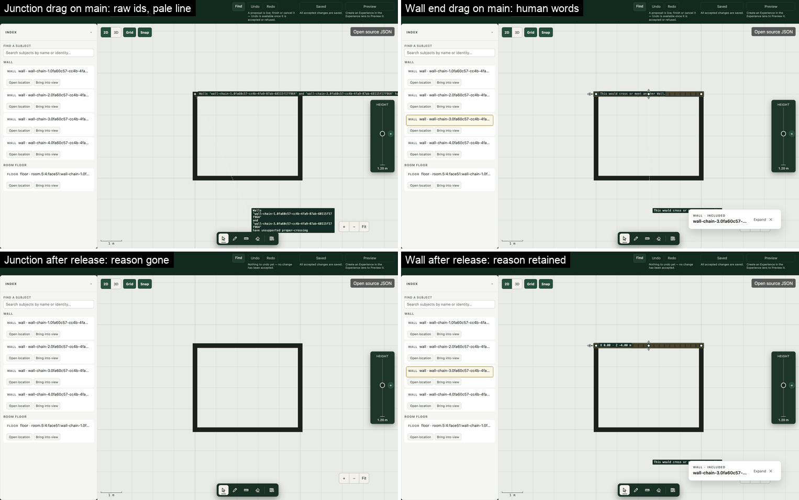
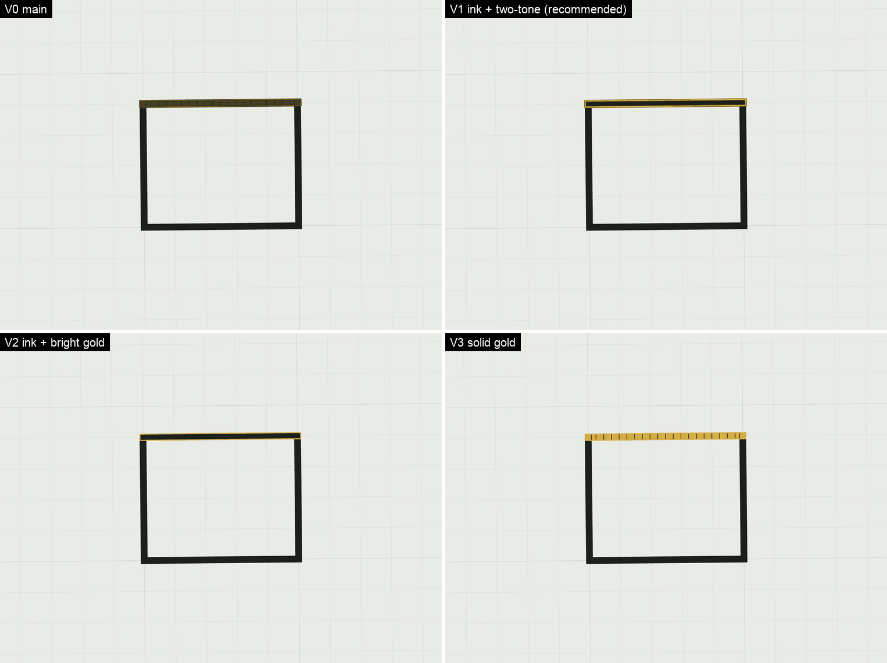

# R217 post-S19 owner review: causes and proposed fixes

**Status:** Investigated, then implemented on PR #247 at the owner's direction (2026-11-01), pending the
owner's final review. Shipped acceptance records are unchanged. The owner's brief is
[here](../post-s19-owner-manual-review.md). Sections below keep the investigation's findings;
[what landed](#what-landed) says where the implementation departed from them.

**Tested on:** `main` at `239ab893`, editor dev server, real GPU (HeadlessChrome 152, ANGLE Metal,
Apple M2), 1440 × 900. Stage settings on `main`: 24-bit depth, antialias on, Three r186.

## What landed

| Group | Change | Verified by |
| --- | --- | --- |
| A. Wall geometry | `layout-core` publishes `terminal-cap` and `corner-exposed-end` surfaces; the builder triangulates them | `wall-mesh-solid-matrix.test.ts`; frozen compile digests unchanged once these surfaces are projected out |
| B. Ground depth | Mat subdivided and pushed back four depth steps; **no Camera change** | 28-pose sweep and orbit and zoom records on the real components, see below |
| C. Grid fade | One weight per level, from the denser direction | Shader pin, browser captures |
| D. Refusal feedback | Words, retention, one tag, halo, reach from the moved end | `layout-wall-manipulation.test.ts`, `stage-candidate-label.test.ts`, browser |
| E. Paper selection | Ruled V1, O1 and J2 amended for cut poché | `paper-marks.test.ts`, browser |

**Departures from the proposals:**

- **The 2% near floor was rejected, as the owner's review suspected.** With the eye 1 m from a Wall at T 60 it
  [clipped every Wall pixel in the frame](./evidence/ground-options.json). Subdivision plus a four-step mat offset removes the
  fighting just as completely with near left at 1 cm: 0 floor and grid pixels lost at all 28 poses, blink 0 in orbit and zoom. So
  Camera is untouched, and `camera-viewport-evaluation.test.ts` now pins the near floor inside a large scene.
- **Three more Wall defects were found and fixed:** a mitre read by a leg in the opposite role twisted any Wall that starts at a
  shared corner (`swapCorner`); the thickness step carried a normal in its own plane, so its winding was arbitrary; and an Opening
  reaching a free end left a stray jamb in open air.
- **The Opening measure planner leaked too,** so Card and mark refusals both changed. `openingRefusalWords` moved to `refusals.ts`
  to avoid an import cycle.
- **Cut poché follows the fill's treatment, not the subject kind,** so a Layout object drawn as cut poché also keeps its ink.
- **The cap experiment placed caps in the builder.** The landed surfaces are published by `layout-core`, as proposed.

**Residuals:**

- **Corners under about 45°.** At 30° a Wall has a triangle wound against its normal, and at 12° the bevel leaves mismatched edges. The
  matrix stops at 45°. Bevels and sharp mitres need their own geometry work, so I stopped there rather than improvise.
- **An arched Opening reaching a free end.** The compiled endpoint band stops at the Opening's nominal height, so a gap remains between
  the arch's spring and that height. Rectangular Openings are closed.
- **A T junction's root** stays an abutment: the branch ends on the through Wall's face.
- **Black patch in a large project (unproven).** The Stage shadow box is ±5 m, map 512, bias 0.
- **Lighter mat near the horizon.** Lit `MeshStandardMaterial`; not investigated, visible in the fade captures.
- **Mat offset.** Content under the datum within four depth steps can draw over the mat. With the near floor that is about 24 cm at 100 m,
  and only with the eye inside the bounds.
- **Thin-line motion.** Grid-only motion still scores 11–29‰ blink on the large room; the mat and floor score 0. Judge by eye.
- **Not run:** Safari, other GPUs and the visitor route. The visitor shares the builder; S11's new row renders it.

## Summary

| # | Finding | Actual cause | Class | Blocks S11? |
| --- | --- | --- | --- | --- |
| 6 | Single Wall reads as a sheet | The mesh has no end faces. A second hole exists where corner Walls differ in height | Foundation gap (P23.9/P23.15) | Yes, J16 |
| 5 | 3D ground flickers | The mat fights the floor and grid: a near plane stuck at 1 cm, plus one huge mat triangle pair | S19 residual on an older foundation | Yes, J13 |
| 7 | Far grid fades unevenly | Each axis fades from its own spacing, so perspective removes crosswise lines first | S19 design choice | Yes, if J13 is amended as proposed |
| 1 | Refused drag shows raw text and a pale line | The raw text is **S16**, not S15. The pale line is S14's shared overlay | Implementation defect | Yes, J6 and J14 |
| 4 | Selected Paper Wall looks brown | S18 built O1 exactly. A 22% tint over black ink is brown | Accepted but unpleasant, plus one small defect it exposes | No. Polish, needs an owner ruling |

**No pending slice covers any of this.** S22 is Card and Height Sheet layout. S23's "Ink" is the
drawing tool's palette, not selection ink. S20, S21, S24 and S25 don't touch these paths.

### Where the evidence disagrees with the brief

- **The raw refusal is not S15.** S15's Wall path is correct and maps to human words. The same drag
  through a hovered Junction takes the S16 path, which prints the planner's message. S16 was marked
  "good", but this leak is S16's.
- **The flicker is not shader or line aliasing.** Three line-filter variants made it no better. It is
  depth fighting, and it only appears when the eye is inside the project's bounding sphere. That is
  why rooms small enough to keep the eye outside looked fine, and why S19's sweep passed.
- **The missing end faces are confirmed, but they aren't the whole hole.** A corner between Walls of
  different heights is open above the lower Wall, and that remains after end caps.
- **The brown Paper Wall is not an S18 defect.** It follows the ratified O1 values and J2's "an outline
  alone fails". Fixing it needs a ruling, not just a code change.
- **The far fade is not precision or depth.** Depth loss is 0% at every far pose, including 1,000 m.
  No tighter zoom limit is justified, and none is proposed.

## Finding 6: standalone Wall

**Reproduce:** `pr247-single-wall`, a Wall from (0,0) to (5,0), 0.2 m thick and 3 m high, seen in 3D from
either end or at an oblique angle.

**Proven path:**

1. `terminalJoin` in `packages/layout-core/src/layout-junction-resolution.ts:493` publishes no surfaces.
2. `buildSectionFaces` in `apps/editor/src/lib/layout/wall-mesh-builder.ts:870` emits front, back, top and
   bottom only.
3. `squareEndCorner` at `wall-mesh-builder.ts:444` only places corner points, and
   `buildStandaloneEndBridge` at `wall-mesh-builder.ts:520` returns null for a free end. The docblock at
   `wall-mesh-builder.ts:265` claims a "square terminal cap" that nothing builds.
4. `layout-junction-wall-ends.test.ts:113` checks the join kind and that a mesh exists, and the watertight
   matrices cover only `buildRoomWallMesh`. So nothing could catch this.

| Fixture ([data](./evidence/wall-solid.json)) | Boundary edges on `main` | With experimental caps ([data](./evidence/wall-solid-capped-experiment.json)) |
| --- | --- | --- |
| Single Wall | 8 (4 per end), volume 2 against nominal 3, 0 end-facing triangles | 0, volume 3, 2 faces per end, winding correct |
| L corner | 8 | 0 |
| Closed rectangle | 0, which is why rooms look fine | 0 |
| T junction | 16 | Root loop of 4 remains: branch sealed against the through Wall's face, not a visible hole |
| L corner, heights differ | 14 | **6, still open: a residual vector area of 0.283** |
| Rectangle, one lower Wall | 12 with no free ends, vector area 0.4 | **12, not closed by caps** |

Straight continuations that change thickness or height keep 8 and 6 edges after caps. Those are T-vertices along surfaces that
do exist, not holes, so the new test has to account for them rather than ban them.

**Ruled out:** winding agrees with normals, there are no non-manifold edges, and `FrontSide` is correct.
Lighting isn't the cause either: with caps, the unchanged material and light read as a solid. `DoubleSide`
would hide the hole rather than close it. Selection clones the same open geometry, so gold frames a hole.



The [height-step captures](./evidence/wall-height-step.png) show the corner fixture before the fix, and
[this branch](./evidence/branch-wall.png) shows the result.

**Visitor:** same builder and same `VisitorLayoutShell` representation, so the same mesh by code path. I did
not render it, because Preview needs an Experience. Treat visitor as inferred until the fix's browser row.

**Fix as proposed (landed, see [what landed](#what-landed)):**

- `layout-core` publishes exposed-end surfaces from `terminalJoin` and the height-step surface from
  `resolveLegPairCorner`. The builder only triangulates them, following the existing P23.15 rule. The
  experiment's caps were built in the builder only to test the result; that isn't the proposed placement.
- Keep the null-ends path. Bump `STANDALONE_WALL_MESH_BUILDER_SIGNATURE`.

**Tests:** `wall-mesh-solid-matrix.test.ts`, a physical-Wall watertight matrix on `buildStandaloneWallMesh`: union edge incidence with T-vertices
accounted for, vector area, one outward face per free end, an Opening reaching an end, and differing corner
heights. Strengthen `layout-junction-wall-ends.test.ts:113`. This also discharges the coverage precondition in
[the T1 README's retirement note](../../t1-spatial-world/README.md).

**Risk:** the triangle count changes (164 against 160), so mesh pins and any test that counts surfaces will
move. New surfaces need correct classification and picking.

## Finding 5: ground flicker in motion

**Reproduce:** `pr247-large-room`, 120 × 90 m. Target (2, 1.5, −2), azimuth −0.6, elevation 40°, target-plane
height 24 m: floor and grid are entirely gone.

**Proven causes, both required:**

- **A. Near plane.** `groundDepthRange` at `packages/camera-core/src/viewport.ts:546` lets near fall to the
  0.01 m floor whenever the eye is inside the scene sphere (`d < r`). At 100 m the depth step is about 6 cm,
  against a 4 mm gap between mat and datum. The floor dates from `00429538`.
- **B. Mat geometry.** `StageMatGround.svelte:60` draws the mat as one unsubdivided quad up to 262,144 m wide,
  so its interpolated depth is noisy. The grid quad next to it is already subdivided, for a similar reason.

Why S19 passed: its plan measured row 5 only for poses where "the target-centred scene sphere does not reach
the eye", and its browser fixture was small. The residual records this as "far-target", which understates it:
it occurs at close and medium targets inside large projects.

| Static pose (r = 75 m) | Floor lost to mat | Grid pixels lost to mat |
| --- | --- | --- |
| Elevation 5°, T 30 | 9.9% | 0 |
| Elevation 15°, T 60 | 33.6% | 11,833 |
| Elevation 35°, T 30 | 57.8% | 99,331 |
| Elevation 60°, T 60 | 100% | 245,273 |
| **All 28 poses with both candidates** | **0** | **0** |

| Motion, mat + floor only | Residual on `main` | Blink on `main` | With both candidates |
| --- | --- | --- | --- |
| Orbit, el 35, T 30 | 7.64 | 13.2‰ | about 0.01, blink 0 |
| Orbit, el 60, T 60 | 12.37 | 21.5‰ | about 0.01, blink 0 |
| Orbit, el 15, T 60 | 8.34 | 46.4‰ | about 0.01, blink 0 |
| Zoom, el 35 | 9.27 | 17.7‰ | about 0.01, blink 0 |

Residual is the 8 × 8 block swing that smooth motion can't explain. Blink is the share of pixels whose swing
above 24/255 reverses on the next frame. Neither candidate is enough alone: near only leaves 2.01 at el 60 T 60,
and subdivision only leaves 8.47.





**Isolation:** the mat alone doesn't blink. The 5 × 4 m room keeps the eye outside the sphere, and lost grid at
one 56-pixel case only. Wall and selection overlays are not involved.

**Candidate rejected in review:** a 2% near floor. See [what landed](#what-landed) and the
[option comparison](./evidence/ground-options.json).

**Landed fix:** `StageMatGround.svelte` uses `args={[1, 1, MAT_GRID_SEGMENTS, MAT_GRID_SEGMENTS]}` and
`polygonOffsetUnits={MAT_GROUND_POLYGON_OFFSET_UNITS}`.

| Motion on this branch, 14 frames | Mat + floor residual, blink | Full scene residual, blink |
| --- | --- | --- |
| Orbit, el 35, T 30 | 0.02, 0‰ | 0.72, 11.5‰ |
| Orbit, el 60, T 60 | 0.06, 0‰ | 1.51, 29.2‰ |
| Orbit, el 15, T 60 | 0.05, 0‰ | 1.21, 20.4‰ |
| Zoom, el 35 | 0.75, 0‰ | 3.05, 26.5‰ |

**Tests:** a viewport row pinning near inside a large scene, a source pin on the mat, and S11's J13 row with a 120 × 90 m fixture.

**Remaining after the fix:** grid-only motion still scores 9–31‰ from ordinary thin lines moving across pixels, and
line-filter variants made it no better. This is not eliminated. Re-judge by eye once the fighting has gone.

## Finding 7: uneven far fade

**Reproduce:** `pr247-empty`, real UI at maximum zoom-out (mat 262,144 m, eye about 694 m high), then recorded poses.



**Proven:**

- Not depth: 0% depth loss at every pose, including T 1,000.
- Not a world axis: the imbalance follows the screen. X/Z energy is 1.64 at azimuth 0, 0.61 at azimuth 90° and 1.00 at
  azimuth 45°. So "horizontal on screen" is correct, and it isn't a fixed X or Z axis.
- Cause: the loop at `stage-mat-grid.ts:88` weights each axis from its own projected spacing. Foreshortening compresses
  crosswise lines first, so they drop below 8 px while receding lines stay at full weight. The derivatives are correct;
  this is expected minification meeting a per-axis choice. The owner's "missing strips" are that same per-axis hand-off
  between 5 m and 25 m happening in bands.

At T 1,000, el 15, az 0, bottom to top, constant-X energy is `929 809 876 1159 1230 579 48 0 0 0` and constant-Z is
`584 781 1025 929 124 0 0 0 0 0`. Upper bands hold one direction only.

**Fix, tested live and then landed ([this branch](./evidence/branch-far-fade.png)):** each level's weight uses the smaller of the two axis spacings, so both directions of a level
leave together, and past 25 m the ground is plain mat.

```glsl
float weight = levelFade(min(spacingCssPx(vLattice.x / M), spacingCssPx(vLattice.y / M)));
```

Single-direction energy falls from 2.3–10.7% to 0.0% across the [zoom series](./evidence/fade-zoom.json) and the
[orbit series](./evidence/fade-orbit.json). The hand-off keeps the tested twin's formula, so no dead band appears.





**Trade-off to judge by eye:** 1 m and 5 m lines are less dense at low orbit (level-1 energy at T 60 goes from 4878 to 3698),
and X/Z still reads 0.61–0.82 at low elevation because perspective remains.

**Zoom limit:** keep the 1,000 m clamp. No product-scale reason supports a tighter one, and the end state is clean without it.

**Files:** `stage-mat-grid.ts`, the doc on its twin `matGridLevelWeights`, and the mat grid paragraph of the visual-system contract.

**Tests:** the shader pin in `stage-grid.test.ts` requires one weight per level outside the per-axis loop, the dead-band test stays, and J13 covers motion.

## Finding 1: refused drag on Paper

**Reproduce:** `pr247-room`, Plan view, the same drag from (706,341) to (900,780).



| Gesture | Owner | Text | After release |
| --- | --- | --- | --- |
| Selected Wall's end mark | S15 | "This would cross or meet another Wall." | Reason retained |
| Hovered Junction, nothing selected | S16 | "Walls 'wall-chain-1…' and 'wall-chain-3…' have unsupported proper-crossing", drawn twice and overflowing | Nothing retained, no reason left |

**Proven path:**

- `apps/editor/src/lib/authoring/adapters/layout.adapter.ts:3144` assigns `planned.rejection.message`; the S15 path at `:3358`
  goes through `wallRefusalWords`. The message originates at `packages/layout-core/src/layout-wall-chain.ts:1582`.
- The same leak is on the Opening gesture at `:1068` and `:3204`: "Opening 'opening:door:…' does not fit on Wall '…'". The Card
  path at `:1359` already uses `openingRefusalWords`, so the words exist.
- `:776` shows ``Junction ${junctionId}`` as a hover tag. Retention (`settledRefusal`, `:3644`) exists for the Wall gesture only.
- This breaks [target specification line 109](../post-s10-convergence/target-specification.md): "never a raw id or code".

**Pale line:** S14's `StageOverlay.svelte:402` and `:416` draw `#f3f4ee` at 70% with no halo, unlike marks. That is 1.06:1 on Paper
against 6.32:1 on mat. It's the same for the `affected` role, so recolouring the refused state alone wouldn't fix it. The Wall gesture's
reach also starts at the Wall's middle rather than the moved end (`:3665`).

**Fix ([this branch](./evidence/branch-refusal.png)), with the domain words staying in the adapter:**

1. Route Junction and Opening refusals through the existing word maps, and replace the id tag with human text.
2. Retain the reason after release for Junction and Opening, as for Wall.
3. Show one tag: suppress the mark tag when the candidate label says the same thing.
4. Give candidate edges the mark vocabulary's dark halo so they hold on both surfaces.
5. Start the Wall reach at the moved point.

**Tests:** one parameterized "no raw id or code" test over Wall, Junction and Opening gestures, matching
`wall-chain|junction-chain|opening:|proper-crossing`. An overlay structure test for the halo. Browser rows at J6 and J14.

**Risk:** low. The `labelLines` wrap at `StageOverlay.svelte:85` stops mattering once words are short.

## Finding 4: selected Wall on Paper

**Proven:** sampled `#443f25` is exactly 78% `#1b201c` plus 22% `#d4ad45`, so brown is what O1's tint produces over black.

| Pair | Contrast |
| --- | --- |
| Dark gold edge on tinted poché | 1.55 |
| Tinted poché on ink | 1.56 |
| Dark gold on ink | 2.42 |
| Bright gold on ink | 7.77 |
| Bright gold on Paper | 1.77 |
| Dark gold on Paper | 5.68 |

The dark edge is hard to see against the tint, and neither gold works on both sides of the contour. The
[contract](../../../reference/design-system/editor-shell-and-visual-system.md) already allows for this: variable content "may need a two-tone".

**Small real defect:** black ticks about every 0.25 m. The per-span cut stroke from `ringSegments(band)` in `paper-plan.ts` sits on layer 40, above
the tint at 39.5. It's invisible black on black until the tint exposes it.



**V1, approved by the owner and [landed](./evidence/branch-paper-selection.png):** no tint on cut poché, and a two-tone contour with `#74560c` at width 5 under `#d4ad45` at width 2.5. The ink stays crisp,
the gold reads on both Paper and ink, and the ticks stay hidden. V3 reveals the ticks and loses the ink.

O1 and J2 are amended for cut poché only. Room floors, Scene fills and all of 3D keep the tint.

**Files:** `paper-marks.ts`. **Tests:** `paper-marks.test.ts`, tone per treatment and no tint mesh for cut.

## S11 amendments applied

S11 has not run, so [its plan](../r217.s11-integrated-final-gate/implementation-plan.md) changed without touching accepted history: J2 (cut poché), J6 and J14 (no raw text, reason retained), J13 (large project in motion, far fade), new J16 (solid Walls in Stage and Preview), the *large* fixture, and a Safari cell.

## Reproducing

The regression tests above are the durable proof. The one-off browser probes, fixture seeding and cap experiment were dropped from the tree; they stay at `git show 5af89329:docs/roadmap/r217-core-editor-stability/post-s19-owner-manual-review/report.md` and its sibling `probes/` directory.
