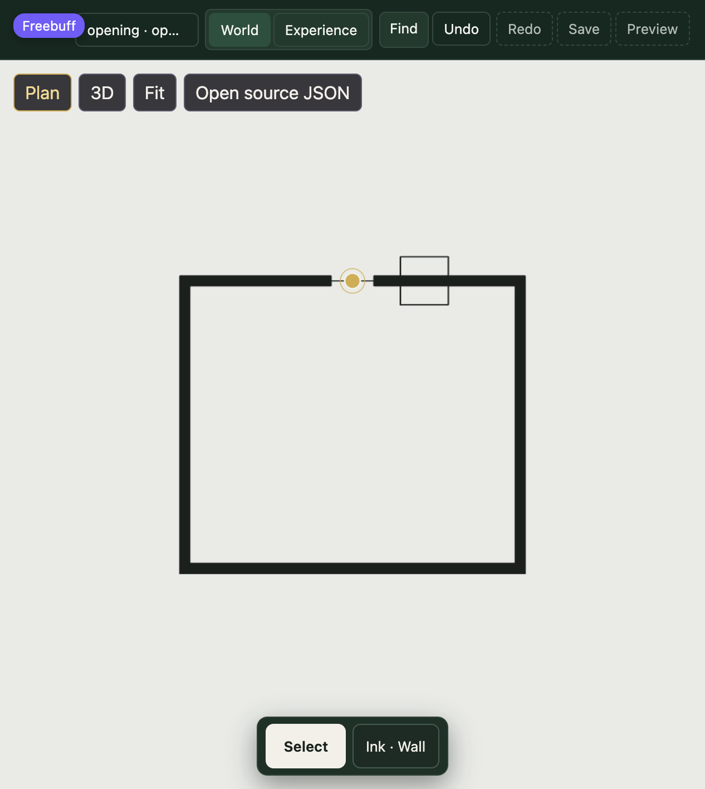
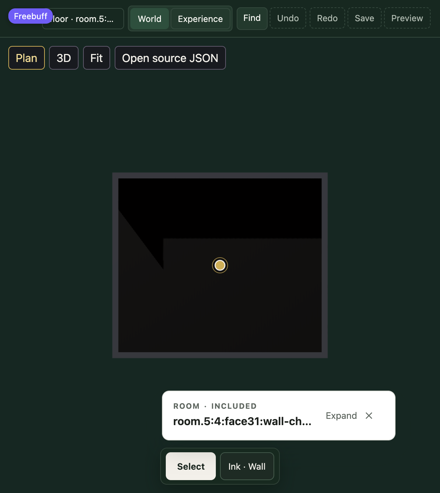
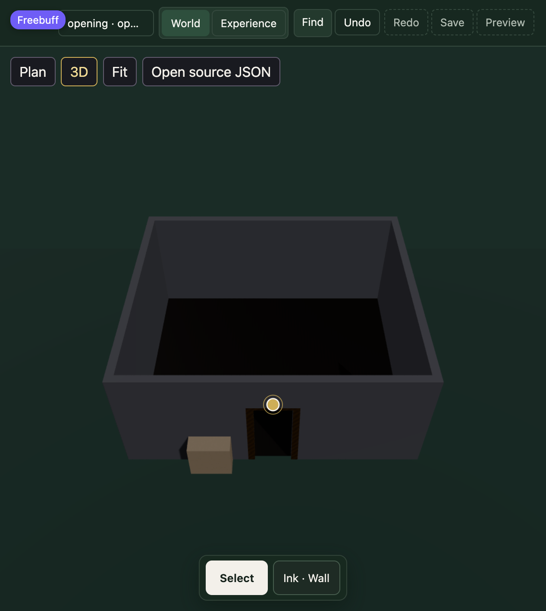

# R217.S04 — acceptance record: Paper Plan

**Slice:** R217.S04 · **Status:** implemented, independently reviewed, ready to merge; the
phase's integrated gate remains [R217.S11](../r217.s11-integrated-final-gate/acceptance.md) ·
**Plan:** [implementation-plan.md](./implementation-plan.md) (owns the criteria) · **Phase:**
[R217](../README.md)

The owner authorised this implementation and a ready-to-merge PR without a release-list row. The
slice was implemented from `83d50b70` (the S03 merge); `main` `c13a949d` is an ancestor of the
branch. The implementation revision is the PR head that contains this record. **No merge has been
performed**, and this record claims no phase release.

## 1. What ships

2D is now a drawing of the Plan the Stage already computes, not a second projection:

- **Paper layer.** `StagePaper.svelte` mounts inside the one Stage `<Canvas>` and draws one
  `PlanEvaluation` plus the existing Scene footprint projection. It is mounted only when the
  reading is settled Plan at orthographic weight 1 and the preference is Paper.
- **Poché.** Cut Wall spans become a band at the compiled Wall thickness, filled `#1b201c` with a
  1.5 CSS px edge. Junction ends square off; Opening jambs keep their exact edge.
- **Streams.** `projected` draws at 0.7 opacity, `hidden` dashed at 0.45, `symbol` at full ink, and
  `room-floor` is the vellum tint under everything. Every fragment comes from
  `eligiblePlanFragments`, so excluded and unrevealed sources contribute nothing to either the
  drawing or the picker.
- **Scene and native-form outlines.** Footprints come from `planSceneFootprintsFor`, the same
  cached projection the Scene adapter's Plan pick reads. Upright footprints draw their ring;
  tilted forms draw the boundary of their existing projected polygon union, with collinear pieces
  merged. A footprint is drawn only when `scenePick.hasVisibleRoot` says its body is mounted and
  visible, matching the hit path.
- **Appearance is a mask.** Paper geometry is on layer 2. `StageCamera` sets `camera.layers` from
  the appearance; no appearance code writes `Object3D.visible`. The pick source's raycaster keeps
  its default layer-0 mask, so world meshes stay pickable while Paper hides them.
- **3D mat.** The Stage background is `#152c26`, a mat ground `#1d3a33` sits at the level datum,
  and `<T.Fog>` is gone. Visitor rendering is untouched.
- **Preference and continuity.** The existing `planAppearance` preference gains its Paper/Shaded
  effect. The Camera pose, selection, armed tool, Card, Index, open work and history are not
  re-authored; the reading transition remains the existing `ViewingIntent` seam.

## 2. Verification

All commands ran in the branch worktree with the final source tree.

| Check | Result |
| --- | --- |
| `apps/editor npm run test:full` | **239 files / 3,018 tests passed**, exit 0 |
| Focused `stage-paper.test.ts` | **19 tests passed** |
| Focused `stage-paper-pick.test.ts` | **5 tests passed** (real Three roots, both masks) |
| `apps/editor npm run test:arch` | **23 files / 193 tests passed**, exit 0 |
| `npm run check` | **0 errors, 0 warnings** |
| `npm run build:editor` | **success**, Vercel adapter output written |
| Built chunk scan | `StagePaper` / `buildPaperPlan` appear only in the Stage route chunk, not in the `/p` public chunk |
| Stage route client bundle | Brotli **151,675 → 159,325 B (+7,650 B, +5.04%)**; gzip 183,119 → 192,325 B (+9,206); raw 638,002 → 666,523 B (+28,521) |

The full suite includes the existing camera, reading-transition, gesture, selection, source and
history suites; no S04 change touches their authorities. The architecture lane includes the
visitor, public and preview boundary checks and documentation references.

**Independent review.** One independent technical reviewer examined the actual diff. Two blocking
findings were corrected before this record:

1. **Datum.** Footprint outlines were written at `y = 0`; they now use the accepted level
   `datumMeters`, matching Plan fragments and the Scene Plan ray. A non-zero-datum regression test
   was added.
2. **One projection.** The Scene adapter built footprints from a derived Scene document while the
   Canvas drew the runtime Scene. The adapter now reads `context.snapshot.domain.scene`, the same
   object the route passes to the Canvas as `boot.snapshot.domain.scene`, and both sides use
   `planSceneFootprintsFor`'s identity cache. The reviewer's remaining concerns were the Shaded
   mat decision and the S07 `visible` boundary, both recorded below. Per the owner's direction,
   the corrected tree was not sent through a second review loop.

**Browser verification.** Exercised in Chromium against the current dev server at
`127.0.0.1:5190`: a starter enclosure in 3D, the same source on Paper, and Shaded Plan; then a
Wall selected, a 0.9 m door placed by offset through the real Ink adapter, and a native primitive
placed. Paper showed the vellum, Wall poché, the Opening's symbol in the wall, and the primitive's
outline. 3D showed the mat, the Opening void, and the same primitive. Switching 3D ↔ Plan retained
the selected subject; the existing camera, gesture and task suites cover the rest of the reading
continuity. A fresh preference store defaults to Paper
(asserted by `stage-paper.test.ts`); the browser session itself had a persisted Shaded choice from
the earlier capture and was switched explicitly for each state.

## 3. Acceptance criteria

1. **Drawn equals picked — met.** `stage-paper.test.ts` proves source/stream set equality and
   layer-rank equality against `eligiblePlanFragments` on the starter and L fixtures; every drawn
   Scene footprint resolves to its own entity through `resolvePlanSceneHit`. `stage-paper-pick.test.ts`
   mounts real Layout and Scene roots and proves interior, edge-halo and occlusion outcomes are
   identical under the Paper and Shaded masks.
2. **Stream treatment — met.** Cut walls are poché bands; a below-cut Wall is hidden dashed ink; a
   lintel above the cut is projected; an Opening is a symbol; a revealed floor draws.
3. **Picking under both appearances — met.** The focused pick suite covers the forms fixture,
   unmounted and support-occluded bodies, the S03 Wall/Opening regression, and the identical result
   sets under both masks. The structural tests find no `.visible` write in Paper or appearance code.
4. **Continuity — met by preservation and browser observation.** The Camera realizer still only
   copies the `ViewportEvaluation`; the full existing camera/gesture/task suite is green, and the
   browser switch retained the selected subject. No Camera code was changed for continuity.
5. **3D ground — met.** No `<T.Fog>` remains, mat ink is set, and visitor suites are unchanged.
6. **Boundaries — met.** Architecture lane green; the built Stage route is the only client chunk
   containing `StagePaper` or `buildPaperPlan`.
7. **Bundle — reported above.** No budget is claimed.

## 4. Deliberate deviations

1. **The mat also grounds Shaded Plan.** The plan scoped the mat to 3D and said Shaded keeps
   today's mesh rendering. In practice the visitor plinth reads as a black void in a settled 2D
   mesh view, so the mat background/ground is kept in both mesh readings; Shaded still draws the
   existing visitor surfaces and meshes, just on that surface. To revert strictly to the plan's
   wording, gate the mat ground on the reading rather than on `!paperVisible` in
   `StageCanvas.svelte`.
2. **Non-Paper camera masks are `{0, 2}`, not `{0}`.** Paper is unmounted outside Paper, so this
   changes no S04 image. It is deliberate so S07's selection/hover overlays on layer 2 are visible
   on the mat and in Shaded without another mask decision. If a strict `{0}` is preferred, change
   `stageCameraLayerMask(false)` and S07 must revisit the mask.

## 5. Residual risks

- **Opening symbol detail.** The representation's Opening symbol is `centerPolyline`, the straight
  centerline across the void. It carries no swing hand or swing-arc geometry. Paper draws that
  evaluated symbol faithfully; a swing arc would be fabricated without a representation field,
  which is the plan's stop condition for a T1 change. This is the main visual gap against a fully
  architectural door symbol and should be resolved in the representation before the integrated
  gate if the owner wants swings.
- **S07 `visible` conflict.** S07's `StageSelectionLayer` currently writes `root.visible` in its
  worktree. That directly contradicts S04's rule and will make `hasVisibleRoot`/Paper footprint
  filtering disagree with the mark. S07 must not take that approach; see the handoff.
- **Shaded Plan quality.** With today's visitor surfaces the settled Shaded view is a dark mesh
  field on the mat. It is functional and preference-preserving, but it is not a light architectural
  surface; a later appearance slice may need to restyle it.
- **Browser evidence is manual.** The three captures below are the visual record; no automated
  screenshot diff was added.

## 6. S07 integration handoff

1. Import `STAGE_OVERLAY_LAYER` and `PAPER_LAYER` from
   `apps/editor/src/lib/authoring/stage/paper-plan.ts`.
2. Put every Canvas-drawn mark on `STAGE_OVERLAY_LAYER` (2) with `depthTest: false` and
   `renderOrder` above `PAPER_LAYER.sceneFootprint` (60); 70 is the next free band.
3. **Do not write `Object3D.visible`** for appearance, selection or hover. `visible` remains the
   pick source's mounted-and-eligible flag; the camera mask is the only appearance switch. Do not
   parent overlay geometry under a registered pick root.
4. Reuse the one drawing set: `buildPaperPlan(plan, compiled, footprints, …)` is the source/stream
   authority, and `fragmentLayer` is the pick rank. S07 can filter its selected source's line/fill
   entries by `sourceId`; it should not regroup streams or build a second plan drawing.
5. No S04 change is needed for the mark to appear in all three states: Paper's mask is `{2}` and
   the mesh readings' mask already includes layer 2. If S07 needs a different rank, change only
   its own `renderOrder`, not the camera mask or `PAPER_LAYER`.
6. S04 does not own S07's selection/mark files. S07 owns removing its `root.visible` write and
   proving its mark layer does not enter the pick raycaster.

## 7. Evidence

