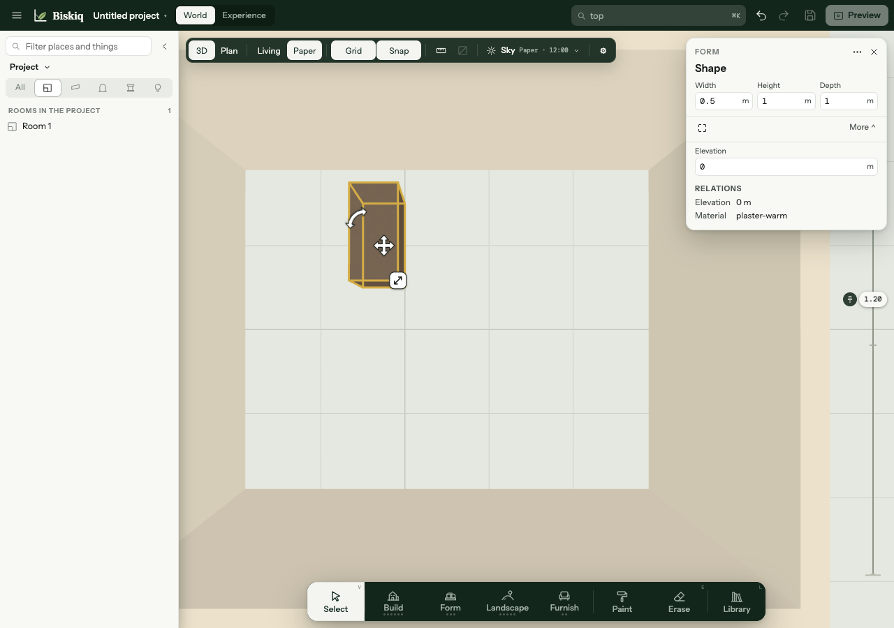
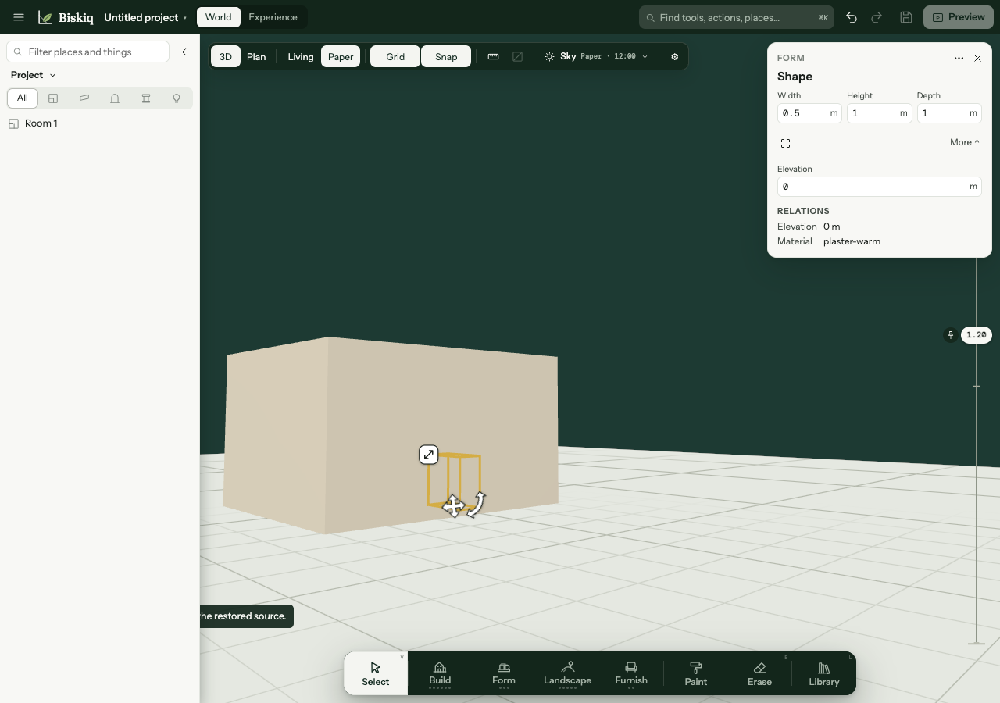
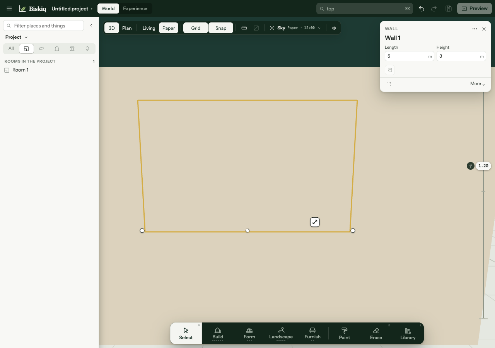
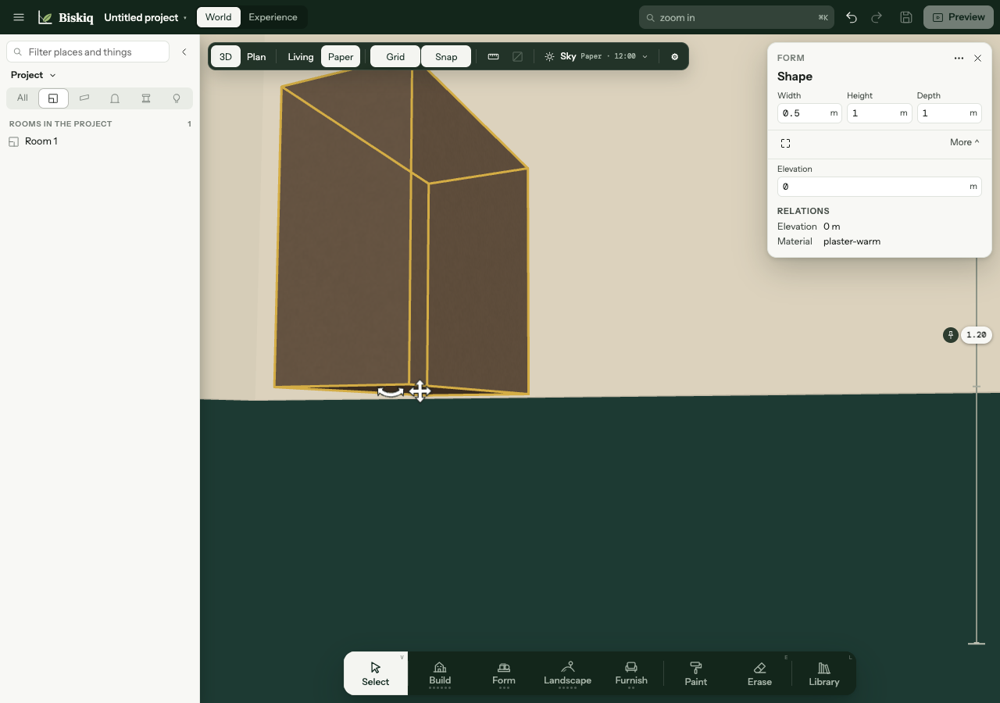

# X0 — Interior Visibility Truth Check

**Verdict:** X0 is complete. The latest-main Stage has no Lift or automatic near-wall cutaway. From a high 3D view the Box is visible and pickable; from outside at a low angle a full-height Wall hides it and wins the Stage click. After manually moving the inspection camera through a Wall, the Box is again visible and pickable. That manual camera movement is not a cutaway or click-through behavior.

## Fixture and reproduction

Observed in the running editor from latest `main`, commit `6e1b7bc5fe3dc200ddbc9b8e5c40bb2c4d48b76e`, on 2026-11-11. I created a local unsaved project in a 1280×900 browser viewport:

1. In Plan, used Build → Walls → Line to draw a 5 m × 4 m closed rectangle and closed the ring. The Stage derived **Room 1**, 20.0 m², with 3 m boundary Walls.
2. In 3D, used Furnish → Objects → Box and placed it inside the Room at floor elevation. The Form card reads **0.5 m × 1 m × 1 m**, elevation 0 m.
3. Orbited to a high angle and clicked the Box. The Box body rendered and the Form card selected `Shape`.
4. Lowered the 3D view outside the Room. The front Wall remained a solid 3 m face while the selected Box body disappeared. Clicking the Box’s projected position selected `Wall 1` (5 m length, 3 m height).
5. Repeated Zoom In and orbited the Stage inspection camera through that Wall. From the resulting inside view the Box rendered and a direct click selected `Shape` again.

The camera can therefore be moved through Wall geometry manually, but normal outside visibility and picking still stop at the Wall. Searching the Stage command field for **Lift** returned no action; the visible **Slice** control is disabled and marked planned.

## Screenshots

**Above in 3D:** the selected Box is visible inside the Room and its card confirms a Stage pick.

**Outside at the near Wall:** the Wall is opaque. The gold Box contour remains visible as selection ink, but the object body is hidden.

Clicking that projected Box position selects the full Wall; it is neither shortened nor click-through.

**Inside after manual camera passage:** the Box body is visible and directly selectable.

## What the Stage does today

| View / action | Observed result |
| --- | --- |
| High 3D angle | The Box is visible and a click selects `Shape`. No Lift or overhead-reveal state is entered. |
| Low outside angle | The near Wall stays full height and opaque. The selected Box’s gold contour may draw over it, but the Box body does not. A click at the Box’s projected position selects `Wall 1`. |
| Camera manually moved inside | The Box body is visible and a direct click selects `Shape`. No Wall representation changes automatically. |
| Reveal controls | No Lift or near-wall Cut/Whole action exists in the Stage command field. Slice is shown as planned/disabled. |

The contour-through-Wall effect is selection ink, not proof that the subject is visible or that the click passed through. The Stage selection layer lives outside the pick root ([`StageSelectionLayer.svelte`](../../../../apps/editor/src/lib/authoring/stage/shell/StageSelectionLayer.svelte#L1)); the rendered Box body remained occluded and the ray hit the Wall.

## Source trace

- Layout compiles a Room ceiling elevation from its boundary Walls’ maximum height and derives a ceiling polygon from the Room floor boundary ([`layout-geometry.ts`](../../../../packages/layout-core/src/layout-geometry.ts#L1659)). The Stage renders that ceiling mesh alongside the floor, the compiled physical Walls, and the Layout object meshes ([`VisitorLayoutShell.svelte`](../../../../apps/editor/src/lib/visitor/VisitorLayoutShell.svelte#L74), [`VisitorLayoutShell.svelte`](../../../../apps/editor/src/lib/visitor/VisitorLayoutShell.svelte#L199)). The high-angle visibility above is ordinary camera visibility; no Lift action or overhead state was applied.
- Physical Walls are built as full meshes from compiled Wall geometry ([`layout-wall-representation.ts`](../../../../apps/editor/src/lib/render/layout-wall-representation.ts#L181)); Layout objects are separate meshes ([`layout-object-representation.ts`](../../../../apps/editor/src/lib/render/layout-object-representation.ts#L103)). The only wall hiding prop passed by the Stage shell is the explicit unfold overlay, not a camera-driven reveal ([`StageCanvas.svelte`](../../../../apps/editor/src/lib/authoring/stage/shell/StageCanvas.svelte#L277)).
- Stage selection raycasts the registered rendered roots and keeps the nearest visible mesh hit ([`scene-pick-source.ts`](../../../../apps/editor/src/lib/authoring/scene/scene-pick-source.ts#L173)). This matches the observed Wall selection outside and Box selection above/inside.
- The Stage Camera realizer copies evaluated camera matrices; it does not edit geometry ([`StageCamera.svelte`](../../../../apps/editor/src/lib/authoring/stage/shell/StageCamera.svelte#L1)). Here “Camera” means the editor’s inspection camera/session, not an authored Camera View or Preview run ([`camera-session.ts`](../../../../apps/editor/src/lib/authoring/stage/camera-session.ts#L1), [Camera contract](../../../../docs/reference/components/camera-tour.md#one-authority)).

## X1 / X2 decision

- **X1 Lift can proceed as approved.** No Lift hook or session state exists today. One implementation assumption should be explicit: a wall-first Room already compiles a ceiling polygon at the maximum boundary-Wall height, so Lift must decide and cover that generated Room ceiling as well as any authored dropped ceiling/overhead. Keep the approved source-identity outline, click-through and ghost behavior; preserve camera pose and lighting.
- **X2 Near walls can proceed as approved.** The outside click test confirms the problem: the full-height Wall obscures and intercepts the interior subject. Derive the cut from the Stage inspection Camera pose plus compiled Layout geometry; do not treat the gold selection contour as a hit-through path. Implement the approved Cut/Whole, hold-to-see-whole, selected-host-Wall exception and stub selection behavior.
- **Status versus design:** PLATE describes automatic near-wall cutaway, but this Stage does not implement it. This report corrects the PLATE status wording while preserving the approved X2 target. J11 remains a target journey pending X1/X2.

**Browser status:** Verification succeeded in the local running editor. No browser blocker. No production code, Stage architecture, schema, or T2-owned files were changed.
