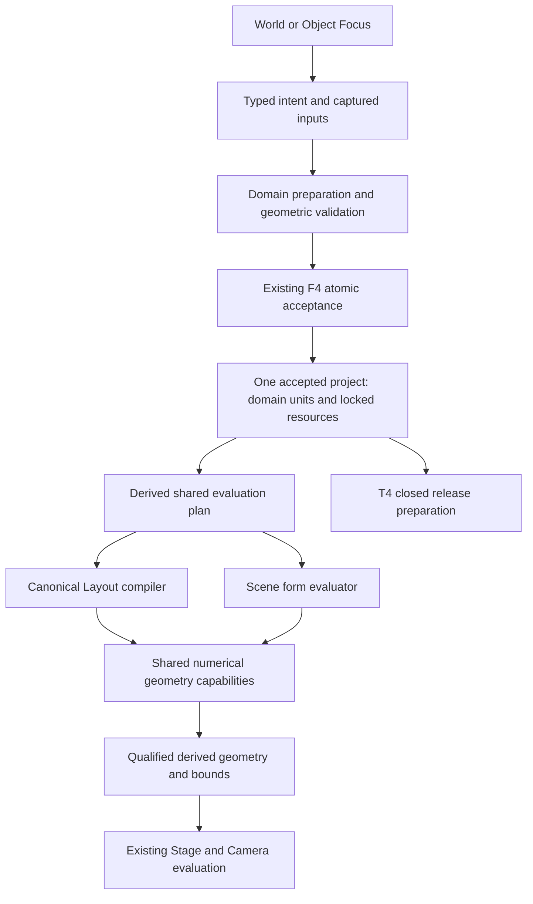

# T5 G0 — A revisable language of form

**Stage 1 architecture and capability-roadmap proposal · 27 October 2026 · awaiting owner review.**
This is the deliverable of the [approved G0 commission](../g0-foundation-architecture-commission.md),
not a ratified contract, registered phase, implementation plan or dependency approval. It leaves
the commission, track register, release list and current contracts unchanged. Independent review
and owner ruling are still owed. The companion [kernel and evidence assessment](./kernel-evidence.md)
contains the adoption decisions, primary sources and licensing analysis.

## 1. Recommendation

**Build an intent-centered geometry system: retain what defines a form, evaluate it through a small
set of specialized representations, and let direct manipulation revise that definition.** Start
with curves and constructive solids plus spatial deformation. Make functional implicit composition
the next expressive foundation for blending, carving and topology change. Add sampled detail,
surface refinement and precision B-rep capability only when a demonstrated creative need earns
their additional cost.

The durable abstraction is a **form definition with explicit controls, operations, relationships
and region meaning**. Its evaluation recipe is not its Undo history. World and Object Focus edit
the same definition/instance through the same project acceptance boundary. A generated mesh is a
view of that work, not the only editable artifact left behind.

The central product hypothesis is that **a small vocabulary of creative intentions can drive many
geometric operations**. “Make this wider while keeping this mounting area” may change a profile,
solve several parameters, then deform the surrounding material. “Make these flow together” may
introduce an implicit blend. The creator need not identify those algorithms. The interpretation,
affected scope and any lost guarantees must nevertheless be inspectable before acceptance.

This is neither a promise of universal reversibility nor a proposal to assemble every kernel now.
It is a deliberate choice to invest in revision semantics and constrained direct manipulation as
the product's core, while buying difficult numerical machinery where suitable implementations
exist. The first architectural test is whether the same object can remain pleasurable to revise
after ten hours, not how many operations a demonstration can list.

### Decisions to retain or reject as a package

| Decision | Consequence |
| --- | --- |
| Authored controls and operations are primary; representation is an evaluator concern | Original drawings and dimensions remain editable after refinement; no global “convert to mesh to continue” cliff |
| Constructive geometry and deformation first; functional fields for expressive topology next | A useful first release need not wait for a universal sculpting engine, but its source model already supports deeper work |
| One explicit representation route per operation version, with declared conversion boundaries | No invisible backend switching that changes geometry, tolerance or correspondence after a library update |
| Semantic anchors and qualified correspondence, with explicit uncertainty | Surviving identity is meaningful; ambiguous splits and destroyed regions require repair |
| Small local solves, explicit invariants and bounded inference | Sophisticated response without an all-project constraint solver or hidden recognition rules |
| Workers, incremental evaluation and retained results; existing Stage and renderer | Heavy computation can move off the UI thread without replacing S06, F acceptance or Camera |
| Manifold is the first kernel candidate; no dependency is admitted by G0 | The current permissive path is credible; weak-copyleft candidates remain separately actionable options |

## 2. What the existing evidence changes

The [ratified North Star](../../../reference/decisions/northstar-ratification-2026-09-27.md)
requires federated semantic authorities, common composition/execution and portable delivery.
The [current destination](../../../reference/north-star.md#product-convergence-destination)
adds expressive native architecture and honest revision. T5 is a geometry capability provider
inside that direction, not a new editor or a sixth catch-all authored domain.

| Evidence | Take forward | Do not infer |
| --- | --- | --- |
| [Native Form Lab findings](../../../../prototypes/native-form-lab/FINDINGS.md), PR #194 | Retained profiles, keyed carriers, role references, cap lifetimes and explicit repair work in bounded journeys | No general booleans, arbitrary deformation, creator study or browser-performance proof |
| [Shape Focus specification](../../../../prototypes/native-object-shaping/UX-SPEC.md), PR #196 | A temporary section can express a local reshape; focused work should preserve the same object and context | Its figures are designed states, not evidence of a working solver; its single-contour restriction is not a product ceiling |
| [Spatial-modeling research](../../../../broad-research/spatial-modeling-depth-research-2026-10-25.md) and [native-depth synthesis](../../../../broad-research/native-creative-depth/synthesis-and-direction.md), PR #192 | Profiles, paths, repetition, meaningful frames and finish produce real creative value | The proposed exclusion of arbitrary booleans, free surfaces and retained operation graphs is too restrictive for this commission |
| [Architectural depth study](../../../../prototypes/p3-depth/DESIGN.md), PR #195; [Vellum](../../../../prototypes/p3-vellum/DESIGN.md) | A roof field over a plan and a walk/rail rule derive complex results from few controls; contextual interpretation and legible consequences | The depth prototype uses floating-point arrangements and banded curved sections; its refusal of non-height-field roofs or complex joinery is not a permanent product boundary |
| [Expressive form/sculpting research](../../../../broad-research/expressive-3d-form-sculpting-hybrid-modeling-2026-10-27.md), PR #200 | Semantic operations, representation boundaries, spatially bound edits and graded survival | It establishes ingredients, not a tested integrated engine; “hybrid” alone does not decide what to build |
| [S06 acceptance](../../t1-spatial-world/t1.p02-native-wall-creation/t1.p02.s06-performance-foundation/acceptance.md), PR #190 | Canonical compilation, retained structures and representation, locality instrumentation and honest end-to-end measurement | Local derivation does not make acceptance, first picking or drawing independent of total project size |
| [World-scale study](../../../../broad-research/all-visible-editing-and-town-overview.md), PR #189 | Separate semantic work, transport, retained memory and presentation costs | Its scale and speedup objectives are historical hypotheses, not S06 certification |

I reject two inherited shortcuts. First, excluding generated geometry from authored truth does
**not** make precision topology irrelevant: a retained B-rep source can be valuable when users
author that structure deliberately. Second, naming generator roles does **not** solve identity
after unrestricted booleans or blending. Both distinctions matter to the architecture below.

The 15-minute and ten-hour ambitions are product targets, not findings. Existing agent-run QA
does not establish learnability. Future interaction studies must be allowed to invalidate this
architecture's control and repair assumptions without renegotiating a supposedly ratified UI.

## 3. A form is retained intent, not a gesture log

### Authored structure

A form definition would contain these concepts, with concrete schemas deferred to T2/F review:

- **Controls:** keyed curves, profiles, local frames, dimensions, handles, cages and protected
  regions. Frame ownership is explicit: object-relative, control-relative, surface-relative or
  deliberately world-relative. Nothing requires a Room frame.
- **Operations:** versioned constructions, combinations, deformations and detail applications,
  with typed inputs, parameters, output roles, validity conditions and approximation policy.
- **Relationships:** explicit dependencies and constraints, including their scope, units,
  required/optional character and repair policy. A snap alone creates no relationship.
- **External sources:** pinned source/resource revisions with admitted capabilities and provenance.
  An imported mesh stays useful without acquiring fictitious extrusion history.
- **Public interface:** stable components, anchors, material regions and meaningful parameters
  that an instance or Experience can address. Internal implementation nodes are not all public API.

This is a domain-owned recipe within the existing definition/resource system, not a separately
saved T5 document. The shared composition layer derives the cross-domain evaluation plan; the
geometry evaluator derives its numerical work from that plan and the recipe. Neither derived
plan is a second authored dependency graph.

A change to an earlier operation revises the recipe. Undo restores the accepted project snapshot;
it does not walk an independent modifier-history stack. Node IDs survive parameter edits, and
explicit split, replacement and deletion operations define lifetimes. IDs are allocated into the
captured intent before deterministic planning; fresh creations after Undo must not reuse retired
identity. Copying creates a new identity and re-roots internal references; accepting a new shared
definition revision is distinct from editing one allowed instance parameter or explicitly detaching.

### Turn manipulation into a small, explainable solve

An interaction supplies a target, frame, desired geometric change, affected scope and invariants.
The planner first tries the smallest supported change to existing controls. It can use analytic
inversion or a bounded optimization over a few parameters. If that cannot express the intent, it
may propose an additional deformation or constructive operation. It must not secretly rewrite
unrelated construction, infer a chair category, or attach to a nearby host.

For an underdetermined change, minimize deviation from the accepted controls, with a fixed,
versioned preference order and tie-break. Hard constraints are checked as constraints; merely
assigning them large penalty weights is insufficient. An inconsistent problem refuses and reports
which invariants conflict. Soft preferences may yield, visibly. General nonlinear systems need
bounded iterations, residual checks and a declared starting state, not convergence by wish.

Keep dimension, coincidence, parallelism, tangency and symmetry over compact controls where
possible. Local coupled constraints form one bounded solve block; dependencies between blocks
remain acyclic initially. A cycle such as an object reshaping the surface that positions that same
object refuses until a specific coupled solver is admitted. Whole-project optimization is not the
starting architecture.

For the first reshape, prefer a compact-support spline displacement map in an explicitly bound
object/control frame, with a small fixed control lattice. Solve its control displacements from
the requested contour/handles while fixing the protected base region. Evaluate the same map on
the surface and any supported attached controls; do not store displaced render vertices as the
native source. Keep its rest frame and upstream binding explicit so revising the starting profile
does not redefine the edit from the latest tessellation. This is a bounded algorithmic starting
point, not a claim that one lattice handles every deformation; compare ARAP for later
surface-relative refinement and Kelvinlets for localized spatial edits.

A protected region is scoped: preserve it during this operation, or retain an invariant checked
on every downstream accepted result. Those meanings must not be conflated. A later cut that
removes an invariant mounting patch refuses unless the same explicit intent releases or repairs
that invariant. Whole-instance transforms move object-relative constraints with the instance;
world-relative dimensions and dependencies receive their own validation.

This combines ideas from [FiberMesh](https://igl.ethz.ch/projects/FiberMesh/) (retained curves as
surface controls), [ARAP](https://igl.ethz.ch/projects/ARAP/) (detail-preserving deformation), and
[regularized Kelvinlets](https://graphics.stanford.edu/~djames/publication/kelvinlets/) (analytical
spatial deformation). Those papers demonstrate mechanisms; they do not prove this proposed
intent interpreter or its usability. Machine learning could later propose interpretations, but
acceptance stores explicit controls and captured inputs, never depends on re-running a model.

### Example: one object, increasing depth

A creator draws an asymmetric plinth, gives it depth and places an exhibit on an authored support
anchor. Later they narrow its waist while preserving the base and mounting patch, blend in a
second mass, cut a recess, and repeat a decorative groove. The original outline and recess depth
remain editable. A change to the outline reevaluates dependent form operations and reports any
groove or anchor whose support disappeared. Materials follow declared regions, not triangle order.

Object Focus changes editing scope and the Camera-evaluated view. It does not move a copy to the
origin, establish another selection/history store or require a second Save on return. A section,
handle, stroke, numeric dimension or future agent instruction can express the same intent. This
proposal selects none of their final gestures, panels or layouts; [PLATE](../../../reference/design-system/editor-shell-and-visual-system.md)
remains the shell authority.

## 4. Representation strategy: a small, directed hybrid

There is no single universal geometric representation. There should be **one authoritative source
for each piece of work**, with explicit evaluation routes rather than interchangeable competing
truths. An operation version chooses its representation semantics; a future optimization must
prove equivalence or become an explicit revision/migration.

| Representation | Authoritative input | Evaluated use and boundary |
| --- | --- | --- |
| Analytic/parametric construction | Curves, dimensions, frame rules, profiles, sweeps, revolutions, loft controls | Default compact source for precise design intent; tessellate late with stated error. Analytic inputs do not make all intersections exact |
| Solid mesh evaluation | Constructive recipe or a pinned imported mesh source | Manifold candidate for closed-solid union/difference/intersection. Generated topology carries provenance; it is not the saved native definition |
| Functional implicit composition | Versioned field expression derived from retained masses, curves, blends and carve operations | Preferred expressive topology-changing substrate. Spatial pruning and adaptive meshing; no whole-scene voxelization |
| Spatial deformation | Authored map/cage/handle controls plus protected regions and binding frame | Applies to constructive or surface output; an implicit evaluator requires a valid inverse map or an explicit conversion |
| Sampled local detail, later | Deliberately authored samples/deltas in a typed source resource with fixed frame, resolution and semantics | Local sculpt/detail without an infinitely growing expression. Disposable field caches remain distinct from authored samples |
| Explicit surface control, later | Authored control mesh, creases and surface-relative detail | Refinement with stable surface flow and parameterization; topology change requires qualified transfer |
| Precision B-rep island, later | Imported B-rep source or an authored precision recipe | Exact-surface vocabulary, trims, fillets and exchange when needed; tolerant numeric kernel, not exact arithmetic everywhere |

The first route is constructive source → validated solid surface → optional deformation → shared
render buffers. The second adds constructive source → implicit composition → validated surface.
Conversions declare direction, evaluator revision, geometric error, retained attributes and lost
capabilities. Keep consecutive compatible operations together. Do not implement a general optimizer
that repeatedly converts B-rep ↔ mesh ↔ field. Converting back cannot recover the original design
intent; retain the source branch and make new work downstream of it.

**Choose functional fields before a sampled-volume core.** Compact retained construction and
resolution-independent reevaluation fit early revisable forms better than an always-authored voxel
grid. [Fidget](https://docs.rs/fidget/latest/fidget/) provides a concrete precedent for expression
tapes, interval pruning, gradients and contouring. Sparse sampled detail is a later complement
when stroke count, local repair or fine texture makes replay uneconomical. If the early workload
shows functional evaluation cannot meet latency and memory targets, switch the expressive
evaluator to sparse local fields before widening the operator set; keep controls and identity.

Do not call every implicit function an SDF. Smooth combinations and non-rigid warps generally
lose the exact distance property. Offsets, shell thickness, sphere tracing and clearance queries
must declare whether they require a true distance, a conservative bound or a re-distance step.
Interval exclusion must be conservative under actual floating-point evaluation; an uncertified
bound cannot discard potentially occupied space. Adaptive contouring needs cell-transition and
thin-feature tests, not merely a visually smooth result. [Implicit evaluation research](https://www.mattkeeter.com/research/mpr/)
supports this computational direction, not a Biskiq speed guarantee.

### Geometry guarantees are explicit

Separate three quantities: authored dimensional intent, acceptance tolerance, and display/export
approximation. Store SI units and explicit local frames; specify supported coordinate range and
minimum feature size per admitted operation. A screen-space preview tolerance never changes an
accepted dimension. A field blend radius is not automatically a constant-radius mechanical fillet.

Use adaptive robust predicates for orientation/intersection decisions where appropriate; exact
predicates alone do not make constructed intersection coordinates exact. Use a deliberate scaled
integer boundary for planar clipping where admitted, recording range and rounding error rather
than silently snapping existing Layout arithmetic. [Shewchuk](https://www.cs.cmu.edu/~quake/robust.html)
and [Clipper2's robustness documentation](https://angusj.com/clipper2/Docs/Robustness.htm) establish
those distinctions. T5 must preserve S06's existing arithmetic and canonical equivalence until
an owner-approved cutover.

Curves start with lines, arcs and cubic/B-spline control; continuity is explicit at joins (position,
tangent direction or stronger continuity), not inferred from a smooth-looking tessellation.
Offsetting can collapse a narrow feature or split a contour. Trimming/intersection returns all
admitted components and degeneracies with provenance; it does not select a convenient component
silently. General trimmed freeform surfaces and robust surface/surface intersection should use
a specialist kernel when justified, not grow accidentally inside a profile utility.

For each operation, validate inputs **and** outputs independently of a kernel success flag:
finite coordinates; orientation/connectivity; expected closedness; self-intersection policy;
feature/tolerance bounds; plausible containment/volume relations; and correspondence completeness.
Manifold topology does not prove correct shape. Empty results are legitimate only when the operation
and intent permit them. Failed validation preserves the prior accepted state.

Deformation needs particular care: a positive Jacobian locally does not prove global injectivity.
Early admitted deformations use bounded domains and check for foldovers and self-intersections;
large edits may subdivide the solve or refuse. Kelvinlet falloff does not automatically enforce
a preserved finite patch. Protected regions require an explicit constrained map/solve and residual
validation. “Keep this part” must be tested across the region, not just at one convenient vertex.

## 5. Correspondence and revision survival

The durable reference is the existing F.1 qualification plus a form component/control/region
identity and its lifetime. Evaluated hits additionally carry generation and source correspondence.
An output mesh index, a nearest point, or a kernel face number never establishes durable identity.

Prefer authored anchors, datum frames, curve parameters and explicit material regions. Where a
creator targets a generated patch, its owner creates a supported semantic binding to the source,
with a stated validity domain. Do not manufacture a stable face ID for a blend that has no such
semantic face.

| Revision result | Permitted response |
| --- | --- |
| Preserved semantic role/control | Resolve the existing identity and recompute its geometry |
| Proven one-to-one continuation | Transport through the owner's declared correspondence |
| One-to-many or many-to-one | Apply the consumer's explicit policy; a broadcast finish may cover descendants, a singular anchor generally requires repair |
| Approximate projection | Offer a repair candidate with deviation and normal/region checks; explicit acceptance creates the new binding |
| Removed, ambiguous or incompatible | Retain the original reference and typed repair state; do not silently choose a replacement |

For two blended masses, output provenance can be a contributor set or weighted attribution, not a
false single parent. Such attribution helps materials and diagnostics; it is not proof that an
attachment survived. Conflicting finishes need an authored precedence/repair decision, not “the
first input wins” by library accident. Face/edge/vertex references may be admitted inside a bounded
precision or control-mesh representation, with exactly the same lifetime and repair obligations.

Correspondence is invalidated when input revisions, operation semantics, topology-affecting
parameters or conversion policy change. Rebuild it from authored keys and operation provenance;
geometric matching can propose repairs, never establish continuity by itself. A cap disappearing
at 360° and returning at 270° receives a new lifetime. Undo restores the prior keys exactly, but
the project receives a fresh accepted revision; new edits after Undo cannot revive retired keys.

Persist authored controls, binding policy and accepted explicit repairs. Recompute generated
maps, spatial indices and meshes. Any new authored sample/control resource must be explicitly
admitted by its owning codec; serializing an evaluator cache is not a shortcut around that review.
An optional derived checkpoint can speed reopening only if deleting it leaves a complete,
reproducible authored definition. Deliberate baking creates an explicit source revision with loss
of capabilities disclosed and upstream resources retained as policy requires; it is not automatic
garbage collection of editability.

## 6. Integrate through the existing authorities

The proposed allocation follows [architecture](../../../reference/architecture.md#semantic-authorities-ratified-destination),
[Scene definitions/resources](../../../reference/components/scene-content.md) and the
[F contract](../../../reference/composition-execution.md). These are interface recommendations,
not new format declarations.

Temporary candidate previews use the same admitted operation semantics but remain outside the
accepted snapshot. The diagram shows ownership/dataflow, not new services or packages.

| Owner / boundary | T5 integration |
| --- | --- |
| **T1 Layout** | Layout owns Walls, Rooms, topology, levels, architectural forms and validity. Its canonical compiler may call shared numerical operations. Plan/representation consumes that compiler's output; T5 never reconstructs architecture from rendered meshes. A generic carved object does not become a hosted Opening |
| **T2 Scene and definitions** | Scene owns placed objects, components, attachments and overrides. Native form recipes belong to Scene-semantic definitions; reusable revisions use the existing typed-resource boundary and lock. An architectural canopy belongs to Layout by semantic role, not to whichever editor view created it |
| **T5 mathematics** | Stateless numerical evaluation, operation semantics, validation helpers, provenance and conversion machinery. No project writer, private registry of cross-domain references, selection or history |
| **Shared F evaluation** | Cross-domain dependencies and coherent invalidation remain shared. An object-local numerical DAG is implementation, not a rival project execution engine. Geometry exposes declared bounds/anchor outputs to consumers |
| **T3 / F4** | Prepare against one expected revision; stage required resources; validate every affected unit/reference/lock; atomically accept once. Planner write scopes and resource grants remain enforced. Failure, no-op, cancel or stale result adds no history |
| **Camera / Experience** | Geometry changes invalidate declared bounds/frames; Camera evaluates resulting viewing intent. Experience retains editorial references and explicit repair states. No geometry solver writes poses, FOV or tour order |
| **Stage / renderer** | One Stage, selection facade and renderer. Domain adapters publish qualified hits and previews through the public seam. Object Focus needs an additive capability if multiple views or nonplanar inverses are introduced; AM-5 does not already authorize them |
| **T4 release** | Lower accepted, closed dependencies to immutable geometry/material/semantic-address derivatives. Ship only runtime-safe evaluators actually required by a declared visitor capability; ordinary static forms need no authoring kernel. No editor, solver UI, history or authoring validator in visitor chunks |

### Acceptance, deterministic evaluation and Save

The protocol remains F4: captured intent → candidate preparation → staged resources → composed
validation → one accepted snapshot. Async evaluation cannot install directly. Completion carries
the expected revision, session epoch, operation/input sequence, dependency identities and evaluator
version; acceptance rechecks the baseline. Resource upload failure and stale completion leave the
previous project intact. Preview buffers are explicitly transient and cannot be captured by Save
or publication as accepted source.

Save captures the exact accepted source/revision/operation identity and retains the existing
saved-base CAS. Undo/Redo reinstalls accepted authored content, rather than numerically applying
inverse deformation. The recipe is saved; the chronological Undo stack remains session state.
Capture of a visible deformation into authored parameters is a separate validated operation,
never a side effect of inspection or playback.

Keep byte-level source/hash/history guarantees separate from geometric tolerance. Pin operator
semantic versions, evaluator compatibility, resource revisions, solver initialization, iteration
and rounding policies. For nonlinear solves that create new authored controls, freeze the chosen
control values as captured inputs and validate them deterministically against the expected source;
do not solve afresh during Save or Undo. Untrusted captured values still require validation.
An evaluator upgrade that changes accepted outcomes needs explicit revision/migration, not cache
invalidation alone. GPU preview output is never the canonical authored answer. Exact existing
Layout oracle comparisons stay exact; new geometry gets declared, tested equivalence rules.

### F amendments needed before implementation

| Proposed addition | Owning review and proof |
| --- | --- |
| Form-region/control reference and correspondence results: revision/lifetime, split/merge/removed/repair, consumer policy | F.1 + T1/T2/T3; cap lifetime, ambiguous split, instance expansion, explicit repair and ABA fixtures |
| Native definition recipe and any authored detail-resource kind; exact locks and evaluator-semantic compatibility | F.2 + T2/resources; strict codec, closure, unsupported-version refusal, Save/Open and reusable revision fixtures |
| Geometry parameter/anchor/bounds outputs, frames, units and supported operators | F.3 + semantic owner; no generic topology writes, deterministic dependencies and supported capture |
| Async prepared-candidate admission and geometry diagnostics | F.4 + T3; fit the enduring entry point, prove stale/cancel/replace/rollback and one history step. Add a scope only if the existing admission cannot express it |
| Object Focus view/hit/inverse capabilities and resource lifetime | Shared Stage owner + T2/T3; additive AM-5 review, Camera-only view evaluation and teardown |
| Prepared geometry derivative and any permitted dynamic parameter profile | F.5 + T4; pinned provenance, closed selected program, compatibility failure and visitor import isolation |

These are amendment **shapes**, not six new systems or preassigned amendment numbers. Draft the
minimum needed by the first consumer. No T5 phase-local protocol may become a cross-domain API.

## 7. Execution and performance

Use TypeScript for intent preparation, ownership adapters and small numerical controls. Prefer
Manifold's existing C++/WASM module for bounded solid operations after admission and measurement.
Use a worker-hosted evaluator with transferable, batched numeric buffers and explicit lifetime
management. A single-thread worker is the baseline; workers remove UI blocking, not computation
cost. Native JIT benchmark claims do not transfer to WebAssembly. Custom Rust/WASM must pass the
[existing technology gate](../../../reference/north-star.md#technology-gates): isolated CPU cost
and boundary-inclusive benefit. G0 supplies no such benchmark.

Cache by source/resource identities, operation semantic version, parameters, frame/binding scope,
accuracy policy and evaluator build. Retain immutable accepted results and bound preview work to
the latest input, with cancellation points and backpressure. Reuse shared definition geometry
across instances; transform/material changes must not regenerate it. Local deformation invalidates
its supported region plus required halo; upstream changes invalidate dependent operations and
their downstream consumers. A boolean between large bodies or a long dependency chain can be
global. Record that honestly rather than declaring every operation local.

Let N be total project data, A the affected dependency closure, and G its evaluated geometric
complexity. Seek derivation cost proportional to A and G plus indexing, rather than N. A sparse
field edit may visit only affected bricks; a functional edit may invalidate many simplified tapes.
Neither bounds worst-case cost independently of shape. Existing canonicalization/Save still has
whole-source cost. Coarse conservative invalidation is acceptable initially; instrumentation
determines where refinement pays.

S06's recorded baseline is already valuable: on its M workload, warm input-to-preview was
16.3 ms, accepted commit 25.51 ms and Undo/Redo 12.21 ms (slowest run p95s). These were recorded on
Apple M2, 16 GiB, Chrome 156.0.8078.48, AC, at product `d89554b1`, harness `25d61deb`; they are
**historical S06 results, not new T5 measurements**. Its L cold open remained about 5.06 s, and
canonicalization still touched the whole document. The [acceptance record](../../t1-spatial-world/t1.p02-native-wall-creation/t1.p02.s06-performance-foundation/acceptance.md)
owns exact provenance, omitted rows and AC qualification; the
[performance contract](../../../reference/components/performance.md) owns method and commands via
the [test manual](../../../../apps/editor/tests/README.md#product-convergence-performance-workflow).

**Proposed T5 decision targets, not new budgets:** for an ordinary edited object embedded in the
contract's M scene, target matching-preview p95 ≤50 ms, command-to-final-result and Undo/Redo p95
≤100 ms, frame p95 ≤20 ms and no main-thread task >50 ms during ordinary interaction. Declare a
starting object envelope of 32 constructive/deformation operations, 8 boolean operands and
100k evaluated triangles; test 10× complexity as a stress case with bounded refusal, not a claim
that it meets the ordinary target. These are initial falsification choices for owner review, not
measured capacity or permanent limits. Complex refinement may be an explicitly asynchronous
operation; acknowledgments cannot masquerade as matching previews or completed results.

Reuse S06's end-to-end sequence/revision-to-presented-frame attribution, work counters, oracle
comparisons, cold/warm/repeat-use states, transfer accounting and retention measurements. Use the
contract's normal statistical plan; the S06-specific milestone exception is not inherited by T5.
Include continuous pointer-pan CPU and first pick after commit, which S06 identifies as coverage
gaps. Report solve, transfer, validation, hashing, upload and presentation separately without
substituting them for the end-to-end result. Record machine, power, browser, revision and exact
command. Browser performance experiments are proposed future work, not part of Stage 1.

Memory is an explicit budget dimension: count source resources, JS and WASM heaps, duplicated
buffers, retained history and GPU bytes. Proposed first-object incremental CPU-memory target:
≤64 MiB including its evaluator and working results, with ten open/edit/close cycles returning to
a stable post-GC plateau. This target must be reconciled with existing scene budgets before release.
Bound caches by bytes and lifetimes; do not expand the current history depth to hide recomputation.
Dispose canceled jobs and detached WASM objects. Do not introduce WebGPU, HLOD or a new renderer
to make the first modeling feature appear viable.

## 8. Capability trajectory

The long-term opportunity is a continuum from sketch to designed object to revisable environment.
These are capability horizons, not registered phases or calendar promises.

| Horizon | What a creator gains | Why the foundation compounds |
| --- | --- | --- |
| **Draw and reshape** | Make a distinctive plinth, vessel, sign or small sculptural object; refine its proportions and protected regions without restarting | Retained controls, direct intent and exact acceptance become the substrate for every later operation |
| **Combine and flow** | Carve recesses, join masses, soften transitions, bend and branch a form; mix crisp construction with organic expression | Constructive/implicit routes reuse identity, constraints, validation and material regions |
| **Relate and repeat** | Turn a custom part into fitted shelving, a light array or a responsive display system; revise one dimension across controlled instances | Stable members, constraints and resource revisions convert individual craft into reusable design |
| **Refine and finish** | Spend hours shaping surface flow, creases, engraved strokes and local detail; maintain chosen seams and dimensional anchors | Explicit surface/detail resources extend the same definition and repair system rather than discarding it |
| **Compose environments** | Reuse numerical capabilities in Layout-owned roofs, canopies, shells and spatial assemblies while Scene objects follow deliberate supports | T1's canonical compiler keeps architectural meaning; cross-domain relationships use F rather than copied geometry |
| **Explain, vary and exchange** | Publish an explainable assembly, compare valid configurations, hand precision work to specialist tools and bring revisions back | T2 interfaces, T3 presentations, Camera evaluation and T4 prepared delivery consume the same qualified subjects |

Thin shells, membranes, lattices, terrain and fabrication exchange are credible later consumers,
not claims that the first solid representation already supports them. Detail need not always be
geometry: materials, decals and displacement can deliver visual richness without raising the
base shape's cost. Simulation, arbitrary creator code and neural reconstruction are separate
capabilities, not prerequisites for expressive modeling.

### The first five deliverable increments

Each requires later owner approval, a real consumer, owning-track/F review and a released plan.
The production boundary is explicit: an isolated lab result does not satisfy an increment.

| Increment | Real consumer and bounded deliverable | Acceptance evidence and decision |
| --- | --- | --- |
| **1. A revisable native object** | T2 creator makes a profile-derived plinth or vessel, performs one bounded local reshape with a protected base, and edits its starting profile again. Shared World/Object Focus identity; material region and one semantic anchor | Production codec/operation/Stage/Save path; exact Undo/Redo and reopened controls; zero silent retargets; protected-region deviation ≤ the proposed 0.1 mm fixture tolerance; meet ordinary performance targets. Compare with direct primitive editing. Falsify before adding breadth if revision destroys the reshape or repair dominates |
| **2. Reliable construction and cuts** | T2 exhibition creator adds recesses and joins/cuts reusable native bodies; Manifold adapter, holes, source regions and independent validation | Corpus of disjoint, touching, coplanar, near-coincident, thin and empty cases; expected analytic volumes where available, metamorphic checks and declared tolerances; malformed inputs refuse atomically; byte-identical source restoration, no lost material/anchor identity; all final-result time includes the kernel boundary |
| **3. Expressive mass and protected deformation** | T2 creator makes a sculptural chair or branching lamp with smooth joins while preserving a mount/clearance; functional implicit evaluator against a sampled-field comparator | Same source intents and accuracy on both evaluators, matching-preview latency/memory, thin features, conversion error and foldover corpus. Choose the measured route before broad field adoption; if functional cost fails, replace that evaluator rather than impose a mass-count ceiling silently |
| **4. Relationships that multiply craft** | T2 creator turns the custom object into an anchored pattern with per-member changes and shared revisions; T1 supplies one admitted support relationship | Count 20→19→20, member deletion, host split, shared-definition update, detach, Save/reopen and mixed history. Unrelated member IDs/overrides unchanged; no identity revival; no geometry regeneration on rigid instance motion. No cross-domain writer bypass |
| **5. Sustained refinement and delivery** | An experienced creator refines one object over a long session, adds surface/detail layers, explains it through a T3 Presentation, and exports or prepares it through T4 when that path is released | Ten-hour-equivalent edit/save/reopen corpus with bounded retained memory, cold reconstruction and explicit repair; same semantic subjects in delivery, no authoring imports, honest interchange capability report. Source detail/control resources admitted before they persist; runtime-only evaluations declared by profile |

For increment 1, propose a formative study with at least eight first-time target creators, six
completing a self-chosen finished object within 15 minutes without expert intervention. Record
where help was needed and whether creators understand the effects and retained controls. For
increment 5, use at least three experienced creators on sustained work plus scripted long-session
replay. These are proposed decision criteria, not statistical market validation. “Beautiful”
requires creator judgment and review of the output, not a pass count or screenshots alone.

“Production-owned” means the capability has domain ownership and conformance, registered
acceptance, strict serialization, coherent history/Save, Stage lifecycle and relevant delivery
proof. Exact phases, slice IDs, implementation boundaries and final UX remain for later planning.

## 9. Serious alternatives and why this direction wins

Criteria are effortless initial form, sustained revision, topology freedom, precise constraints,
browser cost, reuse across domains and cost of making failure understandable. No benchmark here
assigns numerical scores to those judgments.

| Alternative | Strongest reason to choose it | Why not the foundation; evidence that would reverse the choice |
| --- | --- | --- |
| **B-rep/CAD kernel first** | Mature precision operations, trims, fillets and exchange; clear engineering constraints | General deformation and topology-free sculpting become exceptions, with a large tolerance/integration burden. Choose it if real creator work is dominated by editable exact surfaces/fillets and a bounded OCCT integration wins end-to-end tests |
| **Everything is an implicit field or sparse volume** | Unified blending, carving and topology change; minimal surface bookkeeping | Distances, thin features, stable parameterization, sharp trims and correspondence still need special machinery. Choose it if early mixed crisp/organic workloads preserve anchors and precision with substantially simpler implementation and acceptable transfer/meshing cost |
| **Mesh/SubD plus modifiers** | Mature surface editing, familiar interchange and efficient rendering/deformation | Repeated topology changes threaten control structure and detail; precise construction must be rebuilt above the mesh anyway. Choose it if creators mostly refine stable surface flow and the intent model adds more repair/work than it removes |

The chosen hybrid earns its complexity only while representation boundaries remain few and
legible. It does not require every representation to be implemented. A generic geometry IR with
arbitrary plugins, an automatic cross-kernel optimizer or an all-purpose node editor would be
premature. Adopt useful precedents from [OpenExec](https://openusd.org/release/intro_to_openexec.html)
for derived dependencies and invalidation; do not import a second scene/composition architecture
to avoid implementing a small geometry evaluator.

## 10. Risks, falsification and what changes if we are wrong

| Risk | Earliest discriminating proof | Failure response |
| --- | --- | --- |
| Direct intent becomes unpredictable inverse modeling | Same reshape expressed by contour, handle and dimension; compare affected controls and residuals in increment 1 | Reduce inference; require explicit affected region/operation intent. Retain one source and common acceptance |
| Revision is technically correct but creatively exhausting | Upstream outline edits after multiple refinements; count repairs and record creator explanations | Improve semantic anchors or narrow the survival guarantee. If ordinary revisions repeatedly need manual repair, reconsider the recipe decomposition before scaling features |
| Backend conversion consumes the advantage | Same objects with/without field conversion; include transfers, correspondence, meshing and memory | Remove a conversion or representation; keep operations in one evaluator longer. Do not hide loss behind automatic baking |
| Functional expression depth grows with every stroke | Increasing edit count at fixed visible detail, cold reopen and cancellation | Add explicit local authored detail blocks and derived checkpoints; choose sparse evaluator if needed |
| Robustness masks invalid geometry | Adversarial scales, coincident solids, thin shells, self-intersection and constraint conflict | Refuse unsupported domains, improve validation or replace kernel. Do not accept a kernel success flag as the oracle |
| Deformation corrupts preservation or clearance | Full protected-patch residuals, Jacobian and global collision tests across large edits | Restrict or subdivide deformation; admit a stronger solver only with evidence |
| Replay changes after browser/kernel upgrade | Identical captured intents across supported browsers and pinned evaluator builds; exact source/hash comparison | Freeze evaluated controls, version semantics, or withhold capability. Never weaken existing exact F guarantees |
| Main-thread cost remains despite workers | End-to-end attribution plus pan CPU/pick-after-commit and scene-size sweep | Escalate to the owning F/Stage scope for measured acceptance or install cost; no private T5 acceptance path |
| Libraries are legally or operationally unaffordable | Exact shipped dependency closure, license/build review and small integration spike | Stay on permissive constructive path; defer the blocked capability or seek an explicit policy/commercial-license ruling |
| Architecture rewards experts but fails entry | Uncoached 15-minute study and later return-to-edit study | Change the interaction/control model before treating the engine as validated; no UX has been ratified here |

## 11. Review and stopping point

The recommended first commitment is to **one complete revisable-object loop**, including a bounded
deformation and relationship, before expanding the operation catalog. Review should decide whether
to retain the authored-intent model, the constructive-to-functional progression, qualified
correspondence, the proposed ownership/F amendment shapes and the library strategy. Licensing
policy is a separate owner decision; implementation admission remains blocked where indicated.

This package stops at the Stage 1 proposal PR. It performs no prototype, benchmark campaign,
dependency installation, production change, phase registration, contract ratification or roadmap
reconciliation. Acceptance of a direction would authorize none of those automatically.
