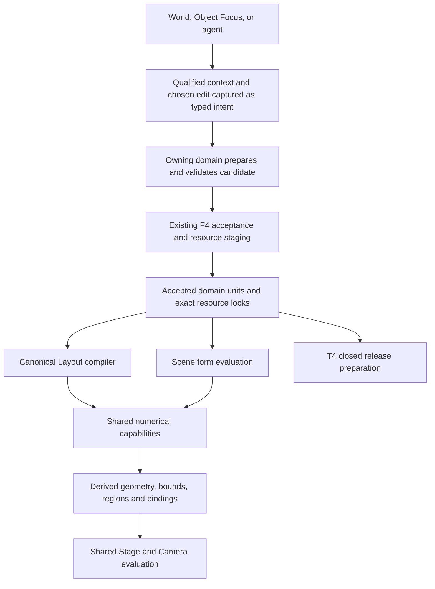

# T5 G0 — Disciplined creative freedom

**Reconciled architectural proposal · 27 October 2026 · for owner ratification.**

This is one recommended direction, replacing the need to choose between the two proposals in
[PR #202](https://github.com/Biskiq/spatial-sketch-editor/pull/202). It does not ratify itself.
It proposes no production implementation, dependency admission, registered phase or release, and
does not change the North Star, reference architecture, commission or current roadmap registers.
Independent review of this reconciliation and an owner ruling remain due.

The inputs are [A: A revisable language of form][proposal-a], [A's kernel assessment][kernels],
and [B: Stratified form][proposal-b], all inspected at PR head `9961f92b90f9a50b15725f70037d5bc48f315fec`.
B originally compared A at `97c72bfe`; this reconciliation evaluates the actual two documents at
the shared head. Current foundations were checked in local `main` at `852b373746ab428038c56deb6533ce0d7fe56ef0`.
No geometry benchmark, creator study or new prototype was run. Recommendations below are analysis;
existing implementation and prototype evidence are identified separately.

## 1. The decision: make spatial intent composable

**The engineering foundation survives this challenge; the workflow hypothesis and delivery order
need to change.** A more approachable operation-based modeler is a credible outcome of the previous
sequence, but it is not enough to establish Biskiq's advantage. Making a plinth, then adding booleans,
then sculpting, then relationships would validate familiar modeling capabilities before testing the
reason to choose this editor.

The stronger product hypothesis is: **creators can use what they see, draw and arrange as reusable
design context, and revise several kinds of spatial work through the same small set of interactions.**
They indicate where something goes, what shape or spacing they want, and what should continue to
follow. Biskiq supplies qualified construction, local solving and dependency management. Those
mechanisms remain real engineering obligations; they need not be the creator's planning language.

This is a hypothesis about lower translation and revision effort, not a claim to have invented
sketch modeling. [SketchUp's current Follow Me documentation][sketchup-follow] already describes
non-destructive procedural components with editable profiles and paths. [Rhino SubD][rhino-subd]
already offers directly editable organic shapes. [FiberMesh][fibermesh] retains drawn curves as
surface controls, and [sketch-based mesh editing][oversketch] demonstrates surface/silhouette
oversketching. These primary sources establish precedents, not comparative Biskiq usability or
browser-performance results. Retained profiles, direct manipulation or a friendly pen alone are not
a defensible novelty claim.

[Structured Annotations][annotations] also shows that high-level relationships can be supplied
through drawing-oriented annotations. This supports testing legible local relations; it does not
establish that constraints disappear or that Biskiq should infer them from every mark.

Biskiq's potential difference is the **combined loop**: create in a meaningful spatial context,
reuse that context across form and arrangement, make expressive exceptions locally, then revise the
whole without reconstructing its intent. Its existing Layout, Scene, Camera and Experience authorities
make that integration credible. Distinctiveness must be demonstrated by transfer to unfamiliar tasks,
less preparatory geometry and dependable later revision. A renamed sweep or a beautiful scripted
example does not establish it.

### 1.1 A concrete creative loop

Consider an installation around a found sculpture. A creator draws the line the display should take
on the floor, gives a short section its desired depth/height, and sees a continuous band. They place
one information stand and use the same line to arrange a few more. They redraw a stretch of the band
to make the entrance welcoming, while indicating a mounting area that must remain unchanged. Later
they widen the entrance and change the line: the band and the deliberately following arrangement
revise together; the free sculpture stays put. A stand is allowed to become an individual exception.

The creator can begin with the band, the arrangement, a borrowed boundary or an existing object.
They need not decide “build a definition, add a sweep, create an array, constrain these members.”
The visible line is design evidence, not a universal hidden dependency: using it once and explicitly
continuing to follow it are different choices. A support disappearing produces an understandable
choice about the affected work, not silent retargeting.

This must also help less architectural work: arranging objects around a table, shaping a lamp
against an observed silhouette, or adapting a display to a new setting. If it succeeds only with
walls and exhibition plinths, it is a useful specialist workflow with a smaller ceiling than claimed.
The experiment therefore includes an unprepared transfer task and a deliberately irregular exception.

### 1.2 An interaction language to test, not a new set of tools

The proposed common pattern is **indicate → change → see what follows**. It composes the existing
PLATE tools and precision ladder; these words are not new buttons or a ratified gesture grammar.

| Creator intention | What can be indicated | Bounded response and retained meaning |
| --- | --- | --- |
| “Along here”, “between these”, “around this” | A drawn line, existing boundary, two endpoints or an explicit region | A supported domain interprets that context: extend form, span or distribute. Preview names the reading; unavailable meanings are not offered. The same picked evidence can feed different admitted consumers. |
| “More like this” | A selected visible contour/stretch, a handle or a replacement stroke | Change the current result within a shown reach. It need not correspond to a pre-existing profile parameter; use a bounded deformation when appropriate. Other views reveal what the edit actually did. |
| “Leave this”, “keep this distance” | A patch, anchor, gap or measure | Preserve the indicated quantity for the stated scope. Most editing needs no added persistent requirement; a deliberate continuing relation is inspectable and removable. |
| “Use this here too” | An existing object, a section, material or arrangement | Reuse a qualified source or solve-once placement; continuing shared source/following is explicit. Do not infer a generic reusable rule from any two examples. |

The language must compose by reusing **qualified design evidence**, not by requiring a global
construction graph. Reusing a path for a band and an arrangement is the first test. Reusing a
current section to shape a different object is a later test with explicit frame/scale correspondence.
Borrowing a contour does not turn its owner into a new object type or preserve a relationship by
proximity. Across domains, each owner still controls admissible meanings and writes.

**Some choices are irreducible.** One stroke cannot reliably distinguish a hole from a patch, and
“follow this curve” does not choose between fixed count and fixed spacing. Expose the consequence
when it matters; do not hide it in a solver. Unambiguous drags commit normally under PLATE, with no
new confirmation ritual. A proposed interpretation or continuing relationship becomes visible before
acceptance. If correction consumes the apparent savings, use a more explicit contextual action.
Mouse, keyboard and numeric equivalents remain first-class: drawing skill is not an admission test.

### 1.3 Unconventional directions, with a cost test

| Direction | Creative value and technical route | Decision and falsifier |
| --- | --- | --- |
| **Design the space left around things** | Draw an aisle/gap or an envelope to fit inside. A planar region, explicit offset or local clearance query is feasible without simulating people or optimizing a scene. | Experiment early with one local editable clearance. Keep it only if it reduces setup and survives revision better than ordinary dimensions. It is a geometric preference, not a claim of accessibility, structural or building-code compliance. No global automatic rearrangement. |
| **Draw the visible change, without choosing a construction operation** | Oversketch a current silhouette/section or a few control curves; solve a bounded deformation. Existing research supports the mechanism. | Test beside direct handles. Disambiguate depth/plane, bound reach and inspect an opposite view. Reject unrestricted single-view reconstruction as the ordinary path; a plausible front view is insufficient. |
| **Compose current forms without preserving a construction recipe for everything** | A deliberately authored control surface or local detail source can support sustained manipulation better than hundreds of modifiers. | Keep as a serious source-model alternative. Compare revision cost and lost upstream control on the same object. No forced conversion, fabricated history or automatic loss of editability. |
| **Reuse a relationship by example** | Select a deliberately authored arrangement, nominate its carrier and exposed controls, then reuse that pattern. | Later experiment after one explicit distribution works. Reject general demonstration-to-program inference until transfer accuracy and repair savings justify it. A copied pattern is enough initially. |
| **Create from a desired view, shadow or visitor experience** | An image-space target can guide a bounded local edit or canopy section; Camera/Experience can supply the evaluated view. | A high-ceiling research option, not R1. Freeze view/light assumptions, expose alternate solutions and measure the unobserved geometry. Defer inverse lighting, structural optimization and whole-scene view solving. |
| **Reuse an inspection to explain the work** | Explicitly capture a useful view or admitted reveal into a Presentation over the same subjects, so explanation follows valid source revision. This builds on Biskiq's Camera/Experience separation. | A product-integration candidate alongside geometry growth when T3 is ready. Test whether it avoids reconstructing an explanation after edits. Inspection alone never authors Experience, and a screenshot/mock tour does not prove runtime binding. |
| **A single universal material/clay world** | Direct mass manipulation and topology change can remove construction planning for sculpture. | Reject as the universal foundation: context, thin surfaces, precision, reuse and identity still need machinery. Admit a local field tool only for a demonstrated job that simpler controls cannot do well. |
| **An AI designer interprets every action** | Can propose a rich draft from references and language. | Optional proposer over the same operations. Reject as a dependency of direct editing: latency, unpredictability and loss of agency would undermine the central loop. Compare suggestions against simple deterministic readings before investment. |
| **Solve the entire design from goals** | Attractive promise of specifying atmosphere, dimensions and relationships together. | Reject as the starting architecture: underdetermined taste, coupled constraints, opaque tradeoffs and unbounded cost. Use explicit local requests and a small affected set; infeasible goals return choices. |

This is a portfolio of falsifiable opportunities, not an obligation to implement each. The first
three can challenge both the reconciled source model and its interaction assumptions. The remaining
ideas wait for evidence from actual creative work. Names such as “natural” or “intuitive” do not
reduce ambiguity, numerical cost or maintenance obligations.

### 1.4 What earns its place in the architecture

Retain one source and acceptance path, explicit semantic ownership, qualified correspondence,
recoverable revision and bounded computation. These protect freedom across long sessions. Keep the
small directed hybrid as a practical implementation strategy, but stop treating a retained operation
program as the necessary representation of every form or every user action. A current control model
can be the right authored source; a construction recipe is valuable when people actually revise its
construction. Choose the smallest source that preserves the admitted edits and declared relationships.

The earliest investment now proves **interaction transfer and spatial revision**, together with the
minimum semantic feasibility. Rich boolean, field, assembly and specialist kernels follow measured
consumer needs. The direction is worth pursuing if it lowers the amount of modeling knowledge needed
without reducing the range or ownership of the resulting work. Otherwise retain the reliable simpler
editor and narrow the differentiation claim rather than add more infrastructure.

## 2. What to preserve, change and reject

| Question | Architectural assessment | Reconciled decision |
| --- | --- | --- |
| What is authored? | A separates controls/operations from evaluated geometry; B makes controls concrete but excludes native control-mesh source. The first reconciliation also overcommitted to a form program as the universal answer. | Retain the meaning the supported edits need: a compact recipe, control surface or explicit source resource as appropriate. No disposable render mesh becomes source accidentally. Imported source remains useful without invented history. |
| What determines order? | A can express order-sensitive work but leaves ordinary recipe complexity under-specified. B's fixed strata simplify a subset and relocate other sequences into hierarchy. A bend after a cut differs from a cut after a bend; two successive bends generally differ when reversed. | Store meaningful dependencies/order, supply simple defaults, and add only supported operation kinds. Do not expose a generic node editor or modifier stack as a prerequisite. Do not confuse semantic parts with evaluation groups. |
| What may an edit depend on? | Source controls and frames are more durable than arbitrary generated face indices. B's frame-only rule does not eliminate naming: a located datum must still find its supporting region after change, and source segments can split too. | Prefer source-bound references; permit qualified surface/feature bindings with explicit validity and repair. A frozen frame means fixed placement unless a following rule is also retained. |
| What does a dimension promise? | B's post-shape features are useful, but a late cutter guarantees neither adequate remaining material nor continuing support. Numeric entry is not evidence that a feature should stop following a bend. | Separate value, binding and preservation policy. A dimension may describe, drive or constrain; measuring/typing it must not silently move an operation to another stage. Validate the final result. |
| How do ordinary gestures work? | Stable fact editing is strong, but requiring an existing parameter still makes creators think in construction. The current visible result can itself supply a supported edit target. | Facts, contextual evidence and bounded current-result reshaping share one path. Use local inversion when justified; a broad mechanism search is not required on each drag. The affected scope and continuing relations remain legible. |
| What survives revision? | A correctly distinguishes semantic identity from geometric matching. B's label diff is useful bookkeeping, not sufficient correspondence; a role can remain while an anchor lies outside it. | Publish consumer-specific continuation evidence and typed repair. Labels, provenance and split records contribute to that evidence; none alone proves support. |
| What does “keep” mean? | Masks can make one displacement exactly zero in a region. Neither masks nor a constrained solve guarantee every later cut, blend or transform preserves it. | Declare the protected quantity, frame, region and operation scope. Persistent requirements are checked on downstream accepted results. Masks versus solves remain an experiment. |
| When are decisions made? | Both correctly freeze solved controls before acceptance. B improves attention to identity-bearing outcomes, but recording all generated outcomes risks a second geometry authority. | Capture chosen controls, allocated identities and accepted binding/repair decisions. Derive meshes, correspondence maps and diagnostics. Persist only minimal semantic lifetime records that cannot be reconstructed safely. |
| How are crisp and soft joins related? | B offers useful continuity of intent, but a zero-to-positive softness transition can change topology, support and materials. Key-sorted arithmetic does not prove identity invariance or universal order independence. | Keep the join's authored identity when its meaning continues; version its mode and conversion semantics. Revalidate result regions. Group blends may be symmetric; sequential blends remain legitimate when explicitly intended. |
| What comes first? | Both original proposals, and the first reconciliation, establish modeling depth before the product advantage. A headless harness cannot establish transfer of a creative language. | Run a small workflow comparison alongside semantic feasibility; then a Scene-scoped composition/revision loop. Relationships move forward; boolean and field breadth lose their position as mandatory gates. |
| How much interface change? | Both identify the right F concerns. B's limit of two interfaces per increment is arbitrary and can hide necessary cross-domain work. | Minimize changes by consumer, with every required owner involved. Review completeness and coherent scope matter more than an interface count. |

Three alternatives remain serious: a B-rep-first foundation if precision trims/fillets dominate
real work; a surface/control-mesh-first foundation if stable surface flow dominates; and a field-first
foundation if crisp and organic creation can share it without unacceptable precision or identity
costs. Today none has evidence sufficient to make every ordinary object pay its complexity.
The proposed directed hybrid must also earn its cost: remove a representation boundary if its
conversion and repair burden exceeds the creative value it adds.

## 3. Decisions suitable for ratification

These are proposed durable commitments. Ratifying them would select product and architectural
direction, not approve the mechanisms or UI in later sections.

| ID | Commitment | Why it should endure |
| --- | --- | --- |
| D1 | Creation, spatial composition and advanced refinement share authored subjects and one revision path. World/Object Focus are scopes over that work. | The unit of creative work can be an evolving composition, not only an isolated object. |
| D2 | Authored form retains the controls, dependencies, binding policies and source resources needed for its admitted edits; evaluated geometry is derived. A full construction recipe is not mandatory for every representation. | Editability survives rendering choices; meaningful control surfaces and samples remain possible without invented construction history. |
| D3 | Order and dependencies follow authored meaning. Simple construction patterns are defaults; exceptions are explicit and validated. | Avoid both unrestricted accidental history and permanent restrictions imposed by fixed strata. |
| D4 | Direct edits can target a fact, qualified context or the current visible result, with stable scope and explicit following. Ordinary interaction must not require construction-order knowledge. | Predictability and transferable interaction; the concrete grammar and interpretation remain hypotheses. |
| D5 | Precision, preservation and following are explicit, scoped guarantees, tested on the resulting work. | Neither a dimension, a mask nor an unchanged identifier substitutes for the promised behavior. |
| D6 | Semantic references carry qualification, lifetime and repair policy. Ambiguity never silently retargets. | Durable revision includes honest failure and recoverable work. |
| D7 | Layout, Scene, Camera, Experience, resources and F keep their existing authority. T5 supplies reusable numerical capabilities. | Reuse strengthens the foundations without another compiler, writer, history or renderer. |
| D8 | Acceptance is reproducible at the level its contract requires; approximation and conversion are explicit. Reopen cannot depend on transient caches. | Save, Undo, upgrades and delivery remain dependable. |
| D9 | Capability admission is evidence-led: creative value and transfer, revision semantics, correctness, browser cost and an understandable failure path. More kernels or operations are not a proxy for differentiation. | Disciplined creative freedom selects outcomes; the roadmap changes when its workflow hypothesis loses. |

### Proposed North Star clarification

The [current non-goals](../../../reference/north-star.md#permanent-non-goals) reject DCC-style
modeling as the normal workflow and describe sculpting/general geometry as likely external territory.
The [T5 owner direction](../../../reference/decisions/t5-g0-approval-2026-10-27.md) explicitly seeks
deeper expressive modeling. B correctly identifies an ambiguity, but its proposed permanent ban on
authored vertices/edges/faces would replace that ambiguity with an artificial technical ceiling.

Proposed owner-ratifiable wording:

> Biskiq enables drawing, shaping, arranging and refining spatial work through direct, contextual
> interaction. Creators can reuse spatial intent across form and composition, with progressive depth
> in Object Focus. Its complexity is earned by expressive value, predictable revision and reuse in
> spatial work. Deliberately authored geometric
> controls and detail may use specialized representations; generated presentation geometry remains
> derived. Ordinary work never requires mesh topology management, a modifier graph or a full CAD/DCC
> workflow. Advanced capabilities are admitted for demonstrated creative needs, not for parity with
> another modeling application.

Retain the boundaries against becoming a general DCC, BIM, fabrication-documentation or character
animation suite. Keep external-tool exchange valuable. Do not classify all local sculpting,
surface refinement or mesh-based controls as permanently external solely because of their technique.
An eventual topology tool still needs a compelling Biskiq workflow; architectural openness is no
promise to implement it. Promote this clarification only after an explicit owner ruling.

## 4. The smallest robust source model

### 4.1 Retain editable meaning, not every action

A native definition contains the controls and sources needed for its admitted edits, plus explicit
bindings and a small public interface of regions, anchors and parameters. A profile-driven object
benefits from a compact recipe. A continuously reshaped surface may benefit from a control surface
with local detail. Both are deliberately authored sources; their rendered tessellation is derived.
Do not store two coequal writable representations of the same shape. Transitions declare preserved
edits, approximation and recovery. Which native source wins is partly an E0 question, not a conclusion
that a more sophisticated graph can always repair.

Where construction order matters, use keyed, versioned operations with explicit inputs. Derive the
local evaluation order and dirty closure. Cycles refuse unless a specific bounded coupled solve is
admitted. Repeatedly changing a height edits one value; drag samples do not accumulate as operations.
Revising a reshape updates its controls where its meaning continues. Chronological Undo is separate.
Retaining every incidental construction step is unnecessary; silently discarding an admitted source
control or relationship is unacceptable. The source must state what remains editable.

Start with the smallest typed control model and evaluator needed by the winning first workflow.
No general graph language, creator-code runtime, plugin ABI or cross-kernel optimizer is required.
Do not require creators to give an object a family/category before they can create it. Domain-aware
families can supply strong behavior; work that leaves a family's guarantees may continue through
another admitted form capability, with any lost guarantees explicit. This is an extension path,
not a promise to accept unsupported geometry.

### 4.2 An edit contract, before a universal construction grammar

The immediate architectural addition is a small **domain-owned edit contract**, prototyped at the
existing Stage/intent seams before any shared interface is ratified. It describes which qualified
context a capability can consume, what visible target it can change, its affected scope, and what
following/preservation it can promise. This is an adapter obligation, not a new persisted domain or
second general-purpose command framework.

For the first consumer, qualify a plane/path interval/region or current-result hit with its owner,
frame, source revision and lifetime. A capability returns a bounded candidate with affected subjects,
matched target/error, continuing relations and refusal reasons. Handle movement, oversketch and
numeric entry may address that same effect. The chosen interpretation freezes into the existing typed
intent; preview and acceptance use the same admitted semantics. A changing camera or delayed worker
cannot change what the captured stroke meant.

A temporary guide can remain gesture/session state. If a creator deliberately reuses a guide as a
continuing input, promote the needed control into the owning definition or an admitted typed resource
with exact references and dependencies. Do not create a global writable “intent canvas” beside Scene
and Layout. A Scene-owned carrier first serves Scene consumers; cross-domain consumption requires F
review. Each reader resolves the owner, not a copied curve that quietly diverges.

**Make relationship cost proportional to intent.** Picking a host for this edit is solve-once unless
following is explicit. A relation is created only by a deliberate act with its ongoing effect shown;
ordinary resizing does not create constraints. Constraints remain engineering tools for explicit
requirements, not a prerequisite sheet of settings. There is no permission dialog on each drag.
When multiple interpretations really differ, show the smallest relevant choice; measure correction
cost before adding recognition or another mode. All five properties in §4.4 are source semantics,
not five questions every creator must answer.

### 4.3 Default order, explicit exceptions

The usual object can construct a body, shape it, add fitted features and apply finish. An operation's
input determines which body it changes. Geometry combination groups declare their members, operation
and policy. Material evaluation consumes resulting regions rather than regenerating geometry.

For a recipe-backed form, the same vocabulary must also express:

- Cut a slot, then bend the slotted material; or bend first, then make a straight slot.
- Shape two masses together, then add a third that stays unshaped.
- Engrave a pattern that follows a later bend; or apply a fitted engraving to the final surface.
- Edit a starting outline while keeping later refinements spatially or parametrically bound.

These examples require no new semantic part unless the creator means a distinct reusable or
addressable part. Local evaluation groups can express scope without becoming components. Grouping
for organization, sharing a definition and composing numerical operations are separate concepts.
Keep relation to prior work inspectable; whether people see stages, marks or contextual actions is
open. Reordering is itself a validated edit with a preview of changed meaning and broken bindings.

Where an operation declares unordered inputs, normalize their order deterministically and test
permutation invariance under that declared semantics. Where order affects the intended result,
retain it. Opaque ID allocation or incidental collection iteration must not secretly choose geometry.
Copies re-root identities while preserving the intended evaluation order; they must not reshape just
because newly allocated keys sort differently.

### 4.4 Edit meaning has independent dimensions

| Property | Examples | Consequence |
| --- | --- | --- |
| Target and scope | Overall height; waist at a section; selected feature; a whole definition or one use | A direct edit names what it changes and whose uses are affected. |
| Value meaning | Relative displacement; absolute target; observed measurement | “30 mm narrower” and “270 mm wide” respond differently to upstream changes. Measurement creates no constraint. |
| Binding | Object rest frame; keyed curve parameter; source datum; surface-relative binding; explicit world frame | Determines how the operation follows source and instance changes. It is not inferred from proximity. |
| Preservation | Keep during this reshape; maintain a mounting diameter; keep material region through subsequent edits | States what is invariant, for which operations, and within which tolerance. |
| Evaluation dependency | Before a bend; after a blend; on a qualified resulting region | Determines the material/result to which the edit applies. Numeric entry does not silently change it. |

An absolute dimension can legitimately belong to deforming material. A precisely specified slot can
be intended to bend with a shade. Conversely, a mounting bore can be required to stay circular after
shaping. The second may be implemented efficiently by a late cut, but acceptance must also check
placement, support, wall thickness and any declared clearance. A valid empty cutter intersection is
not a successful mounting bore.

Local relations such as equality, symmetry, parallelism, tangency and distance operate on declared
controls with units and frames. Prefer direct constructions where possible. Small coupled blocks
may solve during preparation, with bounded iteration, fixed initialization and residual checks.
Conflicting hard requirements refuse; soft preferences can yield only as declared. Do not solve the
whole project or invent an intent priority from the order of pointer events.

### 4.5 Shaping and preservation

For an ordinary reshape, the target is a change to the **current accepted body**. Preparation may
derive a compact spatial map or cage from that body and freeze its controls, rest binding and reach.
The saved form remains reconstructible from its admitted source. For a recipe-backed form,
re-evaluating a revised starting profile
does not mean replacing the current object with its original extrusion: retained later operations
must reapply according to their declared binding, or explicitly require repair.

This reconciles the useful intent of [Shape Focus §11](../../../../prototypes/native-object-shaping/UX-SPEC.md#11-geometric-contract-for-implementation)
with upstream editability. Rest-space superposition does not automatically reproduce a sequence of
edits to an evolving body. Compare it with sequential maps before choosing either; neither is a
durable law. Oblique, multi-directional and overlapping edits must be in the early corpus.

“Keep” must say whether it preserves material points during shaping, the shape of a patch, a datum,
a dimension or a relationship. A compact mask is a promising first mechanism for fixed material;
a constrained transition solve may improve fairness. Both need reach-boundary, foldover and global
self-intersection checks. A positive local Jacobian is insufficient to establish global validity.
Persistent preservation is checked after later cuts/blends as well. Explicit whole-object transforms
have their own semantics; scaling a kept base must not silently violate a persistent physical size.

## 5. Correspondence, repair and long sessions

Prefer references to authored controls and source datums, then semantic regions, then bounded surface
bindings when the task needs them. Qualified generated hits identify a current evaluation and its
source; mesh indices and kernel face numbers are not durable addresses. A picked frame alone is a
snapshot of placement. Following needs a retained host, binding parameters and transport policy.

Treat survival as several questions: does the identity continue, can its geometric support be
evaluated, do required constraints hold, and is the mapping exact or approximate? A single “Strong”
badge is insufficient if only identity survived.

| Result | Required behavior |
| --- | --- |
| Same semantic target, valid support and preserved requirements | Re-evaluate and continue without a repair dialog. A changed pose is allowed when the binding explicitly follows. |
| Proven continuation with changed parameterization | Apply the owner's explicit transport and recheck the consumer's requirements. |
| Split or merge | A material may broadcast under an authored policy; a singular anchor needs an unambiguous mapped location or repair. Contributor labels alone cannot choose. |
| Approximate projection | Offer a candidate with deviation, normal/region checks and lost guarantees. Projection is not accepted continuity merely because it is close. |
| Removed, unsupported or ambiguous | Retain the original identity and a typed repair state. Never silently clamp, select a nearby face or invent a replacement. |

Use source keys, provenance, region/component lifetimes and supported parameter transport together.
Disappearing and newly returning caps or repeated members receive new lifetimes; Undo restores prior
keys exactly but new work after Undo cannot reuse retired identity. A role unchanged by a deformation
can still lose an attachment's clearance or valid support. Subsequent topology operations are checked
again, even if the deformation itself preserved connectivity.

Persist minimal semantic decisions: authored bindings, explicitly accepted repairs, allocated member
and region lifetimes, and any identity-bearing split allocation needed for stable reevaluation.
Do not persist every triangle label or generated correspondence table. Reconstruct derived mappings;
if they cannot validate a recorded semantic outcome, report incompatibility rather than reassign IDs.
The concrete lifetime representation is an F.1/F.2 design question to test before codec commitment.

Repairable authored bindings may be accepted only where the owning validators permit them, with the
consequence visible in the same candidate. Invalid geometry or a violated hard preservation rule
cannot be waived by accepting an unresolved attachment. A last known pose is recovery information,
not proof of following; its display or detach behavior belongs to the admitted binding contract.
Required unresolved behavior blocks executable closure/publication under F.5.

Dependable long sessions require more than Undo. The current history is
[bounded to 100 states](../../../../apps/editor/src/lib/authoring/f4/history.ts), and is not saved
as a gesture log. After those states expire or the project reopens, retained controls must still
edit the form. Derived checkpoints may accelerate reconstruction but deleting them must not alter
editability. Automatic performance management must never flatten source.

Explicit consolidation may later replace many controls with an authored displacement/detail resource.
It must declare which edits are lost, preserve a recoverable prior source revision through the shared
resource/project lifecycle, and provide retention rules. Undo alone is insufficient recovery after
reopen. Until that lifecycle exists, destructive consolidation is not eligible. Named alternatives
and broader version recovery belong to T2/T3's shared systems, not a private T5 history.

## 6. Numerical representations and feasibility

Use a **directed hybrid**, with an explicit route and accuracy policy per admitted capability/source version. There
is one authoritative source for each piece of work; multiple evaluated representations are derivatives.
A native object may start with a single evaluator. A common edit contract is not a requirement to
implement every operation on every representation; capability/refusal reporting keeps the boundary honest.
Equivalent optimizations need conformance evidence. A change in accepted meaning requires a new
semantic version or explicit source migration, not silent backend substitution.

The table allocates capabilities, not a mandatory implementation sequence. An explicit control
surface can arrive earlier if the current-result editing comparison justifies it; a field engine
can remain absent if it does not remove a meaningful creative barrier.

| Capability | Initial route | Boundary and admission evidence |
| --- | --- | --- |
| Profiles, extrusions and later revolutions/sweeps | Retained curves/frames; analytic construction with controlled tessellation | Start with the curve kinds required by the consumer. Add holes, continuity, offset/trim behavior and seam/frame policies deliberately. Self-intersections, collapsed offsets and multiple outputs require declared outcomes. |
| Bounded spatial shaping | Compact map/cage controls over an admitted body; evaluated surface plus semantic transport | Compare simple maps, masks and a small solve. Need whole-region preservation, boundary continuity, validity and upstream revision evidence, not just a fitted section. |
| Crisp combination and fitted cuts | Validated closed surfaces through a narrow solid-kernel adapter | Manifold is the first candidate. Test degenerate/touching/coplanar inputs, thin features, emptiness, provenance and transfer cost. Kernel success is not the product oracle. |
| Organic blending/carving/topology change | Local functional implicit composition, compared against a sampled-field route | Prefer compact retained expressions initially, conditionally. Measure field evaluation, contouring, conversion, support transfer and memory together. No whole-scene voxelization. |
| Sustained fine detail | Authored local detail resource or explicit control surface, chosen by the workflow | Samples need resolution/frame semantics; control surfaces need topology/detail transfer rules. Material/normal/decal detail should be considered when geometry adds no value. |
| Specialist precision | Bounded B-rep recipe/source when a named consumer needs it | Admit a mature kernel rather than gradually writing general surface intersection, healing and filleting inside profile utilities. Precision exchange is not a first-object dependency. |

Separate authored dimensional intent, acceptance tolerance and preview/export approximation. Specify
SI units, explicit frames, coordinate range, minimum feature size and error accumulation for each
admitted route. An analytic primitive is not a promise of exact intersections. Robust predicates do
not make all constructed coordinates exact. Planar quantization must declare scale and rounding;
it must not change existing Layout arithmetic incidentally.

A warped or blended implicit function need not remain a signed distance function. Offsets, thickness,
clearance and conservative exclusion require the appropriate distance/error guarantees. A spatial
deformation of an implicit body needs an admitted inverse map or a declared conversion, not merely
the same forward vertex transform. Field extraction must detect missed thin features, cracks and
self-intersections under its supported envelope.

Each conversion states direction, source/evaluator version, geometric error, provenance retained,
unsupported operations and lost precision. Keep consecutive compatible work together. Repeated
automatic mesh/field/B-rep round trips are not the extension strategy. Imported bodies keep their
provenance and actual edit capabilities; an open mesh may admit shaping and finish while refusing
closed-solid operations. Do not fabricate native construction history or silently repair an import.

### Kernel and licensing recommendation

Build Biskiq's intent, bindings, validation and ownership adapters; reuse established numerical
machinery where it fits. [Manifold's official documentation](https://manifoldcad.org/docs/html/)
describes a solid triangle-mesh kernel with vertex properties; its
[upstream build notes](https://github.com/elalish/manifold) currently describe serial WASM execution.
Use it as a bounded candidate, not a guarantee of browser latency or persistent naming.

Manifold's [Apache-2.0 license](https://raw.githubusercontent.com/elalish/manifold/master/LICENSE)
and Clipper2's [BSL-1.0 license](https://raw.githubusercontent.com/AngusJohnson/Clipper2/main/LICENSE)
make them initial candidates under the existing permissive-only ruling. Pin and audit the actual
release, bindings, build options and dependency closure before admission. Clipper2 is for a proven
new planar need, not a required replacement for current Layout math.

[Fidget](https://github.com/mkeeter/fidget) is an experimental implicit-evaluation candidate under
[MPL-2.0](https://raw.githubusercontent.com/mkeeter/fidget/main/LICENSE.txt), so remains outside the
current admission policy. Preserve A's conditional investigation, not a mandatory dependency. A
permissive small field implementation also has substantial validation cost; if neither route is
credible, defer that capability or seek a separate policy ruling. Do not choose Biskiq's product
license to rescue an engine choice. A's [broader kernel assessment][kernels] remains comparative
background; this proposal does not admit its candidates or repeat its legal conclusions as policy.

Use TypeScript for domain integration and small controls; worker/WASM evaluation is a measured
implementation option. Custom Rust/WASM still follows the existing
[technology gate](../../../reference/north-star.md#technology-gates). No renderer replacement,
WebGPU migration, global solver or new geometry service is required for the first consumer.

## 7. Deterministic preparation and shared execution

This describes ownership and dataflow, not proposed services or package scaffolding. The shared
composition model owns cross-domain dependencies; form-local numerical evaluation does not become
another project execution engine.

Preparation captures chosen controls and decisions against one expected revision, stages any needed
resources, validates affected domains/references/locks, and submits one candidate through F4.
Freeze bounded solver results as captured inputs and validate their relationship to the baseline;
the captured values are not trusted merely because a worker or agent supplied them. Recheck final
residuals, operation domain and output validity. Preparing a later upstream edit recomputes its
dependent controls inside that new candidate; Save and Undo never silently rerun an interpretive solve.

Async work carries expected revision, epoch, input sequence, dependency/resource identities and
evaluator version. Stale completion cannot install. Cancellation and latest-input backpressure bound
queued work. Before Apply, a final candidate must be validated; a coarse preview cannot imply final
acceptance. Its final preview and accepted evaluation must agree under the declared fidelity contract.
Resource failure, stale results, invalid candidates, cancellation and no-op add no history.

Save captures the exact accepted source and operation identity and uses the existing saved-base CAS.
Local accepted revision and durable saved base remain distinct. Undo/Redo restores accepted content
with fresh revision identity through the same boundary; it does not numerically reverse a deformation.

Distinguish three determinism obligations:

1. **Exact authored content and acceptance:** same baseline and fully captured intent produce the
   same canonical candidate and semantic identity decisions where F requires exactness. Full source
   restoration and Save retry rules remain intact; geometric tolerance cannot excuse a digest change.
2. **Reproducible accepted geometry:** pinned evaluator semantics reconstruct the admitted result and
   validate its bindings/invariants. Identity-affecting decisions need deterministic treatment even
   when tessellation equivalence is tolerance-based.
3. **Presentation:** preview tessellation may vary within its explicit approximation policy, without
   changing accepted source, semantic identity or promised dimensions.

B usefully identifies numeric discipline, but WASM alone is not a whole-program determinism proof.
The [ECMAScript specification](https://tc39.es/ecma262/multipage/numbers-and-dates.html#sec-math-object)
permits implementation-approximated transcendental results; the
[WASM numeric specification](https://webassembly.github.io/spec/core/exec/numerics.html) also identifies
permitted nondeterminism. Pin code/math builds, ordering, finite-value policy, solver choices and
serialization; test the supported engines and architectures. Avoid nondeterministic instructions
in canonical paths. Recording a result cannot rescue a geometry evaluator that later cannot reproduce
or validate it. Unsupported evaluator versions refuse explicitly; upgrades require compatibility
proof or an explicit migration with recovery.

## 8. Integration: reuse what exists, admit what is missing

The governing contracts are [architecture](../../../reference/architecture.md),
[F](../../../reference/composition-execution.md) and [Scene](../../../reference/components/scene-content.md).
Their destination must not be mistaken for already shipped form capabilities.

| Owner | Existing foundation and required addition |
| --- | --- |
| T1 / Layout | The canonical compiler and S06 retained compile/Plan/representation remain authoritative. New architectural families may consume shared numerical functions inside that compiler. A carved Scene body does not become a Wall or hosted Opening. Numerical reuse does not require Layout to adopt Scene's whole form grammar. |
| T2 / Scene | Current Scene 2 supports models/primitives/lights and world-local placement; native definitions, components and attachments require admission. The first workflow adds one Scene carrier/control, a native form and a bounded following arrangement, with an explicit break-following operation. Shared revision, arbitrary overrides and reusable assemblies are later T2 semantics, not prerequisites or T5 instancing. |
| F.1 / resources | Add qualified form controls/regions and lifetime/transport results, plus strict resource revisions/locks. Current generic unit resolution refuses component/capability references; a field in a type is not a landed provider. |
| T3 / F4 | Reuse unit acceptance, planner write scopes, resource grants, 100-state history and conditional Save. Determine whether asynchronous preparation fits the existing entry before proposing an additive scope. Geometry workers never install directly. |
| Stage / Camera | One Stage, selection facade and Camera authority. Focus changes editing scope, working context and evaluated framing, never object placement or a second Scene. Admit additional nonplanar inverses/hits or views only as required; the present planar AM-5 seam does not prove them. |
| Experience / F.3 | Consume admitted semantic anchors, bounds and properties. Geometry may invalidate these; it does not write Camera pose/FOV or editorial order. Dynamic geometry is a later declared capability, not automatically available because an editor can compute it. |
| T4 / F.5 | Static delivery uses immutable prepared geometry/material/address derivatives from closed accepted source. Include a runtime evaluator only for a declared visitor capability; preserve editor isolation. Native-source export and flattened delivery/export are distinct products with distinct guarantees. |

Concrete implementation anchors are
[the canonical compile session](../../../../packages/layout-core/src/layout-geometry.ts),
[unit acceptance](../../../../packages/project-model/src/f4/unit-acceptance.ts),
[unit reference resolution](../../../../packages/project-model/src/references/unit-resolution.ts), and
[shared history](../../../../apps/editor/src/lib/authoring/f4/history.ts).
Some older ownership-summary rows still describe pre-cutover Camera-in-Scene storage; the live
F.2 implementation section, current Scene contract and unit code describe separate units. This
proposal uses the live cutover and does not reopen a legacy source path.

Before each consumer, draft the smallest necessary amendment set: F.1 region/anchor lifetime and
consumer policy; F.2 native source/resource validation; F.3 outputs only when consumed; F.4 async
admission only if needed; AM-5 Focus/hit lifetime; F.5 delivery at its actual consumer. These are
shapes, not preassigned amendment IDs. The first increment needs substantive T2 and shared-boundary
work; calling the engine “stateless” does not remove it. Package boundaries follow accepted callers
and ownership, rather than preceding them.

## 9. Performance and recovery constraints

Aim to recompute the affected dependency closure and its geometric complexity. Cache by exact
source/resource identity, semantic/evaluator version, binding frame and accuracy policy. Share
definition geometry across instances. Pure material edits should not regenerate shape; rigid instance
motion should not regenerate the shared definition. World-bound relations or non-rigid transforms
may legitimately invalidate dependent work. Local deformation is local only when its supported
influence and downstream consumers are local; booleans and root edits can be global for a form.

The first contextual loop has a tractable route: a simple planar carrier supplies sampled frames
to one bounded band generator and a small keyed arrangement. Work grows with carrier/profile samples
and affected members, not the number of unrelated objects. Degenerate offsets, self-crossings and
unsupported curvature refuse under a declared initial envelope. This is not a general sweep or
surface-fitting claim. A later capability can widen that envelope without changing the creator's
entire workflow. Interpretation should query the selected/pointed context through existing qualified
hit/spatial facilities, not search every object or run a scene-wide inverse solve on each movement.

Workers address responsiveness, not total cost. Account for serialization, transfers, WASM/JS memory,
resource staging, validation, hashing, first pick and presented frames. Retain only bounded jobs and
byte-budgeted caches; dispose canceled results and detached resources. A stalled kernel must permit
the UI to cancel/abandon the job and reclaim its worker without losing accepted source.

[S06 acceptance](../../t1-spatial-world/t1.p02-native-wall-creation/t1.p02.s06-performance-foundation/acceptance.md)
is the baseline, not a T5 benchmark. Its grid-M slowest-run p95s were 16.3 ms input-to-preview,
25.51 ms commit and 12.21 ms Undo/Redo on the recorded M2/16 GiB/Chrome/AC setup (product
`d89554b1`, harness `25d61deb`). Its L cold open remained about 5.06 s; canonicalization still
touches the whole document. Its coverage and AC qualification do not certify new geometry work.

Retain A's numbers only as **provisional experiment targets**: matching preview p95 ≤50 ms,
final ordinary edit and Undo/Redo p95 ≤100 ms, frame p95 ≤20 ms, no >50 ms main-thread task in
ordinary interaction. Start with its 32-operation/8-operand/100k-triangle test object in the M scene,
and stress 10× complexity with honest asynchronous progress or bounded refusal. These are workloads,
not permanent creative limits. The proposed ≤64 MiB incremental object/evaluator CPU-memory target
needs a measured breakdown, including cold module cost, working copies and retained history, before
becoming a budget. Measure GPU memory separately and total scene headroom together.

Use the [existing performance workflow](../../../../apps/editor/tests/README.md#product-convergence-performance-workflow)
and [performance contract](../../../reference/components/performance.md): actual sequence/revision
to presented-frame attribution, designated machine/power condition, cold/warm/repeat-use, transfer and
retention accounting, independent oracles and the normal statistical plan. Do not inherit S06's
special sample exception. Include continuous pan CPU and first pick after commit. Acknowledgment is
not a matching preview; kernel duration is not end-to-end latency.

For long sessions, test more than the history limit, repeated cancellation, Save/reopen with caches
deleted, resource failure, worker crash and project replacement. Memory should reach a bounded plateau
under a fixed-size revision workload; growing authored detail may grow storage legitimately and must
be reported separately. If ordinary work misses the target, improve the measured owner/boundary or
change the operation route before expanding breadth. Do not silently bake or truncate creative work.

## 10. Earliest evidence: earn the workflow and the architecture together

Propose a separately authorized **E0 comparative experiment** with a workflow track and a semantic
track. Neither must wait for the other to finish. No prototype, study, benchmark or new dependency
is authorized or performed by this document. Paper/interactive mockups may eliminate bad ideas,
but a successful timed revision task requires working geometry and bindings; a scripted animation
cannot supply that evidence.

**Keep the first experiment small:** one planar guide, one analytically generated band and a few
placed primitives are sufficient to test the core composition claim. Reuse prototype numerics where
appropriate without promoting them to production. The core comparison and its shared-source lifecycle
fixture gate R1. Contour, negative-space and advanced ordering probes test the ceiling separately;
they do not require a new solver, boolean kernel or multiple complete representations before R1.

### 10.1 Workflow comparison before capability expansion

Recruit eight target spatial creators with mixed modeling experience, reporting the strata rather
than averaging away novice/expert differences. Give matched onboarding, counterbalance task/order,
and use both a small contextual prototype and a competent explicit-control baseline with the same
geometry, accuracy, rendering and operations. Do not compare a finished prototype with a crippled
baseline. Include an experienced-user workflow in a current relevant editor for at least the retained
path/repetition task, or report competitive differentiation as untested. Do not assume those tools
lack procedural editing; the current documentation says otherwise.

| Task | What it tests | What would falsify the proposed advantage |
| --- | --- | --- |
| Core: create and revise a display band plus a few placed objects from one drawn/borrowed guide, then change a support and detach one exception | Context reused across form and arrangement; deliberate following; preparation avoided on revision. Transfer to an unprepared arrangement around a table with different endpoints/spacing. | Requires graph knowledge or unexplained modes; revision needs as much rebuilding as explicit controls; automatic following surprises the creator |
| Ceiling probe before R2: adapt a different existing object by changing a visible contour while keeping one meaningful patch | Transfer from contextual construction to current-result editing; freedom beyond a preset family | Requires reconstructing the object's creation recipe or a new tool vocabulary; unseen geometry is damaged; direct handles work better |
| Core: make an irregular, personally chosen variation. Optional probe: fit work around a local empty region | Creative ownership; separately, whether negative-space editing adds enough value | Results converge on presets; corrections/constraints dominate; a simple dimension or imported asset achieves the goal more cheaply |
| Reopen later, explain what follows, revise the original context and recover an intentionally broken relation | Comprehension and dependable return to work | People can finish the demo but cannot predict consequences or resume without instruction |

Measure time to a creator-approved result, separately coding navigation, preparatory geometry,
construction choices, interpretation corrections, manual rework, repair and expert help. Count
unintended accepted changes and ask the creator to predict two revision consequences. Assess
self-chosen differences in output and abandoned intentions, not just conformity to a target shape.
Use keyboard/mouse equivalents; do not select only confident sketchers.

**Provisional decision rule, to set before running:** at least six of eight complete the composition
and an unfamiliar transfer/revision task without expert rescue; at least six correctly predict the
two tested following outcomes; median preparation-plus-rework time improves by roughly 25% over the
matched baseline without materially worse total completion, fidelity, correction or help. Report
individual outcomes, failures and both experience groups. This is a practical pilot threshold, not
statistical market proof. Preference alone cannot pass, and no average may hide silent data loss.
Repeat with new participants before claiming general learnability or competitive superiority.

Ablate the proposed advantage: reuse the same controls with guide following disabled, and compare
oversketch against direct handles. Keep the simpler path when performance is comparable. If shared
context helps but sketch interpretation does not, ship explicit contextual actions. If a small
relationship editor helps but deformable native form adds little, bring composition forward and defer
the shaping engine. If neither beats the baseline, retain the reliable object loop, narrow the claim,
and reconsider the first customer job before expanding T5.

### 10.2 Minimal semantic and numerical proof

Use shared numerical routines to compare source encodings; do not build two complete engines. Begin
with three fixtures, adding a dependency/kernel only where the decision cannot be tested analytically.

| Fixture | Consequential hypothesis | Required evidence and failure response |
| --- | --- | --- |
| R1 gate: shared guide → native band + three placed members; change path, detach one, remove support, Undo/new edit, Save/reopen | One qualified source can drive different consumers without hidden state or a universal intent document | Deterministic candidate, supported frames and stable member lifetimes; zero silent retargets; copy/reminted keys preserve geometry. If integration cost dominates the creator gain, reduce the first relationship scope or reject it. |
| Before R2: current body → two perpendicular contour edits → kept patch → upstream revision | A compact recipe, sequential map or direct control source can retain the edits people actually want | Compare residuals, unseen geometry, repair and source growth at 20/50/100 changes. A minimal control-surface comparator is allowed if the recipe repeatedly fails. Do not make “keep the graph” a passing condition. |
| Before admitting order-sensitive precision: bent shade/bracket with a material-following slot, a round fitted bore and detail before/after bend | Explicit dependency freedom may be needed; fixed strata or hidden reordering can misrepresent intent | Final dimensions/support, transition quality, order-sensitive result and absence of forced semantic parts. Use analytic fixtures first. If a simpler default covers the real work, use it; this is not a prerequisite kernel campaign for R1. |

Add cap/split and count 20→19→20 cases when the corresponding identity is admitted. Test copied
source, canceled/stale preparation and identical captured candidates across the supported engines
and architectures. Identity-affecting mismatches and silent retargets must be zero. Removed support
must diagnose; correct refusal is not counted as corruption. Report unnecessary repair in ordinary
edits, not only a corpus average. Independent numerical oracles and finite geometric envelopes remain
necessary even when creators prefer a workflow.

### 10.3 Evidence sufficient for a decision

The core E0 ends with a decision record: preferred first interaction and its minimum source,
rejected alternatives and why,
observed failure/repair burden, performance envelope, and the smallest R1 consumer contract. It is
not complete with more research recommendations. A weak result can justify one bounded iteration;
continued failure returns to product scope rather than funding a larger solver. The irreversible
investment to avoid is a persisted general-purpose form language before the workflow earns it.

## 11. Capability roadmap

These are proposed outcomes/dependencies, **not registered phases, releases or dates**. Each production
milestone requires an owner-reviewed plan and release. A complete production consumer includes strict
source, atomic history/Save, lifetime handling and actual integration evidence. The architecture
experiment and UX experiment are proposed future work, not evidence already obtained.

| Milestone | Meaningful deliverable | Dependencies and ownership | Acceptance that earns the next investment |
| --- | --- | --- | --- |
| **R1 — Compose and revise one spatial idea** | A Scene-scoped guide drives a simple native band/display and a bounded arrangement of placed objects. Creators edit the guide, create one local exception, finish it, Save/reopen and deliberately break following. Use existing floor/plane context; no new curved-Wall authoring dependency. World and a minimal Focus scope refer to the same subjects. | E0 workflow/source decision; T2 native control/form and bounded following/member scope; F.1/F.2 qualification; existing F4/Stage/Camera with only demonstrated additive needs. | Working transfer/revision tasks, stable identities and explainable consequences; no graph or construction-order knowledge required; exact Undo/Save and cold reopen; ordinary browser targets and >100-edit retention. Divide into source/persistence and interaction/following slices, but a solitary extrusion does not close R1. |
| **R2 — Shape the result and make deliberate exceptions** | Bounded current-result contour edits, protected regions, and one demonstrated local fit/cut or gap workflow. Native and found objects expose honest supported edit sets. A creator can depart from the original recipe without restarting. | R1; E0's deformation/source comparison; T2 region/support validation. Admit a solid kernel only if the selected cut/fit task requires it. | Multi-direction edits, opposite-view inspection, preserved patch/support, creator-authored irregular output, upstream revisions and repair. Compare direct handles and imported/lightweight alternatives; do not turn every solved example into a new operator. |
| **R3 — Carry a design into another setting** | Reuse the proven form/arrangement with changed context, one-use versus shared edits, member overrides and one admitted Layout support relationship. Add a small reusable pattern only when it saves repeated work. | R1 and a demonstrated transfer job; R2 only for shaped geometry being reused. T2 definition/resource lifecycle, T1 host/transport and joint F4 where authored consequences cross domains. | Shared update, detach, host split/removal, count lifecycle and mixed history; fewer manual reconstruction steps on a new setting. No implicit-field dependency; no universal family or template system prerequisite. |
| **R4 — Remove a demonstrated expressive ceiling** | Choose the next blocked creative job: smooth mass/carving, controlled surface/detail refinement, a robust sweep/span, or a precision feature. Complete one through the common edit/repair path before adding another representation. | Only the relevant R1–R3 contracts and measured demand; exact kernel/licensing decision. Functional fields, control surfaces and precision kernels compete as solutions, not as obligatory stages. | Same intended result/error across candidate routes; conversion/identity/latency/memory cost; new output creators could not reasonably achieve with existing controls/import/materials. Reject the route if its repair/interaction burden exceeds the gained freedom. |
| **R5 — Finish, explain and recover sustained work** | Surface/material/detail depth, recoverable alternatives and truthful exchange or prepared publication; an experienced creator revises substantial work across sessions and can explain it through admitted Experience/Camera capabilities. | Reliability tests start in R1; particular detail depends only on its admitted representation. T2/T3 recovery and Presentation consumers; T4 readiness gates publication, not native editing. | Scripted ten-hour-equivalent corpus plus at least three experienced creators; cold reopen beyond bounded history; recoverable consolidation; closed prepared delivery and no editor imports; compare visual completion from materials/assets against more geometry. |

The critical path is **E0's workflow + semantic decision → R1**, then the next demonstrated consumer.
R2 and R3 need not serialize: contextual reuse may matter before detailed shaping. R4 is conditional,
not a promised implicit-engine milestone. R5's reliability and visual-finish discipline run from the
start; its advanced recovery/exchange scopes arrive with their owning tracks. A small Presentation
consumer can be brought forward when T3 permits it, but T5 does not invent visitor infrastructure
or make publishing a prerequisite for evaluating drawing and revision.

The highest credible ceiling is a continuum from a quick line or found object to a distinctive,
reusable and revisable spatial composition. Thin sheets, canopies, shells, landscape, deliberate
surface flow and precision exchange remain possible. They are not forced through a closed-solid
pipeline or predetermined kernel schedule. Each future capability names the creative barrier it
removes, the simplest alternative it beats, the revision contract and the total cost it introduces.

## 12. Remaining uncertainties and falsifiers

| Uncertainty | Earliest evidence | Consequence if wrong |
| --- | --- | --- |
| Contextual composition is just procedural modeling with new labels | E0 matched controls/current-editor comparison and unfamiliar transfer | Keep only demonstrated savings; narrow the product claim and revisit customer/job priority before adding engine breadth. |
| One grammar becomes ambiguous or demands drawing skill | E0 correction/help costs, non-sketch input and cross-task transfer | More explicit contextual actions or direct handles; do not add universal interpretation to conceal the failure. |
| Relationship memory burdens ordinary creation | E0 comprehension, ablation and delayed return | Fewer persistent relations; solve-once defaults. If continuing context has little value, simplify R1. |
| Source programs recreate fragile construction history | E0 20/50/100 revisions and R2 current-result editing | Use a simpler control source or fewer operation families. Preserve meaningful dependencies, not a preferred graph design. |
| A family-first model suppresses individual expression | E0 irregular task and R2 departure from initial shape | Offer admitted free composition/control sources with honest lost guarantees; reject a family taxonomy as the product ceiling. |
| Preservation/correspondence works only on curated cases | Final-result invariants, host removal/split and ordinary repair rates | Improve bindings/control decomposition or temporarily narrow supported cases; never reinterpret projection or an unchanged ID as survival. |
| Browser cost defeats directness | Presented-result, cancellation, memory and cold-reopen evidence in E0/R1/R4 | Remove conversions or change representation; admit explicit asynchronous work where appropriate. Do not silently bake, truncate or offload each drag to a server. |
| Reproducible acceptance fails | Captured-candidate cross-engine/architecture test and reopened evaluation | Fix/pin canonical numerics, capture validated controls, or withhold the operation. Tolerance cannot weaken exact F obligations. |
| “More depth” adds little usable value | Observe abandoned intentions and compare imports/materials/simple controls before R4 | Defer the kernel or operation. Spend effort on fit, finish, response and dependable revision instead. |

Still open: the concrete gesture/readback grammar, context reuse and negative-space interaction,
Focus entry/return, edit-contract shape, source encoding, deformation/field/detail algorithms,
correspondence, runtime/cache policy and budgets. Explicit domain authority, coherent acceptance,
source/derivative separation, honest failure and recovery remain stronger than the unconventional
alternatives examined. They earn retention by preventing lost work rather than by being novel.

## 13. Ratification and promotion handoff

Recommend ratifying **D1–D9 and the revised authoring-depth boundary**, with **interaction transfer
and contextual revision as the first investment test**. Accept the roadmap's conditional dependency
logic, not an unconditional feature sequence. The common interaction pattern, specific source model
and E0 numerical/creator thresholds remain hypotheses until their evidence exists. No “natural
language of form” has been validated or ratified by this proposal.

An owner ruling on direction does not admit dependencies, authorize prototypes, approve F amendments
or release production. The next planning act is a bounded E0 commission naming its matched baseline,
fixtures, decision criteria and stop condition. R1 planning follows the result, instead of designing
a general persisted form framework in advance. Formal independent review remains due; this revision
was developed alone, without sub-agents, and does not claim to supply that review.

| Promotion destination after owner ruling | What belongs there | What stays provisional |
| --- | --- | --- |
| North Star | Disciplined creative freedom; creation/composition/refinement continuity; depth admitted for creative value rather than parity | Novelty/superiority claims, exact gestures, fixed tool counts and permanent exclusion of geometric techniques |
| Architecture and component contracts | D2–D8 ownership, semantic edit/correspondence obligations and the same source/acceptance boundary | Concrete edit-contract/F formats and evaluator choices until consumer review; landed descriptions remain current until cutover |
| Grand roadmap / T5 charter | E0 → R1 differentiation gate; R2/R3 need-based ordering; conditional R4; R5 reliability throughout | No invented releases or slice IDs. Existing T1/T2/T3/T4 lifecycle and release ownership remain intact |
| Decision provenance | Accepted direction, explicit hypotheses and supersession of A/B as recommendations | Keep source proposals as evidence; after promotion maintain one live normative statement per concern |

The credible ambition is that creators spend more of a session deciding what their spatial work
should be, and less reconstructing how it was built. The proposed changes make that claim testable
before asking the product to pay for a larger geometry system.

[proposal-a]: https://github.com/Biskiq/spatial-sketch-editor/blob/9961f92b90f9a50b15725f70037d5bc48f315fec/docs/roadmap/t5-expressive-geometry/g0-architecture-proposal/README.md
[proposal-b]: https://github.com/Biskiq/spatial-sketch-editor/blob/9961f92b90f9a50b15725f70037d5bc48f315fec/docs/roadmap/t5-expressive-geometry/g0-independent-proposal/README.md
[kernels]: https://github.com/Biskiq/spatial-sketch-editor/blob/9961f92b90f9a50b15725f70037d5bc48f315fec/docs/roadmap/t5-expressive-geometry/g0-architecture-proposal/kernel-evidence.md
[sketchup-follow]: https://help.sketchup.com/en/sketchup/extruding-follow-me
[rhino-subd]: https://www.rhino3d.com/features/subd/
[fibermesh]: https://igl.ethz.ch/projects/FiberMesh/
[oversketch]: https://igl.ethz.ch/projects/Laplacian-mesh-processing/sketch-mesh-editing/index.php
[annotations]: https://cragl.cs.gmu.edu/annotations/
