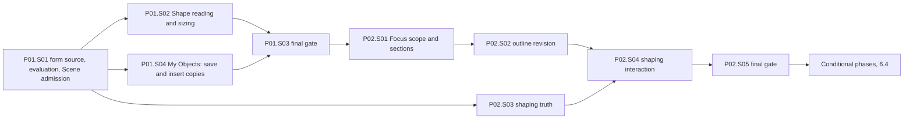

# T5 umbrella plan — native forms and Object Focus

**Status:** T5's planning direction, adopted when the owner merges the T5 planning PR
([record](../../reference/decisions/t5-object-focus-planning-2026-10-27.md)). It supersedes the
withdrawn [E0 execution plan](./e0-execution-plan.md). It is roadmap authority, not a reference
contract: the [North Star](../../reference/north-star.md#creative-freedom-and-depth), the
[architecture obligations](../../reference/architecture.md#expressive-creation-and-revision-destination),
the Scene, persistence and assets contracts, F and PLATE keep their authority, and landed contracts
keep describing current behavior. Only [T5.P01](./t5.p01-drawn-native-objects/README.md) is
registered. Later phases are planned here and registered when their predecessor's evidence supports
them. Nothing here is released.

## 1. Recommendation

T5 delivers **native forms**: Scene objects whose shape is authored source — a drawn outline given
depth, then refined through an ordered set of object-space operations. Creators make them by
drawing in World and refine them in **Object Focus**, a scope on the same Stage. A small
runtime-safe kernel evaluates every form deterministically for the Stage, Preview and, later,
delivery. Creators save a form to **My Objects** and insert editable copies of it into their other
projects. Creators never manage mesh topology, construction order or a feature tree. The source
keeps what their edits mean, so revision, Undo, Save and reopen stay dependable.

| # | Commitment | Consequence |
| --- | --- | --- |
| A1 | Object Focus is a **scope on the one Stage**, not a workspace application | Same selection, Card, dock, history, Save and Camera; a state pill and Put back; no route, canvas, document or second host |
| A2 | A native form is **Scene truth**: T5 builds the capability, Scene keeps the meaning | A new entity kind in the Scene unit, written by T5 under T2 review; no T5 document, writer or history |
| A3 | Edits bind to **authored controls and object space**, never to generated topology | Earlier controls can be revised and later work re-evaluates deterministically; admitted operations need no topological naming; lost support refuses or reports repair |
| A4 | **One form pipeline with admitted representation routes**, not a universal kernel | P01–P02 use analytic generators, explicit meshes and closed-form spatial maps in TypeScript; solids, implicit masses and B-rep enter only for a named capability with its own route and evidence |
| A5 | Canonical evaluation is **deterministic by construction** and validated at acceptance | Exactly rounded IEEE arithmetic in a fixed order gives bit-identical geometry in every engine; changed canonical output moves the format version |
| A6 | **Integrate in place, prove at gates** | Accepted slices merge into the product behind Scene admission; creator entry points appear at named slices; each phase ends at an exhaustive final gate; no parallel studio or prototype to port |
| A7 | **Native objects are reusable across projects** ([owner amendment](../../reference/decisions/t5-object-focus-planning-2026-10-27.md#owner-amendment-reusable-native-objects)) | Save to My Objects keeps the authored source as a library-scope typed resource; inserting creates an editable copy with a new identity, refined independently; shared instances and updates wait |

**Rejected now:** a separate studio route or shell; polygon modeling (vertex, edge and face
editing, retopology, UV unwrapping) as the creator model; a universal implicit or B-rep substrate;
a node graph, feature tree or modifier stack as a prerequisite; topology-addressed features such as
"fillet this edge"; sculpt brushes as the foundation; whole-scene solving; inference or generation
as a dependency of direct editing. Each rejection names a cost the plan avoids; none forbids a
technique that later earns admission (§6.4).

## 2. The studio hypothesis, challenged

The working direction — a dedicated Object Focus workspace for creating, shaping and refining 3D
objects — is right about **depth** and wrong, as architecture, about **place**.

- A separate workspace with its own route, canvas or shell would fork the one Stage, selection and
  history that [PLATE's invariants](../../reference/design-system/editor-shell-and-visual-system.md#authority-and-invariants)
  and the architecture require ("Focus is an editing scope, not another Scene, persisted domain or
  renderer"). It would also be built twice: once as a studio, then again when integrated.
- Creation belongs where the object will live. Drawing on the floor, an upright sheet or a wall face
  in context is the drawing-first principle and PLATE's ratified Ink **Shape** reading
  ([World authoring](../../reference/design-system/editor-shell-and-visual-system.md#084-world-paper-authoring-destination)).
  Focus deepens an existing object; it is not the only place an object can begin.
- Object-first creators need no studio either: World without architecture is an empty floor, and a
  project need not contain Rooms.

What survives from the studio idea fits the scope: the object framed and isolated through a Camera
viewing intent, surrounding work receding as read-only context, a neutral backdrop as a viewing
setting, object-relative sections on paper, a bounded tool set, and a return that restores the
prior view. The visible verb is decided in P02's design loop; the
[Shape focus specification](../../../prototypes/native-object-shaping/UX-SPEC.md) recommends
**Shape**. Whether sections take the Stage (PLATE's default for Edit shape) or sit beside the 3D
view (the specification's split; PLATE's [retained inset alternative](../../reference/design-system/editor-shell-and-visual-system.md#retained-alternatives-round-2))
is a named P02 decision.

## 3. Capability ceiling

The ceiling is a continuum from a quick drawn outline to a distinctive, precise and revisable object
of the kinds spatial experiences need — plinths, display fixtures, furniture, lamps, signage,
canopies, sculptural pieces — composed into World with the rest of the project.

| Capability | Creative barrier removed | Route | Where |
| --- | --- | --- | --- |
| Draw a body from an outline (Line, Box, Round, Sketch) on the floor, an upright sheet or a Wall face, with a visible depth | Native objects are four primitives or imports | R1 | P01 (Wall faces once T1's face-frame query exists) |
| Place, turn and size per axis; Undo, Save, reopen, Preview | — composition of native forms in World | R1 | P01 |
| Revise the outline; inspect true sections; reshape a contour stretch with visible reach; keep a part; exact section dimensions | Refinement needs an external tool or a redraw | R1 | P02 |
| Cut and add bodies: holes, slots, recesses, joined parts | Topology fixed by the first outline | R2 | Conditional |
| Revolve a profile, sweep a section along a drawn spine, inflate an outline; bend, twist, taper | Turned, tubular and organic forms | R1 | Conditional |
| Save a form to My Objects; insert editable copies into other projects | Objects must be redrawn in every project | R1 with T2's resource system | P01 |
| Anchors on a form; attached objects follow shaping; shared forms and library instances with offered updates | Composition does not survive refinement; repeated objects are edited one by one | R1 with T2 | Conditional |
| Smooth blending and carving of masses | Soft joins and carved masses | R3 | Conditional |
| Reshape imported geometry with the same reach-bounded operations, with declared lost guarantees | Imported content is take-it-or-leave-it | R1 | Conditional |
| Prepared native-form derivatives for publication | — | with T4 | T4 |

Engineering CAD, simulation, character production and general DCC parity remain outside the
product, as the North Star states. A conditional capability names its barrier, beats a simpler
alternative (materials, imports, existing controls) and meets §7's criteria, under the North Star's
evidence-led admission.

## 4. Responsibilities and boundaries

| Concern | Owner | T5's role |
| --- | --- | --- |
| Native-form semantics: Scene unit entity, codec, planners and validation | Scene (T2 authority) | T5 writes the native-form parts under T2 review; T2 keeps Scene meaning, other entity kinds and definitions/instances |
| Typed resources, project and library scopes | T2 | T5 lands the library scope for the `form` kind (My Objects) under T2 review, decision D8 |
| Reusable geometric numerics, `@portfolio/geometry-core` | T5 | Owns it; it carries no domain meaning, renderer or DOM |
| Stage host, selection, Ink, readings and the Focus scope capability | T1 | T5 lands bounded seams as T1-reviewed patches, or consumes T1-provided ones |
| F4 acceptance, history, Save and Head | F4 owners / T3 | T5 consumes them; any F4 change is a T3-reviewed amendment |
| Camera framing and navigation | Camera / T3 | Focus framing is a viewing intent through the one Camera authority |
| Architecture: Walls, Openings, Rooms, roofs | Layout (T1) | Unchanged; a form never becomes architecture; Layout may later adopt geometry-core inside its own compiler |
| Shell composition and visual language | PLATE | Focus obeys it; new chrome needs a named retained-alternative decision or an owner shell ruling |
| Visitor delivery and publication | T4 | Forms evaluate through a runtime-safe kernel; publication derivatives are T4's |

**World.** Forms are created, placed, sized and composed with architecture in World. Object Focus
is entered from a selected form and returns to World. The World | Experience framing is unchanged.

**T2.** Native forms are Scene object content. P01 stores each form's source inline on its entity;
shared forms wait for T2's definition/instance cutover, which a later T5 phase consumes rather than
invents. My Objects is the first bounded consumer of the typed resource system's ratified library
scope: a library item is an owner-scoped, immutable, content-addressed revision of a form's source,
following T2's identity and persistence rules, and inserting it creates a detached copy with a new
authored identity. T5 does not edit model or import code paths. It serializes Scene-unit, resource
and API edits with T2's writers under the
[shared-file protocol](../cross-track-execution.md#shared-files-and-merge-protocol).

**F4.** Every form edit is a typed, serializable Scene intent planned by a pure planner from
captured inputs and accepted through unit F4: one history entry per accepted edit, conditional Save,
Undo by restoration. P01 and P02 evaluate synchronously within the per-edit budget and need no F4
change. Route R2 may need asynchronous preparation; that is proposed to T3 as an additive F4 scope
only when its phase is planned.

**Stage.** Forms render through the shared Scene renderer and are picked through the Stage adapter
contract. P01 slice S02 needs Ink to accept readings from more than one domain (today Ink is the
Layout adapter's task). P02 needs a scoped-editing host capability, object-relative readings and
surface hits on evaluated forms beyond the planar AM-5 seam. Each is a T1-reviewed seam declared as a
host capability that an adapter requires or refuses.

**PLATE.** Creation is the Ink **Shape** reading. Size uses rays and points with the Card as the
one writer. Focus is a temporary reading with a state pill and Put back. Refusals follow PLATE's
grammar; keyboard and numeric equivalents are first-class.

**Camera and Experience.** Geometry never writes Camera pose or editorial order. Experience may
later reference form anchors through F.1, when that phase exists.

## 5. Architecture

### 5.1 Form source

```text
form                     a Scene entity kind
├── generator            one body from authored controls     P01: extrude(plane, keyed outline, extent)
├── operations[]         ordered, object-space, typed         P02: reshape, keep, release; later cut, add …
├── scale                per axis, about the base origin      applied after operations
└── nextKey              monotonic allocator for control keys
```

The source holds controls, not geometry. The generator owns keyed controls, such as outline anchors.
Each operation records the frozen result of its preparation — for a reshape, its section frame,
reach and compact displacement field — so evaluation replays the stack without solving, inferring
or reading caches. Order is meaningful and kept; there is no graph, no fixed strata, and no
operation the creator must choose by name. New capabilities add generator or operation kinds:
additive codec growth with a format bump under the
[pre-baseline rule](../../reference/north-star.md#development-stage-schema-compatibility-pre-baseline).

Per-axis scale is form source, not an entity transform. Resizing never rewrites drawn controls, so
repeated resizes cannot drift them, and it scales refinements proportionally, as the Shape focus
specification requires. Forms carry no entity-level scale, so size has one writer.

### 5.2 Binding and identity

- **Controls have keys with lifetimes.** Outline anchors carry keys allocated from `nextKey`. A
  removed key is never reallocated in the accepted lineage, and Undo restores exact keys. Generated
  faces, vertices and triangle indices are never addresses.
- **Operations bind to object space.** A reshape is an object-relative plane, a reach and a
  displacement field; a keep is a material region captured at declaration. Revising an earlier
  control re-evaluates later operations where they are in the object, and the result is validated.
  A candidate that would fold, collapse or change a kept part refuses with its reason. The declared
  promise is: **shaping stays where it is in the object**.
- **Anchors, when admitted,** bind to generator surface coordinates (edge key, parameter, height
  fraction) and travel through operations: exactly through spatial maps, and through cuts only
  while they remain on surviving surface, otherwise unresolved with a typed repair. Proximity or an
  unchanged label never proves continuity.

### 5.3 Evaluation

```text
source → generator body → operations in order → scale → validation → form result
form result = closed oriented mesh · regions (caps, sides by edge key) · bounds · footprint · contact
```

One evaluator serves preview and acceptance, Stage, Preview and future delivery. Results are cached
by source identity and evaluator version. Nothing derived — meshes, sections, BVHs, normals, UVs —
is serialized. A material change does not re-evaluate shape, and rigid placement does not
re-evaluate the form.

### 5.4 Computation strategy: admitted routes

| Route | Representation and method | Admission | Libraries |
| --- | --- | --- | --- |
| **R1** | Analytic generators, explicit triangle meshes and closed-form spatial maps with deviation-driven refinement; exact predicates for decisions | P01–P02; synchronous TypeScript in `@portfolio/geometry-core`; runtime-safe | `robust-predicates` and `earcut` (both already in the tree, Unlicense and ISC); an editor-side BVH for picks and self-intersection (`three-mesh-bvh`, MIT) when P02 needs it |
| **R2** | Closed-solid combination (cut, add) with provenance mapped back to regions | Conditional phase; worker; lazy chunk; F4 asynchronous review | Manifold (Apache-2.0) first candidate, release and closure pinned |
| **R3** | Local implicit composition (smooth union and subtraction) contoured into R1 meshes | Conditional on R2 evidence and a named barrier | A small in-house field evaluator, Manifold's level-set contouring, or an MPL candidate (Fidget, libfive) after the [weak-copyleft review](../../reference/decisions/t5-object-focus-planning-2026-10-27.md#owner-amendment-t5-dependency-licensing) |
| **R4** | A B-rep island for exact trims, fillets, offsets and exchange | A named precision consumer only | OCCT (LGPL-2.1 with exception) as the leading candidate and Truck (Apache-2.0) as the permissive comparison, judged as below; nothing selected |

A route is admitted with its accuracy policy, cost envelope and conversion statement. Each form keeps
one authored source; conversions between routes are explicit, one-directional and never silent.

**Library licensing.** Under the [T5 licensing amendment](../../reference/decisions/t5-object-focus-planning-2026-10-27.md#owner-amendment-t5-dependency-licensing), permissive libraries are admitted
as before and weak-copyleft libraries (LGPL, MPL) are eligible after a documented compatibility,
distribution and compliance review in the admitting slice plan. Licence category alone neither
admits nor excludes a candidate.

**Evaluating an R4 kernel (OCCT or an alternative).** When a named precision capability needs a
B-rep route, its plan compares candidates on:

| Criterion | Evidence required |
| --- | --- |
| Capability | The named operations (for example trims, fillets, offsets, shelling, STEP exchange and healing) on a corpus from that capability, with failure modes and how they surface as refusals |
| Browser performance | On the designated reference machine: download size (brotli), compile and instantiate time, peak memory, and worker latency for the named operations; lazy loading outside the Stage first-load and visitor load sets unless a declared capability needs it |
| Integration cost | Worker and asynchronous F4 preparation, conversion to R1 meshes with provenance to regions, determinism of a pinned WASM build (a build change is a format-version event), build and upgrade burden |
| Compliance | The weak-copyleft review: a separately loaded, replaceable module, notices, the exact source and build instructions, and compatibility with every plausible product licence |

No kernel is installed or selected before such a plan is approved.
Layout keeps its landed geometry; adopting geometry-core inside the canonical compiler would be a
deliberate T1 decision.

### 5.5 Determinism, tolerances and validity

- Canonical evaluation uses only exactly rounded IEEE-754 operations — `+ − × ÷`, `Math.sqrt`,
  comparisons, `Math.abs/min/max/floor/ceil/round/sign` — in a fixed order. `Math.sin/cos/tan`,
  `exp/log/pow`, `hypot`, `atan2` and `cbrt` are excluded from canonical paths; angles needed later
  (revolve) use a fixed in-house polynomial. JavaScript performs no fused multiply-add, so a source
  gives bit-identical canonical geometry in every engine. A source-scan test enforces the rule.
- Units are metres. Minimum feature 1 mm; coordinates within ±50 m; dimensions up to 100 m; bounded
  control counts. Constants live in geometry-core and are restated by each admitted capability.
- Exact predicates decide outline validity at load and at acceptance. Tolerance-based mesh validity
  (fold, self-intersection) is decided at acceptance; reopening re-evaluates and reports, and never
  silently refuses or rewrites accepted source.
- Changed canonical output for an accepted source is a semantic change: it moves the Scene format
  version and regenerates the goldens. It is never a silent reinterpretation.

### 5.6 Acceptance and sessions

A stroke, a candidate reshape, a slice position and Focus itself are session state. Create or Apply
turns the frozen candidate into one intent; the planner re-evaluates and validates it against the
expected revision, and F4 installs one result. Cancellation, refusal, stale results and no-ops add
no history. A preview never becomes a different accepted body.

### 5.7 Performance envelope

Forms are measured with the [performance contract](../../reference/components/performance.md#budgets)
and its on-demand workflow, on the designated reference machine with Laptop A reported:

- form evaluation for one pointer move within the per-edit evaluation row (≤ 4 ms S, ≤ 8 ms M),
  applied to the edited form;
- drag preview p95 ≤ 33 ms (S) and ≤ 50 ms (M); commit and Undo/Redo completion ≤ 100 ms; no
  main-thread task over 50 ms in ordinary interaction;
- Stage first-load JS growth ≤ 25 KiB br per slice, without worsening the recorded 456 KiB known
  miss unless the owner records it; R2 and R3 modules lazy, and outside the visitor load set unless a
  declared visitor capability requires them;
- P01 workloads: S = 10 forms of up to 32 anchors, M = 60 forms of up to 128 anchors in the M
  fixture, plus a 256-anchor worst-case outline. P02 adds shaped forms (up to 32 operations and
  100k triangles) and sessions longer than the 100-entry history.

## 6. Phase roadmap

### 6.1 Sequence



P02 is registered when P01's first slice is accepted, so its headless shaping slice can run beside
P01's creation slice. Its interaction slices wait for the P01 gate, because Focus builds on the
accepted creation journey.

### 6.2 T5.P01 — Drawn native objects (registered)

**Outcome.** A creator draws a closed outline with Ink in World, reads it as a Shape, pulls its depth
and creates a native object. They place, turn and size it, see it identically in Plan, 3D and
Preview, and keep it exactly through Undo, Redo, Save and cold reopen. They save it to My Objects,
insert an editable copy in another project and refine it independently.

| Slice | Delivers | Exposes to creators | Depends on |
| --- | --- | --- | --- |
| S01 | Native form source, evaluation and Scene admission: geometry-core, Scene unit 4 `form`, codec, `create-form` and `set-form-size` planners, existing Scene operations on forms, shared renderer, Plan footprint, selection | Nothing new (opened documents and tests) | `T2.P02.S03` merged or a T2 Scene-unit handoff |
| S02 | One Ink with readings from several domains; the Shape reading on the floor and an upright sheet (and a Wall face, if T1's face-frame query has landed); depth ray and Create; per-axis size rays and Card writers | Creation and sizing | S01; a T1-reviewed Ink reading seam |
| S04 | My Objects: the `form` library payload and owner-scoped library storage; Save to My Objects; insert an editable copy (`place-form-copy`); remove | Cross-project reuse | S01; T2 agreement on the library scope (D8); may run beside S02 |
| S03 | Integrated final gate (keeps its id; S04 was added by owner amendment) | — | S01, S02, S04 |

**Phase acceptance.** §7 at P01 scope: closed oriented meshes for the whole outline corpus;
refusals in words with no partial source; bit-identical evaluation in V8 and a second engine;
Undo/Save/reopen identity; the cross-project reuse journey with Save and cold reopen of both
projects; S and M budgets on the reference machine; visitor isolation; and an owner walkthrough
creating three different objects from an empty project, one reused in a second project.

### 6.3 T5.P02 — Object Focus: refine and shape (planned)

**Outcome.** From a selected form the creator enters Object Focus, inspects true sections in Front,
Side and Top, revises the outline, reshapes a contour stretch with visible reach, keeps a part, types
exact section dimensions, Applies or Discards each change as one undo step, and returns to World.
Successive edits in different orientations compose; resizing scales refinements; an outline edit
after shaping re-evaluates spatially or refuses; everything survives Save and reopen. A shaped form
saves to My Objects with its operations and inserts as an editable copy.

**My Objects across P02's format change.** P02's change to the form encoding moves the library
payload format. Until beta there is no versioning ([ruling](../../reference/decisions/t5-object-focus-planning-2026-10-27.md#owner-amendment-reusable-native-objects)):
items saved earlier stay listed as unusable with Remove available, and P02's acceptance checks that
they refuse insertion cleanly. Migrations start at beta.

| Slice | Delivers | Notes |
| --- | --- | --- |
| S01 | Focus scope and section reading: a scoped-editing host capability (enter and return, context recession, pick filtering, framing intent, state pill), object-relative sections from a runtime-safe section query, slice position, Card facts | T1-reviewed seam; inspection only |
| S02 | Outline revision in Focus: move, insert and remove anchors, straighten, smooth corners, exact entry; key lifetimes | First Focus writer |
| S03 | Shaping truth, headless: `reshape`, `keep` and `release` operations, frozen displacement fields, deviation-driven refinement, fold, collapse and self-intersection validation, section target fit, corpus and budgets | Can run beside P01 S02 once registered |
| S04 | Shaping interaction: stretch selection, oversketch, Straighten/Arc/Smooth, reach, Keep part, the pending candidate bar, refusals, the pending-exit choice, resize after shaping | The [Shape focus specification](../../../prototypes/native-object-shaping/UX-SPEC.md) is the starting design, through the feature design loop |
| S05 | Integrated final gate | — |

**Settled inside P02, not before:** section presentation (takeover or split), the visible verb,
whether a Throughout reshape on the generator's own plane is stored as an outline edit, the
displacement-field representation and reach profile, and the self-intersection strategy. The
[Shape focus geometric contract](../../../prototypes/native-object-shaping/UX-SPEC.md#11-geometric-contract-for-implementation)
is the starting obligation set.

### 6.4 Conditional phases

None is registered or promised; each starts from an owner decision citing its entry evidence.

| Candidate | Entry evidence | Outcome | Principal risk |
| --- | --- | --- | --- |
| Composite forms (R2) | P01 and P02 walkthroughs record holes, slots or joined parts as blocked intentions | Cut and add bodies; provenance to regions; upstream revision through combination | WASM size, asynchronous F4, provenance stability, delivery derivatives |
| Generators and deformers (R1) | Turned, tubular or organic intentions blocked with P02's tools | Revolve, sweep along a drawn spine, inflate; bend, twist and taper as operations | Frame stability along spines; refinement cost |
| Related and reused forms (with T2) | T2's definition/instance and attachment cutovers accepted; repeated or attached objects in real work | Anchors; attached objects follow shaping; shared forms with local or shared edits; My Objects items used as shared library instances with offered updates | Cross-domain F4 and F.1 lifetime amendments |
| Smooth masses (R3) | Composite forms accepted and soft joins still blocked | Smooth union and subtraction contoured into meshes | Weak-copyleft compliance if an MPL kernel is chosen, contouring fidelity, cost |
| Imported-geometry shaping (R1) | Creators adapt imports rather than redraw them | P02's operations over imported meshes, with declared lost guarantees | Import mesh quality; T2 resource lifecycle |

Publication of native forms follows T4's prepared-delivery plan; Preview uses the runtime-safe
evaluator meanwhile.

## 7. Integration strategy

### 7.1 Model

There is no studio to port. T5 code lands in production packages and the one Stage from its first
slice, behind Scene admission, at three levels:

1. **Code integration.** A slice merges only after its own acceptance and the complete merge gate,
   so `main` never carries an unaccepted capability.
2. **Creator exposure.** Entry points appear at named slices: P01 S02 (creation and sizing), P01 S04
   (My Objects), P02 S01
   (Focus inspection), P02 S02 and S04 (Focus writers). Before them, forms are reachable only through
   opened documents and tests.
3. **Phase proof.** Each phase's exhaustive final gate proves the integrated capability on the
   integrated tree before the phase can become closable.

### 7.2 What must be proven

| Family | Required before a capability is integrated | Proven at |
| --- | --- | --- |
| Functional geometry | Every accepted form evaluates to a closed, consistently outward-oriented 2-manifold with positive volume. A corpus of valid and invalid sources — concave, near-degenerate, collinear runs, minimum features, limits — passes or refuses with typed reasons. Footprint, contact and bounds agree with the mesh; Plan, 3D and Preview draw the same result | Each slice; the corpus grows with each capability |
| Dependable revision | One accepted edit is one history entry; preview equals commit; Undo and Redo restore exact source and keys; refused, cancelled, stale or no-op edits add no history; Save and cold reopen reproduce identical evaluation; a session longer than the 100-entry history keeps every control editable; a My Objects copy is identical to its saved source, and edits to the copy, the original or the saved item never reach each other, across projects and through Save and reopen | Each writer slice; phase-gate journeys |
| Performance | §5.7's rows on the designated machine with the peak-first method; no regression of existing hard rows; bundle growth recorded | Slice evidence; phase-gate recheck |
| Source compatibility | Strict codec with format bump and regenerated fixtures; golden evaluation digests pinned per format version; bit-identical canonical evaluation in V8 and at least one other engine; no derived data persisted; a semantic change requires a format bump; the My Objects payload format moves with the Scene form encoding, and until beta older items are refused and listed as unusable, never migrated or misread | Each format-changing slice; phase gate |
| Ownership | T2 review of Scene unit, codec, planner, library-scope and API changes; owner-only access to My Objects; T1 review of Stage seams; T3 review of any F4, Head or Save change; the unconditional architecture lane (visitor isolation, package direction, F4 public isolation); geometry-core free of domain meaning, renderer and DOM | Each slice |
| User experience | PLATE conformance (one writer per fact, state pill and Put back, refusal grammar, keyboard and numeric paths, narrow and short shells, reduced motion); the feature design loop in a real browser; owner walkthroughs — three different objects from an empty project (P01), then one object refined to an intended form and deliberately revised in a later session (P02) — with blocked intentions recorded | Exposure slices; phase gate |

### 7.3 What blocks integration

Lost accepted work; an invalid accepted body; a preview that differs from the accepted result;
silent retargeting or repair; changed canonical output without a version change; a hard budget miss
without an owner disposition; editor machinery in visitor chunks; a second selection, history,
Camera or writer. Any of these stops the slice. It is fixed inside the slice or escalated, never
waived by the slice itself.

## 8. Owner decisions

The [decision record](../../reference/decisions/t5-object-focus-planning-2026-10-27.md#owner-decisions)
lists the decisions this plan needs, the defaults that apply on merge and the release step for the
first slice. It also records the owner's two amendments: T5 dependency licensing and reusable
native objects. Manifold admission, asynchronous F4 preparation, the weak-copyleft review of any
OCCT, Fidget or libfive candidate, and T2 definition/attachment consumption belong to the phase that
needs them.

## 9. Evidence and reuse

| Source | Reused | Not reused |
| --- | --- | --- |
| [Shape focus specification](../../../prototypes/native-object-shaping/UX-SPEC.md) | Creation semantics (outline, positive depth, Flip side), whole-object sizing about the base, current-body shaping with reach, kept parts, transaction and failure rules, the geometric contract | Its split layout as a given; its prototype tolerances as standards |
| [Native Form Lab](../../../prototypes/native-form-lab/FINDINGS.md) | Keyed controls and key lifetimes, preview equal to commit, refusal without mutation, role addressing for later anchors | Operation choice, carrier editing and coordinate lists in the creative path |
| [Expressive form research](../../../broad-research/expressive-3d-form-sculpting-hybrid-modeling-2026-10-27.md) | Intent above generated geometry, representation islands, deformation as an operator family, asynchronous browser architecture | A semantic graph as the first source model; an implicit-first substrate |
| [G0 reconciled proposal](./g0-reconciled-proposal/README.md) and [kernel assessment](./g0-architecture-proposal/kernel-evidence.md) | Source/derivative separation, object-space binding, determinism obligations, library dispositions | Guide and band composition as the first investment; the R1–R5 milestones |
| E0 ([withdrawn plan](./e0-execution-plan.md), PR #206) | Relocating controls is not a creative advantage | Its fixture, prototype and relationship machinery |
| [S06 acceptance](../t1-spatial-world/t1.p02-native-wall-creation/t1.p02.s06-performance-foundation/acceptance.md) | Measurement method and baseline | Any claim that new geometry meets budgets |
| Landed code | Scene planners' captured-input pattern and record scope, F4 unit acceptance and history, the shared Scene renderer, Plan footprint and hit paths, the robust orientation adapter, `WorkingPlane` for upright sheets | Layout's curve algebra and compiler, which stay Layout's |
