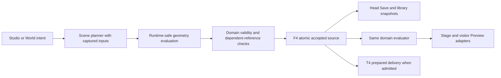

# T5 Expressive Geometry — implementation umbrella

**PR #266 · planning only · reviewed against main `cda02e61` (2026-11-07).**
This is the single proposed T5 direction. It replaces the earlier native-form/Object Focus plan
and the research proposal's C1–C6 experimental promotion sequence. The
[Studio journeys](./object-studio-design.md) specify its UX. The
[evidence note](../../../broad-research/native-modeling-freedom/PROPOSAL.md) retains the alternatives;
research and prototype designs are supporting evidence, not competing implementation instructions.
Nothing here records an owner approval, changes a codec, admits a dependency or activates production.

## Direction and ceiling

Make Object Studio a deliberate, first-class place to create and refine an object **inside the
existing editor**. Standalone and World-origin entries use the same Stage, tools, selected subject,
Camera, acceptance, history and Save. A route is an entry address, not a new semantic document or
renderer. Quick World shapes remain useful without entering Studio.

Grow depth in this order: a dependable Studio journey; revision of existing profile controls;
separately addressable parts and reusable assemblies; bounded shape operations; then additional
modeling families where evidence justifies them. Each shipped writer produces savable canonical
source. There is no fixture-only modeling mode in the product, second Undo stack, or later bulk
promotion from an experimental document.

The intended ceiling includes distinctive furniture, casework, lamps, signage, display equipment,
sculptural objects and assemblies as complex as a piano. A lid and its casing must remain separate
parts if a future interaction will move the lid. A single fused mesh cannot supply that meaning.
Conversely, an object made from five bodies does not require a boolean kernel. Architectural roofs,
walls and openings remain Layout elements even when they use similar geometric operations.

This is a growth path, not a promise to model every example with the first tools. No general CAD
constraint solver, arbitrary B-rep editing, mesh-element editor, rigging system, node graph or
animation timeline is required upfront. None of the choices below forecloses a later, explicitly
admitted representation for a demonstrated creative need.

## Baseline on current main

| Evidence | Consequence for this plan |
| --- | --- |
| [F2 and persistence](../../reference/components/persistence.md#one-source-format-f2-clean-epoch): envelope 1, Layout 6, Scene 5, Camera 1, Experience 4, resources 2 | Scene 4 is historical. Scene 5 is already shipped; a later shaping cutover cannot be called “promotion to Scene 5.” Recheck versions before each format PR. |
| [Scene form source](../../../packages/project-model/src/scene.ts), [planners](../../../packages/project-model/src/scene-planning/planners.ts) | One extruded keyed outline, positive extent, `form.scale` and `nextKey`. Create, size, name, ordinary transforms, duplicate, delete and detached library insertion exist. Outline revision, holes, operation lists and assemblies do not. |
| [geometry-core](../../../packages/geometry-core/src/index.ts) and [extrusion](../../../packages/geometry-core/src/extrude.ts) | Runtime-safe TS profile/extrusion evaluator, evaluator version 1, with `earcut` and `robust-predicates`. It is not a general solid kernel. Current footprint and render layout assume one extruded ring. |
| [Form library](../../../packages/project-model/src/library/form-library.ts) | Payload 1 is immutable, content addressed, owner scoped, single-form source. It is not mutable draft storage or a shared-instance update mechanism. |
| [Boot](../../../apps/editor/src/lib/authoring/stage/boot-state.ts), [support](../../../packages/project-model/src/scene-planning/support.ts) | Empty-Layout projects and datum support already exist. `create` and `open` are different intents; a missing project must never turn into a new draft. |
| [F.1](../../reference/composition-execution.md#f1-identity-and-reference) and [Scene destination](../../reference/components/scene-content.md#ratified-destination-not-shipped) | Whole Scene entities resolve; non-null components currently refuse. Clusters and Three children are not assemblies. Definitions, components and their providers need a real first consumer. |
| [Host acceptance](../../../apps/editor/src/lib/authoring/stage/host-acceptance.ts), [Camera session](../../../apps/editor/src/lib/authoring/stage/camera-session.ts) | Reuse unit F4 and the one Camera-output protocol. Source changes invalidate old inspection tickets; return after editing needs a revalidated Camera intent, not replay of a stale ticket. |
| [Acceptance coordinator](../../../apps/editor/src/lib/authoring/f4/acceptance-coordinator.ts), [unit preparation](../../../packages/project-model/src/units/acceptance.ts) | Planner preparation currently returns a synchronous `PrepareResult`. The async host install does not make expensive worker-backed preparation an implemented capability. |
| [Renderer](../../../apps/editor/src/lib/museum/entities/form-geometry.ts), [Scene contract](../../reference/components/scene-content.md#current-implementation) | Stage and visitor Preview render native forms. Public release still refuses them. The renderer infers cap/side layout from extrusion buffers; arbitrary meshes cannot simply be passed through it. |
| [Workflow](../../workflow.md), [test contract](../../../apps/editor/tests/README.md) | Capability PRs and risk tiers replace phase authorization. No hold is inferred from old research. Documentation/architecture gates apply here; implementation PRs retain the full repository merge contract. |

The live status read matched main `cda02e61` with a complete report and no failing gate checks;
the Studio rows had no tagged checks or claims. This is baseline evidence, not a stored maturity
declaration. Issue [#272](https://github.com/Biskiq/spatial-sketch-editor/issues/272) remains relevant
to metadata scope enforcement. Every new planner must prove unchanged envelope metadata as well as
unchanged foreign units; it must not depend on that gap. Issues
[#274](https://github.com/Biskiq/spatial-sketch-editor/issues/274) (focus restoration) and
[#273](https://github.com/Biskiq/spatial-sketch-editor/issues/273) (stale browser locators) inform the
actual return/keyboard tests, not a new project-wide prerequisite bundle.

## Architectural decisions

### Ownership and sharing

| Concern | Owning authority and implementation seam |
| --- | --- |
| Object composition, form meaning, shape-operation source, component capabilities | **Scene / T2.** Runtime-safe codecs, planners and validation in `@portfolio/project-model`; T5 supplies the modeling capability. No T5 unit or Studio document. |
| Pure profile, solid, deformation and validation algorithms | **T5 / geometry-core.** Plain numeric input/output, no Scene IDs, resources, renderer, DOM, selection or history. Add a separate package/subpath only when a real dependency boundary requires it. |
| Library identities, immutable revisions, closure and access | **Typed resources / T2**, with shared project-model and API readers. Scene defines the meaning of an object-definition payload. Do not duplicate the resource service for Studio. |
| Architectural elements, host surfaces, support and compiled geometry | **Layout / T1.** One compiler and owner-qualified frame queries. A Scene form cannot be used as a hidden architectural wall or opening. |
| Stage host, picking, gesture lease, readings and shell composition | **Shared editor / T1 and approved shell.** Domain adapters own legal edits; Studio scopes exposure and context, not domain validity. |
| Framing, inspection, projection, spatial return | **Camera.** Camera-owned viewing intents through the existing session/facade. Never a Studio orbit controller or pose tween. |
| Atomic installation, revisions, history, Save | **F4 and persistence.** Reuse the shared coordinator; cross-unit operations register their actual scope. Async geometry does not create an alternate acceptance path. |
| Future interactions, timed use and visitor composition | **Experience and shared F.3 execution.** Scene exposes intrinsic capabilities; Experience binds/invokes them. Studio does not introduce a private animation loop. |
| Visitor Preview and public prepared derivatives | **Runtime domain evaluators / T4 delivery.** Share geometry semantics; exclude authoring infrastructure. Public admission is separate from authoring a form. |

T1/T2/T5 are areas, not review silos or permission gates. One capability PR may change all necessary
seams. Share numeric algorithms and common identity/acceptance interfaces; keep Scene operations,
Layout compiler meaning, Camera evaluation and UI gestures domain specific. Similar-looking
“extrude” gestures do not justify a universal domain command or a second architectural compiler.

### One editable source per body

Retain the landed profile/extrusion source for existing forms. Add bounded source constructs only
with their first consumer. The selected extension direction is **authored generator plus typed,
ordered shape operations**, evaluated from source; a general mutable planar B-rep is not selected
as the foundation. Direct interaction is compatible with this representation: pulling a known
extrusion cap can change extent, while a recess can own an explicit cutter. Interaction need not
expose construction order to the creator.

The first operation-bearing form has these semantic fields (future codec work, not a current type):

```text
generator      supported analytic source, including its keyed controls
operations[]   stable operation ID + discriminated kind + complete authored parameters
scale          existing positive per-axis whole-form size, applied last
```

An operation list describes current editable meaning, **not chronological Undo events**. Revising
an operation replaces its parameters under the same identity; removing it is an explicit edit.
Reopening needs neither session history nor an old mesh. There is no reorder UI, arbitrary expression
language, cyclic dependency graph or generic plugin registry. Operands are owned local source,
not a hidden live reference to another Scene entity. Public relationships require F.1 semantics.

Existing `form.scale` remains the single whole-body size writer. Shape operations use the unscaled
object frame; controls displayed in physical metres convert through that scale. Rigid entity
placement follows evaluation and does not change body source. Proportional Size explicitly scales
all refinements. Stretch is a distinct operation with a narrower preservation promise.

An upstream revision re-evaluates the whole affected body. It either preserves the admitted operation
meaning and validity or refuses the candidate, naming the operation and repair action. Do not silently
drop, reorder, retarget, flatten or bake downstream work. Unsupported advanced controls stay absent;
the persistent source remains editable beyond the 100-entry session history.

### Assemblies, reuse and future behavior

Assemblies are the first consumer of Scene definitions/components, not a T5-only parts format.
Choose immutable **project-local typed object-definition resources** with explicit content revisions
and locks; placed Scene object instances reference them. Definition payloads carry a root frame and
stable component IDs, local rigid transforms, and supported leaf content. They are source, not a
Three hierarchy or a second Scene document. The initial admitted leaf is a native form with ordinary
catalogue appearance; nested definitions, external model dependencies and shared edits wait.

Initial assemblies are flat and independently owned: one placed root uses one local definition.
Editing creates a new immutable definition revision and updates that instance's reference/lock in
one registered Scene/resources F4 operation. Reuse creates a new editable identity and remaps internal
references. It does not turn every duplicate into a live shared instance. The storage/interface uses
the existing resource system even though shared updates are deliberately unavailable initially.

The logical definition ID survives an ordinary edit; its content revision changes. The current
envelope retains the revisions its exact locks require, not an ever-growing table of every edit.
Undo snapshots and saved project versions preserve their own earlier source/locks. No new long-term
revision store, garbage collector across projects or cloud Undo service is required by this consumer.

No per-axis assembly transform is added. Root Move/Turn act rigidly; a component's own form size is
its only shape scale. The local origin is an explicit pivot; preserve it when geometry changes.
This keeps a later rotating lid or sliding drawer possible without joints, timelines, constraints
or behavior channels now. A later capability can expose component transform/visibility/material
channels through F.3; execution remains separate from authored shape and never writes generated
vertices back into source.

### Identity, topology and revision

Separate four identities: accepted project revision; immutable source/content revision; authored
subject/control/operation identity; and evaluation generation. Equal content is not the same subject.
A copied object gets new authored identities even when its geometry is byte-identical.

- Keep existing whole-entity IDs and outline keys for edits that preserve them. The first profile
  revision changes existing controls only; it does not add/delete keys. `nextKey` restored by Undo
  is not evidence of non-reuse across Undo branches and reloads.
- New components, hole loops and shape operations receive fresh opaque IDs captured before planning
  through the shared allocation pattern (the current Scene callers use UUIDs). Never allocate from
  current occupancy, array position, a label, time alone or a mesh digest. Reject duplicate supplied
  IDs. An Undo restores the same subject; a new command after Undo supplies new IDs. Any later
  topology-changing profile editor must settle key lifetimes before exposing durable control refs.
- A pick is generation qualified. Generated triangles, vertices and face numbers expire on
  re-evaluation. Resolve a supported hit to a source role such as cap, source edge, cutter operation
  or component; otherwise allow whole-body selection/inspection only.
- Owner correspondence has explicit preserved, split, merged, retired and unresolved outcomes.
  A split may preserve a role set without identifying a unique face. No consumer chooses a fragment
  by nearest position, area, order or a reused `faceID`. Persistent attachments and per-face material
  bindings wait for their own lifetime and repair contract.
- Pure frame capture and following differ. Early tools may capture an object-local plane once.
  They must disclose that it does not follow a later changed support surface. No inferred attachment
  is serialized. Layout surface frames come only from Layout; junction caps are not wall-side hosts.

This bounds the topological naming problem; it does not claim to solve it generally. Whole-body and
component identity are enough for the first capabilities. Arbitrary face identity is not a
prerequisite for useful objects or future part animation.

### Evaluation and geometry validity



For each body, evaluation returns positions/indices, explicit surface provenance, geometric
adjacency or a render-vertex-to-topology map, bounds, contact and an honest projected footprint.
Holes and disconnected projections require rings/regions; a single convex hull or bounding box is
not silently substituted for hit or placement truth. A coarse selection proxy is labelled and is
never a geometric oracle. Normals, UVs, acceleration structures and Three objects are derivatives.

Do not assume the current `FormMesh` buffer ordering is a general interface. The first holes/operation
consumer must extend the evaluator result and update rendering, Plan footprint/hits, support,
contact, picking, caches and Preview together. Define cap/side UV and seam behavior explicitly;
generic result geometry cannot rely on “the first N vertices are the base.” Existing unmodified
forms retain their pinned output unless a reviewed semantic version change says otherwise.

For hole extrusions, caps use their profile-plane coordinates and each loop's sides use its own
arclength/depth in metres; duplicate the closing UV seam while preserving geometric adjacency.
For stretch, carry each subdivided triangle's source-surface parameters through the map; its texture
stretches with that surface, with whole-object Size retaining its declared sizing semantics. The
solid-route research must decide cut-surface UV provenance before admission; whole-body material
selection alone does not answer texture mapping. It must either retain validated operand surface
coordinates or explicitly scope the first solid writer to untextured materials with truthful UI.

Validation is capability specific. For admitted solid results require finite bounded coordinates,
consistent orientation, no open/T-junction/non-manifold geometric edges, no self-intersections,
positive intended volume, and supported component count. Check topology after accounting for
intentional render-vertex duplication at normal/UV seams; index-edge counting alone rejects valid
current extrusions. Never weld by an arbitrary epsilon to make the test pass.

Manifoldness and a nonzero volume do not prove the intended shape. Use independent geometric
oracles for the admitted families: analytic extrusion volume, planar containment, exact predicates,
component/section expectations, and operation-specific bounds/volume relations. A cut can validly
split a body in a general modeler, but the first single-body cut capability refuses that result.
Do not invent a universal validator that claims to catch every erroneous boolean.

### Determinism and precision

Retain the landed evaluator's restrictions and goldens. Canonical source bytes, IDs, ordering,
reference resolution, F4 outcomes and exact Undo restoration remain exact. For any new evaluator,
pin the algorithm, dependency/build version, tessellation policy, ordering/tie-break rules and
tolerances. Runtime rounding into GPU buffers cannot feed back into source or the next edit.

Basic IEEE arithmetic plus a source scan is not sufficient proof for a new TS/WASM pipeline.
The [ECMAScript specification](https://tc39.es/ecma262/multipage/numbers-and-dates.html#sec-math.sqrt)
specifies square-root rounding and distinguishes implementation-approximated transcendental
functions; it does not certify our dependencies, serialization, traversal order or worker results.
Use literal-input golden fixtures on the existing Linux x64 job and the local runner; new canonical
operations additionally require matching results in a second browser engine. Do not weaken a
failing exact oracle to a tolerance. Narrow the operation, fix the deterministic path, or ask for
an explicit contract change. A changed canonical result for accepted source requires a reviewed
version/compatibility decision, not just regenerated goldens.

Keep metre units and the landed limits for existing forms: 3–256 anchors, 1 mm minimum control edge
and scaled dimension, ±50 m control coordinates, extent up to 100 m, positive scale in [0.01, 100].
These are not a universal CAD precision claim. New operations state their own feature separation,
approximation and count bounds; exact predicates classify topology, while quantitative tolerances
bound approximation. Integer polygon kernels need an explicit scale, overflow limit and round-trip
error policy. Float64 source cannot undo a Float32 conversion already made at a library boundary.

### Transactions, async work and persistence

One gesture or explicit Apply captures one typed serializable intent against one accepted revision.
Preview is a candidate from the same planner/evaluator used for acceptance. Cancel, refusal, no-op,
lost pointer capture and stale result install nothing and create no history. Acceptance validates
actual changed units and unchanged project metadata; one compound operation gives one Undo result.

For an asynchronous operator, preparation is identified by project ID, session epoch, expected
revision, target/source content identities, complete parameters, evaluator version and request ID.
Latest preview wins. Source change, Undo, target deletion, project replacement, Studio exit or worker
restart invalidates outstanding work. A completed worker result is never itself a write permission.
Recheck identity and domain validity before F4 installs. Timeout/cancel/failure leaves the last
accepted source intact. Bound the queue to one in-flight job plus one newest request; release
transferred buffers and WASM handles on every terminal path.

The first solid consumer extends the shared preparation contract to accept a `PrepareResult` or
its Promise, awaits it in the existing F4 coordinator, and repeats the expected-revision/session
checks after the await before installation. Preserve synchronous planners; update every affected
preview, acceptance and source-admission caller with typed handling and call-site tests. There is
no separate async history/coordinator or worker-owned write path. Separate strict structural parsing from expensive
geometric validation without bypassing either. Browser worker, headless/API validation and visitor
Preview use the same pinned runtime-safe evaluator. No client-supplied “valid mesh” bypasses server
source validation, and no synchronous WASM fallback is silently installed on the interaction path.

Save always captures accepted canonical source with the existing saved-base precondition. Pending
geometry is not included; applying it while Save is in flight leaves the newer source dirty. Local
expected revision and cloud saved base remain different identities. Reopen evaluates accepted source
and reports incompatibility/failure without rewriting it. Retain original recoverable source bytes;
never silently replace a failed body with a proxy and call it valid.

The first format-changing PR lists every reader: Scene/resources codecs, library canonical writer,
API validation, source download/open, Preview, references, fixtures and any release reader. Bump only
affected unit/payload contracts. Adding Scene environment did not change form payload 1; similarly,
adding an assembly kind need not invalidate unchanged single-form items. Changing common form source
does require compatible library handling. Use the current strict pre-baseline policy unless the
owner chooses a tested recovery/migration exception. No reset, old-data deletion, beta declaration
or blanket “one final format bump” is authorized here.

### Cost and delivery boundaries

Evaluate changed bodies and affected dependents only. Cache by complete source content and evaluator
version, with bounded retention; key instance/world bounds separately by pose. Material, Camera and
rigid placement changes must not remesh a body. Preview buffers are replaceable and do not accumulate
in source history. Operation/count limits are semantic resource bounds, not timing benchmarks.
The new operation pipeline caps every intermediate and final result at 100,000 triangles; check
growth before subdivision/allocation or abort without acceptance. Per-body limits compose with
definition/component limits and input-byte limits. The initial counts below are conservative
admission bounds to be tested, not measured claims of interactive speed or a licence to allocate
all bodies at their worst case on each pointer move.

Lazy-load Studio tools and later optional kernels. Test both import closure and the built chunk
graph: a dynamic import is not proof of isolation, and entry wiring is not literally zero bytes.
Keep authoring controllers out of visitor/public imports. Preview may load a runtime-safe geometry
worker when a supported source needs it; do not place that shared worker under an editor-only import
closure. Public releases remain refused until T4 admits a prepared derivative or runtime route.
Recommend immutable prepared meshes plus source/build/provenance hashes for static publication;
future animated parameters may need a declared runtime evaluator in that delivery profile.

The [performance policy](../../reference/components/performance.md) controls measurements. Do not
reinstate the historical 425 KiB, 4/8 ms or p95 matrix as acceptance gates. Record structural load
boundaries, bounded work and deterministic invalidation tests. Report observed stalls honestly and
use only an owner-initiated investigation or an authorized spot-check trigger for timing work.
Old kernel microbenchmarks do not certify integrated editor or visitor responsiveness.

## Capability sequence

These are product outcomes and implementation PRs, not authorization stages. PRs can subdivide a
capability at the integration seams below; do not label a headless helper as a working creator
journey. Every dependency is semantic, not an area handoff. Keep the remaining sequence here rather
than opening a new umbrella in each PR. A capability's draft holds only its concrete implementation
plan and any newly resolved decisions; remove completed planning text at merge.

| Order / capability | Dependency | Useful completion | Risk and stopping boundary |
| --- | --- | --- | --- |
| **1. `studio.dual-entry`** | Owner decision O1; landed core | Enter from World or directly, create/size, Save/reopen, return and reuse with existing source | Shared shell Tier 1; approval of a changed approved UX is Tier 2. No new modeling source or dependency. |
| **2. `studio.profile-revision`** | 1 | Change existing outline controls and extrusion depth; reopen and continue | No topology/key allocation or new persisted fields. Refuse invalid profiles. |
| **3. `scene.object-definition`** | 1, 2 and O2 | Promote a form to a flat, editable multi-part object with durable components | First Scene/resource/component consumer; incompatible formats are Tier 2. No nested or shared-instance edits. |
| **4. `studio.assembly-reuse`** | 3 | Save an assembly snapshot and insert/open independent editable copies | Typed resource/library/API closure; no mutable library drafts or offered shared updates. |
| **5. `studio.profile-holes`** | 2 and O2 | Make and revise a pierced panel/frame from one extruded profile with holes | First profile topology extension; all renderer/footprint consumers updated together. |
| **6. `studio.stretch`** | 5's generalized result seam and O2 | Lengthen a bounded band while geometry outside it translates rigidly or stays fixed | First ordered shape operation. No universal thickness/angle preservation claim. |
| **Research: `studio.geometry-research`** | Named blocked recess/solid-combination task | Decide a bounded solid route with reproducible correctness evidence | No product UI or acceptance shortcut. New dependency still needs owner approval. Can run independently of 3–6 when useful. |
| **7. `studio.solid-combine`** | Positive research result, generalized result seam, O2/O3 | Saved, revisable local cutter/adder operations in the same Studio | Async admission + API/Preview parity. Refuse unsupported results; no automatic general face editing. |

Definitions in [the capability ledger](../../../capabilities.json) are planning coverage, with no
owner implementation review or maturity assigned. Existing `studio.dual-entry` and
`studio.geometry-research` keep their identities. The old engine/experimental/demo/promotion rows
are replaced by creator outcomes; there are no tagged checks or live claims to reassign for them
at this baseline. A demonstration is evidence for these capabilities, not a separate capability
that makes all prior work count as accepted.
`studio.geometry-research` identifies research work and its flags; headless evidence does not count
as a core creator journey for `studio.solid-combine` or any other product capability.

### First capability: studio.dual-entry

**Outcome:** a creator makes and sizes a native form directly in Studio, saves and resumes it,
reuses it in another project, and edits an existing World form without changing its identity or
placement on entry/return. This deliberately proves the full lifecycle before new geometry.

Implement in two small PRs if needed, keeping this capability incomplete until both journeys pass:

1. World-origin scope and direct empty-project entry. Add a lazy Studio controller, explicit
   session entry target and origin, shared chrome gating, non-pickable context, Camera framing and
   validated return. Expose only existing form commands and creation gestures. Direct `/studio`
   creates an empty-Layout project through the normal create intent; opening uses the normal load
   path. The query posture never changes source admission.
2. Resume and copy journeys. Add `Open in Studio` on project rows, explicit root choice for projects
   with multiple forms, `Open editable copy` from My Objects and `Place copy in World` using the
   existing immutable form payload and destination placement path. Save the source project before
   a cross-project switch or retain it in place if Save fails; cancellation loses no accepted work.

The [journey specification](./object-studio-design.md) fixes visible actions, pending-edit policy,
same-project and cross-project placement, direct URL behavior, scope and responsive acceptance.
Do not create a schema field saying a project “is Studio.” Every project remains discoverable in
Projects; `Open in Studio` chooses a posture. No persisted primary-object guess or mutable draft
library is required.

**Concrete seams:** existing spatial route orchestrates; `boot-state.ts` admits; `stage-facade.ts`
and `camera-session.ts` realize viewing intent; `EditorHead`, `EditorCard`, `StageDock` and the
Scene adapter supply the existing controls. A new authoring-only Studio module owns session scope
and gesture cleanup. `form-card-command.ts`, Scene planners, `host-acceptance.ts`, Head Save and
the form-library client remain the writers. Reuse the import/placement capture pattern, not the
model-import schema. Avoid growing another all-purpose host inside the already large route.

**Core acceptance:** zero-Room direct entry → Box/Free → size/name → one Undo/Redo → Save → cold
reopen via `Open in Studio`; World form → Edit in Studio → size → Back to World with same root and
revalidated view; Save to My Objects → open editable copy → modify → insert in a second project,
with original, snapshot and copy remaining independent; ordinary quick World creation still works.

**Edge acceptance:** new/open distinction and unknown URL target; forbidden/missing project;
cancelled login or conflict during source Save; pending invalid gesture on exit; Preview and return;
Undo deleting the scoped root; project replacement and late async library read; source edit between
framing and return; duplicate clicks during insertion; keyboard focus restoration and reduced motion.
Navigation creates no source history; each accepted edit/insertion creates exactly one result.

**Stop:** any separate editable draft, history, selection or Camera; accepted work that cannot Save;
transient candidate described as saved; old ticket reuse after editing; implicit insertion on return;
or a shell restriction used to omit standalone entry. Resolve inside the PR or flag the exact conflict.
Do not add holes, face editing, parts or a kernel to rescue this capability.

### Profile revision

Provide `Edit outline` on an eligible form. Invoke the generator's plane as an orthographic reading
through Camera; keep one active reading and one Card. This is **generator editing**, not a section
through an arbitrary current body. Existing anchors can move by drag or numeric U/V and toggle their
existing smooth flag; extent is a positive numeric/drag edit. Key count/order, `nextKey`, plane,
entity orientation and whole-form scale remain unchanged. Apply installs the whole candidate once;
Discard restores it. Add/remove/reorder controls and changing a plan form into an elevation form
are explicit later work, not hidden in a move.
During this task, an extent control displays physical extrusion depth and converts through the
current scale; the ordinary Size writer for that fact is unmounted. This is a mutually exclusive
editing posture, not two simultaneous controls for the same dimension.

Add typed Scene intents carrying target, changed existing keys/values and captured expected revision.
Validate the full candidate with the existing profile/extrusion evaluator, current limits and
support/contact policy. On an elevation form, preserve the resting support using the evaluated
contact exactly as sizing does; on a lifted form preserve the declared lift. No topology addressed
bindings are admitted. My Objects payload 1 already stores these source fields and remains unchanged.

Extend profile/Scene planner, source codec, Card and paper-agreement suites. Prove concave and smooth
outlines, invalid crossing/collinearity/minimum edge refusal, both planes, lifted support, repeated
revision, exact source restoration and cold reopen. Show one meaningful case: turn a rectangular
plinth into an asymmetric display profile without redrawing or losing World identity. Stop before
an operation requires adding keys or a new source representation.

### Local object definitions and components

Use `scene.object-definition` for the first assembly consumer. Promote a selected native form in
place: keep the Scene root ID and world pose, move its source into the first component at identity
local pose, and add the owned definition resource and exact lock atomically. No existing reference
to the whole root changes target. Do not silently group every intersecting form.

First operations: promote, add a newly created native-form component, select root/component, rename,
rigidly move/turn a component in the declared root frame, revise its form, duplicate/remove a component,
and duplicate/delete the root. A component does not independently snap to a Room floor; root placement
resolves support from the union's contact. Component edits preserve the root pivot/pose and may
change its contact; any explicit “Place on floor” re-grounds the root as one command. No auto-resize
or recenter moves other parts.

The definition payload is a bounded table of 1–128 native-form components with stable IDs, names,
local position/rotation, form source and supported appearance. No nested instance reference,
component-level resource lock, behavior, constraint or arbitrary metadata bag. Root Scene instances
reference an exact definition revision through the existing lock semantics. Register the F.1
component provider for selection/validation; unsupported F.3 component behaviors still refuse.
Removing the last component refuses with Delete object available; it does not leave an empty,
unevaluable definition. Part-local pitch/roll are supported rigid transforms; the root's first
World placement remains upright with yaw and support-owned Y, matching the landed placement family.

Implement source/resource codecs and compound planners with runtime evaluation first, then Parts
navigation and scoped writers in the same capability. Instance rendering, bounds, projected hits,
selection, Find, Preview and deletion consequences must consume the component provider. Root
rename/placement need not clone a definition. An attempted edit of a multiply used definition
refuses until explicit detach/shared-edit semantics exist; initial duplication always detaches.

Acceptance object: a table with top, apron and four individually named legs. Change one leg, move
the whole table and change the top profile; all other component IDs and local source survive Undo,
Save and reopen. Delete/Undo/recreate a part with the same name and prove it is a new identity;
stale component references do not resolve to it. Prove unchanged Layout/Camera/Experience,
metadata scope, atomic Scene/resources/lock installation, no dangling pins and Preview parity.
Stop on guessed child identity, a second selection, inherited root nonuniform scale/shear, or any
required silently shared edit. O2 must settle the format compatibility disposition before merge.

### Assembly reuse

Extend the typed library with an immutable object-definition payload and exact closure, using the
same owner authorization and canonical hashing service. Preserve the single-form kind. First
payloads contain the bounded native-form component definition and catalogue appearance only;
imports, textures and other private-resource dependencies are refused rather than copied incompletely.

`Save to My Objects` captures the accepted definition revision. `Open editable copy` and `Insert copy`
allocate a new root, definition and component identities, remap all internal references and admit
their exact lock in one destination F4 operation. Repeated inserts never share mutable definitions.
Names/order do not supply the remapping. Deleting the snapshot cannot break existing copies.

Prove two copies in two projects, independent revisions to one component, payload hash verification,
authorization, unsupported-version listing/removal, cancellation, and atomic rollback on invalid
closure. API/library tests run against the database as the test contract requires. Stop if a private
source-project URL or a mutable “latest” reference is needed. Shared instances and offered library
updates are a later Scene capability, not a shortcut for reuse here.

### Profiles with holes

Extend the extrusion generator with explicitly authored, stable-ID inner loops; retain the outer
outline and its keys. First holes are straight closed polygons, 3 or more vertices per loop, at most
8 holes and 256 total control vertices. Each hole lies strictly inside the outer profile, with at
least 1 mm separation from it and every other hole; crossing, touching, nesting and zero-area loops
refuse. Coordinates and extrusion limits remain those of the existing profile. Do not infer a hole
from an unrelated stroke. Explicit `Draw hole` and selected-loop edit/delete own these operations.
Separation is checked in evaluated object metres after `form.scale`; source controls also obey
the existing profile limits. Whole-object Size must revalidate the new feature-separation promise.
Within one loop, moving vertices preserves its keyed order and count. Replacing the contour creates
a new loop identity; removing and redrawing it never reuses the old ID. Topology-changing control
insertion is not silently added to the earlier fixed-key profile editor.

Use exact orientation/intersection tests and declared distance checks before triangulation. Feed
validated rings to the existing triangulator; explicitly subdivide cap edges wherever a retained
boundary vertex lies on them and use the identical boundary subdivision for sides. Validate the
resulting geometric adjacency, coverage and analytic signed area × depth. Do not assume earcut
guarantees a conforming mesh. If this bounded route cannot produce valid output, stop with the
failing fixture; do not silently repair source or install another library.

Land the generalized result/UV/provenance/footprint seam with all callers before admitting the new
source. The source/library version PR and UI PR may be separate, but an admitted source must already
load, Save and render correctly in Stage and Preview. Acceptance: a frame/pierced panel with a moved
hole; concave outer ring; collinear boundaries; near-touch refusal; transformed/elevation cases;
analytic volume and Plan holes; Undo/cold reopen/library round-trip. Stop on T-junctions, cap gaps,
hole-filled hit proxies or old renderer assumptions.

### Bounded stretch

Add the first source operation `stretch`: stable ID, local axis, two ordered band coordinates
`a < b`, and displacement `d`. For the chosen axis coordinate `q`, evaluate from the preceding
source result:

```text
q <= a:  q' = q
a < q < b: q' = q + d * (q - a) / (b - a)
q >= b:  q' = q + d
```

Other coordinates stay unchanged; the low side is the fixed anchor. Require positive remaining
band width of at least 1 mm after final axis scale, an initial unscaled band width of at least 1 mm,
positive-extent overlap with the body, and all resulting form limits. Split triangles at both band planes
before applying the piecewise affine map, preserving provenance and shared intersections; otherwise
a triangle spanning a kink would not represent the intended surface. Validate each intermediate
result. Start with at most 16 stretch operations, no automatic reordering or inferred constraints.

The UI shows axis, band and fixed side; numeric fields own the same values. Preview/Apply evaluates
the full source from the generator, never the last Float32 mesh. Earlier profile/operation edits
replay in object space. Geometry outside the band is rigidly translated or unchanged; oblique
members crossing it can change angle/thickness. Do not label this universal “preserve thickness.”
Proportional Size remains available and visibly different.

Acceptance: a portal body widened from 1.2 m to 2 m with 60 mm vertical end members outside the band;
an oblique-member counterexample that discloses changed geometry; compression refusal at collapse;
20 alternating upstream revisions with no mesh round-trip drift; exact Undo, cold reopen and My
Objects continuity. Stop if general constraint solving, automatic keep-regions or planar B-rep
reconstruction is needed. A simpler per-part move/resize is the comparison for an assembly.

### Solid-route research and admitted cut/add

The research PR answers one question: can a bounded, source-replayed cut/add family reliably serve
recessed casework that profile holes and assemblies cannot express conveniently? Use the retained
corpus and a pinned Manifold build as a **candidate**, subject to O3. Do not build an entire planar
direct modeler merely to compare it. A small face-operation experiment may falsify the source route;
its winner must include revision and persistence, not just an attractive first edit.

Required research outputs are reproducible fixtures, source and build identities, verdicts and an
explicit admit/narrow/reject recommendation. Compare source replay with chained mesh round-trips;
record actual binding precision rather than assuming every Manifold API is Float32. Include 20
upstream revisions, operand-order variants, coplanar/grazing contacts (the retained #1888 case),
thin walls, near-coincident faces, holes and disconnected output. Check source-role provenance and
all claimed preservation. Volume/manifold checks alone are not a sufficient oracle. Performance
measurement follows policy; it is not a new required benchmark suite.

Bound the investigation to one pinned candidate and this corpus. Admission requires all named
supported cases to match their independent oracles, unsupported/ambiguous cases to refuse without
mutation, revision/source round-trips to preserve meaning, and repeated/cross-engine canonical
results to agree. The report fixes binding precision, tolerance envelope, UV/provenance policy and
the admitted input family before implementation starts. Canonical buffer ordering may remove
incidental kernel enumeration differences; it may not round away coordinate errors or change
connectivity. If those obligations fail, return a narrower supported family or a rejection with
the failing fixture, rather than beginning another general-kernel project under the same claim.

If admitted, the first cut/add source operation owns one local extrusion operand plus its rigid
pose, with a stable operation ID and explicit `cut`/`add` kind. Operands are captured once in the
object frame; they do not follow a later face implicitly. Limit to 8 solid operations and 100,000
result triangles per body initially. Accept only a nonempty, connected supported solid. Disjoint
add, a cut that disconnects the body, total removal, uncertain contacts and budget overflow refuse.
A newly drawn operand remains a ghost until Apply; it is never a hidden placed Scene object.
Revising the base or an operand replays the complete program and either validates or refuses with
the offending operation. No automatic removal of a now-ineffective cut.

Implementation order: runtime-safe evaluator and independent validators; generalized surface and
appearance mapping (initially whole-body material only); awaited source admission/F4/Save/API and
Preview; strict versioned source/library writers; then the 3D cutter/adder task and source-operation
editing. Exact field names are codec implementation detail; these semantics are fixed. Do not merge
a product writer that can only export fixtures. Acceptance includes a recessed vitrine, revised
cutter depth and upstream size, async races, crash/retry, Save during preparation, cold reopen and
independent library copies. Stop if the selected build cannot meet determinism/validity or if
repair requires a second authored mesh/B-rep. Keep the earlier capabilities usable and record the
failed case; do not expand the kernel project by default.

## Later depth, with bounded next decisions

These are deliberately **not implementation-ready promises**. Their next executable work is a
bounded design/research PR with the outputs below; no implementation agent should invent the
missing mechanism while coding another capability.

| Need | Next investigation and decision | Stop / simpler alternative |
| --- | --- | --- |
| Soft local reshaping and Keep | Compare one section-driven deformation on a sculptural chair back; specify field, reach, injectivity/self-intersection proof, preservation quantity/frame/lifetime, source editing and holes/multiple-contour UX | Do not equate a mask with preservation. The old prototype's single-contour restriction is an honest first scope, not a global Studio limit. No mandatory split view or automatic section on entry. |
| Turned and tubular forms | Specify one revolve family, then a separate sweep family: authored profile/path keys, seams, frame transport, curvature limits, deterministic tessellation and revision | A sample position buffer is not a valid closed solid. Do not add revolve, sweep and loft in one foundational engine PR. |
| Inset, bevel and direct planar face edits | Demonstrate a named blocked task; compare authored profile/cutter control with planar face source, including split/merge correspondence and upstream revision | No arbitrary edge fillet or degree-four face solver by implication. Explicit scalar planes do not solve incidence or topological naming. |
| Shared assemblies, nesting and variants | Scene consumer specifies acyclic definition references, revision lock/closure, explicit edit reach, detach/update and component correspondence | Independent copies already work; do not add global reactive graphs or propagate edits silently. |
| Surface anchors and architectural following | Layout/Scene consumer specifies owner frame, parameterization, reference lifetime and deletion/repair policy | Solve-once placement needs no attachment. T5 cannot reconstruct wall side frames or solve architecture itself. |
| Animation and interaction | A real lid/drawer consumer registers Scene component capability and F.3 channel behavior, then Experience invocation and reset/conflict semantics | No Studio animation authority, physics or rig infrastructure prebuilt for hypothetical consumers. |
| Smooth masses, sculpting, B-rep or imported-mesh editing | Named creative barrier, supported input family, loss/recovery policy, conversion fidelity and complete runtime/licence comparison | No silent conversion of authored controls into generated mesh. OCCT/MPL candidates are eligible under the existing review policy, not selected or categorically forbidden. |

## Verification and review

Each implementation PR carries capability-tagged core and edge checks. Extend existing owning
suites rather than mirroring implementation in new tests. Pure helpers need caller evidence where
scope, identity or lifecycle depends on wiring. Useful existing homes:

| Contract | Existing checks to extend |
| --- | --- |
| Strict source, planner and evaluator parity | [Scene form codec](../../../apps/editor/tests/lib/content/scene-form-codec.test.ts), [form evaluation](../../../apps/editor/tests/lib/content/form-evaluation.test.ts), [geometry-core](../../../apps/editor/tests/lib/geometry-core/), [units](../../../apps/editor/tests/lib/project-model/units-conformance.test.ts) |
| Revision, scope, Undo and Save | [host acceptance](../../../apps/editor/tests/lib/authoring/stage-host-acceptance.test.ts), [unit acceptance](../../../apps/editor/tests/lib/authoring/unit-acceptance-conformance.test.ts), [Save journey](../../../apps/editor/tests/lib/authoring/head-save-journey.test.ts), [Save call sites](../../../apps/editor/tests/lib/authoring/save-call-sites.test.ts) |
| Entry, selection, Plan and render continuity | [boot states](../../../apps/editor/tests/lib/authoring/stage-boot-states.test.ts), [resume](../../../apps/editor/tests/lib/authoring/spatial-route-resume-save.test.ts), [paper agreement](../../../apps/editor/tests/lib/authoring/native-form-paper-agreement.test.ts), [form geometry](../../../apps/editor/tests/lib/museum/form-geometry.test.ts) |
| F.1 components and immutable reuse | [resolution](../../../apps/editor/tests/lib/project-model/unit-resolution-conformance.test.ts), [form library](../../../apps/editor/tests/lib/project-model/form-library.test.ts), [API library](../../../apps/api/tests/form-library.test.mjs), [API Save](../../../apps/api/tests/save-units.test.mjs) |

New component/operator tests belong beside their owning contracts. Browser tests prove real creator
journeys, keyboard/touch paths and failure recovery; headless proofs do not establish usable Studio
UX. Follow the [test contract](../../../apps/editor/tests/README.md#what-a-change-requires) for the
full repository gate, package checks and zero-skip DB-backed API verification. Run the unconditional
architecture lane, visitor/public isolation, one Camera, one history and scope boundaries. Do not
run a formal performance battery as a substitute for correctness or UX.

First capability browser cases use wide 1440×900, narrow 820×1180 and short 1280×720 layouts,
keyboard-only and coarse pointer paths, plus reduced motion. Later capabilities repeat the changed
journeys in that shell. A piano or chair illustration is ambition; table/vitrine/portal fixtures
only establish the specific operations demonstrated. No unmeasured timing or unrun acceptance row
is recorded as passing.

For this documentation PR, run documentation and architecture checks, review relative links and
the diff against current main, and verify that no source, schema, lockfile or dependency changed.
The owner requested a solo review: this pass is not represented as an independent fresh-context
review or an owner UX approval. #266 stays unmerged.

## Owner decisions

| Decision | Recommended disposition | Needed when; consequence of no decision |
| --- | --- | --- |
| **O1 — Studio product/UX target** | Approve the exact dual-entry journeys and shared-host Studio posture in [the UX specification](./object-studio-design.md): direct launch, in-place World edit, scoped dock and later Parts; 3D first with invoked readings | Resolve with #266's owner review, before the first Studio implementation. These are proposed changes/extensions to approved shell scope, not facts inferred from current code. If not approved, retain core World behavior and revise this plan; do not quietly ship a reduced journey. |
| **O2 — First source compatibility cutover** | Keep current strict pre-baseline readers; make each affected format change explicit, preserve unsupported original data and offer existing source recovery/removal. Decide any migration exception against actual data before that PR merges | Required for assemblies, holes, operations and their library payload changes. Does not block dual entry or existing-control revision. This plan does not settle beta versus Source Baseline or authorize data deletion. |
| **O3 — Optional kernel admission** | Keep existing TS dependencies for the first capabilities. Consider one pinned Manifold artifact only after the bounded solid research scope and distribution/licence review are concrete | Required before installing a new dependency and again for the capability's adoption decision. A negative result stops solid-combine; Studio, profiles and assemblies continue. No Clipper2/OCCT adoption is implied. |

Approval of this planning PR can settle O1 by approving the linked target as written or by editing
it. O2/O3 remain explicit later consumer decisions; they are not a global release gate. Promote
enduring approved Studio rules into the existing shell reference with implementation, replacing
superseded text. Do not create a decision-record tier, phase registry, acceptance document or
closeout PR. After #266 is approved and merged, check live claims, claim `studio.dual-entry` in an
implementation PR and execute its specification. No further T5 umbrella or general kernel design
is needed to begin.
