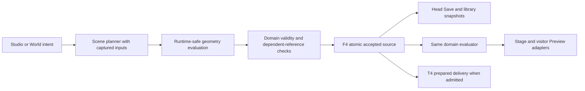

# T5 Expressive Geometry — implementation umbrella

**PR #266 · planning only · reviewed against main `cda02e61` (2026-11-07).**
This is the single proposed T5 direction. It replaces the earlier native-form/Object Focus plan
and the research proposal's C1–C6 experimental promotion sequence. The
[Studio journeys](./object-studio-design.md) specify its UX. The
[evidence note](../../../broad-research/native-modeling-freedom/PROPOSAL.md) retains the alternatives;
research and prototype designs are supporting evidence, not competing implementation instructions.
Nothing here records an owner approval, changes a codec, admits a dependency or activates production.

## Direction and ceiling

Make Object Studio a deliberate, first-class place to create and refine an object **inside the
existing editor**. Standalone and World-origin entries use the same Stage, tools, selected subject,
Camera, acceptance, history and Save. A route is an entry address, not a new semantic document or
renderer. Quick World shapes remain useful without entering Studio.

The ceiling is sophisticated spatial experiences created largely within Biskiq: architecture,
furniture, everyday objects, decorative structures, procedural geometry and interactive assemblies.
Integrated creation power is the useful game-engine analogy; a game-engine execution model or a
Blender-equivalent tool inventory is not the architecture. Specialist interchange remains valuable,
but “this needs surface controls” or “this is difficult to implement” is not a reason to export an
otherwise coherent native workflow. Accessibility comes from progressive learning and disclosure.

Start with a dependable Studio journey and profile revision. Then grow composition, procedural
relationships, controlled surfaces and solid refinement as distinct capability paths. They need
not all pass through boolean modeling. Each shipped writer produces savable canonical source;
there is no fixture-only product editor, second Undo stack or later bulk promotion.

A lid and its casing must remain separate semantic parts if an interaction will move the lid.
A fused mesh cannot supply that meaning; an object made from five bodies needs no boolean kernel.
Conversely, part composition cannot substitute for a continuous cushion, curved chair shell or
locally refined surface. The foundation must support both. Architectural roofs, walls and openings
remain Layout elements even when they share numeric geometry with Scene objects.

**Fixed foundation:** domain ownership, one active editable source per body, explicit representation
and capabilities, qualified identity, declared dependencies, reproducible evaluation and one F4
acceptance/history path. **Initial bounds, not permanent limits:** extrusion, flat independent
assemblies, one active object scope/viewport, fixed control topology and no operation reordering.
General constraint solving, B-rep, subdivision/patch evaluation and richer procedural authoring are
admitted by concrete consumers, not prebuilt as a universal engine. Complexity is justified by the
creative and revision need; implementation ease is not the selection criterion.

## Baseline on current main

| Evidence | Consequence for this plan |
| --- | --- |
| [F2 and persistence](../../reference/components/persistence.md#one-source-format-f2-clean-epoch): envelope 1, Layout 6, Scene 5, Camera 1, Experience 4, resources 2 | Scene 4 is historical. Scene 5 is already shipped; a later shaping cutover cannot be called “promotion to Scene 5.” Recheck versions before each format PR. |
| [Scene form source](../../../packages/project-model/src/scene.ts), [planners](../../../packages/project-model/src/scene-planning/planners.ts) | One extruded keyed outline, positive extent, `form.scale` and `nextKey`. Create, size, name, ordinary transforms, duplicate, delete and detached library insertion exist. Outline revision, holes, operation lists and assemblies do not. |
| [geometry-core](../../../packages/geometry-core/src/index.ts) and [extrusion](../../../packages/geometry-core/src/extrude.ts) | Runtime-safe TS profile/extrusion evaluator, evaluator version 1, with `earcut` and `robust-predicates`. It is not a general solid kernel. Current footprint and render layout assume one extruded ring. |
| [Form library](../../../packages/project-model/src/library/form-library.ts) | Payload 1 is immutable, content addressed, owner scoped, single-form source. It is not mutable draft storage or a shared-instance update mechanism. |
| [Boot](../../../apps/editor/src/lib/authoring/stage/boot-state.ts), [support](../../../packages/project-model/src/scene-planning/support.ts) | Empty-Layout projects and datum support already exist. `create` and `open` are different intents; a missing project must never turn into a new draft. |
| [F.1](../../reference/composition-execution.md#f1-identity-and-reference) and [Scene destination](../../reference/components/scene-content.md#ratified-destination-not-shipped) | Whole Scene entities resolve; non-null components currently refuse. Clusters and Three children are not assemblies. Definitions, components and their providers need a real first consumer. |
| [Host acceptance](../../../apps/editor/src/lib/authoring/stage/host-acceptance.ts), [Camera session](../../../apps/editor/src/lib/authoring/stage/camera-session.ts) | Reuse unit F4 and the one Camera-output protocol. Source changes invalidate old inspection tickets; return after editing needs a revalidated Camera intent, not replay of a stale ticket. |
| [Acceptance coordinator](../../../apps/editor/src/lib/authoring/f4/acceptance-coordinator.ts), [unit preparation](../../../packages/project-model/src/units/acceptance.ts) | Planner preparation currently returns a synchronous `PrepareResult`. The async host install does not make expensive worker-backed preparation an implemented capability. |
| [Renderer](../../../apps/editor/src/lib/museum/entities/form-geometry.ts), [Scene contract](../../reference/components/scene-content.md#current-implementation) | Stage and visitor Preview render native forms. Public release still refuses them. The renderer infers cap/side layout from extrusion buffers; arbitrary meshes cannot simply be passed through it. |
| [Workflow](../../workflow.md), [test contract](../../../apps/editor/tests/README.md) | Capability PRs and risk tiers replace phase authorization. No hold is inferred from old research. Documentation/architecture gates apply here; implementation PRs retain the full repository merge contract. |

The live status read matched main `cda02e61` with a complete report and no failing gate checks;
the Studio rows had no tagged checks or claims. This is baseline evidence, not a stored maturity
declaration. Issue [#272](https://github.com/Biskiq/spatial-sketch-editor/issues/272) remains relevant
to metadata scope enforcement. Every new planner must prove unchanged envelope metadata as well as
unchanged foreign units; it must not depend on that gap. Issues
[#274](https://github.com/Biskiq/spatial-sketch-editor/issues/274) (focus restoration) and
[#273](https://github.com/Biskiq/spatial-sketch-editor/issues/273) (stale browser locators) inform the
actual return/keyboard tests, not a new project-wide prerequisite bundle.

## Architectural decisions

### Ownership and sharing

| Concern | Owning authority and implementation seam |
| --- | --- |
| Object composition, form meaning, shape-operation source, component capabilities | **Scene / T2.** Runtime-safe codecs, planners and validation in `@portfolio/project-model`; T5 supplies the modeling capability. No T5 unit or Studio document. |
| Pure profile, solid, deformation and validation algorithms | **T5 / geometry-core.** Plain numeric input/output, no Scene IDs, resources, renderer, DOM, selection or history. Add a separate package/subpath only when a real dependency boundary requires it. |
| Library identities, immutable revisions, closure and access | **Typed resources / T2**, with shared project-model and API readers. Scene defines the meaning of an object-definition payload. Do not duplicate the resource service for Studio. |
| Architectural elements, host surfaces, support and compiled geometry | **Layout / T1.** One compiler and owner-qualified frame queries. A Scene form cannot be used as a hidden architectural wall or opening. |
| Stage host, picking, gesture lease, readings and shell composition | **Shared editor / T1 and approved shell.** Domain adapters own legal edits; Studio scopes exposure and context, not domain validity. |
| Framing, inspection, projection, spatial return | **Camera.** Camera-owned viewing intents through the existing session/facade. Never a Studio orbit controller or pose tween. |
| Atomic installation, revisions, history, Save | **F4 and persistence.** Reuse the shared coordinator; cross-unit operations register their actual scope. Async geometry does not create an alternate acceptance path. |
| Future interactions, timed use and visitor composition | **Experience and shared F.3 execution.** Scene exposes intrinsic capabilities; Experience binds/invokes them. Studio does not introduce a private animation loop. |
| Visitor Preview and public prepared derivatives | **Runtime domain evaluators / T4 delivery.** Share geometry semantics; exclude authoring infrastructure. Public admission is separate from authoring a form. |

T1/T2/T5 are areas, not review silos or permission gates. One capability PR may change all necessary
seams. Share numeric algorithms and common identity/acceptance interfaces; keep Scene operations,
Layout compiler meaning, Camera evaluation and UI gestures domain specific. Similar-looking
“extrude” gestures do not justify a universal domain command or a second architectural compiler.

### One active source, several representation families

Retain the landed profile/extrusion source unchanged for existing forms. **Generator plus typed
ordered operations is one source family, not the universal object representation.** Scene owns a
versioned, discriminated shape source. A family owns its authored controls/topology, legal edits,
evaluation and correspondence. A body has one active source; an assembly may contain bodies from
different families without flattening them. One authoritative source may itself compose typed
sub-sources and explicit conversion/deformation steps; it need not be one primitive or one homogeneous
representation forever. Evaluating that source may use mesh, field and analytic intermediates together.
Those are derived representations with declared boundaries, not independently writable copies of
the same body. This follows the existing
[editable-source contract](../../reference/components/persistence.md#editable-source-and-revision-destination).

| Source family | Appropriate meaning | What remains derived / boundary |
| --- | --- | --- |
| Profile/path/analytic generator, optionally with ordered operations | Editable outline, depth, sweep path, local cutter, deformation parameters | Tessellation and kernel work meshes; order is current construction meaning, not Undo history |
| Authored control surface or control mesh | Deliberately authored control positions and connectivity, creases or patch parameters when supported | Evaluated surface, subdivision and render triangulation; controls are not a renderer buffer dumped into source |
| Explicit solid topology / B-rep | Faces, edges, curves and incidence when a real precision/direct-edit consumer needs them | Tessellation and acceleration data; topology and correspondence still need an owning algorithm |
| Implicit field | A bounded authored field recipe/control set when continuous blending earns admission | Sample grids and extracted meshes; material/region addressing and conversion require declared limits |

Only the first family exists today. The controlled-surface capability below supplies the first
different source family. The other rows are extension contracts, not selected kernels or promised
tools. No empty variants, plugin registry, universal half-edge model or generic operation IR land
in the first Studio PR. Introduce typed family dispatch with its first additional consumer; reject
unknown required kinds. Existing Scene 5/payload 1 data are not wrapped or migrated by this plan.

Every admitted family supplies the same *obligations*, with a small runtime-safe adapter: strict
parse/version validation; declared input/result class (curve, surface or solid); supported typed
edits and parameter ports; local frame/units; evaluation with diagnostics and source correspondence;
bounds/contact/projection queries; and persistence/library/release handling. Shared renderer adapters
consume evaluated results; domain planners never reverse-engineer meaning from those results.
Do not force an open surface through a closed-solid validator, offer a solid cut on it, or invent
volume/thickness because its rendering looks closed. A kernel adapter serves particular operations;
it does not become Scene's codec, identity provider or universal geometry authority.

For the first operation-bearing extrusion, retain generator, stable-ID typed operations with complete
parameters, and the existing positive `form.scale` applied last. Operations use the unscaled body
frame; physical controls convert through scale. Rigid placement follows evaluation. Proportional
Size explicitly scales refinements; Stretch has its separate preservation promise. These semantics
belong to this family, not every future surface, parameterized assembly or representation.

An operation list is a linear dependency program. Revising replaces parameters under the same ID;
removing previews dependent consequences. First operands are owned local source. Later named inputs
may reference typed parameters, components or pinned resources through explicit dependency edges;
they must not be encoded as duplicated local operands pretending to follow another object. Branching
or reused inputs require an acyclic typed dependency graph when first consumed. A list can be a
chain within that graph; it must not be stretched into a universal log. Graph UI and graph semantics
are independent decisions. No arbitrary code, feedback cycles or solver is needed for the first
procedural assembly. Reorder, suppression and richer expressions are explicit later source edits,
not permanently forbidden by the initial list UI.

For later hybrid evaluation, keep compatible operations together and make each representation
boundary explicit: input/output class, precision loss, supported edits, provenance and recovery.
Do not convert back and forth after every edit or infer a live link from equal geometry. A detail
layer or deformation declares whether its controls are body-, source-control-, surface- or
world-relative and how upstream changes affect them. Explicit approximate detail transfer may be
an authored operation; it is not proof of semantic identity or permission for silent nearest-face
repair. The first local operations need none of this infrastructure prebuilt.

The first operations refuse a candidate whose downstream geometry cannot evaluate, naming the
operation and repair. The creator can revise/remove it in the same pending compound candidate and
Apply once; repairs must not require accepting an invalid intermediate body. Future dependent
bindings may remain explicitly repairable where F.1/F.4 permit it. Unevaluable shape programs need
their own source-admission/recovery capability before they can be saved; the last valid mesh must
never masquerade as a current valid result. No silent dropping, reordering, retargeting or baking.

**Conversion is an operation, not an implementation detail.** A future generator → control mesh or
solid → surface conversion declares approximation, retained/lost edits, material/attachment impact
and correspondence before acceptance. Keep the root/component identity when it is the same subject;
allocate new control identities where no continuation exists. Retain an immutable recoverable source
revision with provenance in the typed resource closure when conversion loses meaning, with an
explicit restore action beyond session Undo. Only the destination is writable; restore creates a
new accepted revision and revalidates dependents. No continuously synchronized dual representations,
fake generator history for an imported mesh, or silent round-trip conversion. The first controlled
surface is created directly and needs no converter.

### Assemblies, reuse and future behavior

Assemblies are the first consumer of Scene definitions/components, not a T5-only parts format.
Choose immutable **project-local typed object-definition resources** with explicit content revisions
and locks; placed Scene object instances reference them. Definition payloads carry a root frame and
stable component IDs, local rigid transforms, and explicitly typed leaf content. They are source, not a
Three hierarchy or a second Scene document. The initial admitted leaf is a native form with ordinary
catalogue appearance; nested definitions, external model dependencies and shared edits wait.

Initial assemblies are flat and independently owned: one placed root uses one local definition.
Editing creates a new immutable definition revision and updates that instance's reference/lock in
one registered Scene/resources F4 operation. Reuse creates a new editable identity and remaps internal
references. It does not turn every duplicate into a live shared instance. The storage/interface uses
the existing resource system even though shared updates are deliberately unavailable initially.

The logical definition ID survives an ordinary edit; its content revision changes. The current
envelope retains the revisions its exact locks require, not an ever-growing table of every edit.
Undo snapshots and saved project versions preserve their own earlier source/locks. No new long-term
revision store, garbage collector across projects or cloud Undo service is required by this consumer.

The first assembly adds no per-axis root scale. Root Move/Turn act rigidly; a component's own form
size is its shape scale. These initial placement controls do not limit later full 3D root pose or
declared assembly dimensions. Nonuniform assembly resizing needs an explicit parameter/deformation
meaning, not accidental inherited shear. The local origin is an explicit pivot; preserve it when
geometry changes.
This keeps a later rotating lid or sliding drawer possible without joints, timelines, constraints
or behavior channels now. A later capability can expose component transform/visibility/material
channels through F.3; execution remains separate from authored shape and never writes generated
vertices back into source.

### Procedural composition and relationships

Scene definitions must support **literal parts, referenced definition uses and procedural members**
as distinguishable meanings when admitted. Do not make “definition = a flat array of inline forms”
the permanent API. Definition IDs identify reusable source; instance IDs/path qualify each use;
component/member IDs identify its supported internals. Render instancing is an optimization over
those meanings, never their identity scheme. Independent copies remain the default; linked reuse
has an explicit edit reach, pinned revision, detach and offered-update operation.

Typed parameter ports expose units, limits, defaults and whether they affect geometry, composition,
appearance or supported runtime behavior. A relationship declares its driver, target port/frame,
reach, dependency and failure policy. Exactly one authored mechanism writes a driven fact: direct
editing invokes its driver or explicitly removes the binding while capturing the evaluated value.
Editing a width must not fight a hidden constraint, generate baked child edits or install both a
literal and live relation as coequal truth. A one-time alignment still writes only a pose.

The first parametric-assembly consumer below implements local affine parameter bindings and a
linear repeat with explicit member records. It uses Scene-owned dependency evaluation in stable
ID order, cycle checks and affected-dependent invalidation; numeric helpers remain geometry-core.
Common dependency/reference descriptors and F4 acceptance are shared. Neither a second project
conductor nor a universal solver belongs in T5. Arbitrary expressions, cross-domain following,
constraint cycles and event-driven behavior are not smuggled into the recipe evaluator.

Architecture consumes the same numeric constructions through Layout's compiler and publishes
owner-qualified frames/queries. Scene relationships to those frames require a registered joint
acceptance when source or bindings change. Experience may later drive only explicitly admitted
F.3 ports; execution parameters are session contributions over the authored baseline, never writes
into the recipe or a Studio animation loop. Static and runtime-changing geometry have different
delivery/cost envelopes; a parameter is not automatically animatable.

### Identity, topology and revision

Separate four identities: accepted project revision; immutable source/content revision; authored
subject/control/operation identity; and evaluation generation. Equal content is not the same subject.
A copied object gets new qualified subject identities even when its geometry is byte-identical;
owner-local control keys may be retained under a newly allocated owner, never resolved unqualified.

- Keep existing whole-entity IDs and outline keys for edits that preserve them. The first profile
  revision changes existing controls only; it does not add/delete keys. `nextKey` restored by Undo
  is not evidence of non-reuse across Undo branches and reloads.
- New components, hole loops and shape operations receive fresh opaque IDs captured before planning
  through the shared allocation pattern (the current Scene callers use UUIDs). Never allocate from
  current occupancy, array position, a label, time alone or a mesh digest. Reject duplicate supplied
  IDs. An Undo restores the same subject; a new command after Undo supplies new IDs. Any later
  topology-changing profile editor must settle key lifetimes before exposing durable control refs.
- A pick is generation qualified. Generated triangles, vertices and face numbers expire on
  re-evaluation. Resolve a supported hit to a source role such as cap, source edge, cutter operation
  or component; otherwise allow whole-body selection/inspection only.
- Owner correspondence has explicit preserved, split, merged, retired and unresolved outcomes.
  A split may preserve a role set without identifying a unique face. No consumer chooses a fragment
  by nearest position, area, order or a reused `faceID`. Persistent attachments and per-face material
  bindings wait for their own lifetime and repair contract.
- Pure frame capture and following differ. Early tools may capture an object-local plane once.
  They must disclose that it does not follow a later changed support surface. No inferred attachment
  is serialized. Layout surface frames come only from Layout; junction caps are not wall-side hosts.

Authored topology is not generated topology. A control-net point, authored mesh edge, patch or
B-rep face can have stable owner identity; this does not make its evaluated triangles persistent.
Only externally addressable controls/regions need F.1 capability/reference admission. Other handles
are revision-qualified task focus under the canonical body/component selection, not a second
public identity system. Geometry-core returns local correspondence/provenance; Scene qualifies it
with source, component and instance identities.

Correspondence is an explicit result between the concrete before/after source revisions, with
preserved, created, retired, split, merged or unresolved records. Compose it only through declared
maps; a missing hop stays unresolved. Source-role sets (for example all sides of an outline) and
singular targets (one attachment frame) have different cardinality contracts. A split may extend
an expressly set-valued finish target, but cannot choose a singular attachment. A merge with
conflicting finishes needs a declared resolution, not an arbitrary “primary wins.” Queries are
bounded owner-defined roles/keys with declared cardinality, not a generic geometry search language.

A procedural member has an authored identity record separate from its generated placement/mesh.
Changing count must reconcile those records in the planner before evaluation, not mint IDs during
rendering. Suppression retains a member identity; retirement ends it; adding a new member after
Undo/count reduction gets a fresh ID. Position, ordinal and equal geometry never confer continuity.
A qualified instance path distinguishes two uses of the same definition/component even if both
resolve to byte-identical source. Detach publishes an explicit internal-reference remap.

This bounds topological naming; it does not solve arbitrary correspondence. Whole-body/component
identity suffices initially, but the interface must carry source-element/region correspondence when
controlled editing or persistent surface bindings consume it. That is a real extension obligation,
not a reason to forbid fine-grained editing forever.

### Evaluation and geometry validity



Evaluation identifies its source family/version, result class and diagnostics, then returns
positions/indices, explicit surface provenance, geometric adjacency or a render-vertex-to-topology
map, bounds, applicable contact and an honest projected footprint. Solid volume, surface sidedness,
open boundaries and approximation guarantees are explicit capabilities, not guesses from triangles.
Holes and disconnected projections require rings/regions; a single convex hull or bounding box is
not silently substituted for hit or placement truth. A coarse selection proxy is labelled and is
never a geometric oracle. Normals, UVs, acceleration structures and Three objects are derivatives.
A display LOD or preview approximation cannot silently become the canonical surface used for
acceptance, attachment or physical queries; each result declares its evaluation policy and source
mapping. Admitted task picks requalify through that mapping when display tessellation changes.

Do not assume the current `FormMesh` buffer ordering is a general interface. The first surface,
holes or operation consumer must extend the evaluator result and update rendering, Plan footprint/hits, support,
contact, picking, caches and Preview together. Define cap/side UV and seam behavior explicitly;
generic result geometry cannot rely on “the first N vertices are the base.” Existing unmodified
forms retain their pinned output unless a reviewed semantic version change says otherwise.

For hole extrusions, caps use their profile-plane coordinates and each loop's sides use its own
arclength/depth in metres; duplicate the closing UV seam while preserving geometric adjacency.
For stretch, carry each subdivided triangle's source-surface parameters through the map; its texture
stretches with that surface, with whole-object Size retaining its declared sizing semantics. The
solid-route research must decide cut-surface UV provenance before admission; whole-body material
selection alone does not answer texture mapping. It must either retain validated operand surface
coordinates or explicitly scope the first solid writer to untextured materials with truthful UI.

Validation is capability specific. For admitted solid results require finite bounded coordinates,
consistent orientation, no open/T-junction/non-manifold geometric edges, no self-intersections,
positive intended volume, and supported component count. Check topology after accounting for
intentional render-vertex duplication at normal/UV seams; index-edge counting alone rejects valid
current extrusions. Never weld by an arbitrary epsilon to make the test pass.

Manifoldness and a nonzero volume do not prove the intended shape. Use independent geometric
oracles for the admitted families: analytic extrusion volume, planar containment, exact predicates,
component/section expectations, and operation-specific bounds/volume relations. A cut can validly
split a body in a general modeler, but the first single-body cut capability refuses that result.
Do not invent a universal validator that claims to catch every erroneous boolean.

### Determinism and precision

Retain the landed evaluator's restrictions and goldens. Canonical source bytes, IDs, ordering,
reference resolution, F4 outcomes and exact Undo restoration remain exact. For any new evaluator,
pin the algorithm, dependency/build version, tessellation policy, ordering/tie-break rules and
tolerances. Runtime rounding into GPU buffers cannot feed back into source or the next edit.

Basic IEEE arithmetic plus a source scan is not sufficient proof for a new TS/WASM pipeline.
The [ECMAScript specification](https://tc39.es/ecma262/multipage/numbers-and-dates.html#sec-math.sqrt)
specifies square-root rounding and distinguishes implementation-approximated transcendental
functions; it does not certify our dependencies, serialization, traversal order or worker results.
Use literal-input golden fixtures on the existing Linux x64 job and the local runner; new canonical
operations additionally require matching results in a second browser engine. Do not weaken a
failing exact oracle to a tolerance. Narrow the operation, fix the deterministic path, or ask for
an explicit contract change. A changed canonical result for accepted source requires a reviewed
version/compatibility decision, not just regenerated goldens.

Keep metre units and the landed limits for existing forms: 3–256 anchors, 1 mm minimum control edge
and scaled dimension, ±50 m control coordinates, extent up to 100 m, positive scale in [0.01, 100].
These are not a universal CAD precision claim. New operations state their own feature separation,
approximation and count bounds; exact predicates classify topology, while quantitative tolerances
bound approximation. Integer polygon kernels need an explicit scale, overflow limit and round-trip
error policy. Float64 source cannot undo a Float32 conversion already made at a library boundary.

### Transactions, async work and persistence

One gesture or explicit Apply captures one typed serializable intent against one accepted revision.
Preview is a candidate from the same planner/evaluator used for acceptance. Cancel, refusal, no-op,
lost pointer capture and stale result install nothing and create no history. Acceptance validates
actual changed units and unchanged project metadata; one compound operation gives one Undo result.

For an asynchronous operator, preparation is identified by project ID, session epoch, expected
revision, target/source content identities, the full resolved dependency-lock closure and effective
parameter inputs, evaluator/build version and request ID.
Latest preview wins. Source change, Undo, target deletion, project replacement, Studio exit or worker
restart invalidates outstanding work. A completed worker result is never itself a write permission.
Recheck identity and domain validity before F4 installs. Timeout/cancel/failure leaves the last
accepted source intact. Bound the queue to one in-flight job plus one newest request; release
transferred buffers and WASM handles on every terminal path.

The first consumer that needs worker-backed validation extends the shared preparation contract to
accept a `PrepareResult` or its Promise, awaits it in the existing F4 coordinator, and repeats the expected-revision/session
checks after the await before installation. Preserve synchronous planners; update every affected
preview, acceptance and source-admission caller with typed handling and call-site tests. There is
no separate async history/coordinator or worker-owned write path. Separate strict structural parsing
from expensive geometric validation without bypassing either. Browser worker, headless/API validation and visitor
Preview use the same pinned runtime-safe evaluator. No client-supplied “valid mesh” bypasses server
source validation, and no synchronous WASM fallback is silently installed on the interaction path.

Save always captures accepted canonical source with the existing saved-base precondition. Pending
geometry is not included; applying it while Save is in flight leaves the newer source dirty. Local
expected revision and cloud saved base remain different identities. Reopen evaluates accepted source
and reports incompatibility/failure without rewriting it. Retain original recoverable source bytes;
never silently replace a failed body with a proxy and call it valid.

The first format-changing PR lists every reader: Scene/resources codecs, library canonical writer,
API validation, source download/open, Preview, references, fixtures and any release reader. Bump only
affected unit/payload contracts. Adding Scene environment did not change form payload 1; similarly,
adding an assembly kind need not invalidate unchanged single-form items. Changing common form source
does require compatible library handling. Use the current strict pre-baseline policy unless the
owner chooses a tested recovery/migration exception. No reset, old-data deletion, beta declaration
or blanket “one final format bump” is authorized here.

### Cost and delivery boundaries

Evaluate changed bodies and affected dependents only. Cache by source family/version, complete
source and resolved dependency content, effective parameters and evaluator/build/tessellation policy,
with bounded retention; key instance/world bounds separately by pose. Definition sharing may reuse
geometry, never selection, overrides or execution state. Dependency resolution and cycle detection
precede geometry evaluation. Equivalent source uses may share derivatives; semantic qualification
and correspondence remain per use. Fine-grained incremental scheduling waits for a measured need;
a deterministic Scene dependency walk is enough for the first bounded recipes. Material, Camera and
rigid placement changes must not remesh a body. Preview buffers are replaceable and do not accumulate
in source history. Operation/count limits are semantic resource bounds, not timing benchmarks.
The first operation pipeline caps every intermediate and final result at 100,000 triangles; check
growth before subdivision/allocation or abort without acceptance. Per-body limits compose with
definition/component limits and input-byte limits. The first assembly evaluators also bound total
expanded geometry to 1,000,000 triangles per definition before allocation; sharing render buffers
does not exempt semantic expansion, picking or closure work. Keep current library byte limits until
a consuming payload change explicitly adjusts them; a count maximum does not promise that every
worst-case combination fits. Bounds can expand with capability evidence, not silent truncation.
The initial counts below are conservative admission bounds to be tested, not measured claims of interactive speed or a licence to allocate
all bodies at their worst case on each pointer move.

Lazy-load Studio tools and later optional kernels. Test both import closure and the built chunk
graph: a dynamic import is not proof of isolation, and entry wiring is not literally zero bytes.
Keep authoring controllers out of visitor/public imports. Preview may load a runtime-safe geometry
worker when a supported source needs it; do not place that shared worker under an editor-only import
closure. Public releases remain refused until T4 admits a prepared derivative or runtime route.
Recommend immutable prepared meshes plus source/build/provenance hashes for static publication;
future animated parameters may need a declared runtime evaluator in that delivery profile.

The [performance policy](../../reference/components/performance.md) controls measurements. Do not
reinstate the historical 425 KiB, 4/8 ms or p95 matrix as acceptance gates. Record structural load
boundaries, bounded work and deterministic invalidation tests. Report observed stalls honestly and
use only an owner-initiated investigation or an authorized spot-check trigger for timing work.
Old kernel microbenchmarks do not certify integrated editor or visitor responsiveness.

## Capability sequence

These are product outcomes and implementation PRs, not authorization stages. PRs can subdivide a
capability at the integration seams below; do not label a headless helper as a working creator
journey. Every dependency is semantic, not an area handoff. Keep the remaining sequence here rather
than opening a new umbrella in each PR. A capability's draft holds only its concrete implementation
plan and any newly resolved decisions; remove completed planning text at merge.

| Order / capability | Dependency | Useful completion | Risk and stopping boundary |
| --- | --- | --- | --- |
| **1. `studio.dual-entry`** | Landed core and this UX specification | World or direct entry, create/size, Save/reopen, switch roots, return and reuse with existing source | Shared shell; no new modeling source or dependency. |
| **2. `studio.profile-revision`** | 1 | Change existing outline controls and extrusion depth; reopen and continue | No topology/key allocation or new persisted fields. Refuse invalid profiles. |
| **3. `scene.object-definition`** | 1, 2 | Flat editable multi-part objects with durable components | First Scene/resource/component consumer. No nested or shared-instance edits yet. |
| **4. `studio.assembly-reuse`** | 3 | Save an assembly snapshot and insert/open independent editable copies | Typed library/API closure; no mutable library drafts. |
| **5. `studio.parametric-assembly`** | 3, 4 | Bind dimensions/part placement to named parameters and repeat a part with stable members | Local typed acyclic relationships; no solver, scripts or silently baked child edits. |
| **6. `scene.definition-instances`** | 5 | Explicit linked local instances, edit reach and detach | Pinned immutable revisions and atomic affected-use validation; no automatic library updates. |
| **7. `studio.control-surface`** | 2, 3, 4 | Create/edit a bounded control surface as a distinct source, alone or in a reusable assembly | First multi-representation/result-class consumer; no inferred thickness or general mesh conversion. |
| **8. `studio.profile-holes`** | 2 | Make and revise a pierced panel/frame | Profile topology extension; generalized result seam and all consumers land here if not already supplied by 7. |
| **9. `studio.stretch`** | Generalized result seam from 7 or 8 | Lengthen a bounded band with explicit fixed/translated regions | First ordered shape operation, initially on extruded solids. No universal preservation claim. |
| **Evidence: `studio.geometry-research`** | Named blocked recess task | Admit/narrow/reject one bounded solid route | Retained correctness corpus, no product acceptance shortcut. Independent of 3–9; optional dependency admission still applies. |
| **10. `studio.solid-combine`** | Positive solid evidence and generalized result seam | Saved, revisable local cutter/adder operations in Studio | Async admission + API/Preview parity; no automatic face editor. |

The numbering gives a default implementation order, not a mandatory serial chain. After profile
revision, holes can proceed without waiting for assemblies; surface/procedural capabilities do not
wait for a solid kernel. The first result-seam consumer owns that integration PR; later consumers
extend its declared capabilities, not a competing geometry pipeline. Format/dependency review follows
the normal workflow at the actual consuming PR, with the dispositions at the end of this plan.

Definitions in [the capability ledger](../../../capabilities.json) are planning coverage, with no
owner implementation review or maturity assigned. Existing `studio.dual-entry` and
`studio.geometry-research` keep their identities. The old engine/experimental/demo/promotion rows
are replaced by creator outcomes; there are no tagged checks or live claims to reassign for them
at this baseline. A demonstration is evidence for these capabilities, not a separate capability
that makes all prior work count as accepted.
`studio.geometry-research` remains the evidence identifier for the retained solid-route question;
it does not require a separate research program/PR before every geometry capability. Resolve the
bounded question in the consuming solid capability draft. Headless evidence does not count as a
core creator journey for `studio.solid-combine` or any other product capability.

### First capability: studio.dual-entry

**Outcome:** a creator makes and sizes a native form directly in Studio, saves and resumes it,
reuses it in another project, and edits an existing World form without changing its identity or
placement on entry/return. This deliberately proves the full lifecycle before new geometry.

Implement in two small PRs if needed, keeping this capability incomplete until both journeys pass:

1. World-origin scope and direct empty-project entry. Add a lazy Studio controller, explicit
   session entry target and origin, shared chrome gating, non-pickable context, Camera framing and
   validated return. Expose only existing form commands and creation gestures. Direct `/studio`
   creates an empty-Layout project through the normal create intent; opening uses the normal load
   path. The query posture never changes source admission. Add explicit New object here and Choose
   object within the same project; capture root scope and restore it on cancelled creation.
2. Resume and copy journeys. Add `Open in Studio` on project rows, explicit root choice for projects
   with multiple forms, `Open editable copy` from My Objects and `Place copy in World` using the
   existing immutable form payload and destination placement path. Save the source project before
   a cross-project switch or retain it in place if Save fails; cancellation loses no accepted work.

The [journey specification](./object-studio-design.md) fixes visible actions, pending-edit policy,
same-project and cross-project placement, direct URL behavior, scope and responsive acceptance.
Do not create a schema field saying a project “is Studio.” Every project remains discoverable in
Projects; `Open in Studio` chooses a posture. No persisted primary-object guess or mutable draft
library is required. Multiple canonical roots can coexist; Studio edits one explicit root at a time.

**Concrete seams:** existing spatial route orchestrates; `boot-state.ts` admits; `stage-facade.ts`
and `camera-session.ts` realize viewing intent; `EditorHead`, `EditorCard`, `StageDock` and the
Scene adapter supply the existing controls. A new authoring-only Studio module owns session scope
and gesture cleanup. `form-card-command.ts`, Scene planners, `host-acceptance.ts`, Head Save and
the form-library client remain the writers. Reuse the import/placement capture pattern, not the
model-import schema. Avoid growing another all-purpose host inside the already large route.

**Core acceptance:** zero-Room direct entry → Box/Free → size/name → one Undo/Redo → Save → cold
reopen via `Open in Studio`; World form → Edit in Studio → size → Back to World with same root and
revalidated view; Save to My Objects → open editable copy → modify → insert in a second project,
with original, snapshot and copy remaining independent; create a second root in the same project,
switch back and Save/reopen without losing either; ordinary quick World creation still works.

**Edge acceptance:** new/open distinction and unknown URL target; forbidden/missing project;
cancelled login or conflict during source Save; pending invalid gesture on exit; Preview and return;
Undo deleting the scoped root; project replacement and late async library read; source edit between
framing and return; duplicate clicks during insertion; keyboard focus restoration and reduced motion.
Navigation creates no source history; each accepted edit/insertion creates exactly one result.

**Stop:** any separate editable draft, history, selection or Camera; accepted work that cannot Save;
transient candidate described as saved; old ticket reuse after editing; implicit insertion on return;
or a shell restriction used to omit standalone entry. Resolve inside the PR or flag the exact conflict.
Do not add holes, face editing, parts or a kernel to rescue this capability.

### Profile revision

Provide `Edit outline` on an eligible form. Invoke the generator's plane as an orthographic reading
through Camera; keep one active reading and one Card. This is **generator editing**, not a section
through an arbitrary current body. Existing anchors can move by drag or numeric U/V and toggle their
existing smooth flag; extent is a positive numeric/drag edit. Key count/order, `nextKey`, plane,
entity orientation and whole-form scale remain unchanged. Apply installs the whole candidate once;
Discard restores it. Add/remove/reorder controls and changing a plan form into an elevation form
are explicit later work, not hidden in a move.
During this task, an extent control displays physical extrusion depth and converts through the
current scale; the ordinary Size writer for that fact is unmounted. This is a mutually exclusive
editing posture, not two simultaneous controls for the same dimension.

Add typed Scene intents carrying target, changed existing keys/values and captured expected revision.
Validate the full candidate with the existing profile/extrusion evaluator, current limits and
support/contact policy. On an elevation form, preserve the resting support using the evaluated
contact exactly as sizing does; on a lifted form preserve the declared lift. No topology addressed
bindings are admitted. My Objects payload 1 already stores these source fields and remains unchanged.

Extend profile/Scene planner, source codec, Card and paper-agreement suites. Prove concave and smooth
outlines, invalid crossing/collinearity/minimum edge refusal, both planes, lifted support, repeated
revision, exact source restoration and cold reopen. Show one meaningful case: turn a rectangular
plinth into an asymmetric display profile without redrawing or losing World identity. Stop before
an operation requires adding keys or a new source representation.

### Local object definitions and components

Use `scene.object-definition` for the first assembly consumer. Promote a selected native form in
place: keep the Scene root ID and world pose, move its source into the first component at identity
local pose, and add the owned definition resource and exact lock atomically. No existing reference
to the whole root changes target. Do not silently group every intersecting form.

First operations: promote, add a newly created native-form component, select root/component, rename,
rigidly move/turn a component in the declared root frame, revise its form, duplicate/remove a component,
and duplicate/delete the root. A component does not independently snap to a Room floor; root placement
resolves support from the union's contact. Component edits preserve the root pivot/pose and may
change its contact; any explicit “Place on floor” re-grounds the root as one command. No auto-resize
or recenter moves other parts.

The first definition payload is a bounded table of 1–128 components with stable IDs, names,
local position/rotation, a tagged native-form leaf and supported appearance. Leaf access goes
through its supported source/evaluation operations, not public callers assuming every leaf has
`generator.outline`; only the native-form variant is initially admitted. No nested instance reference,
component-level resource lock, behavior, constraint or arbitrary metadata bag. Root Scene instances
reference an exact definition revision through the existing lock semantics. Register the F.1
component provider for selection/validation; unsupported F.3 component behaviors still refuse.
Removing the last component refuses with Delete object available; it does not leave an empty,
unevaluable definition. Part-local pitch/roll are supported rigid transforms; the root's first
World placement remains upright with yaw and support-owned Y, matching the landed placement family.

Implement source/resource codecs and compound planners with runtime evaluation first, then Parts
navigation and scoped writers in the same capability. Instance rendering, bounds, projected hits,
selection, Find, Preview and deletion consequences must consume the component provider. Root
rename/placement need not clone a definition. An attempted edit of a multiply used definition
refuses until explicit detach/shared-edit semantics exist; initial duplication always detaches.

Acceptance object: a table with top, apron and four individually named legs. Change one leg, move
the whole table and change the top profile; all other component IDs and local source survive Undo,
Save and reopen. Delete/Undo/recreate a part with the same name and prove it is a new identity;
stale component references do not resolve to it. Prove unchanged Layout/Camera/Experience,
metadata scope, atomic Scene/resources/lock installation, no dangling pins and Preview parity.
Stop on guessed child identity, a second selection, inherited root nonuniform scale/shear, or any
required silently shared edit. Apply the source compatibility disposition below before merging
the format change.

### Assembly reuse

Extend the typed library with an immutable object-definition payload and exact closure, using the
same owner authorization and canonical hashing service. Preserve the single-form kind. First
payloads contain the bounded native-form component definition and catalogue appearance only;
imports, textures and other private-resource dependencies are refused rather than copied incompletely.

`Save to My Objects` captures the accepted definition revision. `Open editable copy` and `Insert copy`
allocate a new root, definition and component identities, remap all internal references and admit
their exact lock in one destination F4 operation. Repeated inserts never share mutable definitions.
Names/order do not supply the remapping. Deleting the snapshot cannot break existing copies.

Prove two copies in two projects, independent revisions to one component, payload hash verification,
authorization, unsupported-version listing/removal, cancellation, and atomic rollback on invalid
closure. API/library tests run against the database as the test contract requires. Stop if a private
source-project URL or a mutable “latest” reference is needed. Shared instances and offered library
updates are a later Scene capability, not a shortcut for reuse here.

### Parametric assemblies and stable repetition

`studio.parametric-assembly` is the first explicit relationship consumer. A creator defines a table's
width/depth/height/thickness once, drives the top's dimensions and leg positions from them, and
makes a slatted screen whose repeat count/spacing can change without replacing every member.
Use the same object-definition resource, component provider, compound F4 planners and library closure.
This is a Scene capability exposed by Studio, not an independent recipe document.

**Source and evaluation:** admit at most 16 named parameters with opaque IDs, length-in-metres or
bounded-integer type, default and bounds; at most 128 local port bindings; and up to 16 linear repeat
records with count 1–128, with at most 128 live/suppressed members plus literal parts in the expanded definition.
The limits are initial resource bounds. A length expression is an affine sum `c + Σ(k_i * p_i)` of
length parameters with finite scalar coefficients, canonical terms ordered by parameter ID. Integer
count is a literal or direct bounded-integer parameter, with no rounding/coercion. No expression
text parser, arbitrary functions or cyclic solver is required.

Targets are explicit component/template ports: native-form physical X/Y/Z size, root-local
translation axes, and repeat spacing/count. Resolve a form's bound size axes together through its
single size-to-scale adapter after evaluating the unscaled body; do not apply sequential gizmo edits
or auto-reground individual parts. Each declared port is typed and belongs to a concrete source
family. Affine bindings can express `width / 2 - thickness / 2` without inverse constraint solving.
A named assembly parameter is not automatically a constraint on measured overall bounds; its
bindings define what it drives, while evaluated measurements remain honest readouts. Rotations stay literal initially. A bound port takes precedence over its literal
source default and is its sole effective writer; failed evaluation never falls back to that default.
Resolve inputs into transient leaf-evaluator arguments, not persisted generated child geometry or
scale values. Direct editing opens the parameter/binding; **Make independent** captures the current
value into the literal source and removes that binding in one edit. Removing a referenced parameter
requires replacing/removing its bindings in the same candidate; otherwise refuse with uses listed.

Repeat on an unbound literal native-form part replaces it with a repeat record owning that source
and appearance as its template. Preserve the original part ID as the first member, with its local
pose; allocate a separate recipe ID and fresh IDs for additional members. A currently driven part
must first be made independent explicitly; no hidden flattening of its bindings. A linear repeat
holds the template, local origin, axis X/Y/Z, spacing of at least 1 mm and an ordered list of member
records with opaque IDs and suppression state. Template size may subsequently use the same typed
parameter bindings as a literal form. Position is origin plus slot ordinal × spacing on that axis; orientation is the template's rigid orientation. The ordinal is a
placement input, never identity. Count increase appends freshly captured IDs; decrease retires the
tail records and reports affected references; new increases never reuse retired IDs. Suppress/restore
keeps a record and its slot, does not close gaps, and makes that member unavailable/available to
geometry consumers. The definition must retain at least one evaluated part: suppressing/removing
its last active part refuses with Delete object available. No per-member overrides initially.
**Make member independent** suppresses its slot and creates a literal component at its evaluated pose with a fresh ID and explicit remapping
of supported references; Undo restores both atomically. The new part captures effective authored
form/pose values, not evaluated triangles, and no longer follows the repeat template or bindings.
Replacing the template revises the same member subjects only through its declared source correspondence, never new render-instance indices.

The planner resolves parameters, reconciles member IDs and validates units/bounds/ports before
evaluating leaves. This first graph is acyclic by construction: parameters → bindings → parts/repeat.
Evaluate in stable ID/term order; refuse backreferences to outputs rather than building a solver.
Reject unknown ports, duplicate drivers, cycles, non-finite results, invalid geometry and expansion overflow. Required
references to retired/suppressed members block unless their owner permits an explicit unresolved
binding in the same F4 candidate. No silent reassignment to an adjacent slat. Cached geometry may
be shared by repeated members, but picks and F.1 references remain instance/member qualified.

**PR seams:** parameter/binding/repeat codecs, evaluation and compound planners first; then invoked
Parameters/Repeat tasks, dependency diagnostics and same-source library/Preview integration. The
Card exposes values; an invoked binding editor names the driven port, driver, units and edit reach.
Changing a parameter previews the entire affected object and applies once. Repetition creates one
source rule with member identities, not a burst of ordinary duplicate commands.

**Acceptance:** change a six-part table from 1.2 m to 2 m width while 60 mm legs retain size and
move according to the declared formula; an unrelated component stays byte-identical. Change a
slatted screen 12 → 8 → 12: the first eight IDs survive, new tail IDs differ, and a reference to a
retired slat remains unresolved/refused according to its owner. Suppress/restore a middle slat,
detach a member, Undo/Redo, Save/reopen and make two independent library copies. Check unit errors,
duplicate writers, attempted cyclic/backreference inputs, budget overflow, foreign-unit scope and
per-use picking.
Stop if this needs hidden constraints, per-frame source writes, an unrestricted node language or
inferred member correspondence. Later recipes can admit more operators without changing this boundary.

### Linked definition instances

`scene.definition-instances` adds **Create linked instance** as a deliberate alternative to Duplicate
or Insert copy. First scope is reuse of an exact project-local definition by root instances; nested
uses and cross-project live links are absent. Each instance has its own ID, pose and explicitly
allowed parameter/material overrides; geometry and component identity are qualified by that use.
The definition's interface declares overridable ports. Override precedence is definition defaults
then permitted instance overrides; it does not permit writes into arbitrary internals.

A definition edit offers **Edit all linked uses** with the affected instance count or **Make this
instance independent**. The shared edit creates an immutable revision and updates all
linked local uses/locks atomically after validating each effective instance and its dependents.
The first shared-edit action updates all local linked uses of that definition; it does not silently
leave a subset behind. If any required use fails, nothing installs and diagnostics identify that
use. Pose-only and permitted instance-parameter edits affect that instance without cloning source.
Detach keeps the placed root identity/pose, allocates a new definition and internal component/member
IDs, publishes the explicit internal-reference remap and updates affected bindings in one compound
F4 operation. Unsupported required remaps refuse; they are never matched by name.

Library snapshots remain immutable. Saving a configured linked instance captures its pinned
definition/closure plus authored parameter/material overrides as instance configuration; it must
not silently save defaults or bake the effective geometry. Extend the versioned library payload
and API reader in this capability. Open/Insert copy remaps definition, component/member and binding
IDs and retains that configuration on the new independent root. Detach likewise remaps and keeps
per-use overrides. Linked project uses never reference a user's mutable library item. A later
library update must be offered and explicitly accepted with correspondence and closure. Nested definition uses will be typed, acyclic references
with stable instance IDs, exact lock closure and expansion budgets; do not counterfeit nesting by
flattening content while promising shared updates. No nested schema or generic graph service is
needed for this first linked consumer.

**PR seams and acceptance:** extend instance source/overrides, typed resource closure and F.1 use
qualification before exposing shared editing. Test two tables sharing one definition, a width
revision reaching both while placement and an allowed material override remain local; then prove
an explicitly overridden width masks the definition default for only that use. Test one invalid use
refusing the whole update, and detach followed by independent edits. Identical part IDs under two
instance paths must resolve to different uses. Test Undo/Redo and Save/reopen across edit/detach,
reference repair, library-copy independence and Preview. Stop on ambient latest, implicit propagation
across projects, or one instance's selection/behavior state leaking into another.

### Controlled surfaces as authored source

`studio.control-surface` proves the representation boundary with a useful **faceted surface net**,
not a mesh-conversion experiment. Create a decorative panel or chair-back surface, raise/lower
selected controls in 3D, and retain those controls through assembly reuse and revision. This is a
bounded first surface tool; smooth subdivision, arbitrary control connectivity and free XYZ moves
are later capabilities, not forbidden workflows or promises made by this tool.

Admit a distinct versioned native shape source at Scene roots and definition leaves rather than
inventing an extrusion generator for it. Its source uses body-local U=X, V=Z, height=Y and holds
positive width/depth up to 100 m, a fixed rectangular grid of 3–17 controls per axis, stable
point/cell IDs and one height
per point. U/V positions are the uniform grid over width/depth; height is along the plane normal.
Canonical point/cell order and each cell's lower-left → upper-right diagonal define two planar
triangles. The authored net/connectivity is geometric source; render buffers, normals, adjacency
and picking tables are derivatives. No smoothing or subdivision is implied by smooth shading.

Only height edits, whole-net width/depth and rigid placement are initially admitted. Width/Depth
name the net's planar dimensions and leave heights unchanged; no generic volume/Height Size writer
is mounted for this family. Root pose uses the existing placement family and a component can use
its admitted full rigid rotation. Grid dimensions, control IDs and connectivity stay fixed after
creation. Controls may be selected as a task set and
moved by one height delta or numeric values; the canonical object/component selection remains the
owner. Heights are finite in ±50 m and adjacent U/V spacing is at least 1 mm. Positive spacing and
single-valued height make the surface a graph over its plane, excluding folds/self-intersections
by construction; no claim extends to a later free-XYZ or subdivision editor. The result is an open,
two-sided surface with a declared boundary and zero thickness, not a closed solid. Solid volume,
Cut/Add, normal-thickness and solid collision capabilities are unavailable.

Use explicit source-cell provenance, geometric adjacency and planar metric U/V texture coordinates.
Bounds/contact/projection are computed from the evaluated surface in its current frame; flattening
to a mat is never source motion. Reuse existing root support/lift semantics from evaluated contact,
while component edits preserve the assembly root pivot/pose. A flat net with zero normal extent is
valid under this surface family's validator even though legacy extrusion requires positive volume.
Plan hit testing uses the actual projected triangles/regions, including edge-on cases; an expanded
pick tolerance may aid selection but cannot masquerade as a filled footprint or thickness.

**PR seams:** introduce only the two admitted source families and their typed adapter/result-class
boundary; extend strict Scene/resource and immutable library codecs, API validation, selection,
contact/footprint consumers, renderer/UV and Preview; then wire Create surface/Edit controls. Legacy
extrusion goldens remain unchanged. Allocate point/cell IDs when capturing the create intent, never
during evaluation. Library transfer preserves owner-local control/cell keys under freshly allocated
root/definition/component identities. All qualified addresses change; no control/cell is a public F.1 target yet.
No new dependency or general half-edge engine is required for this fixed topology.

**Acceptance:** create a flat 5×5 net, raise a central set into a faceted relief, lower one edge,
change width and rotate it as a chair-back component. Unedited control heights/IDs remain exact.
Mix it with an extruded frame in one assembly; save, cold reopen, reuse and edit the copy independently.
Check first/last cells, both sides, edge-on picking, zero-height validity, invalid spacing/heights,
UV/provenance continuity, 120 accepted control edits followed by bounded Undo/Redo and cold reopen,
and refusal of solid-only tools. Source controls survive independently of the 100-entry Undo cap. Stop if the
implementation dumps a generated mesh into source, fabricates thickness or silently converts a form.
This consumer establishes extensibility, not the final surface vocabulary.

### Profiles with holes

Extend the extrusion generator with explicitly authored, stable-ID inner loops; retain the outer
outline and its keys. First holes are straight closed polygons, 3 or more vertices per loop, at most
8 holes and 256 total control vertices. Each hole lies strictly inside the outer profile, with at
least 1 mm separation from it and every other hole; crossing, touching, nesting and zero-area loops
refuse. Coordinates and extrusion limits remain those of the existing profile. Do not infer a hole
from an unrelated stroke. Explicit `Draw hole` and selected-loop edit/delete own these operations.
Separation is checked in evaluated object metres after `form.scale`; source controls also obey
the existing profile limits. Whole-object Size must revalidate the new feature-separation promise.
Within one loop, moving vertices preserves its keyed order and count. Replacing the contour creates
a new loop identity; removing and redrawing it never reuses the old ID. Topology-changing control
insertion is not silently added to the earlier fixed-key profile editor.

Use exact orientation/intersection tests and declared distance checks before triangulation. Feed
validated rings to the existing triangulator; explicitly subdivide cap edges wherever a retained
boundary vertex lies on them and use the identical boundary subdivision for sides. Validate the
resulting geometric adjacency, coverage and analytic signed area × depth. Do not assume earcut
guarantees a conforming mesh. If this bounded route cannot produce valid output, stop with the
failing fixture; do not silently repair source or install another library.

Land or extend the shared result/UV/provenance/footprint seam with all callers before admitting the
new source. Reuse the control-surface seam if that capability landed first. The source/library
version PR and UI PR may be separate, but an admitted source must already
load, Save and render correctly in Stage and Preview. Acceptance: a frame/pierced panel with a moved
hole; concave outer ring; collinear boundaries; near-touch refusal; transformed/elevation cases;
analytic volume and Plan holes; Undo/cold reopen/library round-trip. Stop on T-junctions, cap gaps,
hole-filled hit proxies or old renderer assumptions.

### Bounded stretch

Add the first source operation `stretch`: stable ID, local axis, two ordered band coordinates
`a < b`, and displacement `d`. For the chosen axis coordinate `q`, evaluate from the preceding
source result:

```text
q <= a:  q' = q
a < q < b: q' = q + d * (q - a) / (b - a)
q >= b:  q' = q + d
```

Other coordinates stay unchanged; the low side is the fixed anchor. Require positive remaining
band width of at least 1 mm after final axis scale, an initial unscaled band width of at least 1 mm,
positive-extent overlap with the body, and all resulting form limits. Split triangles at both band planes
before applying the piecewise affine map, preserving provenance and shared intersections; otherwise
a triangle spanning a kink would not represent the intended surface. Validate each intermediate
result. Start with at most 16 stretch operations, no automatic reordering or inferred constraints.

The UI shows axis, band and fixed side; numeric fields own the same values. Preview/Apply evaluates
the full source from the generator, never the last Float32 mesh. Earlier profile/operation edits
replay in object space. Geometry outside the band is rigidly translated or unchanged; oblique
members crossing it can change angle/thickness. Do not label this universal “preserve thickness.”
Proportional Size remains available and visibly different.

Acceptance: a portal body widened from 1.2 m to 2 m with 60 mm vertical end members outside the band;
an oblique-member counterexample that discloses changed geometry; compression refusal at collapse;
20 alternating upstream revisions with no mesh round-trip drift; exact Undo, cold reopen and My
Objects continuity. Stop if general constraint solving, automatic keep-regions or planar B-rep
reconstruction is needed. A simpler per-part move/resize is the comparison for an assembly.

### Solid-route evidence and admitted cut/add

The solid-combine implementation draft first answers one bounded question from the retained research: can a bounded, source-replayed cut/add family reliably serve
recessed casework that profile holes and assemblies cannot express conveniently? Use the retained
corpus and a pinned Manifold build as a **candidate**, subject to the existing dependency/licence review rule. Do not build an entire planar
direct modeler merely to compare it. A small face-operation experiment may falsify the source route;
its winner must include revision and persistence, not just an attractive first edit.

Required evidence is reproducible fixtures, source and build identities, verdicts and an
explicit admit/narrow/reject recommendation. Compare source replay with chained mesh round-trips;
record actual binding precision rather than assuming every Manifold API is Float32. Include 20
upstream revisions, operand-order variants, coplanar/grazing contacts (the retained #1888 case),
thin walls, near-coincident faces, holes and disconnected output. Check source-role provenance and
all claimed preservation. Volume/manifold checks alone are not a sufficient oracle. Performance
measurement follows policy; it is not a new required benchmark suite.

Bound the investigation to one pinned candidate and this corpus. Admission requires all named
supported cases to match their independent oracles, unsupported/ambiguous cases to refuse without
mutation, revision/source round-trips to preserve meaning, and repeated/cross-engine canonical
results to agree. That draft fixes binding precision, tolerance envelope, UV/provenance policy and
the admitted input family before implementation starts. Canonical buffer ordering may remove
incidental kernel enumeration differences; it may not round away coordinate errors or change
connectivity. If those obligations fail, return a narrower supported family or a rejection with
the failing fixture, rather than beginning another general-kernel project under the same claim.

If admitted, the first cut/add source operation owns one local extrusion operand plus its rigid
pose, with a stable operation ID and explicit `cut`/`add` kind. Operands are captured once in the
object frame; they do not follow a later face implicitly. Limit to 8 solid operations and 100,000
result triangles per body initially. Accept only a nonempty, connected supported solid. Disjoint
add, a cut that disconnects the body, total removal, uncertain contacts and budget overflow refuse.
A newly drawn operand remains a ghost until Apply; it is never a hidden placed Scene object.
Revising the base or an operand replays the complete program and either validates or refuses with
the offending operation. No automatic removal of a now-ineffective cut.

Implementation order: runtime-safe evaluator and independent validators; generalized surface and
appearance mapping (initially whole-body material only); awaited source admission/F4/Save/API and
Preview; strict versioned source/library writers; then the 3D cutter/adder task and source-operation
editing. Exact field names are codec implementation detail; these semantics are fixed. Do not merge
a product writer that can only export fixtures. Acceptance includes a recessed vitrine, revised
cutter depth and upstream size, async races, crash/retry, Save during preparation, cold reopen and
independent library copies. Stop if the selected build cannot meet determinism/validity or if
repair requires a second authored mesh/B-rep. Keep the earlier capabilities usable and record the
failed case; do not expand the kernel project by default.

## Later depth, with bounded next decisions

The preceding capabilities are executable commitments of this plan, with explicit initial limits.
The following remain deeper extensions. Their consuming implementation PR must settle the named
algorithm/interaction before code; this is not a separate research program or a second umbrella.
Retained evidence may suffice; only an unresolved technical claim needs a bounded falsifier.

| Need | Next concrete decision | Foundation already preserved / stop |
| --- | --- | --- |
| Smooth control surfaces and local surface refinement | A chair shell or cushion consumer selects an authored control mesh/patch basis, crease/boundary semantics, tessellation, self-intersection policy and topology edit/correspondence rules | Control geometry may be source; do not pretend the first height net is arbitrary surfacing. No silently generated cage or fixed-topology edit claiming unchanged downstream surface identity. |
| Soft local reshaping and Keep | One section-driven chair-back deformation specifies field, reach, injectivity/validity, preservation quantity/frame/lifetime and multi-contour UX | Source/derived boundary and typed operations already exist. A mask alone proves no preservation; single-contour and split-view prototype limits are not product ceilings. |
| Turned and tubular forms | Revolve then sweep: profile/path keys, seams, frame transport, curvature limits, deterministic tessellation and revision | Additional generator families need no new domain or universal B-rep. Position samples alone do not establish valid surfaces/solids. |
| Inset, bevel and direct planar/curved edits | Compare a declared source-operation edit with explicit face/edge/patch source on a named ordinary-object barrier, including revision and finish/attachment correspondence | Fine-grained authored topology is allowed; no automatic general fillet, continuity solver or persistent generated face ID. A kernel may earn adoption for capability, not merely speed. |
| Nested reusable components and library updates | Admit typed acyclic definition-use leaves, stable instance paths, exact dependency closure, expansion bounds and offered revision/remap UI | Local linked instances establish source/use distinction. Do not flatten nesting or silently fetch latest; nested cycles and incompatible required remaps refuse. |
| Richer recipes and constraints | Extend typed ports/operators for a demonstrated procedural object; define conflict, determinism, invalidation and repair before a solver or node authoring UI | First affine/repeat consumer proves relationships without restricting future graphs. No hidden bidirectional rules or arbitrary scripting as the ordinary prerequisite. |
| Surface anchors and architectural following | Owner frame/parameterization, singular versus region target, lifetime and deletion/repair policy | Layout owns architectural frames, Scene owns its bindings, F4 owns compound changes. Solve-once placement needs no continuing attachment. |
| Animation and interaction | A lid/drawer consumer registers Scene component/parameter F.3 channels, then explicit ambient or Experience invocation, reset and contention semantics | Source, instance and execution identities stay distinct. Topology-changing parameters are not automatically safe real-time channels; no Studio timeline or private update loop is prebuilt. |
| Implicit fields, general B-rep or imported-mesh conversion | Named creative need, supported edit/input family, fidelity/loss/recovery and complete evaluator/runtime/licence choice | One active representation with explicit conversion. OCCT/MPL candidates remain eligible, not chosen or categorically forbidden; specialist interoperability remains honest. |

## Foundation tradeoffs and remaining risks

| Judgment | Reason / residual risk |
| --- | --- |
| Reject generator-plus-operations as a universal representation | It cannot honestly describe every direct control surface or explicit topology edit. Multiple source families add adapter/codec work, so admit only concrete families, not a universal geometry metamodel. |
| Reject a universal B-rep, mesh kernel or generic node engine upfront | None supplies semantic identity, repair, resource closure or Studio lifecycle by itself. Specialized solids/surfaces can earn a kernel without replacing Scene/Layout or forcing all existing forms through it. |
| Keep bounded early tools without treating them as the ceiling | Flat parts, fixed profile keys, the surface height net and local affine recipes are useful, testable increments. They do not yet create arbitrary cushions, complex smooth shells or an entire piano. Complexity and learning effort alone do not disqualify the next tool. |
| Keep independent copies and add explicit linked use | Copy-only forever would obstruct reusable kits and coordinated revision. Shared use introduces real edit-reach and affected-instance validation obligations; there is no automatic library propagation. |
| Keep exact source/identity/acceptance obligations | Richer evaluators still need pinned builds and cross-engine evidence. No claim that all future kernels satisfy them; a failing candidate narrows/stops, without silently weakening existing oracles. |
| Make correspondence and conversion explicit | General topology naming remains unsolved here. Set-valued roles do not resolve singular attachments; conversion may lose controls and must retain recoverable source beyond Undo. |
| Broaden Studio through invoked tasks | Ordinary shell simplicity cannot force all advanced work into More or ban scoped sets/relationships. More surfaces must still preserve canonical selection, one writer per fact and Camera authority; exact future multi-view UI is not designed here. |
| Keep one transactional source path | Large dependent objects can make validation and revision costly. Aggregate work bounds, dependency-aware invalidation and async fencing are required; this review measures no responsiveness and creates no new performance gate. |

## Verification and review

Each implementation PR carries capability-tagged core and edge checks. Extend existing owning
suites rather than mirroring implementation in new tests. Pure helpers need caller evidence where
scope, identity or lifecycle depends on wiring. Useful existing homes:

| Contract | Existing checks to extend |
| --- | --- |
| Strict source, planner and evaluator parity | [Scene form codec](../../../apps/editor/tests/lib/content/scene-form-codec.test.ts), [form evaluation](../../../apps/editor/tests/lib/content/form-evaluation.test.ts), [geometry-core](../../../apps/editor/tests/lib/geometry-core/), [units](../../../apps/editor/tests/lib/project-model/units-conformance.test.ts) |
| Revision, scope, Undo and Save | [host acceptance](../../../apps/editor/tests/lib/authoring/stage-host-acceptance.test.ts), [unit acceptance](../../../apps/editor/tests/lib/authoring/unit-acceptance-conformance.test.ts), [Save journey](../../../apps/editor/tests/lib/authoring/head-save-journey.test.ts), [Save call sites](../../../apps/editor/tests/lib/authoring/save-call-sites.test.ts) |
| Entry, selection, Plan and render continuity | [boot states](../../../apps/editor/tests/lib/authoring/stage-boot-states.test.ts), [resume](../../../apps/editor/tests/lib/authoring/spatial-route-resume-save.test.ts), [paper agreement](../../../apps/editor/tests/lib/authoring/native-form-paper-agreement.test.ts), [form geometry](../../../apps/editor/tests/lib/museum/form-geometry.test.ts) |
| F.1 components and immutable reuse | [resolution](../../../apps/editor/tests/lib/project-model/unit-resolution-conformance.test.ts), [form library](../../../apps/editor/tests/lib/project-model/form-library.test.ts), [API library](../../../apps/api/tests/form-library.test.mjs), [API Save](../../../apps/api/tests/save-units.test.mjs) |

New component/operator tests belong beside their owning contracts. Browser tests prove real creator
journeys, keyboard/touch paths and failure recovery; headless proofs do not establish usable Studio
UX. Follow the [test contract](../../../apps/editor/tests/README.md#what-a-change-requires) for the
full repository gate, package checks and zero-skip DB-backed API verification. Run the unconditional
architecture lane, visitor/public isolation, one Camera, one history and scope boundaries. Do not
run a formal performance battery as a substitute for correctness or UX.

First capability browser cases use wide 1440×900, narrow 820×1180 and short 1280×720 layouts,
keyboard-only and coarse pointer paths, plus reduced motion. Later capabilities repeat the changed
journeys in that shell. A piano or chair illustration is ambition; table/vitrine/portal fixtures
only establish the specific operations demonstrated. No unmeasured timing or unrun acceptance row
is recorded as passing.

For this documentation PR, run documentation and architecture checks, review relative links and
the diff against current main, and verify that no source, schema, lockfile or dependency changed.
The owner requested a solo review: this pass is not represented as an independent fresh-context
review or an owner UX approval. #266 stays unmerged.

## Owner decisions

This plan specifies the architectural and initial UX choices. **No separate foundation/UX approval
cycle or T5 authorization stage is added before implementation.** The PR remains a proposed,
unmerged plan, not a ledger record of shipped/approved UX. After its merge, the first implementation
starts from `studio.dual-entry` and the journey spec.

No foundational owner choice is left blocking that first capability. Two decisions remain local to
future consuming PRs under the existing workflow, not a request for approval of this revision:

| Consumer decision | Disposition fixed here | What remains specific to that PR |
| --- | --- | --- |
| Source compatibility | Keep strict pre-baseline readers, explicit affected-version changes and recoverable original data; no reset/deletion or blanket final format bump | Actual existing project/library inventory and any requested migration/recovery exception. This applies equally to assemblies, new source families, relationships and operations. |
| Optional kernel/dependency | First Studio/profile/assembly/control-net tools use existing dependencies. Admit a new artifact only for a named capability with pinned build, licence/distribution review and correctness evidence | The artifact and any owner-required licence/dependency decision; solid-route evidence may admit, narrow or reject it. No Manifold, Clipper2 or OCCT installation is authorized by this document. |

Promote enduring rules into the existing owning references with implementation, replacing superseded
text. Do not add a decision-record tier, phase registry, acceptance document or closeout PR. Check
live claims and continue through capability implementation PRs. This revision does not merge #266,
run a separate research effort, or start production implementation.
