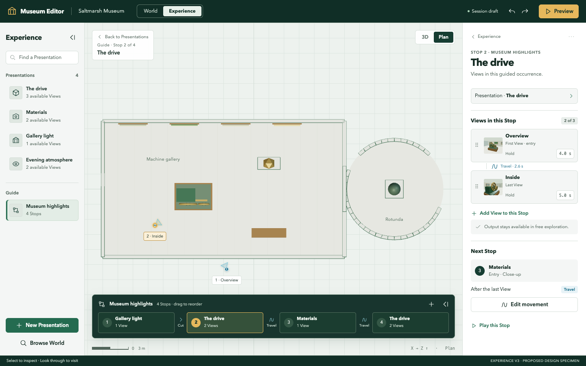

# Experience UX V3 — compose the visit

**Status: SUPERSEDED / INACTIVE (2026-10-13, #114).** The owner accepted
[Conservatory Round 2](../../experience-ux-alternative/README.md).
[PLATE](../../../docs/reference/design-system/editor-shell-and-visual-system.md)
owns the promoted unified shell and Experience authoring/UX acceptance.
This UX3/V3 package, standalone plan and generated PNGs are retained rationale
and Git provenance; none is an active design or implementation instruction.
Do not execute V3-A–V3-F or resume UX7. Next work is
[#115 parallel-track planning](../../../docs/roadmap/README.md).

**Original proposal/audit follows as historical text.** Earlier “active”,
“canonical”, pending-ratification and PNG-acceptance statements below describe
the superseded commission; they do not reopen current design acceptance.

**Status: active design proposal for owner ratification, 2026-10-13.** The owner
commissioned an independent replacement for PR #114's UX direction, including
mockups, reconciliation, and a superseding plan. This package is that replacement
work entry. Its new product semantics and shell amendments are **proposed**, not
ratified, implemented, or a production contract. Implementation waits for review.
UX7 from the former plan must not proceed by default.

**Inspected baseline:** PR [#114](https://github.com/Biskiq/spatial-sketch-editor/pull/114),
branch `prototype-v2-ux-overhaul`, fetched head
`de41341e82f4a745abe85537c59a217c160c60f3`. UX1–UX6 and their latest review
corrections exist in source; their functional proof does not establish owner
acceptance of their product or appearance. UX7 has not started. The older current
baton understated the review follow-up; the [evidence](../../spatial-authoring/qa/EXPERIENCE-UX-EVIDENCE.md#ux4ux6-review-follow-up-2026-10-12--the-five-implementation-review-findings)
records it, and the new [implementation evidence](./implementation-evidence.md)
anchors the source audit.

## Start here, then follow one concern

| Need | Single entry |
|---|---|
| Product direction, relationships and creator/visitor flows | This proposal |
| Shell anatomy, components, tokens, responsive and navigation rules | [V3 design-system specification](./design-system.md) |
| Screens, composition and per-board acceptance | [PNG board package](../README.md) and [visual gallery](../gallery.html) |
| Implementation sequence and compatibility acceptance | [Superseding implementation plan](./implementation-plan.md) |
| Current capabilities and verified code anchors | [Implementation evidence](./implementation-evidence.md) |
| Prior rules/assets, disposition and documentation changes | [Reconciliation record](./reconciliation.md) |
| Recommendation rationale, alternatives, ratification and risks | [Decisions and risks](./decisions-and-risks.md) |

This proposal owns V3 product intent; the design system owns its visual/exposure
rules; the plan owns delivery. PNGs illustrate those rules, never override their
semantics. Existing domain authorities still own validity, Camera evaluation,
Layout/Scene separation, F and production persistence. The [PLATE baseline](../../../docs/reference/design-system/editor-shell-and-visual-system.md)
remains the previously ratified shared/World reference, with a scoped notice of
this candidate Experience replacement. No second active V3 design lives there.



## The product problem

The current prototype can perform sophisticated operations, but its everyday
interface asks a creator to understand the mechanism before composing a visit.
Entry, Next, Gate, From, Cue, Path/Journey and precision are individually
reasonable engineering concepts. Together they fragment one creative job into
many control homes. The Stage shrinks while weakly prioritized forms accumulate.
Passing those controls' tests has not tested whether someone knows what to do.

V3 makes **the visit** the organizing idea. A creator saves things worth seeing,
captures ways to see them, and arranges an encounter. Camera geometry becomes
visible when movement needs attention. This is a spatial creative tool: the museum
remains the largest and most informative part of the screen.

## One recommended model

```text
Presentation                         Guide
  available View uses                  ordered Stops
  one Default                            each references one Presentation
                                         each curates ordered View slots
                                              slot → available View use
                                              local hold + adjacent movement

Camera View ← referenced by View use
Camera Path ← referenced by an explicit Travel transition
Playback = Experience time mapping over Camera evaluation
```

| Creator concept | Meaning and ownership | Essential distinction |
|---|---|---|
| Presentation | Experience-owned reusable visitor composition, optionally associated with Scene subjects | One concept; no Object/Region/Environment creation taxonomy |
| Available View | Experience membership/use referencing Camera-owned framing | Available independently of inclusion in the Guide; inventory order is not a visit sequence |
| Default View | One role in the Presentation inventory | Entry for free exploration and seed for a new Stop, never an exclusivity flag |
| Stop | Experience-owned occurrence of a Presentation in a Guide | Repeated occurrences have independent stable slots, order and dwell |
| View slot | One stable Stop-local reference to an available View use | No copied pose; first slot is entry; local reorder does not change Default |
| Transition | Experience-owned Cut/Travel choice for an actual occurrence pair | Guide order, source membership and Camera connectivity stay independent |
| Camera Path | Directed Camera-owned connection between Camera Views | Generated endpoints, authored interior points, one evaluator; reusable without a visible graph |
| Playback | Read-only observation of an explicitly named Stop or movement | No authored seconds-based pose track or second scheduler |

**Recommend Stop-local View slots.** An inherited Presentation playlist is simpler
only until the same Presentation appears twice. Then editing one occurrence either
changes both or creates opaque overrides. A flat storyboard of Views loses the
visitor's meaningful Stop boundary and eventually reinvents it. Explicit local
slots keep the ownership visible. Limit the prototype UI to distinct available
Views once per Stop; stable slot identities leave repeated local Views extensible
without exposing another feature now. Repeating a Presentation as a new Stop is
already useful and supported.

Each Guide has an explicit execution mode: legacy or V3 View sequence. A Guide
never silently mixes the two. New empty Guides use V3; an existing Guide requires
an atomic whole-Guide conversion review before adding V3 slots. Unsupported
advanced combinations remain legacy and executable rather than half-converted.

The Guide row therefore shows **Stops**, with View count and Cut/Travel between
them. It does not expand every internal sequence. Only the selected Stop's Card
shows its ordered Views. Presentation and Stop Cards share identity typography
and preview treatment, but deliberately use **Available Views** and **Views in
this Stop** as different section headings.

## Creator workflow

### 1. Save a first encounter

The first-use Stage invitation has one primary **New Presentation** action. The
Index exposes that action after content exists; the empty invitation is then gone.
This replaces `+ Present` as the primary label: *Present* can sound like playing
the finished experience. **Present this** remains an effective contextual verb on
a selected Scene object.

New Presentation captures the current eligible 3D composition, creates one Camera
View and its Default use in one accepted history action, and selects the new
Presentation. Present this uses the existing recommended framing with an optional
subject relationship in that same operation. Neither requires a subject type,
intent field or second recommended-framing workflow. Name is editable immediately;
rename and removal are ordinary overflow actions. Selection alone creates nothing.

From Plan, offer **Compose in 3D** or Cancel before capture. Composing is an explicit
Camera operation with a return token; merely entering the dialog does not move
the Camera or create source. V3's new capture flow uses a visitor Perspective View.
Preserve any existing authored Plan/other projection rather than coercing it.
Production projection depth remains governed by Camera.

### 2. Capture and inspect meaningful Views

Presentation selection shows its available Views with one modest preview per row
and a Default badge. **Capture View** uses the current 3D composition and asks for
a name. Stage markers identify the **actual Camera observer positions**, not
compressed satellites around the subject. Plan projects x/z; 3D projects the
Camera observer and direction. An elevated observer may have a ground tether.
Offset or cluster **labels**, keeping a leader to each true origin; do not move
the origin to improve legibility. The Card/list is the complete keyboard inventory.

Select a row or marker: inspect its preview without moving the Camera. **Look
through** begins one inspection session and changes to **Exit View** in the
persistent Stage control. Switching inspected Views reuses the initial authoring
return. **Adjust View** is a deliberate compose-and-accept procedure using Camera
navigation, with Save framing and Cancel; numeric FOV dashboards, frustum editing
and Outside/Through/Plan precision are absent from the primary flow. They remain
valid existing capability evidence, not prototype acceptance requirements.

Make Default changes the role, never a Stop sequence. Remove View means unlink
from the Presentation, not delete shared Camera truth. Explain actual guided/path
references before accepting; preserve repairable missing references and Undo.

### 3. Curate the Guide

**Add to Guide** creates a new Stop seeded with the Presentation's current Default
as a **fixed first slot**, selects it, and reveals the Guide. It copies the
reference, not the Camera pose. Subsequent Default changes do not rewrite this
Stop. A Presentation with no resolvable Default asks the creator to choose an
available View or Capture View; it never silently produces Keep viewpoint.

The Stop Card has three jobs:

1. Name the source Presentation and provide **Open Presentation**.
2. Curate **Views in this Stop**: add from the source inventory, drag or Move
   earlier/later, remove, set each local hold, select the movement between neighbors.
3. Read **Next Stop** from Guide order and open that transition's movement.

Adding a View has one chooser of available inventory with selected membership.
It never captures another Camera View. Removing the final slot refuses with an
explanation and a Replace/Capture route; deleting the entire Stop remains ordinary.
Move the first slot: entry changes locally, the Presentation Default does not.
The Stage shows this Stop's real View positions. Local slot numbers label the
sequence, not extra spatial Stop geometry. A Guide overview can quiet markers;
it does not create numbered Stop pins disconnected from Camera truth.

The Guide is a shallow contextual row above the Stage ruler. Direct dragging
reorders Stops; hover/focus or a context menu reveals management. Keyboard Move
earlier/later invokes the same command. Add the same Presentation again to create
a distinct Stop; no Repeat button. Collapse to a named Guide tab. Selecting a
Presentation keeps the collapsed state and opens the Presentation, not its Stop.

### 4. Shape movement and observe it together

Cut is the default for every new local or inter-Stop transition. Selecting
**Travel** is explicit preparation: reuse a compatible directed Camera Path or
create missing support through the existing Camera operation, with one Undo.
Every View can be an endpoint; Default has no connectivity privilege.

**Edit movement** opens one task under the owning Stop. It names From and To,
shows Cut/Travel and shared-path reach in the Card, and the actual route on Stage.
A compact instrument offers Add path point and Play movement. A plain Stage click
does not add a point. Point insertion follows the evaluated nearest segment; drag
and Remove retain the current Camera operation and show any orphaned legacy events.
Endpoints are read-only derivatives. No topology Deck, origin tree or global graph.

**Play this Stop** opens a bounded player with Play/Pause, derived scrub axis and
**Follow Camera**. It plays holds and selected adjacent movements. Follow off
moves a rig in the spatial view; Follow on realizes the evaluated Camera, preserving
the authoring standpoint. Path editing pauses playback. The geometry controls and
time instrument belong to one task, rather than Path and Journey workspaces.
Stop playback can earn 560–680 px of central Stage width to show adjacent time
segments. It earns neither the whole window nor the space reserved for the ruler.

Autoplay needs **slot dwell**, not a Cue editor. Default hold is 4 seconds; choose
0–60 seconds in this prototype. Movement time remains Camera-derived. Sequence
duration is sum of local holds and evaluated Travel durations (Cut contributes
zero movement time). Rehearsal executes no Activities and writes no source.
Mid-route pause/event creation and Activity invocation editing are deferred.
Legacy authored events remain preserved and visible through a compatibility notice.

### 5. Preview the actual visitor experience

One Head **Preview** enters the isolated visitor runtime and offers **Start guided
tour** or **Explore freely** when a valid Guide exists. With no Guide, free
exploration starts directly. Exit Preview restores authoring selection, task,
panel state, inspection return and realized Camera. The boards' museum geometry is
illustrative; implementation uses the real project renderer and runtime.

## Guided and free visitor behavior

| Action | Guided tour | Free exploration |
|---|---|---|
| Enter a Presentation | Enter its Stop's first local slot | Enter its Default; no Guide cursor |
| Available choices | Named curated Views in the current Stop, with a quiet View pager | All valid Presentation Views, including omitted ones |
| Play/Pause | Automatic local progression through holds and adjacent transitions | No forced Guide progression |
| Select another named View | Pause autoplay/reset hold. Settled forward adjacency uses its authored movement; backward/nonadjacent or in-flight selection cancels movement and Cuts | Use an explicitly selected/directly available Camera connection; otherwise Cut |
| Main Next | Always next Stop; never secretly next View | No Guide Next; browse Presentations instead |
| Previous stop | Cancel playback; Cut to prior Stop's first slot as a fresh visit, initially paused; unavailable on first Stop | No Guide previous-Stop control |
| End of local sequence | Hold the final frame, wait for Next; no endless loop | Stay at the selected viewpoint |
| Final Stop | Wait at the final frame; only explicit Finish offers Explore freely or Restart tour | Continue freely |

**Early Next is a deliberate skip.** In V3's new linear Guide, Next before the
last View has arrived cancels local playback/movement and **Cuts** to the next
entry; the button says **Next now · Materials**. Normal Next from the settled last
View uses the authored inter-Stop Cut/Travel. The movement Card explains
“After the last View · Travel; skipping uses Cut.” This bounded policy avoids
manufacturing a route from the wrong origin. It is an explicit proposed runtime
policy, not a claim that existing Travel already behaves this way. Existing legacy
Guides retain their live-origin Travel semantics until conversion. A missing
required nominal Travel path blocks that movement/Preview; it is not this
interruption fallback and must not silently become Cut.

User Play/Pause preference persists across ordinary Next; the automatic final-frame
wait does not change that preference. Manual View selection/Previous stop pauses
it. Play at a completed Stop is labelled Replay Views and restarts its first slot
with Cut within the same visit; it does not invent a fresh Stop occurrence.

**Free exploration is a visitor context, not an authoring lens.** One authoring
inventory supports both. Moving between guided and free sessions from the entry
screen is enough for this proof. Optional branch/rejoin/resume policy authoring is
deferred; preserve legacy runtime behaviors without promoting them into V3's demo.

## Navigation and source safety

Back returns through invoked contexts: Presentation → View; Guide → Stop;
Stop → Presentation (with an origin crumb); Stop → movement → path point/playback.
It restores the logical context without Undo or implicit Camera movement.
An explicit Exit View / Stop following restores a Camera standpoint. That exit
stays visible after Card/context changes; Back never strands or silently ends it.
Preview is a stronger takeover and restores its full captured context on exit.
All controls use one selection and one chronological authored history.

Source-changing compound actions include create/capture, Travel preparation,
slot/Stop reorder, shared framing update and explicit legacy conversion. Each has
one accepted history result or no mutation on refusal. Panel collapse, selection,
Back, scrub and Preview create no source history. Shared framing/path edits
disclose reach; no local fork option appears unless the model actually supports it.

## Prototype boundary and future ceiling

The proof is four reusable Presentations, one Guide with repeated Presentation
occurrences, several captured Views, independent local sequences, a Cut and a
Travel, spatial point editing, playback/return, and guided/free Preview. The
creator must perform it without raw IDs, station names or a Presenter script.

Defer narration, scripting, activities, Gate/Go/Detour writers, arbitrary mid-path
Cues, multiple-Guide management, a graph editor, spline/animation property editing,
collision planning and production codecs. Preserve valid authored systems and
report their effect; reducing exposure must not delete them.

Future Guides own their Stop collections/order independently and reference the
same Presentation inventory. Use Guide identity in session/transition addressing
from the first V3 consumer. One Guide UI is a limit of this proof, never a claim
that a project can only have one. Production extraction and F amendments remain
a separate route. The [plan](./implementation-plan.md) puts all V3 prototype work
on #114 after ratification; Paper and production stay follow-ups.
