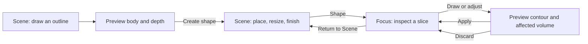
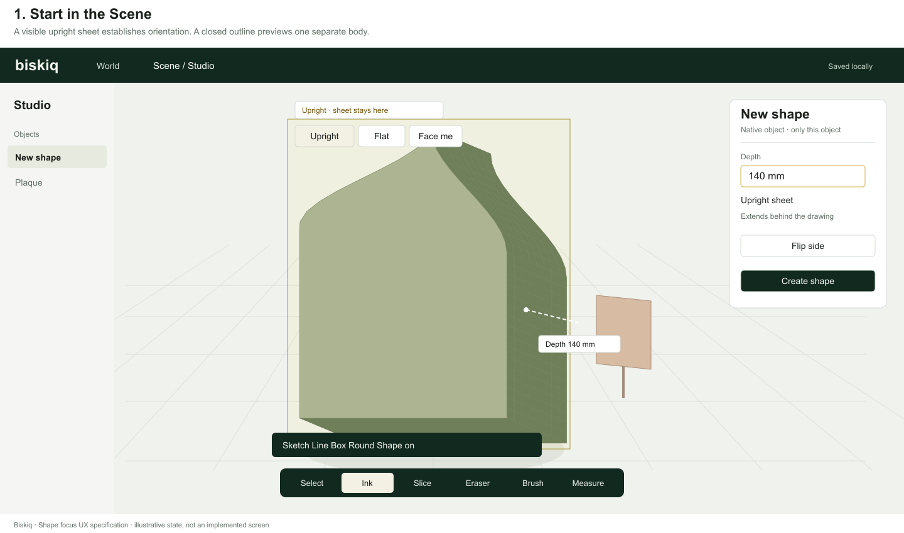
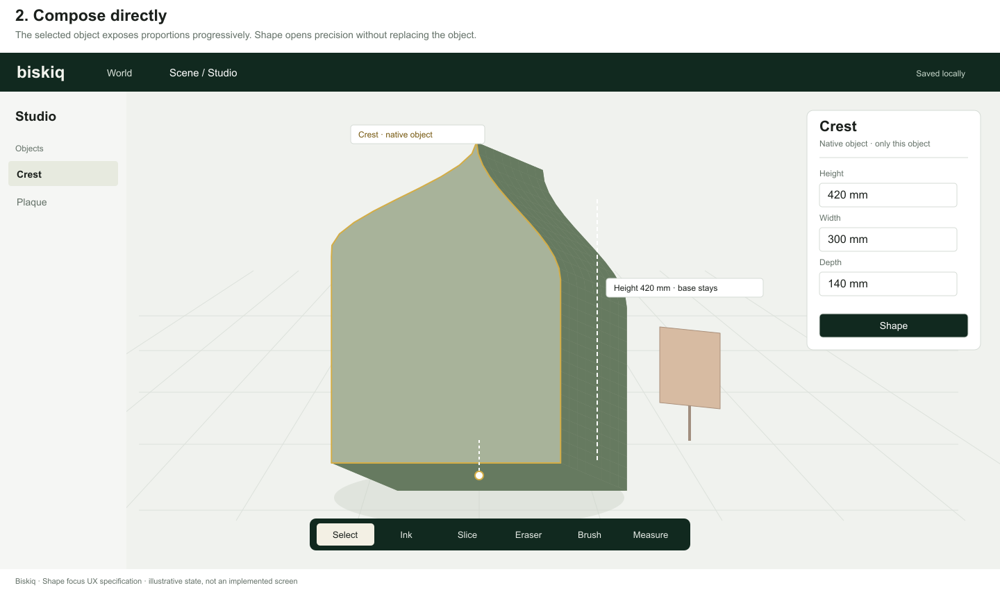
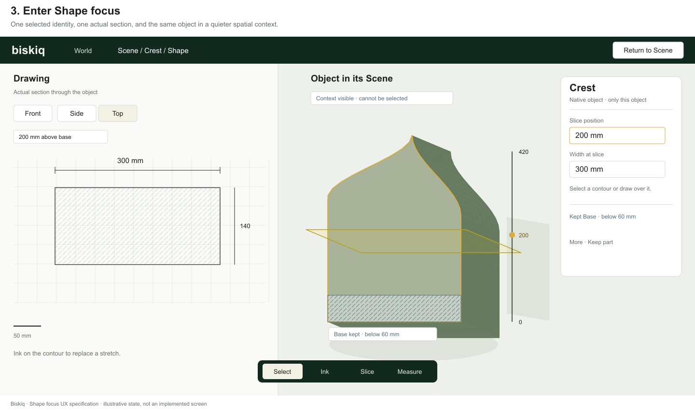
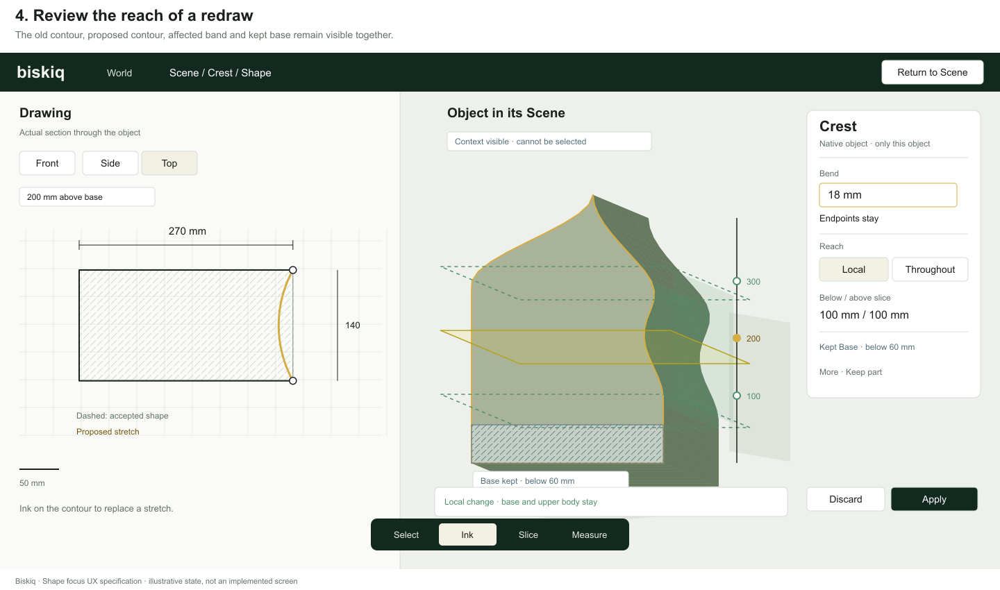
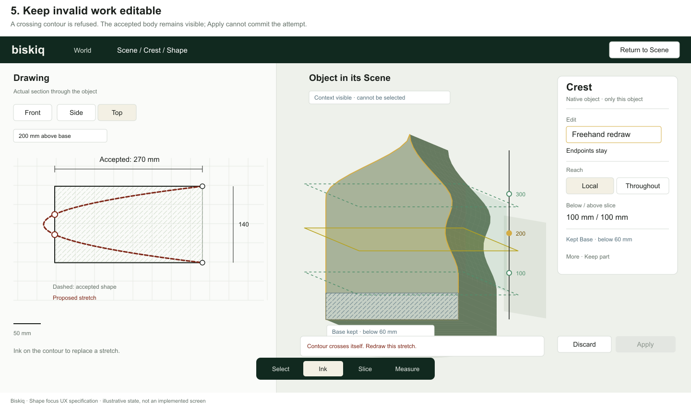
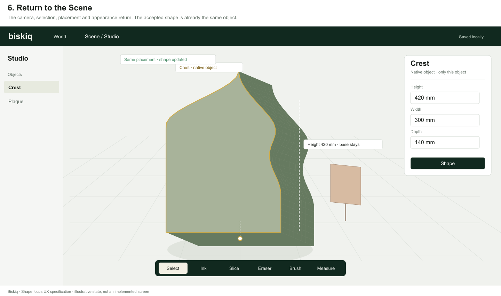

# Biskiq — Shape focus

**Native object creation and deliberate refinement · UX design specification · 26 October 2026**

**Design decision:** create and compose in the Scene; enter **Shape** to refine the same body through a linked drawing and spatial view. Cross-sections are temporary instruments for inspecting and changing an existing volume. They are not the object's construction history.

**Status:** implementation-ready **prototype design**, not production ratification. This specification supersedes the competing-direction program in the [earlier proposal](./exploration-proposal.md). Implement this direction as one coherent experience. Subsequent implementation and review must establish geometric robustness and creator comprehension; neither has been demonstrated here. The figures are authored UX states, not screenshots of a functioning prototype.

## 1. The strongest direction

Biskiq should make an object feel like a piece of work that can receive closer attention. In the Scene, someone draws its outline, sees a proposed body, gives it useful proportions, places it and changes its appearance. **Shape** brings that object closer and supplies a dependable drawing surface without removing its spatial context. Returning simply restores the broader view.

I agree with progressive depth, with an important restriction: the focused environment is an editing scope and a better view, not a separate modeling product. It has the same object identity, units, appearance, editing vocabulary, history and relationships. It does not have its own document, primitive palette, coordinate manager or finishing pipeline.

I am also changing the earlier section proposal. Requiring a body to be authored as retained parallel sections would turn freedom into profile management. Instead:

- **Creation establishes a simple body.** A closed drawing plus a visible depth is sufficient. It does not require a family such as furniture, vessel or pedestal.
- **Ordinary adjustment changes the whole object.** Scene size handles resize the existing form, including its refinements.
- **Detailed shaping changes a bounded part of the current body.** A temporary section exposes the contour at a chosen place. Redrawing or precisely adjusting that contour deforms the surrounding volume within a visible reach.
- **Preservation is spatial.** A creator may keep a region of the body unchanged during shaping. There is no collection of profile constraints to maintain.

This is a deliberate compromise. The first body is easy to understand rather than magically inferred. Detailed shaping is more bounded than sculpting with an unconstrained brush. Its expressive range comes from successive local changes in different orientations, with reliable preservation and exact local decisions.

### Decisions carried forward

| Evidence | Decision for this design |
| --- | --- |
| Vellum's drawing-first approach, visible interpretation and distinct Ink/Select responsibilities | Use the same Ink and Select. Show the drawing surface and the current edit's meaning before acceptance. |
| Living Drawings' useful contextual revision and problematic tidying | Preserve relationships and old work; constrain cleanup to a measurable fitting tolerance. Never automatically straighten a taper or infer object categories. |
| Native Form Lab's validation, history and identity evidence, alongside the commission's criticism of its interface | Keep coherent transactions and honest failure. Remove operation selection, carrier editing and coordinate lists from the creative path. |
| PR #192's distinction between foundation and workflow | Treat a working geometric operation as necessary evidence, not a complete interaction. Do not choose the interaction from a kernel's operation menu. |
| The prior proposal's visible influence | Keep this as the core explanation of a reshape. Replace permanent section construction with temporary sections through the current body. |

## 2. Scope and vocabulary

The prototype supports original, closed, solid native bodies with one connected surface and no internal cavity. Bodies may have asymmetric outlines, concavity, angular and curved stretches, varying proportions, and local bends or bulges that preserve valid topology. A body need not remain an extrusion after creation.

The prototype includes Scene creation and transforms, Shape focus, local contour revision, exact section dimensions, kept regions, history, local save/reopen and demonstrated relationship continuity. It does not include general booleans, hollowing, topology editing, arbitrary surface patch construction, manufacturing tolerances, or architectural authoring.

| Visible term | Exact meaning |
| --- | --- |
| **Shape** | Enter focused refinement of the selected native object. |
| **Drawing** | The left pane containing the actual section contour; it is not a silhouette tracing or a flattened whole object. |
| **Front / Side / Top** | Three stable, object-relative section orientations. Rotating the view does not change them. |
| **Slice position** | Where the inspection plane passes through the body. Moving it alone never changes geometry. |
| **Reach: Local** | The region around the slice within which the proposed shape change fades to zero. |
| **Reach: Throughout** | Apply the same planar deformation through the whole object's extent along this slice's normal. It does not mean uniform scaling in all directions. |
| **Keep part** | Preserve the currently selected material region during subsequent Shape edits. |
| **Apply** | Accept the current reshape and its reach as one object edit. |
| **Return to Scene** | Leave focus. Applied edits are already part of the object; there is no conversion or second save. |

**One selection:** the placed object remains selected in both views. A contour stretch, slice or kept region is a subtarget of that object, not another selected Scene entity. The Card header therefore continues to say **Crest**, for example, while its body may show **Width at slice**.

## 3. The complete workflow



There is no mandatory visit to Shape. A shallow sign, solid display piece or simple support may be complete in the Scene. There is also no graduation into a different object type: a refined object retains the same Scene controls and can re-enter Shape indefinitely.

## 4. Start from almost nothing



### 4.1 Invoke drawing

Use **Ink**, with the existing **Sketch · Line · Box · Round** palette. For this prototype, promote Vellum's previously proposed **Shape intent** to a visible palette toggle labelled **Shape**. It makes an outline read as a native object rather than asking the system to decide between architecture and objects after each stroke. This is a proposed prototype interaction amendment, not a new permanent Object Pen or a ratification of production behavior.

On activation, show one bounded translucent sheet, its ground intersection where applicable, and its orientation label. No invisible plane is selected by the first drawing stroke.

- With an explicitly selected eligible planar face, start on that face and label it **On [object]**. Contact does not imply a continuing attachment.
- Otherwise start **Upright**, through the Scene's current ground focus point. Its initial facing follows camera azimuth; its vertical remains world-up. The sheet then stays fixed.
- **Flat** places the sheet at the same anchor, parallel to the ground. **Face me** aligns it to the current view at that anchor. These are visible alternatives, not XYZ choices.
- Before drawing, drag the sheet's anchor to position it. This is a placement grip, not a vertex editor. On a blank Scene the initial anchor is the stage origin, with a labelled ground baseline and scale mark.

Camera movement never rotates an established sheet. After a stroke exists, choosing another sheet orientation previews a rigid reorientation of the entire pending drawing about its anchor; it never reprojects, stretches or discards the stroke. Accept or cancel that reorientation before continuing to draw.

If the sheet is nearly edge-on (the absolute dot product of its normal and the viewing direction is below 0.25), suspend drawing and offer **Face sheet**. This changes the camera, whereas **Face me** changes the sheet. Preserve the previous camera for **Return to my view**. Never attempt unstable ray/plane drawing and then repair the resulting stroke.

### 4.2 Draw an outline

Sketch records the hand; Line makes an exact straight chain; Box and Round produce exact planar outlines. All become the same kind of native body. Line segments and freehand stretches may continue one another by starting at the highlighted open endpoint.

Only one outer contour is being authored in this creation transaction. A second disconnected stroke remains visibly unassigned with **Continue the outline, or start another object**; it does not silently become a cutout. Starting another object explicitly finishes or discards the first transaction.

Returning within 12 screen pixels of the starting endpoint proposes a closing segment. Show that segment. The creator may also choose **Close outline**, which previews the final straight connection. Self-crossing or zero-area outlines cannot create a body. Open linework stays as a draft and is never silently filled.

### 4.3 Read the body before creating it

A valid closed contour immediately previews a separate constant-depth body. The suggested depth is 20% of the shorter in-plane bounding dimension, subject to the prototype's minimum valid thickness. It is plainly labelled **Depth** and remains provisional. This default is geometric, not an inferred object category or hidden inflation rule.

Drag the depth ray, or click its readout to focus the **Depth** field in the Card. When the ray is nearly end-on, its grip opens a compact side-on depth strip; horizontal motion in that strip changes the same fact. It does not rotate the camera unexpectedly.

Depth is always positive. **Flip side** chooses which side of the drawing receives material. Passing through zero never changes addition into subtraction. Drawing on an existing body creates a separate body; it does not fuse or carve it. Context overlap is shown as **Overlaps [object]**, not resolved by moving or modifying the other object.

**Create shape** accepts the drawing, depth and placement in one undo step and leaves the body selected in Select. **Discard** removes the pending body. The initial shape may now be renamed. Creating or entering focus must not require naming it.

## 5. Work casually in the Scene



Keep the existing Scene manipulation language: a placement anchor, translation and rotation affordances, and a scale point that reveals dimensional rays. Labels appear on hover, focus or drag. Avoid an always-visible cage of dimensions.

| Scene action | Behavior |
| --- | --- |
| Move or rotate | Rigidly transform the whole object, including kept regions and its authored relationship anchors. |
| Resize Height | Scale the current body along its local height about its placement anchor; a supported base stays on its support. |
| Resize Width or Depth | Scale the current body about that same anchor along the named local direction. With the default base-center anchor, growth is centered across the base. |
| Proportional resize | Scale all dimensions about the placement anchor. Preserve the object's asymmetry and all existing refinements proportionally. |
| Enter a dimension | Write the same value as its ray through the Card. The readout names the anchor, for example **Height 420 mm · base stays**. |
| Change appearance | Use ordinary Scene appearance controls. Shape focus later shows that same appearance. |
| Shape | Enter the focused scope described below. This is available for supported native bodies, not arbitrary imported meshes. |

Resizing after refinement does **not** regenerate the original extrusion. Kept regions move and scale with whole-object transforms; they protect against local Shape edits, not against an explicit whole-object resize. Whenever kept regions exist, the resize readout includes **Whole object · kept parts scale too**.

The initial object frame is established by its creation sheet: drawing right/up become local width/height, and the depth direction becomes local depth. For a Flat start, **Height** remains the direction normal to the ground; map the two drawing directions to width/depth. Keep these names stable thereafter. A rotated object keeps its own frame. The creator never has to rename or manage axes.

Straight Scene drags preview continuously and commit on release, once valid. Escape during the drag restores its starting state. This differs intentionally from a contour reshape: a simple resize has a single evident parameter, while a reshape needs a reviewable drawing and reach.

## 6. Enter Shape without leaving the object behind



### 6.1 Entry and layout

Click **Shape** on the selected object's Card. Keep its identity selected, save the Scene camera and visibility state, and fit the object's **view** into the working area. Never translate it to an origin or normalize its real dimensions.

The existing Head, Card and lower tool edge remain recognizable. The Stage gains two readings:

- **Drawing**, left: an orthographic section on light paper, with a scale bar, true contour, optional dimensions and restrained grid.
- **Object in its Scene**, right: the same object at its actual placement, with the active plane, reach and kept regions shown directly on it. Other Scene objects are quiet, read-only context.

The Head says **Scene / [object name] / Shape** and offers **Return to Scene**. The Card retains the object's name; facts follow the active subtarget. There is no second inspector for the drawing and no second editable copy of a dimension.

Use a short 220 ms camera/layout transition and 160 ms context fade, honoring reduced motion. Preserve viewing direction as far as fitting permits. The two views must become legible together; do not fly the object into an unrelated blank studio.

### 6.2 Initial section and orientation

On first entry, show the **Front** section at the body's depth midpoint. Its caption states **Front slice · [distance] from front**. A later entry restores the last valid slice orientation, position and drawing zoom for this object, re-evaluated against its current shape.

The figures use a later **Top** slice at 200 mm to illustrate a waist edit. That is not a different entry mode.

Front, Side and Top are stable object-relative orientations. Front spans the object's local width and height; Side spans depth and height; Top spans width and depth. Thus Front matches an Upright creation sheet, while Top matches a Flat creation sheet. The 2D pane never mirrors as the 3D view orbits. Small matching edge labels on the plane and paper establish which side is front, back, left or right.

Store the last slice location as an object-relative view anchor. Whole-object resizing carries that anchor through the same transform, so a midpoint remains a midpoint. Local shaping does not silently relocate it; if it no longer intersects the body, show the empty-section state and offer **Center slice**. Position captions measure from the current front, left or base extent for Front, Side or Top respectively.

Changing orientation or slice position while clean is inspection only. During an active reshape, it requires **Apply** or **Discard** first; use the pending-change bar, not an automatic commit. Rotating the 3D camera remains available while a candidate is pending and does not change its plane.

### 6.3 Position the slice

Use **Slice** to pick a point on the body; the active orientation's plane moves through that point. Or drag the plane's central grip along the one-dimensional position rail in the 3D pane. Its readout opens the Card's **Slice position** field. The endpoints identify actual body extents, in world-sized units.

Every slice is computed from the current accepted body. It is not a stored profile selected from a stack. Moving it cannot add a feature, flatten the object or alter history.

The left pane displays the actual intersection filled with fine diagonal hatching. The uncut body's projected outline, if useful for orientation, is thin and dashed, labelled **Object outline**. It is not editable. A section with no area says **Slice is outside the body**. A tangent or degenerate section says **Move the slice into the body**.

For the first prototype, shape only a single simple closed contour. If a slice produces multiple disjoint contours or a hole, show all of them accurately for inspection but disable reshaping with **This slice has separate regions. Move it or choose another direction.** Do not choose one region invisibly.

## 7. Shape a contour with a known effect

### 7.1 Select and draw meaningful stretches

Select and Ink remain distinct. In the Drawing pane:

- **Select** clicking a contour selects the whole section. Its bounding measurements become available.
- **Choose stretch**, offered in the selected contour's contextual actions, lets the creator tap two positions on that contour. The connecting stretch is highlighted; **Other side** chooses the other route around the closed loop. These endpoints delimit work; they are not a control polygon.
- **Ink** can directly oversketch a stretch without that preparatory selection. Its start and end must land within the 12 px endpoint acquisition radius of the current contour. Show the snapped endpoints and replaced stretch before acceptance.
- If the two possible contour routes are ambiguous, the draft waits for the creator to select the highlighted route. If either endpoint is unattached, keep the stroke as a dashed proposal and say **End on the contour to replace this stretch**. Apply remains unavailable.
- A stroke wholly inside the body is not a hole, and a stroke outside is not automatically an appendage. Preserve it as an unassigned draft with **Start and finish on the contour**.

For a selected stretch, offer only **Redraw**, **Straighten**, **Arc** and **Smooth** in the contextual palette. These are alternative ways to express the same contour revision, not different solid-modeling operations.

**Straighten** joins the chosen endpoints exactly. **Arc** creates a circular arc between them; one bend grip controls sagitta, and the Card offers **Bend** or **Radius** for precise entry. The radius may not be smaller than half the chord. **Smooth** refits the selected stretch within the displayed fitting tolerance. Endpoints stay fixed. Adjacent tangents continue where compatible with the requested shape; a corner remains a corner unless deliberately included in the replacement. If tangent continuity cannot coexist with an exact arc, show the junction as a corner; do not silently modify the neighbors.

There is no raw vertex, face, spline-weight or handle-cloud editor. Local endpoints, one arc bend and a visible extent are meaningful controls that appear only for the current action.

### 7.2 Precision that preserves intent

Default sketch fitting removes jitter only within the smaller of **0.5 screen pixels converted into drawing units** and **0.05% of the object's diagonal**. Freeze that tolerance at stroke start so zooming cannot change the interpreted curve. Show the raw stroke as a faint ghost until acceptance. **As drawn** removes the optional smoothing while retaining the sampling required to represent the stroke.

Never infer straightness, symmetry, equal dimensions, perpendicularity or an object category from an ordinary Sketch stroke. An intentional narrow taper must survive. Line, Box, Round, Straighten and Arc are explicit ways to request geometric regularity.

When measuring the whole section, **Width** and **Height in drawing** resize that contour within the current reach. The Card displays an anchor choice: **Center**, **Left / Right**, or **Bottom / Top** as appropriate. The default is Center; changing it previews the fixed side with a bracket. These choices do not alter the object's Scene placement anchor.

A displayed dimension is a readout, not a duplicate field. Clicking it selects its fact in the Card. Unit-aware typing, scrubbing and dragging the corresponding mark all share one evaluation. Bare numbers use the displayed unit. Invalid input remains in the field with an explanation; it does not become zero.

Snaps are limited to visible endpoints, the drawing's center reference, selected context references and explicitly armed Line directions. A labelled guide explains each snap. Alt temporarily suppresses positional snapping. A snap never becomes a persistent relationship or an ongoing dimensional constraint.

### 7.3 Reach is part of the edit



As soon as a reshape draft exists, show its reach in the 3D pane and the Card. **Local** is the default. Initially extend one quarter of the body's normal-direction span to either side of the active slice, clipped to body extents and any parallel kept boundary that would otherwise be crossed. Label such a stop, for example **Stops at Base**. These are visible starting values, not a promise that all material in the band will move.

The central plane marks full contour change. Two open-ended boundary outlines mark where the displacement reaches zero. Drag either boundary independently. The Card types the same distances with directional labels, such as **Below / Above slice** for Top, or **Toward front / Toward back** for Front.

The preview must distinguish:

1. **Maximum reach:** the faint band inside which geometry may change.
2. **Actual change:** the surfaces that moved, tinted with a restrained leaf-green hatch or displacement traces.
3. **Unchanged material:** ordinary appearance outside the band, including the kept region.

Displacement eases to zero with zero slope at Local boundaries. Where a boundary coincides with an outer end of the body, that end still stays fixed. To alter that end locally, choose a perpendicular slice; to carry the same change through its full extent, choose **Throughout** explicitly.

**Throughout** previews the same planar deformation at every depth along the chosen normal, with no fade. It remains subject to kept regions and validity. The UI changes the band to a full-object extent and says **Throughout depth**, **Throughout width** or **Throughout height**. It never silently replaces Local after an invalid attempt.

Throughout does not bend its effect around a kept region. If carrying the change through the body would move kept material, refuse that candidate and offer Local or an explicit release. This preserves the meaning of the choice.

Exact values in the Drawing pane describe the selected slice, not every slice in the band. For example, **Width at slice 270 mm** does not imply the whole object is 270 mm wide. The local result and the unchanged overall dimensions must not be conflated in the Card.

After Apply, remove the transient reach volume. The edited body remains; no permanent section generator is added. Starting the next change reads the body as it now exists, in any of the three supported orientations.

## 8. Preserve a part without building a constraint system

Use **Keep part** from the object's contextual actions while no reshape is pending. Position a slice, then select one of its two sides in the 3D preview. The labels describe the direction: for a Top slice, **Keep below** or **Keep above**. Show the entire material region that will be kept before accepting.

For example, set a Top slice to 60 mm and choose **Keep below**. This preserves the existing lower 60 mm of the body, including its boundary. Offer the default name **Kept part 1**, editable to **Base**. It is one undoable action.

This captures the selected material region. It is not a permanent spatial half-space that later captures unrelated material moving through it. The region follows whole-object placement and resizing. Its shape and local position stay fixed during local shaping until released.

A kept region receives restrained slate hatching, a boundary and its name. In the Drawing pane, any intersection with it is similarly hatched and non-editable. The Card has one compact **Kept: Base** row; expand it to find and **Release** a region. Releasing is explicit and undoable. There is no permanent list of section features.

A candidate must preserve kept material and join it without a tear. If a stroke directly targets that region, stop before creating a reshape: **Base is kept. Shape above it, or release Base.** If an indirect deformation would violate it, retain the candidate but disable Apply and identify the boundary. Do not move the boundary, soften the kept shape or silently shrink the requested change.

**Release Base** during a pending candidate proposes the release inside that same transaction. Label the region **Release proposed**, re-evaluate, and commit both only on Apply. Discard restores the protection. Releasing a region while clean is its own undoable action. This avoids forcing someone to throw away a useful stroke in order to resolve the conflict.

Overlapping kept regions combine. If the whole body is kept, Shape remains available for inspection and says **Release a kept part to reshape**. It does not appear broken or invite edits that can never succeed.

## 9. Preview, Apply, history and failure

### 9.1 A single pending change

A contour, its fitting choice, dimensions, anchor and reach together form one candidate. Further adjustments amend that candidate against its starting accepted body. Repeated preview frames must not accumulate deformation or numerical drift.

The acceptance bar offers **Apply** and **Discard**. Apply is enabled only when a valid evaluated result is available for the latest input. After Apply, remain in Shape with the same slice. The creator can continue immediately or Return to Scene. Applied changes autosave as ordinary object edits.

No preview approximation may silently become a different accepted body. If exact evaluation is still running, show the candidate stroke and **Checking shape…**; keep Apply disabled. A late result may update only the input revision that produced it. Older results are discarded. Cancellation must remain responsive.

If a refined evaluation changes the candidate, show the changed geometry before enabling Apply. Do not label a low-fidelity proxy as a final valid shape.

### 9.2 Explicit failure states



| Condition | Visual and message | Recovery |
| --- | --- | --- |
| Open replacement stroke | Dashed stroke; unattached endpoint marked. **End on the contour.** | Continue, redraw, or discard. |
| Section contour crosses itself | Highlight the crossing in the Drawing. **Contour crosses itself. Redraw this stretch.** | Correct the candidate; accepted body remains visible. |
| Connecting volume folds or intersects | Highlight the failing 3D region. **This change would fold the surface. Reduce the change or widen its reach.** | Re-edit the draft or change Local distances. Widening is never automatic. |
| Reach conflicts with preservation | Highlight the kept boundary. **This would change Base.** | Revise the candidate, discard, or explicitly propose releasing Base in the same transaction. |
| Thickness collapses | Mark the affected neck. **This would close the body here.** Include the applicable minimum in units. | Reduce the change. No automatic hole or topology change. |
| Evaluator cannot determine validity | Candidate outline stays; accepted body is explicit. **This shape could not be checked.** | Adjust or discard. Do not invent a geometric explanation. |
| Contextual relationship cannot continue | Affected dependent appears at its last accepted position with a connector and text. **Plaque needs support.** | See relationship acceptance below; distinguish this from invalid body geometry. |

The invalid candidate's contour is shown in terracotta dashes over the **accepted** contour. Do not display the last valid intermediate mesh as if it represented the latest failed gesture. Optional last-valid comparison is explicitly labelled. Invalid geometry never has an override-to-commit action.

### 9.3 History and exit behavior

| State or action | Result |
| --- | --- |
| Escape during a pointer gesture | Cancel that gesture and restore the previous draft or accepted state. |
| Escape with a pending candidate and no gesture | Discard the candidate. Remain in Shape. |
| Escape in clean Shape | Return to Scene. |
| Undo while a numeric text field is being edited | Native text undo first; do not unexpectedly change the object. |
| Undo with draft adjustments | Remove the latest draft adjustment. When none remain, clear the candidate. No accepted history entry is consumed. |
| Undo in a clean state | Undo the last accepted object action, including its dependent effects and keep-state changes. |
| Apply | One accepted undo entry for the complete candidate, regardless of preview frames or draft adjustments. |
| Slice motion, camera motion, entering/leaving Shape | View state only; no geometry undo entry. |
| Return to Scene with a candidate | Inline choice: **Apply & return**, **Discard & return**, **Continue shaping**. Invalid candidates cannot Apply & return. |
| Return to Scene after Apply | Restore saved Scene camera, visibility and pointer tool; keep this object selected. Do not revert edits. |
| Undo removes the object being shaped | End focus and return to Scene with the resulting valid selection. |

The Focus session is not one giant transaction. There is no misleading **Cancel workspace** that discards several already-applied edits. History crosses the Scene/focus boundary; users can undo a reshape after returning.

## 10. Keep spatial identity, appearance and relationships



| Concern | Required continuity |
| --- | --- |
| Object and placed instance | Same identity before, during and after Shape. No replacement object, export/import or silent conversion. |
| Scale and position | Preserve the object-to-Scene transform on entry, slice changes, Apply and return. Local reshaping changes geometry, not placement. |
| Appearance | Preserve authored material assignments. Transport existing surface appearance with the deformation; disclose stretching if relevant. Do not reproject textures every time focus opens. Neutral shading may be a temporary inspection option, never an appearance edit. |
| Other Scene objects | Read-only in focus. Clicking them cannot silently change the editing target. Use Return to Scene to select another object. |
| Ordinary contact | Remains contact. Entering Shape, snapping a stroke or drawing on a face creates no automatic relationship. |
| Attached surface item | Where a valid material correspondence exists, carry its anchor and frame through the deformation. Show that motion in preview before Apply. |
| Resting object | Re-evaluate its existing support relationship. Preserve its horizontal placement and upright orientation unless its authored relation says otherwise; do not slide it to find a new support. |
| Lost or invalid support | Keep the dependent at its **last accepted** pose, retain its unresolved relationship and show **Needs support**. Do not use an intermediate drag frame or nearest replacement surface. |
| Object-level links | Continue to reference the same object. Do not invalidate them merely because its shape changed. |

A geometrically valid candidate with an unresolved dependent needs an explicit relationship choice before acceptance: **Keep plaque in place** accepts the reshape while retaining the plaque and its visible **Needs support** condition; **Keep current shape** rejects that candidate. The explanation names what has stopped following. This is not an override for invalid geometry.

After returning, unresolved conditions remain visible on the object/dependent and in their Cards until repaired. Returning is not a cleanup pass that silently retargets them. The prototype must demonstrate at least one continuing attachment and one deliberate unresolved case; a preservation claim backed only by unchanged IDs is insufficient.

### Shared source scope

If the selected use shares native geometry, reveal that before the first accepted change: **Shared shape · 4 objects** with **Only this object** and **All 4 objects**. Default the visible selection to Only this object, but require the creator to confirm its scope before Apply. Create a local specialization only on the first accepted edit, not merely by opening focus; retain the placed object's identity and relationships.

All uses shows affected uses as read-only context and declares their count in the Card throughout focus. Where the host application has not implemented specialization or shared editing, offer only the actually supported route with its limitation stated. The prototype may implement the simple two-use case locally; this specifies behavior, not a new production source/use format.

### Return and reopen

Return restores the prior Scene framing, even if the object has become larger. Offer **Frame object** if it no longer fits comfortably; do not unexpectedly change the saved composition. Re-entering Shape reuses the current body and re-derives its section. Reopening a saved project must preserve body editability, material, placement, kept regions, resolved/unresolved relationships and shared/local scope. It need not preserve an incomplete pointer gesture.

## 11. Geometric contract for implementation

This section defines the behavior the UX relies on. It intentionally does not select a mesh format, kernel, solver, production authority or persistence schema.

### 11.1 The current body is the starting point

After creation, edits operate on the accepted body as it currently exists. Original creation drawings and recent strokes may be retained for history and recovery, but later changes do not replay an original extrusion over subsequent work. A section is derived inspection data. Applying a reshape does not add a user-managed loft station.

The implementation must support consecutive edits in different section orientations. A hidden collection of parallel profiles that cannot do this would implement the earlier proposal, not this specification.

### 11.2 One reshape

For each candidate, freeze:

- the accepted body and its appearance/relationship correspondence;
- the active plane, target contour or selected stretch, and precision anchor;
- Local reach boundaries or the explicit Throughout choice;
- kept material regions and the draft input revision.

The target contour is a simple closed loop. A partial redraw preserves its selected endpoints and the unselected contour. The active section reaches the accepted target within a declared geometric tolerance. Unselected contour at that section remains unchanged; neighboring sections can change within the displayed reach, as shown by the actual-change overlay.

For Local edits, geometry outside the reach is unchanged. Kept material is unchanged throughout. A deformation may not silently change connectivity, open a surface, flip its orientation or create self-intersection. If no valid deformation satisfies these requirements, refuse the candidate.

One useful mathematical description uses plane coordinates `(u, v)` and normal distance `t`:

```text
F(u, v, t) = (u, v, t) + b(t) · (du(u, v), dv(u, v), 0)
```

Here the planar displacement matches the requested contour change and fixes the unselected contour. For Local, `b = 1` at the active slice and fades to `0` at each boundary, with zero slope there. Use a raised cosine on each side for the prototype. For Throughout, `b = 1` across the body. This describes observable intent, not a required implementation algorithm. Kept regions impose additional fixed-material conditions; they may make a candidate infeasible.

Do not implement contour correspondence using arbitrary array indices or nearest-surface reattachment. The chosen method must retain a defensible mapping through each accepted deformation for material and attachment transport. Topology preservation simplifies this obligation but does not make it automatic.

### 11.3 Tolerances and validation

Use a documented prototype evaluation tolerance, initially `tau = max(0.01 mm, 0.00001 × body diagonal)`. Exact numeric input means meeting the selected fact within `tau`, not guaranteeing fabrication accuracy. The initial minimum neck/thickness is `max(0.1 mm, 10 × tau)`; show the actual relevant value when refusing a collapse. These are prototype parameters, subject to implementation evidence, not production standards.

Validation must examine the connecting surface/volume as well as the 2D contour: a clean loop can still produce a folded transition. A successful fit of the active slice alone cannot enable Apply. Preserve seams at kept boundaries and verify preview/acceptance equality at the same candidate revision.

**Targeted feasibility check completed for this specification:** two analytic deformations were composed on a 300 × 420 × 140 mm body. One narrowed the middle to 270 mm within a height band; the next changed upper depth within a perpendicular width band. Across 10,353 sampled points, the base and geometry outside each edit's respective band had zero displacement in the relevant comparison. The maps' analytic Jacobian determinants stayed positive, bounded below by 0.9 and 1.0 respectively. This supports the limited decision that local edits can compose without a single-axis section stack. It does **not** validate arbitrary contour fitting, remeshing, self-intersection detection or general robustness.

### 11.4 Honest capability boundary

Supported shaping is deformation of an existing closed body with unchanged topology. Creating a hole, splitting a body, fusing two bodies, introducing a cavity, or turning disconnected section loops into one contour is outside this prototype. Negative depth is not a back door to these operations.

There are only three object-relative section orientations in this build. The user can inspect the object from any angle and rotate it in the Scene, but cannot create an arbitrary oblique editing plane. This bounds orientation and projection problems without binding the whole object to one construction direction.

Curved strokes do not promise a globally fair industrial surface. Arc precision belongs to that section; it does not imply constant curvature everywhere nearby. A smooth fade preserves the existing boundary's local behavior but does not magically repair a bad underlying surface.

Specialist tools remain preferable for complex hollow objects, engineered fits, precise blended junctions, controlled surface continuity and detailed sculpting. Those limits must remain visible in refusal copy and capability disclosure, rather than being hidden by prepared examples.

## 12. Visual, input and transition rules

### Visual language

Use Biskiq's established forest framing and neutral work surfaces. The signature of this design is the direct correspondence between paper contour, slice plane and affected material—not a new branded sub-application.

| State | Treatment |
| --- | --- |
| Accepted contour on paper | Dark continuous ink; true cross-section hatching inside. |
| Proposed/selected contour | Gold, with explicit endpoint marks and **Proposed** meaning supplied by the acceptance state. |
| Before geometry | Thin gray dashes, labelled when a comparison could be confused with the current section. |
| Inspection plane | Translucent yellow with an orientation and position caption; never treated as geometry. |
| Maximum reshape reach | Restrained leaf-green boundary outlines; solid central slice, open boundary grips. |
| Actual affected material | Subtle leaf-green hatching/displacement traces; do not tint the whole object as a substitute. |
| Kept region | Slate hatching and name; independent of selection color. |
| Invalid proposal | Terracotta dashes and an explicit failure location; accepted body stays readable. |
| Other Scene content in focus | Reduced emphasis, normally about 20% visual opacity; support edges and relationship targets remain legible. A Context toggle restores full visibility, while edit lock remains. |

Color never carries meaning alone. Use line type, labels and region hatching. Follow the existing type hierarchy: UI sans for controls and identity, tabular numbers for dimensions, readable technical labels. Do not introduce decorative display typography into shaping controls.

At 1440 px width, split the available Stage approximately 40% Drawing / 60% spatial reading, with a movable divider, a 360 px minimum drawing width and a 440 px minimum spatial width. The Card overlays the spatial reading in its ordinary home; fit the object into the remaining safe area. Preserve the lower working edge and the selected identity when the Card is collapsed.

At 900–1199 px, collapse the Index and initially collapse the Card to its identity; selected facts open it on demand. At 768–899 px, use Drawing/Object tabs with a persistent live 3D inset during drawing. That inset must retain the plane and reach indicators; Apply cannot be the only opportunity to see volume. Below 768 px, keep Scene inspection available and explain that precise shaping needs a wider view. Phone authoring is outside this prototype.

### Input

Mouse/trackpad is the baseline; pen is equally valid. Hover, pressure and a physical keyboard are never required to discover an essential action. Touch controls have at least 44 px effective targets, while marks remain visually thin. If several targets fall within the acquisition radius, show an explicit choice rather than switching targets during a gesture.

- Ink draws only in the Drawing pane while focused. In the spatial pane it points to the active slice and offers **Draw here** to focus the paper; it never draws an unannounced surface stroke.
- Slice places/moves the plane. Select picks contours and manipulates announced marks. Empty spatial drag follows existing Scene camera conventions.
- Middle/right drag or Space-drag navigates the spatial view; the paper pans with Space-drag and zooms about the pointer. Wheel input cannot change geometry.
- A pen stroke owns its target and frame until release. Camera gestures during the stroke are suppressed; there is no mid-stroke projection change.
- All precision fields, orientation choices, keep/release actions, Apply, Discard and Return are keyboard reachable with visible focus. Arrow keys nudge a focused numeric fact by its displayed step; Shift uses ten steps. The step is displayed and adjustable through the same fact control.
- Announce completed mode changes, applied edits and refusals to assistive technology. Do not announce every pointer sample or preview frame.

## 13. Interaction walkthroughs

These are deterministic examples of intended behavior, not prepared-model requirements. The creator can choose another outline and obtain the same interaction. The first launch remains blank.

### A. A distinctive object from an empty Scene

1. **Ink → Shape.** An upright sheet appears. The creator draws their own asymmetric crest-like outline and closes it. They never choose a furniture type or create a wall.
2. A body previews with a clearly suggested depth. They type **140 mm**, inspect it obliquely and choose **Create shape**.
3. They set height **420 mm** and width **300 mm** in the Scene, with the base staying on the ground. They name it **Crest**, place a plaque nearby and choose its material.
4. The result may already be useful. The **Shape** action offers a deeper step without requiring it.

### B. A deliberate waist while the base stays intact

1. Enter Shape. The same object remains placed in the Scene; the first Front slice shows its actual middle section.
2. Choose Top, set position **60 mm**, then **Keep part → Keep below**. Name the kept region **Base**. The lower material is visibly hatched.
3. Move the Top slice to **200 mm**. Select the section and set **Width at slice: 270 mm**, anchor **Left**. The left side is bracketed; only the rightward extent moves inward.
4. Local reach starts at visible distances. Set it to **100 mm below / 100 mm above**. The middle narrows while the base and upper body remain unchanged. Review the spatial view and Apply.
5. Redraw a selected stretch of the same contour as an inward arc with **Bend: 18 mm**. Its endpoints stay; the candidate shows the exact local contour and its changed surface region. Apply once satisfied.
6. Change to a Side slice and revise an upper contour stretch to increase depth near the shoulder. This operates on the narrowed body and preserves the waist outside its new reach. No original profile is regenerated, and no loft correspondence is exposed.

### C. Recover without losing work

1. Make a redraw so deep that the contour crosses itself. The crossing turns terracotta; the accepted solid stays visible; Apply is disabled.
2. Reduce the bend. If the contour becomes valid but the 3D transition still folds, the failure moves to the spatial view with its specific reason. Widening reach is available as a manual adjustment, not a hidden repair.
3. A reach that would alter Base identifies that kept region. The creator can revise the change or discard it before explicitly releasing Base.
4. Correct the candidate and Apply. Undo restores the preceding contour, reach effects, kept state and dependent positions in one step. Redo restores the accepted result.

### D. Return, resize and continue

1. Choose Return to Scene. The former framing, other objects and selection return. Crest is already the refined object, at the same scale and placement.
2. Raise its overall height to **480 mm**. The current waist and shoulder scale with it; the base stays supported. The label explains that kept parts scale too.
3. Re-enter Shape. Sections are computed from the new body, not from a stale 420 mm source. Base still identifies the same protected material, now scaled with the object.
4. Save and reopen. The object remains editable, with its appearance, placement and relationships intact. No mesh-import recovery step is necessary.

## 14. Implementation completion criteria

This is a build contract for the prototype, not another research program. Implement the complete path above before expanding the vocabulary.

| Required demonstration | Pass condition |
| --- | --- |
| Blank creation | Real user strokes produce an original upright body without a prepared host or named object. |
| Plane stability | Orbiting does not change the plane; a stroke cannot switch plane or target mid-gesture. |
| Predictable depth | Positive depth and Flip side remain separate from subtraction; preview matches the created body. |
| Shared identity | Entering, applying and returning preserve placed identity and transform. |
| Optional detail | A usable object can be completed in the Scene without entering Shape. |
| Genuine sections | The paper shows actual intersections, including empty and multiple-contour cases truthfully. |
| Local shape change | The requested contour is reached within tolerance; geometry outside reach and kept material remain unchanged. |
| Cross-orientation continuation | A second edit in another orientation starts from the first edit's result and does not regenerate it away. |
| Precision | Straighten, Arc and a typed section dimension achieve their stated geometry while preserving their declared anchors. |
| Intent preservation | A deliberate small taper and asymmetry survive default fitting. |
| Invalid geometry | Crossing, folding and collapse examples retain the candidate and accepted work; Apply cannot commit them. |
| Transaction behavior | One Apply is one undo; stale evaluation cannot replace a newer preview; pending-exit choices work as specified. |
| Relationship continuity | One attachment follows through accepted deformation; one invalid support remains visible and unresolved at its last accepted pose. |
| Shared scope | A two-use example names and respects local versus shared reach, or clearly limits the unsupported route. |
| Round trip | Return, whole-object resize, re-entry and save/reopen preserve editability and intent. |

An implementation agent may choose the rendering, curve fitting, deformation technique and temporary local data organization. It must not improvise different creation semantics, silently introduce unrestricted booleans, replace the section with a silhouette, add a point editor, or turn the body into a fixed single-axis loft. If geometry cannot meet this contract, report the precise unsupported case with the attempted input; do not disguise the gap by changing the interaction.

## 15. Precedents and evidence boundaries

The following principles informed the design. The product descriptions come from official sources; the transfers to Biskiq are design judgments.

| Precedent | Principle adopted | Deliberate difference |
| --- | --- | --- |
| [Onshape: modeling in context](https://cad.onshape.com/help/Content/Assembly/modeling_in_context.htm) | An editable subject can remain surrounded by read-only spatial context, with continuity of view and a clear return. | Do not expose assembly context snapshots, manual update machinery or feature dependencies as the main creative model. Do not inherit a vendor's blanket reliability language. |
| [Fusion: Form environment](https://help.autodesk.com/cloudhelp/ENU/Fusion-Model/files/GUID-5E68A3D4-1871-4F15-A80A-B0ACF3B9864A.htm) and [Edit Form](https://help.autodesk.com/view/fusion360/ENU/?contextId=FORM-EDIT-FORM-CMD) | Focused form work can be a legible contextual activity within a larger design. Adjacent geometry necessarily participates in some edits. | No face/edge/vertex cage, coordinate manipulator or conversion boundary. Reach must explain neighboring change before acceptance, and leaving focus does not finish a different representation. |
| [Shapr3D: using sketch planes](https://support.shapr3d.com/hc/en-us/articles/7874240047388-Using-sketch-planes) | A deliberate drawing plane and a normal-to-sketch view improve spatial legibility. | Use visible object-relative readings and a stable paper pane, rather than requiring plane selection through an axis cube or a history-organized sketch inventory. |
| [Illustrator: isolation mode](https://helpx.adobe.com/ca/illustrator/desktop/manage-objects/select-objects/isolate-objects.html) | Isolation limits accidental edits while preserving an object's context and location on exit. | Retain linked 2D/3D readings and geometric consequence previews; merely dimming other objects is insufficient for 3D shaping. |

Relevant project evidence remains [Vellum's design](../p3-vellum/DESIGN.md), [Living Drawings](../living-drawing/index.html), its [second-round findings](../living-drawing/round-two.html), [Native Form Lab findings](../native-form-lab/FINDINGS.md), and [PR #192](https://github.com/Biskiq/spatial-sketch-editor/pull/192), especially its drafting, editable-form and identity proofs. The [existing shell contract](../../docs/reference/design-system/editor-shell-and-visual-system.md) supplies the shared framing, one-writer Card and instrument language; Shape focus and the explicit Shape intent remain proposed extensions for this prototype.

This specification commits to the interaction and its observable guarantees. It does not claim a creator study, a robust general deformation engine, production adoption or an implemented prototype. No sub-agents were used.
